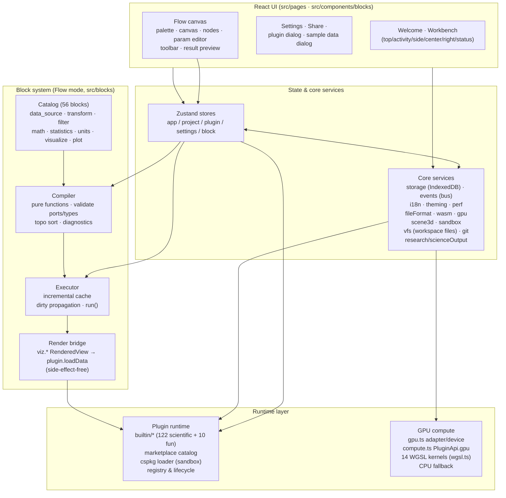

<div align="center">


<h1>Ergalics Studio</h1>

<p><b>An in-browser scientific computing workstation</b> — interactive data
exploration, GPU compute scheduling, and a sandboxed plugin system, all
running in the browser.</p>

<p>
<a href="https://snowleopard-io.github.io/ErgalicsStudio/"></a>
<a href="https://snowleopard-io.github.io/ErgalicsStudio/app/"></a>
<a href="https://snowleopard-io.github.io/ErgalicsStudio/app/docs/"></a>
</p>

<p>
<a href="https://github.com/SnowLeopard-io/ErgalicsStudio"></a>
<a href="https://gitee.com/cnt-code/ergalics-studio"></a>
<a href="LICENSE"></a>
<a href="https://www.typescriptlang.org/"></a>
<a href="https://react.dev/"></a>
<a href="#gpu-compute--native-core"></a>
<a href="#gpu-compute--native-core"></a>
</p>

</div>

<br>


---

## Table of Contents

- [Overview](#overview)
- [Features](#features)
- [Tech Stack](#tech-stack)
- [Getting Started](#getting-started)
- [Architecture](#architecture)
- [Project Layout](#project-layout)
- [Four Workbench Modes](#four-workbench-modes)
- [Research Modules](#research-modules)
- [Version Control](#version-control-git-backed-projects)
- [Plugin System](#plugin-system)
- [GPU Compute & Native Core](#gpu-compute--native-core)
- [Testing](#testing)
- [Documentation](#documentation)
- [Roadmap](#roadmap)
- [Contributing](#contributing)
- [License](#license)

---

## Overview

Ergalics Studio is a scientific-computing workstation that runs entirely in
the browser: a React + TypeScript frontend, a WebGPU compute pipeline, and a
plugin architecture for third-party extensions. The workbench exposes four
modes for four kinds of users:

| Mode           | For                                    | What you do                                                                                                                    |
| -------------- | -------------------------------------- | ------------------------------------------------------------------------------------------------------------------------------ |
| **Standard**   | "I have data → I see something"        | Drag a dataset onto a plugin and the visualisation appears — the fastest path.                                                  |
| **Flow**       | Pipeline builders                      | Compose a visual dataflow pipeline from built-in blocks, run it topologically, inspect every node's output.                    |
| **Block**      | Learners / imperative feel             | A Scratch-like block editor where one green "Run" hat kicks off the program — fully scripted.                                   |
| **Code**       | Real scripting                         | A Monaco editor for **Python / R / JavaScript**; switching language translates the whole buffer via a shared IR instantly.       |

The project is under **active development** and already usable end to end.
What ships today:

| Area              | Shipped today |
| ----------------- | ------------- |
| Workbench         | 4 modes, workbench file explorer + tabbed central area + per-file editors (Code / Flow / Block), **132 built-in plugins (122 scientific auto-load + 10 fun manual) across 17 discipline groups**, sandboxed plugin system + marketplace catalog, `.cspkg` signing gate |
| Compute           | Live WebGPU compute (14 reusable WGSL kernels), in-browser AI training plugin, AI assistant (offline rule engine / online OpenAI-compatible service) |
| Data & plots      | Scientific binary I/O (HDF5 / NetCDF / FITS / Zarr / Parquet), publication-grade SVG/PDF plot engine, statistics subsystem, reproducibility support, 164 sample datasets + 11 sample projects |
| Code editing      | Python via Pyodide; R and JavaScript via the shared IR engine, with R upgraded to a full free-form webR runtime when vendored; three-language round-trip fixed by tests |
| Research          | **26 standalone research tools in 6 groups** (embeddable in the workbench canvas), research-grade plugin metadata + unified science-output strip, unit-system and chunked-ingestion kernels |
| Version control   | Git-backed projects (browser isomorphic-git + LightningFS), sidebar Git panel with Conventional-Commit history |
| Web surfaces      | Official website (gallery / theme marketplace / plugin marketplace), workbench and docs site, deep-linked into one merged deploy |

---

## Features

**Rendering & workbench**

| Capability | Details |
| --- | --- |
| Workbench shell | Top bar (project switcher, mode switcher, research launcher), activity bar, multi-view sidebar (Files / Git / Plugins — resizable and collapsible), tabbed central viewport, right parameter panel, status bar with GPU/perf indicators. |
| File explorer & tabs | Project file tree with file operations and an info panel; the central area hosts tabs for the plugin canvas, file previews (text / markdown / image / PDF / audio / video), file editors, embedded research tools and settings pages. |
| File editors | `.py` / `.js` / `.r` open in a Monaco editor, `*.flow.json` in the Flow DAG editor, `*.block.json` in the Blockly editor — each with a dirty state and save-back-to-workspace; an **open-in-mode** bridge pushes any buffer into the corresponding full workbench mode. |
| Project lifecycle | Create / open / save / autosave / share (`.clproj` in IndexedDB). |
| File routing | Drag & drop, detected by magic number + extension and routed to a matching plugin (picker if multiple match; replace confirmation on name collision); delimited-text parsing skips `#` comment lines, and the format whitelist includes `.xy` / `.xye`. |
| Central export menu | Download the active plugin canvas as PNG (default ≈600 dpi, transparent option) or save it into the project's `figures/` workspace directory; 3-D plugins additionally export the whole scene as **GLB / STL** (download, or save into the `data/` workspace); per-plugin CSV export buttons stay in the parameter panels. |
| 2D & 3D viewports | Shared 2D canvas container (point clouds, time series, histograms, heatmaps, contour, scatter, bar, radar, network, bubble, violin, sankey, box, parallel coordinates, error bands, treemaps, QQ plots, …) plus a host-managed Three.js 3D scene (created lazily for `renderToScene` plugins, hidden when a 2D plugin is active, fully cleared between plugins; ACES filmic tone mapping with IBL environment lighting). |
| 3-D model viewer | GLB / GLTF / STL / OBJ / PLY import with Draco & meshopt decoding; shaded / wireframe / normal / X-ray view modes, clipping plane, glTF animation playback, two-point distance measurement and view presets; any 3-D scene exports as GLB / STL from the central export menu. |

**Plugin system**

| Capability | Details |
| --- | --- |
| **132 built-in plugins** | (122 scientific auto-load + 10 fun manual) over the full API surface; two-tier loading, grouped into **17 disciplines** in the sidebar (charts / mathematics & statistics / physics / chem / bio / geo / env / astro / materials / engineering / econ / psych / data / computer science / fx / music & art science / fun). |
| Marketplace catalog | `src/plugins/marketplace.ts` (curated tags, popularity, category filters). |
| `.cspkg` package loading | Manifest validation + **Worker-first isolation** (§sandbox): third-party entries run via a postMessage RPC bridge and transferred `OffscreenCanvas`; fallback is a restricted `new Function` scope (not a security sandbox). Both are gated by Ed25519 signature verification (FR-05, see `SECURITY.md`). |
| Locale-aware parameter panels | Per-plugin CSV export buttons, analysis overlays (trendlines, density/cumulative histograms, mean markers, jitter, bar ordering), and a **Send to Figure Studio** action on all research-grade plugins. |

**Research-grade plugins**

- `PluginManifest.research` metadata (`src/types/plugin.ts`): a
  research-readiness tier (`research` / `quasi-research` / `demonstration` /
  `educational`) plus declared physical units, embedded benchmark ids, a
  reproducibility flag and scope notes — rendered as a colour-coded badge in
  the plugin market and detail panel (zh-CN / en-US).
- Unified scientific-output bus `src/core/research/scienceOutput.ts` with a
  `ScienceOutputStrip` under the viewport: plugins publish structured
  conclusions (R², RMSE, LOOCV, confidence intervals, convergence /
  conservation diagnostics) so every plot is paired with its numbers.

**Version control**

| Capability | Details |
| --- | --- |
| Git-backed projects | `src/core/git/` exposes one `GitAdapter` with a browser implementation (isomorphic-git + LightningFS over IndexedDB) and a Node implementation (lazily-loaded simple-git, falling back to isomorphic-git), covering init / status / log / diff / add / commit / checkout / branch / merge / remotes / hooks plus file-level write / delete / rename / listing and repo config. |
| Workspace VFS | Files live behind a small `Vfs` abstraction (`src/core/vfs/`): LightningFS over IndexedDB in the browser, an in-memory implementation in Node/tests; the Git working tree and the file explorer share it. |
| Project ↔ repo sync | `projectStore` mirrors the saved snapshot into the repo working tree as `project.clproj` and drives a sidebar **Git panel** (branch + ahead/behind, one-field commit box that stages every pending change with Conventional-Commit messages, recent log, branch / clone / pull / push / fetch through a configurable CORS proxy, auto-commit on runs & figures). |

**Infrastructure**

- i18n (zh-CN / en-US), dark / light theming, performance monitoring (FPS /
  GPU / memory / data scale).
- Research-grade reliability core: structured error taxonomy + `Result` /
  retry + error registry, composable validation framework with safe parsing,
  and a Pandera-style data-quality engine (contracts / profiling /
  quarantine) — see `src/core/errors|validation|data-quality`.

**Scientific & research cores (pure-TS core + Zustand store + standalone page)**

| Core | Location | Scope |
| --- | --- | --- |
| Statistics kernel | `src/core/stats/` | Descriptive stats, special functions, hypothesis tests, effect sizes, multiple-comparison corrections, power. |
| Scientific binary I/O | `src/core/io/` | Single dispatcher for HDF5 / NetCDF / FITS / Parquet / Zarr. |
| Publication-grade plotting engine | `src/core/plot/` | SVG + PDF. |
| Reproducibility kernel | `src/core/repro/` | Seeded RNG, stable hashing, run manifest, DAG→Python; plus `repro.lock`. |
| Data-quality engine & unit system | `src/core/data-quality/` · `src/core/units/` | Pandera-style data-quality engine; typed unit system. |

---

## Tech Stack

| Layer    | Choice                                                        |
| -------- | ------------------------------------------------------------ |
| UI       | React 18, react-router-dom 7, Zustand 5                      |
| Language | TypeScript 5.7 (strict)                                      |
| Build    | Vite 6                                                       |
| 3D       | Three.js r185 (+ @types/three), GLTF / STL / OBJ / PLY loaders with Draco & meshopt decoding |
| Native   | Rust crate `native/ergalics-core` (source-delivered; shipped builds run a generated WASM stub) |
| GPU      | WebGPU / WGSL via web-sys                                    |
| SQL      | DuckDB-WASM (lazy) + Apache Arrow                            |
| VCS      | isomorphic-git 1 + LightningFS (browser) · simple-git (Node, isomorphic fallback) |
| Testing  | Vitest (unit) + Playwright-core (E2E, headless Edge)          |
| Docs     | VitePress (separate `docs/` workspace)                       |
| Packaging| fflate (cspkg ZIP), lz-string (project compression)          |

---

## Getting Started

Prereqs: **Node.js ≥ 20** + npm. A **Rust toolchain** (`wasm32-unknown-unknown`
target + `wasm-bindgen-cli`) is optional — `npm run build:web` ships a
generated WASM stub, and at runtime all compute runs on the browser-native
WebGPU/CPU paths.

```bash
npm install         # install dependencies
npm run dev         # dev run (welcome page hardware self-check: WebGPU/WASM/IndexedDB)

npm run build       # wasm → typecheck → vite build → docs
npm run build:web   # frontend only (generates the WASM stub, no Rust needed)
npm run build:wasm  # compile the Rust core (needs the Rust toolchain)

cd docs && npm install && npm run dev   # docs site
```

Production builds output to `dist/`.

---

## Architecture



- **Host ↔ plugin contract**: each plugin implements a `Plugin` interface
  (init/destroy/activate/…/renderToScene) and receives a `PluginApi`;
  sandboxed plugins talk only through a typed RPC protocol
  (`src/core/sandbox.ts` + `plugin-worker.ts`).
- **WebGPU**: `src/core/gpu.ts` owns adapter/device with CPU fallback;
  `src/core/compute.ts` exposes the plugin-facing compute surface
  (`PluginApi.gpu`).

---

## Project Layout

```
.
├── src/                      # frontend
│   ├── core/                 #   43 subdirectories + 38 root modules: storage, events, i18n,
│   │                         #   gpu, wasm, fileFormat, scene3d, sandbox, cspkg, errors,
│   │                         #   validation, data-quality, stats, io (HDF5/NetCDF/FITS/Zarr/Parquet),
│   │                         #   plot, repro, uncertainty, units, experiment, lineage,
│   │                         #   chunked, figure, notebook, package, model, signal, sweep,
│   │                         #   profiler, sql, report, inference, logger, vfs (workspace
│   │                         #   file system), git (version control), research (science output)
│   ├── blocks/               #   block system (Flow mode): types · registry · compiler ·
│   │                         #     executor · ops · catalog (56 blocks) · sample · l10n · render
│   ├── editor/               #   Block & Code modes: ir · block (Blockly) · code · codegen ·
│   │                         #     runtime (StudioApi + interpreter)
│   ├── components/           #   flow canvas / block & code canvas / workbench shell /
│   │                         #     editor/fileEditors (per-file Code·Flow·Block editors)
│   ├── pages/                #   welcome, workbench (file explorer · tabbed central area),
│   │                         #     settings, share, plugin view, and the research tools
│   │                         #     (single registry: src/pages/research/toolRegistry.ts —
│   │                         #     measure · model · data · signal · deliver · utils)
│   ├── plugins/builtin/      #   132 plugins: 122 scientific auto-load + 10 fun (2D + 3D)
│   ├── plugins/marketplace.ts#   marketplace catalog
│   ├── stores/               #   zustand stores
│   ├── types/                #   plugin & project & editor contracts
│   └── native/               #   generated WASM bindings (untracked)
├── native/ergalics-core/     # Rust core, source-delivered (device, compute, utils)
├── examples/{data,projects,code}/  # 164 sample datasets, 11 `.clproj` projects, 9 Python programs
├── scripts/ · tests/ · docs/ · website/
```

---

## Four Workbench Modes

**Standard mode** — the default landing experience: left sidebar (projects /
plugins), central viewport, right parameter panel. A dropped file is routed
by extension + magic number to a matching plugin (picker on conflicts). Best
for "I already know the plugin; I just need to point it at a file".


**Flow mode** — compose a visual dataflow **pipeline** from **45 built-in
blocks** (data_source / transform / filter / math / statistics / units /
visualize / plot) and run it. Left palette, central canvas (nodes + edges),
right per-node parameter editor, bottom live result preview that adapts to
the selected output (`RenderedView` via plugin renderers / `DataTable`
read-only table / `Scalar` inline). The compiler is pure functions (port/type
validation + cycle detection + Kahn topological sort); the executor has
incremental caching with dirty propagation, so editing one block re-runs only
it and its downstream. Graphs save as `*.flow.json` workspace files
(`{version, kind: 'ergalics-flow', graph}`) editable in the file explorer's
Flow editor; the legacy project `blockGraph` state is still read. See
[`docs/guide/flow-mode.md`](docs/guide/flow-mode.md).


**Block mode** — a Scratch-like editor where a single "Run" hat block is the
only entry point. Block JSON round-trips with a **shared IR**
(`src/editor/ir/`); the IR interpreter calls the same `studio.*` API as Flow
blocks, so `studio.plot(...)` lands on the same scatter plugin; IR → JS /
Python codegen is live-visible. Blockly 13 provides the canvas and is
**lazily loaded** (~828 KB on-demand chunk); i18n plugs into Blockly's
`BKY_*` keys. Ships 42 blocks and 5 sample programs. See
[`docs/guide/block-mode.md`](docs/guide/block-mode.md).


**Code mode** — a real-scripting Monaco editor with a segmented **Python /
R / JS** switcher and engine badges. **Python** runs full CPython via a
Pyodide Web Worker (a proper importable `studio` module, single-expression
REPL, stop restarts the worker). **R / JavaScript** parse to the shared IR
and run on the same interpreter as Block mode; R upgrades to a vendored
full webR runtime when present, falling back to the IR engine otherwise.
Switching language opens a **floating preview dialog** — a Monaco editor
showing the editable reference translation — and applies the new buffer only
after an explicit **Apply**, with **Discard & clear** and **Cancel** options,
a `forceBlank` guard that protects a just-cleared buffer, and one-click undo.
All three modes round-trip seamlessly through one IR (`flow/block/convert.ts`
+ `code/parse.ts` + `mergeFlowIR` merge-write-back + a signature guard that
prevents node loss) — a round trip fixed by
`tests/editor/roundtrip-all-langs.test.ts`. Ships 9 sample programs. See
[`docs/guide/block-mode.md`](docs/guide/block-mode.md).


---

## Research Modules

All 26 research tools live in one registry
(`src/pages/research/toolRegistry.ts`) and share the **ToolShell** layout.
Canonical routes are `/studio/<toolId>` (legacy `/#/<id>` hash routes are
kept as redirects); every tool can also open **embedded as a tab of the
Standard-mode central canvas** via `openToolEmbedded`. Tools with
`requireProject` show an `EmptyProject` placeholder when no project is open.
Each module follows the same layering: a pure-TS core (no React) under
`src/core/`, a Zustand store persisted to the project or IndexedDB, and a
page on top, all unit-tested:

| Group | Page | Route | What it does |
| --- | --- | --- | --- |
| measure | Uncertainty | `/studio/uncertainty` | Bootstrap CI, Monte Carlo propagation, MCMC — CPU or WGSL GPU engine, R-hat / ESS |
| measure | Profiler | `/studio/profiler` | Streaming column profiling, correlation matrix, quality score + issue list |
| model | Model Lab | `/studio/model-lab` | OLS / logistic / ridge / polynomial regression + coefficient table & residual diagnostics |
| model | Inference Forge | `/studio/inference` | HMC / NUTS Bayesian inference + WAIC / LOO / PPC + trace & density plots |
| model | Model Inference | `/studio/model-inference` | Run ONNX models in-browser with WebGPU |
| model | Sweeps | `/studio/sweeps` | Grid / list / Latin-hypercube parameter experiments + response surfaces (requires project) |
| data | SQL Workbench | `/studio/sql` | DuckDB-WASM queries over project files (join / aggregate / window), results wired into lineage (requires project) |
| data | Lineage | `/studio/lineage` | File→run DAG rebuilt from runs + imports (SVG canvas) |
| data | Figure Studio | `/studio/figures` | Multi-panel publication-grade figures on IEEE / Elsevier templates, SVG / PDF / PNG-600dpi (requires project) |
| data | Analysis | `/studio/analysis` | Quick charts + descriptive stats + t / Mann–Whitney tests (not shown in the welcome grid) |
| data | Cleaning | `/studio/cleaning` | Step-by-step wizard: type casts, missing-value policy, outlier flags, dedupe, rename (requires project) |
| data | Files | `/studio/files` | Workspace VFS file browser: lazy per-directory tree, text preview, download (requires project) |
| signal | Signal Lab | `/studio/signal` | FFT / Welch PSD, window functions, Savitzky–Golay / moving-average filters, ACF/PACF, seasonal decomposition (requires project) |
| signal | Notebook | `/studio/notebook` | Markdown + Python cells persisted in the project, run on a dedicated Pyodide (requires project) |
| signal | Runs | `/studio/runs` | Auto-recorded run history (source, params, metrics, timings), A/B compare |
| deliver | Report | `/studio/report` | Narrative + charts + tables + interactive filters → one self-contained HTML (requires project) |
| deliver | Repro Lock | `/studio/reprolock` | `repro.lock` export / import + drift checks & one-click reproduce |
| deliver | Supplement | `/studio/supplement` | Paper companion ZIP (`manifest.json` + runs + lineage + data/code/files + optional `repro.lock`) |
| deliver | Course | `/studio/course` | Assign homework, collect and offline-grade student lab submissions (requires project) |
| deliver | Gallery | `/studio/gallery` | Browse and reopen community-shared reproducible works |
| utils | Unit Convert | `/studio/unit-convert` | Unit conversions (no project required) |
| utils | Calc | `/studio/calc` | Calculator (no project required) |
| utils | Format Convert | `/studio/format-convert` | Data format conversion (no project required) |
| utils | SigFig | `/studio/sigfig` | Significant-figure handling (no project required) |
| utils | Molar Mass | `/studio/molar-mass` | Molar mass calculation (no project required) |
| utils | Quick Stats | `/studio/quick-stats` | Quick descriptive statistics (no project required) |

Companion kernels round out the toolset: the **unit system** (dimension-safe
`Quantity` + `units.convert` / `units.check`) and **chunked ingestion**
(windowed streaming reads of large delimited files). Research pages that
produce text results (analysis summaries, captions, model tables, …) carry a
**Save to workspace** action that writes them into the project VFS. On top
of Figure Studio sits a **journal submission check** (IEEE / Elsevier,
pre-flighted by *image / annotation / text / metadata*), a **caption
drafter** (bilingual), and a **3D field plot** panel type. Runs from every
mode feed one shared history and lineage graph — "which run produced this
figure, from which data?" is always answerable and shipped with the
supplement ZIP.

### Research lab highlights


*Inference Forge runs NUTS sampling in the browser (WebAssembly): posterior
summary with 94% HDI / MCSE / R-hat / ESS, WAIC / PSIS-LOO comparison,
posterior predictive checks, and trace + density plots.*


*Figure Studio composes publication-grade figures — here a multi-panel sheet
on the IEEE single-column template, with a caption drafter, a journal
submission check, and SVG / PDF / 600-dpi PNG export.*


*Signal Lab does frequency-domain analysis — a Welch PSD of an acceleration
time series with a clear dominant peak — plus radix-2 FFT magnitude spectra,
windowing and filtering, with one-click Send to Figure Studio.*


*The Gallery curates reproducible works by discipline, each card tagged by
repro-lock state (locked / drift / unlocked) for discovery, verification and
citation.*

---

## Version Control (Git-backed Projects)

Projects are **Git-backed**: `src/core/git/` defines a single `GitAdapter`
interface with two implementations chosen at runtime.

| Environment     | Implementation                                                       |
| --------------- | -------------------------------------------------------------------- |
| Browser         | `isomorphic-git` + `LightningFS` (IndexedDB-backed working tree)      |
| Node / desktop  | `simple-git` (lazily imported; drives the system `git` binary), falling back to isomorphic-git when unavailable |

The adapter covers the repository lifecycle (`init` / `clone` / `isRepo`),
reads (`status` / `log` / `diff` / `branches` / `remotes`), writes (`add` /
`commit` / `checkout` / `branch` / `merge`), remotes (`push` / `pull` /
`fetch`), hooks (`installHooks` / `getHook` / `removeHook`), repo `config`,
and file-level helpers (`writeFile` / delete / rename / directory listing).
`projectStore` mirrors every save into the working tree as
`project.clproj`, so the sidebar **Git panel** always shows real, reviewable
changes; commits use Conventional-Commit messages (`save:` / `run:` /
`figure:` / `manuscript:` …) generated by `generateCommitMessage`.

The Git panel ships branch + ahead/behind counters, a one-field commit box
that stages every pending change, recent log, branch creation (refuses to
discard uncommitted changes on switch), clone-from-URL and remote sync
(`pull` / `push` / `fetch` through a user-configurable CORS proxy — the
public isomorphic-git proxy does not cover every host such as Gitee).
Auto-commit fires on run completion, figure save, manual save and supplement
export; `init` preinstalls Ergalics hooks (`pre-commit` verifies
`repro.lock`, `pre-push` runs unit tests) and the standard template includes
a GitHub Actions workflow (`.github/workflows/ergalics.yml`). Still on the
roadmap: the file-level diff viewer and the conflict wizard.

---

## Plugin System

### Built-in plugins

**122 scientific plugins** auto-load at startup, grouped into **17
disciplines** in the sidebar. One table per discipline — names are the
manifest `nameI18n` values (zh-CN / en-US):

**Charts (22)**

| Plugin | 中文名 | Focus |
| --- | --- | --- |
| Scatter Plot | 散点图 | 2-D scatter of numeric columns (x y [value]) with an optional color ramp. |
| Time Series | 时间序列绘图 | Plot CSV columns as time series. |
| Heatmap | 热力图 | Render a 2-D numeric field as a heatmap. |
| Contour | 等值线图 | Color ramp + contour lines for 2-D scalar fields (vortices, topography). |
| 3D Surface | 3D 表面图 | Height-field grids z = f(x,y) from project files or sample data. |
| 3D Voxel Field | 3D 体素渲染 | Isosurface (blocky voxels or smooth marching-tets) and translucent-voxel rendering of 3-D scalar fields. |
| 3D Model Viewer | 3D 模型查看器 | Load GLB / GLTF / STL / OBJ / PLY models: shaded / wireframe / normal / X-ray view modes, clipping plane, two-point measurement, view presets, glTF animation playback. |
| Bar Chart | 柱状图 | Categorical bars, horizontal or vertical, with palettes. |
| Bubble Chart | 气泡图 | Render (x, y, size, [color]) as bubbles. |
| Polar Plot | 雷达图 | Multi-series radar/polar chart — one axis per column, one series per row. |
| Network Graph | 网络图 | Force-directed network graph from edge lists with animated layout. |
| Sankey Diagram | 桑基图 | Flow diagram from source→target→value edges. |
| Treemap | 矩形树图 | Nested rectangles whose area is proportional to value; hierarchical data. |
| Parallel Coordinates | 平行坐标图 | Multi-variate parallel axes, one polyline per row. |
| Point Cloud | 点云查看器 | Render .xyz point clouds with adjustable point size. |
| Point Cloud 3D | 3D 点云 | Interactive 3-D point clouds in the host Three.js scene with height coloring. |
| Image Viewer | 图像查看器 | View raster images (PNG / JPEG / WebP / GIF). |
| Histogram | 直方图 | Distribution histogram for numeric data. |
| Box Plot | 箱线图 | Box-and-whisker plot (quartile box + whiskers + outliers) for grouped data. |
| Violin Plot | 小提琴图 | Kernel-density violin plot with adjustable bandwidth and box overlay. |
| QQ Plot | QQ 图（正态检验） | Sample quantiles vs standard-normal quantiles for normality checks. |
| Error Band | 误差带图 | Line chart with a shaded confidence/error band. |

**Mathematics & Statistics (12)**

| Plugin | 中文名 | Focus |
| --- | --- | --- |
| Linear Algebra Lab | 线性代数实验室 | 2×2 matrix action on the unit grid, eigenvector geometry, SVD chain A = UΣVᵀ, span/projection of vector sets, \|det\| as area scaling. |
| Probability Distribution Lab | 概率分布实验室 | PDF/PMF + CDF for 10 families (Normal, Poisson, Exponential, Beta, Gamma, Student-t, χ², F, Binomial, Geometric), seeded Monte-Carlo histograms, closed-form MLE fitting of sample datasets. |
| Numerical Analysis Lab | 数值分析实验室 | Bisection / Newton / secant root finding, trapezoid / Simpson / Gauss quadrature, forward / backward / central differences, Lagrange / Newton / cubic-spline interpolation, measured convergence orders. |
| Graph Theory Visualizer | 图论可视化 | Adjacency-matrix / edge-list input, Dijkstra / Bellman-Ford / Floyd-Warshall, Prim / Kruskal MST, Ford-Fulkerson / Edmonds-Karp max-flow + min-cut, greedy coloring, bipartite matching, Euler / Hamiltonian trails, step-by-step animation. |
| Topology Visualizer | 拓扑可视化 | Möbius strip, Klein bottle, torus and sphere embeddings rendered with Three.js, fundamental-group loops, homotopy deformation, Euler characteristic and orientability classification. |
| ODE Vector Field & Streamlines | ODE 向量场与流线 | Phase plane of 2-D autonomous systems: RK4 bidirectional streamlines, equilibria localization, Jacobian eigenvalue classification. *(Numerical ODE solver for the differential-equation tier; PDE coverage lives in the Physics suite — Wave Equation for the 2-D wave equation and Diffusion Equation Lab for 1-D/2-D heat/Laplace problems.)* |
| Game Theory Lab | 博弈论实验室 | n×n payoff matrices, pure / mixed Nash equilibria, iterated dominance, RK4 replicator dynamics + ESS, extensive-form game trees with backward induction, first-price / second-price / English auction simulation with VCG metrics. |
| Fourier Series Lab | 傅里叶级数逼近实验室 | Numerical Fourier coefficients, partial sums vs Fejér means, Parseval L² error, Gibbs overshoot. |
| Domain Coloring | 复变函数域着色 | Per-pixel domain coloring of complex f(z) with an embedded expression parser and zoom/pan. |
| Central Limit Theorem Bench | 中心极限定理演示台 | Draws sample means from uniform / exponential / Bernoulli / bimodal / truncated-Pareto populations, overlays the analytic N(μ, σ²/n), reports skewness / kurtosis / Jarque–Bera. |
| Markov Chains & Stationary Analysis | 马尔可夫链与稳态分析 | Stationary distribution via power iteration, irreducibility & period detection, absorbing-chain analysis. |
| Zipf's Law Word Frequencies | Zipf 定律词频分析 | Zipf-law fit over real corpora (OLS on log rank–log freq, s ± σ, R²), ships Jane Austen's *Emma* public-domain corpus. |

**Physics (16)**

| Plugin | 中文名 | Focus |
| --- | --- | --- |
| Particles | 粒子模拟 | Interactive particle simulation on a WGSL compute kernel. |
| N-Body Gravity | 引力 N 体模拟 | 3-D direct-summation gravity with a GPU all-pairs kernel + CPU fallback. |
| LBM Fluid | 流体模拟（LBM） | 2-D D2Q9 lattice-Boltzmann channel flow around an obstacle. |
| 3D Fluid Flow | 三维流体绕流 | D3Q19 lattice-Boltzmann 3-D flow around any imported GLB/GLTF/STL/OBJ/PLY model, with slice/vorticity/tracer visualisation and drag/lift. |
| Wave Equation | 波动方程 | 2-D finite-difference wave equation: Gaussian pulse, two-source interference, double-slit diffraction. |
| Double Pendulum | 双摆（混沌） | RK4 double pendulum with a chaos-diverging ghost pendulum. |
| Electromagnetism | 电磁场 | Draggable charges under Coulomb + Lorentz forces in an independently set B field. |
| Optics Lab | 光学实验 | Geometric ray tracer: thin lenses, dispersive prism, draggable screen. |
| EM Eigensolver | 电磁谐振特征值求解器 | Sparse Hermitian eigenpairs via thick-restart Lanczos / block LOBPCG / Jacobi-Davidson + MINRES shift-invert. |
| 1D-3D Coupled Solver | 1D-3D 双向耦合求解器 | 1-D pipe network ⇄ 3-D field two-way coupling with multi-rate sub-cycling and millisecond valve control. |
| 1-D Schrödinger Solver | 一维量子力学求解器 | Finite-difference eigensolver for infinite-well / harmonic / finite-well / double-well potentials. |
| 2-D Ising Model | 二维伊辛模型 | Metropolis and Wolff Monte Carlo on periodic lattices with susceptibility and correlation diagnostics. |
| Heat Engine Cycles | 热机循环 p-V 分析台 | Otto / Diesel / Carnot / Stirling p-V cycles integrated quasi-statically. |
| Diffusion Equation Lab | 热传导 / 扩散方程实验室 | FTCS explicit and Crank–Nicolson stepping with a stability gate and Dirichlet / Neumann boundaries. |
| Diffraction Lab | 衍射实验室 | Numerical Fresnel–Kirchhoff diffraction integral for single- and multi-slit patterns. |
| Trajectory Kinematics Lab | 轨迹运动学与能量分解实验室 | Trajectory tables → differentiated velocities, KE/PE decomposition and a least-squares projectile fit. |

**Chemistry (5)**

| Plugin | 中文名 | Focus |
| --- | --- | --- |
| Crystal · 3D Unit Cell | 晶胞 · 3D 预览 | Load CIF / POSCAR / XYZ cells; inspect atoms, periodic bonds and density in 3-D. |
| Reaction · MD 3D | 反应 · 自由反应动力学 3D | Langevin molecular dynamics in 3-D — bonds fracture past their Arrhenius barrier. |
| Titration Curve Lab | 酸碱滴定曲线实验室 | Titration curves solved from the full charge + mass ionic balance. |
| Reaction Order & Arrhenius | 反应级数判定与 Arrhenius 分析 | Zero/first/second linearisations of [A]–t data, best order selected by R², k ± σ. |
| Gray–Scott Turing Patterns | Gray-Scott 反应扩散图灵斑图 | Explicit FTCS reaction–diffusion lab with Pearson (1993) pattern classification. |

**Biology (8)**

| Plugin | 中文名 | Focus |
| --- | --- | --- |
| Protein Interactions | 蛋白质交互网络 | PPI network with force-directed layout; reports degree, components, modules. |
| Enzyme Kinetics | 酶动力学 | Michaelis–Menten kinetics with three inhibition modes and an LM fit recovering Vmax & Km. |
| Epidemic Modeling | 传染病分室模型 | Deterministic SIR / SEIR RK4 integration reporting R₀, herd-immunity threshold and attack rate. |
| Sequence Alignment | 序列比对与分析 | BLOSUM62 / nucleotide Needleman–Wunsch or Smith–Waterman with affine gaps, plus GC / codon statistics. |
| Population Genetics | 群体遗传学 | Hardy–Weinberg χ² test + seeded, reproducible Wright–Fisher drift with optional selection. |
| Pharmacokinetics | 药代动力学室分析 | One-/two-compartment PK models with IV bolus / oral absorption and a therapeutic-window overlay. |
| Mendel F2 χ² Tests | 孟德尔 F2 分离比 χ² 检验 | χ² goodness-of-fit for 3:1 / 9:3:3:1 segregation; ships the 1866 seven-trait dataset. |
| Hodgkin–Huxley Neuron | Hodgkin–Huxley 神经元 | The 1952 action-potential model with the original published constants, RK4-integrated. |

**Geography (16)** — every plugin in this suite has one-click **Send to
Figure Studio**:

| Plugin | 中文名 | Focus |
| --- | --- | --- |
| GeoJSON Map | GeoJSON 地图 | Offline GeoJSON rendering with property-driven choropleth shading. |
| Solar Elevation & Day Length | 太阳高度与昼夜长短 | Declination, noon elevation, day length and sunrise/sunset for any latitude and date. |
| Climatograph | 气候直方图 | Monthly climate diagram (temperature line + precipitation bars) with annual summaries. |
| Population Pyramid | 人口金字塔 | Back-to-back age–sex pyramid with 0-14 / 15-64 / 65+ shares and sex ratio. |
| Spatial Interpolation | 空间插值 | IDW and ordinary kriging gridding with LOOCV validation and Moran's I. |
| Distance & Area Measure | 距离与面积量算 | Great-circle distances and enclosed spherical polygon areas from clicked points. |
| Projection Distortion (Tissot) | 投影变形（Tissot 圆） | Tissot indicatrices over world coastlines in seven projections. |
| DEM Terrain Analysis | DEM 地形分析 | ESRI ASCII Grid elevation → hillshade, Horn slope/aspect, contours and an orbitable 3-D mesh. |
| GPX Track Analysis | GPX 轨迹分析 | Total distance, ascent/descent (hysteresis filter), duration and the elevation profile from GPX tracks. |
| Interactive Globe (3D) | 交互地球仪（3D） | Draggable true 3-D Earth with Natural Earth 110m coastlines and spherical Tissot ellipses. |
| Radiocarbon Dating Lab | 放射性碳定年实验室 | Libby conventional ages calibrated against the IntCal20 curve with likelihood profiles. |
| Soil Water Retention Fit | 土壤水分特征曲线拟合 | van Genuchten (1980) curve fitting via bounded Levenberg–Marquardt with covariance standard errors. |
| SCS Runoff Event | SCS 降雨径流模型 | SCS curve-number rainfall excess convolved with a synthetic unit hydrograph. |
| Seismic Wave Propagation | 地震波传播实验室 | Ray-theory P/S travel times on a layered PREM-like Earth, direct-phase shadow zones, synthetic three-phase seismograms with phase picking, focal-mechanism beachballs, and Richter / moment-magnitude / Mercalli scales. 2-D P/S FDTD wave-field simulator with a WGSL fast path and CPU fallback. |
| Mineral Identification Lab | 矿物鉴定实验室 | Property-weighted identification over a built-in 24-mineral reference database (CSV/TSV import swaps in your own collection), Mohs scratch tests, unit-cell → crystal-system classification, classification paths and Michel-Lévy interference colours for 30-µm sections. |
| Hydrogeology Workbench | 水文地质模拟工作台 | Theis / Cooper–Jacob confined-aquifer drawdown, Darcy seepage velocity, multi-well superposition and drawdown cones, Ogata–Banks transport with retardation and decay, pumping-test fitting, and tidal / barometric water-level response. |

**Environmental Science (8)** — strictly data-driven; samples load from the
examples dialog:

| Plugin | 中文名 | Focus |
| --- | --- | --- |
| Air Quality (AQI) | 空气质量评价（AQI） | Per-pollutant IAQI and daily AQI per HJ 633-2012 with level grading. |
| Water Quality | 水质评价（地表水分类） | Classifies each indicator into GB 3838-2002 classes Ⅰ–Ⅴ; the worst single factor sets the overall class. |
| Greenhouse Effect | 温室效应模拟 | 0-D radiative-balance teaching model driven by CO₂ / albedo / cloud sliders (Myhre 1998 forcing). |
| Carbon Cycle | 碳循环推演 | Four-pool carbon box model (atmosphere / vegetation / soil / ocean) with emission scenarios and Monte-Carlo 95% intervals. |
| Biodiversity Indices | 生物多样性指数 | Richness, Shannon H′, Gini-Simpson and Pielou evenness per site from an abundance matrix. |
| Pollutant Dispersion | 污染物扩散模拟（高斯烟羽） | Gaussian plume ground-level concentrations with Pasquill–Gifford dispersion parameters. |
| 3-D Global Environment | 3D 全球环境 | Teaching-approximate CO₂, albedo and surface-current layers on a 3-D globe. |
| Predator–Prey (Lotka–Volterra) | 捕食者-猎物（Lotka–Volterra） | RK4 Lotka–Volterra with phase portrait and a conserved-invariant numeric check. |

**Astronomy (3)**

| Plugin | 中文名 | Focus |
| --- | --- | --- |
| Astronomy CCD Pipeline | 天文 CCD 管线 | FITS reduction: bias/dark/flat calibration, cosmic-ray rejection, aperture photometry. |
| Exoplanet Transit Fitting | 凌星系外行星光变拟合 | Simplified-BLS period detection + Levenberg–Marquardt trapezoid fit with phase folding. |
| Hertzsprung–Russell Diagram | 赫罗图（HR 图） | Colour–magnitude workbench with the empirical main-sequence reference overlay. |

**Materials Science (3)**

| Plugin | 中文名 | Focus |
| --- | --- | --- |
| XRD Pattern Analysis | XRD 衍射图谱分析 | Peak detection, Bragg d-spacing conversion and lattice-parameter refinement. |
| Stress-Strain Analysis | 应力-应变分析 | Tensile-property extraction per ASTM E8 / GB/T 228 with 0.2 % offset yield. |
| Thermal Analysis (DSC/TGA) | 热分析（DSC/TGA） | Baseline-corrected peak detection, extrapolated onset temperatures and transition enthalpy. |

**Engineering Simulation (5)**

| Plugin | 中文名 | Focus |
| --- | --- | --- |
| Structural Mechanics | 结构力学 | Trusses carry loads — members heat up with axial force and snap on overload until collapse. |
| DC Circuit Node Analysis | 直流电路节点分析 | Modified Nodal Analysis of DC resistive circuits with partial-pivot Gaussian elimination. |
| Plane Truss FEA | 平面桁架有限元分析 | 2-DOF bar elements, stiffness assembly and constraint condensation. |
| Control Systems Lab | 控制系统实验室 | First/second-order plants with PID unity feedback: step-response metrics and Bode sweeps. |
| FEM Lab | 有限元实验室 | Parametric 2-D Delaunay meshing, P1 assembly and conjugate-gradient solves for Poisson, transient heat and plane elasticity, with convergence benchmarks. |

**Economics & Finance (2)**

| Plugin | 中文名 | Focus |
| --- | --- | --- |
| Black-Scholes Option Lab | Black-Scholes 期权定价实验室 | Analytic prices and Greeks validated against a seeded Monte Carlo engine. |
| Spatial Prisoner's Dilemma | 空间囚徒困境演化博弈 | Nowak–May lattice game — cooperation vs defection over the 8-neighbourhood with optional mutation. |

**Psychology & Behavior (2)**

| Plugin | 中文名 | Focus |
| --- | --- | --- |
| Signal Detection ROC / d′ | 信号检测论 ROC / d′ 分析 | d′, β, criterion c and AUC from hit/false-alarm rates with analytic ROC curves. |
| Reaction Time Lab | 简单反应时实验室 | In-browser simple-RT experiment with exact 95 % t CIs and Welch tests across alternatives. |

**Computer Science (7)**

| Plugin | 中文名 | Focus |
| --- | --- | --- |
| Algorithm Visualizer | 算法可视化器 | Step-by-step sorting, searching and graph-traversal traces with comparison/swap counters and a cross-algorithm cost comparison. |
| Data Structure Lab | 数据结构实验室 | BST / AVL / max-heap / separate-chaining hash table with operation history, rotation annotations and per-step complexity notes. |
| Automata & Regex Engine | 自动机与正则引擎 | Regex → Thompson NFA → subset-construction DFA → minimised DFA, with character-by-character match traces. |
| Cryptography Lab | 密码学实验室 | RSA round-trips, FIPS-197 AES-128, SHA-256, P-256 point arithmetic and avalanche analysis over user-supplied parameters. |
| Neural Network Visualizer | 神经网络可视化器 | Backprop-trained MLP on XOR / circle / spiral datasets with loss curves, gradient checks and a decision-boundary grid. |
| Complexity Analyzer | 复杂度分析器 | Fits measured n/time runs against O(1), O(log n), O(n), O(n log n), O(n²), O(n³) and O(2ⁿ), with log-log exponent recovery. |
| Network Protocol Simulator | 网络协议模拟器 | TCP handshake/teardown, the TLS 1.3 1-RTT flight and a discrete Reno congestion-window trace, all timed in RTTs. |

**Data & Intelligence (2)**

| Plugin | 中文名 | Focus |
| --- | --- | --- |
| AI Trainer | AI 训练 | TF.js regression / classification training with live loss curves and visualizations. |
| Image Processing | 图像处理 | 2-D FFT, convolution, Gaussian blur, Sobel edges and histogram equalisation. |

**Effects Rendering (7)**

| Plugin | 中文名 | Focus |
| --- | --- | --- |
| Black Hole · 3D Ray Tracer | 黑洞 · 3D 光线追踪 | Per-pixel Schwarzschild geodesic integration with a Doppler-beamed accretion disk. |
| Water · 3D Fluid Waves | 水波 · 3D 流体 | FDTD wave-equation solver with interactive drops plus a Gerstner deep-water channel. |
| Volumetric Clouds · Sky Renderer | 体积云 · 天空渲染器 | Raymarched clouds with Beer–Lambert extinction and Henyey–Greenstein scattering. |
| Daylight Sky · Atmosphere | 日光天空 · 大气散射 | Nishita-style analytic atmosphere: Rayleigh + Mie, twilight, limb-darkened sun. |
| Starfield · Night Sky | 星空 · 夜天渲染器 | Procedural stars, a galactic-plane Milky Way, sidereal rotation and a Bortle light-pollution model. |
| Ocean Swell · Sunrise & Sunset | 波浪海面 · 日升日落 | Gerstner wave trains from a discretised Pierson–Moskowitz spectrum, two-lobe sun path, Schlick-Fresnel water body and marine haze. |
| Misty Peaks · Layered Ridges | 雾锁青山 · 叠嶂云海 | Near-to-far ridged-noise ridge silhouettes, sun-lit, dissolved by aerial perspective and a Koschmieder-visibility mist band. |

**Music & Art Science (4)**

| Plugin | 中文名 | Focus |
| --- | --- | --- |
| Acoustics Lab | 声学实验室 | Import external audio (WAV / MP3 / M4A / AAC / OGG / Opus / FLAC / WebM) or a waveform CSV for waveform, FFT spectrum, harmonic/overtone analysis and THD; beat-frequency and coherent-interference demos; rectangular-room eigenmodes with Sabine/Eyring RT60, Schroeder frequency and critical distance. Starts empty — nothing auto-plays. |
| Tuning System Calculator | 音律系统计算器 | 12-TET note→frequency mapping, just / Pythagorean / meantone / Werckmeister temperament comparison, cent-deviation grid, diatonic mode and interval analysis, custom tuning-table CSV import. |
| Synthesizer Lab | 合成器实验室 | ADSR editor, RBJ low/high/band/notch filter response, sine / square / saw / triangle / wavetable oscillators, FM synthesis, LFO modulation, offline render to 16-bit WAV and JSON preset import. Starts empty — import presets or press “New preset”. |
| Color Science Lab | 色彩科学实验室 | CIE 1931 xy and 1976 u′v′ chromaticity with the sRGB gamut, RGB/HSV/HSL/Lab/LCH/XYZ conversion, CIEDE2000 / ΔE76, colour-harmony rules, protanopia / deuteranopia / tritanopia simulation, palette CSV import with WCAG contrast checking. Starts empty — import a palette CSV. |

**Fun & utility (10, all `autoload: false`, loaded on demand from the
built-in panel or marketplace)**

| Plugin | 中文名 | Focus |
| --- | --- | --- |
| Fractal Explorer | 分形浏览器 | Mandelbrot and Julia sets with palettes and zoom. |
| Spirograph | 万花尺 | Hypotrochoid / epitrochoid spiral art. |
| Lissajous | 利萨茹曲线 | Animated Lissajous curves with tunable frequency and phase. |
| Conway's Game of Life | 生命游戏 | Classic cellular automaton with play / pause / reseed. |
| Harmonograph | 谐振记录仪 | Curve art from summed decaying sinusoids. |
| Palette Explorer | 配色探索器 | Two-stop gradient preview with generated swatches. |
| Koch Snowflake | 科赫雪花 | The Koch snowflake fractal from recursive segments. |
| Barnsley Fern | 巴恩斯利蕨 | A fern generated by four affine transforms (IFS). |
| Fireworks | 烟花 | Particle fireworks with gravity and trails. |
| Truchet Tiles | 特鲁谢瓷砖 | Randomly oriented quarter-circle tiles forming flowing patterns. |

Simulation plugins are strictly data-driven: empty on load, never faking a
default scene; **Reset** only replays loaded data. Every scientific plugin
ships a sample dataset under `examples/data/` (164 files), one click away in
the examples dialog; the model viewer additionally ships five sample 3-D
models (STL / OBJ / PLY / glTF / GLB).

Plugins may also declare **research metadata** (`manifest.research`) — a
research-readiness tier (`research` / `quasi-research` / `demonstration` /
`educational`) shown as a colour-coded badge in the market and detail panel,
together with physical units, benchmark ids and scope notes — and publish
**structured scientific outputs** to the shared output strip under the
viewport (fit quality, residuals, confidence intervals, convergence /
conservation diagnostics), so a plot is never left without its numbers.

### Plugin Showcase

Two competition-grade scientific solvers run their kernels inside a Pyodide
Worker (independent topic docs: `docs/technical/09`, `docs/technical/10`;
standalone repos: gitee.com/cnt-code/em-eigensolver,
gitee.com/cnt-code/fluid-cfd-coupler):


*EM Eigensolver — sparse Hermitian eigensolver (thick-restart Lanczos / block
LOBPCG / Jacobi-Davidson + MINRES shift-invert) with a 2-D spectrum report
and 3-D mode fields.*


*Fluid CFD Coupler — 1-D pipe network ⇄ 3-D scalar field two-way coupling
with a conservation audit; here the 3-D voxel field of verification Case A.*

Four plugins with non-trivial compute paths:


*N-Body Gravity runs brute-force gravity on the GPU via a WGSL all-pairs
kernel, O(N²) per step.*


*AI Trainer trains linear / non-linear / logistic / convolutional models in
the browser with TensorFlow.js; the ~2 MB TF.js bundle lazy-loads on the
first click of Train.*


*GeoJSON Map renders offline vector maps and choropleths, with Albers /
Mercator / equirectangular projections.*

Three interactive physics labs serve as the flagship demos (objects are
directly manipulable on canvas):


*Electromagnetism: draggable charges move under Coulomb + Lorentz forces;
the cyclotron sample spirals charges on a radius set by speed, mass and B.*


*Optics Lab: geometric ray-tracing (thin lenses, Snell refraction + a
dispersive prism, draggable screens).*


*Structure: pin-jointed trusses color-coded by axial force with a usage
readout; overload snaps members until collapse.*

**More plugin gallery** (geo / fluid simulation / life science / chemistry):


*LBM Fluid uses a D2Q9 lattice-Boltzmann collide+stream dual kernel for
channel flow around obstacles; the vorticity field shows the vortex street
shedding live.*


*Interactive Globe pastes Natural Earth 110m coastlines and a graticule onto a
sphere and overlays spherical Tissot distortion ellipses, with wheel zoom and
auto-rotation.*


*DEM Terrain Analysis parses ESRI ASCII Grid elevation into hillshading,
Horn-method slope/aspect and contour lines, with a draggable 3D terrain model
view.*


*Spatial Interpolation grids scattered station readings: inverse-distance
weighting (tunable power) and ordinary kriging (auto-fitted spherical /
exponential variograms) yield a heat surface, contours and station labels.*


*The bio-enzyme plugin fits substrate–rate data to the Michaelis–Menten
equation via nonlinear LM regression, reporting K_m and V_max with confidence.*


*The chemistry-crystal plugin renders a crystal unit cell in true 3D, rotatable
about any axis with electron-density isosurfaces overlaid.*

**Discipline gallery** (charts / mathematics & statistics / physics /
chemistry / biology / geography / environmental science / effects rendering):

**Charts**


*Sankey Diagram: multi-stage energy/flow ribbons across hierarchy levels.*


*3D Surface: a rotatable mesh surface over a height field z = f(x, y).*


*Scatter Plot: three colored point clusters distinguished by a legend.*


*Time Series: a fitted trend line laid over noisy sampled readings.*


*Bubble Chart: two extra variables mapped onto bubble size and color.*


*Heatmap: a Viridis-shaded heatmap forming a petal pattern.*


*3D Voxel Field: cyan spheres in the voxel view.*


*Bar Chart: monthly bars annotated with values.*


*Polar Plot: a five-axis radar chart.*


*Network Graph: a force-directed network layout.*


*Parallel Coordinates: the iris dataset, one polyline per row.*


*Treemap: nested rectangles sized by value share.*


*Point Cloud: a 2-D .xyz point cloud.*


*Histogram: a bimodal distribution.*


*Violin Plot: kernel-density violins with a box overlay.*


*Box Plot: quartile boxes with outliers flagged.*


*Error Band: a mean line with a shaded error band.*


*QQ Plot: sample quantiles departing from the reference line.*

**Mathematics & Statistics**


*Markov Chains & Stationary Analysis: the state-transition graph with a
sample trajectory through it.*


*Zipf's Law Word Frequencies: a straight-line fit on log rank–log frequency.*


*Central Limit Theorem Bench: sample means overlaid on the analytic normal.*


*Domain Coloring: the per-pixel hue/shade field of a complex f(z).*


*Fourier Series Lab: partial-sum approximation of a square wave with the
coefficients.*


*ODE Vector Field & Streamlines: vector arrows with integrated streamlines.*

**Physics**


*2-D Ising Model: a Metropolis spin configuration with the heat-capacity
peak near the critical point.*


*Diffusion Equation Lab: the numerical solution against the analytic one.*


*Diffraction Lab: the single-slit intensity profile and fringe pattern.*


*Trajectory Kinematics Lab: a least-squares projectile fit with the KE/PE
breakdown.*


*Particles: an interactive particle simulation on a WGSL compute kernel.*


*1-D Schrödinger Solver: stationary wavefunctions of the infinite square
well.*


*Heat Engine Cycles: the Otto p-V cycle with its efficiency.*

**Chemistry**


*Gray–Scott Turing Patterns: reaction–diffusion spots and stripes on a
periodic domain.*


*Titration Curve Lab: the pH jump around the equivalence point.*


*Reaction Order & Arrhenius: zero/first/second integrated-method linear
fits side by side.*

**Biology**


*Mendel F2 χ² Tests: χ² goodness-of-fit for F₂ segregation ratios.*


*Hodgkin–Huxley Neuron: the action potential alongside the m / n / h
gating variables.*

![Enzyme Kinetics — v–[S] curves with inhibition fits](docs/assets/screenshots/plugins/bio-enzyme/inhibition.png)

*The bio-enzyme plugin fits v–[S] curves per inhibition mode, reporting
Vmax and Km with confidence intervals.*


*Population Genetics: 40 seeded Wright–Fisher allele-frequency trajectories
(N = 50).*


*Sequence Alignment: a BLOSUM62-scored Needleman–Wunsch global alignment
(46.4 % identity).*


*Epidemic Modeling: SEIR compartment curves (N = 10⁵, R₀ = 2.8).*


*Pharmacokinetics: a two-compartment concentration–time curve with the
therapeutic-window overlay.*

**Geography**


*Protein Interactions: residue interaction network graph.*

**Geography**


*Projection Distortion (Tissot): Tissot indicatrices on the Mollweide
equal-area projection.*


*Solar Elevation & Day Length: annual noon-elevation and day-length curves.*


*Distance & Area Measure: great-circle distances between cities and an
enclosed area.*


*Climatograph: Cairo's monthly precipitation bars with the temperature line.*


*Radiocarbon Dating Lab: the calibration curve with probability
distributions.*


*Soil Water Retention Fit: a van Genuchten retention-curve fit.*


*SCS Runoff Event: the rainfall–runoff hydrograph.*

**Environmental Science**


*Predator–Prey (Lotka–Volterra): the phase orbit with the population
oscillations.*


*Greenhouse Effect: the 0-D radiative balance and the resulting ΔT.*


*Carbon Cycle: the four-pool box model evolving over a century.*


*Air Quality (AQI): daily AQI bars peaking at 116.*


*Water Quality: radar charts with WQI ratings for four stations.*


*Biodiversity Indices: species-abundance stacks and diversity indices for
three sites.*


*Pollutant Dispersion: Gaussian-plume ground-level concentrations.*


*3-D Global Environment: a 3-D Earth with the albedo layer.*

**Astronomy**


*Astronomy CCD Pipeline: a CCD-simulated star field with source-detection
circles.*


*Exoplanet Transit Fitting: a trapezoid model fitted to the phase-folded
light curve.*


*Hertzsprung–Russell Diagram: stellar scatter with the main-sequence
reference overlay.*

**Materials Science**


*XRD Pattern Analysis: a silicon diffraction pattern with d-spacing
annotations.*


*Thermal Analysis (DSC/TGA): weight-loss step curves.*

**Engineering Simulation**


*Plane Truss FEA: axial-force coloring with the deformed shape overlay.*


*DC Circuit Node Analysis: node voltages over the circuit topology.*


*Control Systems Lab: a step response with Bode sweeps.*

**Economics & Finance**


*Black-Scholes Option Lab: analytic price curves and Monte Carlo
convergence.*


*Spatial Prisoner's Dilemma: the strategy grid with the cooperation rate.*

**Psychology & Behavior**


*Reaction Time Lab: an RT series with histogram and box plot.*

**Data & Intelligence**


*Image Processing: before/after sharpening.*

**Effects Rendering**


*Black Hole · 3D Ray Tracer: per-pixel geodesic lensing with a Doppler-beamed
accretion disk.*


*Starfield · Night Sky: a procedural galactic-plane Milky Way scene.*


*Water · 3D Fluid Waves: an animated wave mesh in the host 3-D scene.*

**Fun & utility**


*Palette Explorer: a 12-swatch gradient.*


*Koch Snowflake: 6 iterations.*


*Barnsley Fern: 300k points.*


*Harmonograph: intertwined damped-pendulum curves.*

When WebGPU is missing, every built-in plugin runs the same math on the CPU —
full compute paths under [GPU Compute & Native Core](#gpu-compute--native-core).

### Third-party packages (`.cspkg`)

A package is a ZIP with `manifest.json` + entry + assets; the manifest is
validated (id format, entry path-traversal guard, sandbox enum) before the
entry runs:

```jsonc
{
  "id": "com.example.analyzer",
  "name": "Analyzer",
  "version": "1.2.0",
  "entry": "dist/index.js",
  "sandbox": "isolated",        // "isolated" (default, runs in a Worker, no DOM) | "trusted" (full DOM)
  "formats": [{ "extension": ".dat" }]
}
```

- `sandbox: "isolated"` (default) — a Worker with its own global scope;
  canvas via a transferred `OffscreenCanvas`.
- `sandbox: "trusted"` — runs in the host context with full DOM access; for
  packages you control.

**Limits (documented honestly)**: Workers share the same-origin IndexedDB,
and the `new Function` fallback is a best-effort approximation, **not** a
security boundary — a warning is shown when it is in use.

---

## GPU Compute & Native Core

The Rust crate `native/ergalics-core` (device management, compute kernel
dispatch, magic-number file detection) is **source-delivered**: it compiles
to `wasm32-unknown-unknown` and binds via wasm-bindgen. The shipped build
does not include compiled WASM — `npm run build:web` injects a generated WASM
stub (`scripts/make-wasm-stub.mjs`), and at runtime every compute path falls
back to the browser-native WebGPU / CPU implementations.

The WebGPU compute pipeline itself is real and exercised by plugins:

- `src/core/gpu.ts` owns the adapter/device lifecycle, with CPU fallback when
  WebGPU is unavailable.
- `src/core/compute.ts` exposes the **plugin-facing compute surface**
  (`PluginApi.gpu`): `createBuffer` / `write` / `read`, `compileKernel`, and
  a one-shot `run`.
- **14 reusable WGSL kernels** live in `src/core/wgsl.ts`: particle
  integration, 3-D all-pairs N-body, histogram, heatmap, point-cloud
  projection, D2Q9 LBM collide / stream / curl, 2-D wave-equation leapfrog,
  matrix multiply, radix-2 FFT, k-means, binning and sparse SpMV — each with
  host-side pack/unpack helpers for the CPU path. Particles demonstrates the
  single-buffer path; N-Body uses ping-pong buffers so every integration step
  stays on device.

> When WebGPU is unavailable, `api.gpu` is `undefined` and plugins fall back
> to the CPU — identical behaviour, no GPU required.

---

## Testing

Unit tests (Vitest, node environment):

```bash
npm test          # or npm run test:unit
npm run verify    # typecheck + unit tests
```

**2868 tests across 175 files** (2 skipped without a GPU), covering:
data & I/O, the statistics kernel, plugins & sandbox, the environmental and
bio suites, GPU compute, the Git adapter & project sync, the workspace VFS,
the research-grade science-output bus, the block system, three-mode IR sync
(Block ↔ Flow ↔ Code round-trips), the research modules (uncertainty / units /
runs / lineage / figures / packaging / notebook / model / profiler / signal /
sweeps / SQL / report / repro-lock / inference), the reliability core, and
the platform.

E2E suite (Playwright-core, headless Edge):

```bash
npm run test:e2e
```

`scripts/e2e-run.mjs` runs eleven scripts (sequentially by default,
`--parallel <n>` optional): `smoke-test`, `verify-ui`, `verify-fixes`,
`verify-3d`, `verify-plugins`, `verify-webgpu`, `verify-block-mode`,
`verify-code-mode`, `verify-ai-samples`, `verify-ai-training`,
`verify-research`. Three run separately: `verify-lang-modes` (R/JS on the IR
engine + cross-mode switching), `verify-r-runtime` (vendored webR full-R
path) and `npm run verify:site` (merged-deploy path integrity across the
three surfaces) — 14 E2E scripts in total.

CI runs as five GitHub Actions workflows: `ci`, `bench`, `deploy`, `release`
and `security`.

---

## Documentation

Three web surfaces deploy to one shared GitHub Pages site:

- **Official website** (`website/`) at the Pages root — gallery, theme
  marketplace and plugin marketplace, with zero-install deep links.
- **Workstation** (the React app) under `<repo>/app/` — the "open the live
  workstation" entry point, embedding its own docs copy.
- **Docs** — a standalone VitePress workspace under [`docs/`](docs/):

```bash
cd docs && npm install && npm run dev    # local docs site
npm run build                            # static site → docs/.vitepress/dist
```

`deploy.yml` merges the three via `scripts/merge-deploy.mjs`; `npm run
verify:site` probes the three key paths before release, so cross-site
navigation regressions fail CI instead of silently producing a dead link.

---

## Roadmap

Highlights (full status in [`docs/guide/roadmap.md`](docs/guide/roadmap.md)):

- [x] Workbench layout, project management, file routing; four modes
- [x] Workbench file explorer + tabbed central area + per-file editors (`.py` / `*.flow.json` / `*.block.json`), central export menu, workspace artifacts
- [x] 132 built-in plugins (122 scientific auto-load + 10 fun manual) across 17 discipline groups, cspkg loading, Worker sandbox, Ed25519 signing gate (FR-05)
- [x] Per-plugin CSV export buttons + analysis overlays; central canvas export menu (PNG / transparent PNG, save to workspace); marketplace catalog
- [x] WebGPU device management + 14 reusable WGSL kernels (particles / N-Body / LBM / wave / FFT / k-means / …)
- [x] Geography suite (IDW + kriging + LOOCV + Moran's I, watershed triple, FAO-56, …), all with Send to Figure Studio
- [x] Environmental science suite (AQI / water quality / carbon / biodiversity / plume / greenhouse / 3-D globe)
- [x] Send-to-Figure-Studio linkage across all research-grade plugin suites (physics / chem / bio / env / geo / math / stats / econ / psych / astro / data / engineering + both solvers)
- [x] Research-grade plugin metadata (four-tier badges) + unified scientific-output strip
- [x] Git-backed projects — adapter, project-store sync and sidebar Git panel (branch / commit / clone / remote sync / auto-commit / preinstalled hooks / CI template; diff viewer & conflict wizard pending)
- [x] Flow mode (compiler + incremental executor + 56 blocks), Block mode (Blockly 13 + shared IR, 5 samples), Code mode (Python / R / JavaScript with preview-dialog translation)
- [x] Seamless three-language round-trip via the shared IR hub (`mergeFlowIR` + signature guard, pinned by tests)
- [x] Statistics subsystem, scientific binary I/O, publication-grade plot engine, reproducibility kernel
- [x] 26 standalone research tools in 6 groups (incl. the no-project utils toolkit), embeddable in the workbench canvas
- [x] Research-grade reliability layer (error taxonomy + validation + data-quality engine)
- [x] AI assistant (natural language → `studio.*` draft → run; offline / online modes)
- [x] Full free-form R runtime (webR + CRAN, falling back to the IR engine when absent)
- [x] Official website (gallery / theme marketplace / plugin marketplace); marketplace "Download" produces loadable `.cspkg`
- [x] Five GitHub Actions workflows (ci / bench / deploy / release / security)
- [ ] Marketplace: third-party self-service submission & install pipeline

---

## Contributing

1. Fork and create a feature branch.
2. Keep changes small and test-covered — `npm run verify` must stay green;
   add E2E checks for new plugin/feature work.
3. Run `npm run test:e2e` before opening a pull request.
4. Re-run `npm run build:wasm` after touching `native/ergalics-core`.

Report bugs and feature requests via [GitHub Issues](https://github.com/SnowLeopard-io/ErgalicsStudio/issues).

---

## License

[MIT](LICENSE) © 2026 [SnowLeopard-io](https://github.com/SnowLeopard-io)
