# Ergalics Studio

Ergalics Studio is a scientific computing workstation that runs entirely in the browser, bringing data import, visualization, statistical testing, numerical simulation and report generation together in one workspace. Projects and data are kept in local storage, and analysis requires no server; source code and tests are publicly available under the MIT license.

## I. Overview and Positioning {#一、概述与定位}

Practical scientific computing is often slowed by three kinds of cost:

- **Environment:** Desktop software requires installation, configuration and licenses, making it difficult to recreate a working environment quickly in a shared computer lab or on a borrowed machine.
- **Data:** Cloud platforms require no installation, but data must be uploaded to a provider, which may be impossible for unpublished data or restricted samples.
- **Delivery:** Completing the analysis is only the beginning: figures must be arranged for journals and conclusions written into reports; months later, the original parameters and data versions may no longer be available for a rerun.

Ergalics Studio puts the entire analysis in one browser tab. Its response to these costs rests on three facts: no installation is required, and it can be started with `npm run dev` or on GitHub Pages; data stays in browser-local storage (IndexedDB / OPFS), with no account or upload; each analysis automatically records parameters, seeds, code and data fingerprints, and its reproducibility status can be checked explicitly.

| Dimension | Desktop scientific software (typical) | Cloud computing platform (typical) | Ergalics Studio |
| --- | --- | --- | --- |
| Getting started | Install and configure an environment | Open a website and register | Open a website, no registration |
| Data location | Local machine | Uploaded to provider | Always local, exportable as `.clproj` for transfer |
| Offline | Available | Usually unavailable | Full functionality offline |
| Compute kernels | Complete | Limited by platform | 14 WGSL kernels + CPython / webR / DuckDB, all with consistent fallbacks |
| Reproduction | Depends on individual workflow | Depends on platform snapshots | Five repro.lock fingerprint categories; drift can be determined |
| Extension | Plugins / scripts, with varying barriers | Limited by platform | `.cspkg` uses the same contract and sandbox as built-in plugins |

The “typical” columns describe common characteristics of each kind of solution and do not refer to specific products.

The product has four parts:

1. **Four-mode workbench**, from dragging in data to see results, through flow pipelines, block programming and real scripts; the three scripting modes share one intermediate representation.
2. **165 built-in plugins** covering visualization, simulation and data analysis across 19 disciplines.
3. **33 research tools** for profiling, cleaning, inference, figure composition, reporting and reproducibility.
4. **Browser runtimes**, including CPython (Pyodide), webR, DuckDB-WASM and 14 WGSL compute kernels.

The core figures cited in this document can all be checked in the public repository:

| Dimension | Current state |
| --- | --- |
| Built-in plugins | 165 across 19 disciplines (155 loaded at startup, 10 on demand) |
| Research tools | 33 in seven groups, all embeddable in the workbench canvas |
| Flow blocks | 38 covering sources, transforms, filters, mathematics, statistics, units, visualization and plotting |
| Compute kernels | 14 WGSL kernels, each with a mathematically consistent CPU implementation |
| Script runtimes | CPython (Pyodide), webR 0.6.0 and DuckDB-WASM, self-hosted with the application |
| Data formats | Unified import of CSV / JSON / HDF5 / NetCDF / FITS / Zarr / Parquet and more |
| Quality assurance | 4,078 unit tests (4,076 passing, 2 skipped) in 263 files, 14 end-to-end suites and five CI workflows |
| Open-source governance | MIT license; releases archived and assigned DOIs through Zenodo; SBOM and citation metadata provided |

Three established technical conditions underlie these figures:

1. **Mature browser graphics and computing interfaces:** WebGPU is enabled by default in mainstream browsers; WebAssembly runs CPython and R interpreters at near-native speed, making serious computation on the web an engineering possibility rather than a stopgap.
2. **Sufficient local storage:** Origin Private File System and IndexedDB provide GB-scale persistence for datasets, run records and Git history, which remain after the browser closes.
3. **Portability through open formats:** A project can be exported at any time as one `.clproj` file for transfer between devices; the data files themselves are not wrapped in a proprietary format.

Different users can enter through different modes:

1. **Standard:** newcomers drag in a file and start viewing figures.
2. **Flow:** analysts organize multistep workflows into pipelines and preview them step by step.
3. **Block:** programming classes start with blocks and move smoothly to real scripts.
4. **Code:** researchers familiar with Python or R call the `studio` interface directly on project data.

All four share the same data and run records: different starting points lead to the same destination.

## II. Typical Examples {#二、典型运行实例}

The following examples cover six types of computation: GPU rendering, Monte Carlo simulation, numerical PDE solutions, complex-analysis visualization, lattice Boltzmann fluids and parametric studies. Screenshots come from built-in plugins and research tools in the current build and can be reproduced by loading sample data or adjusting parameters. This section describes their computations; the complete inventory appears in Chapters III and VI.

```gallery
../assets/screenshots/plugins/nbody-3d.png|Gravitational N-body simulation
../assets/screenshots/plugins/particles.png|Particle simulation
../assets/screenshots/plugins/physics-schrodinger.png|One-dimensional quantum mechanics solver
../assets/screenshots/plugins/optics-prism.png|Optics experiment
../assets/screenshots/plugins/double-pendulum.png|Double pendulum (chaos)
../assets/screenshots/plugins/electromagnetism.png|Electromagnetic field
../assets/screenshots/plugins/math-odefield.png|ODE vector fields and streamlines
../assets/screenshots/plugins/math-fourier.png|Fourier series approximation
../assets/screenshots/plugins/stats-clt.png|Central limit theorem bench
../assets/screenshots/plugins/network.png|Network graph
../assets/screenshots/plugins/surface-3d.png|3D surface plot
../assets/screenshots/plugins/globe-3d.png|Interactive globe
../assets/screenshots/plugins/eng-truss.png|Plane truss finite element analysis
../assets/screenshots/plugins/bio-neuron.png|Hodgkin–Huxley neuron
../assets/screenshots/plugins/terrain-3d-mesh.png|DEM terrain analysis
../assets/screenshots/plugins/astro-hrdiagram.png|Hertzsprung–Russell diagram
```

*Plugin gallery: running views of representative plugins from sixteen disciplines, all loaded at startup with one-click sample data.*

### Black Hole Ray Tracing {#黑洞光线追踪}

The black hole ray-tracing plugin integrates geodesics in Schwarzschild spacetime for each ray in the field of view, sampling accretion-disk radiation after the ray bends in the gravitational field. Disk brightness and color shift account for relativistic Doppler beaming and gravitational redshift; observer inclination, disk radius and resolution are controlled by sliders, and WebGPU renders each frame.

Numerically integrating light rays through spacetime is a traditional challenge in general-relativity visualization: the light equations have no analytical solution, and frame-by-frame rendering in desktop software entails lengthy offline computation. This plugin implements geodesic integration as a WGSL compute shader for parallel GPU execution, turning offline rendering into frame-by-frame interaction: gravitational lensing and Doppler beaming change immediately with the sliders rather than remaining textbook illustrations.


*Black hole · 3D ray tracing: gravitational lensing and accretion disk rendered by per-pixel geodesic integration.*

```card
Black Hole Ray Tracing
What it is｜Real-time rendering by per-ray geodesic integration in Schwarzschild spacetime, with Doppler beaming and gravitational redshift in disk radiation.
Research context｜The Event Horizon Telescope's first black-hole image in 2019 was synthesized using the same kind of general-relativity ray tracing; gravitational lensing is an observable for testing strong-field gravity theories.
```

### Statistical Physics {#统计物理}

The 2D Ising plugin runs Metropolis and Wolff cluster-flip Monte Carlo algorithms on a periodic lattice. Sweeping temperature through the critical region reveals the formation and disappearance of spontaneous magnetization. It also outputs heat capacity, susceptibility and correlation-length curves to locate the transition temperature and examine finite-size effects, with reproducible random seeds for each run. Phase transitions and critical phenomena are central to statistical physics, but apart from cases such as Onsager's exact 2D solution, critical behavior can only be obtained through Monte Carlo simulation. The plugin brings this entire standard research path into the browser: choose a sampling algorithm, scan temperature, read the peaks of heat capacity and susceptibility, and examine finite-size effects, making the textbook chain of reasoning a hands-on experiment.


*2D Ising model: magnetization configurations and susceptibility diagnostics for Metropolis / Wolff Monte Carlo.*

```card
2D Ising Model
What it is｜A spin-interaction model on a periodic lattice sampled with Metropolis and Wolff cluster-flip Monte Carlo algorithms.
Research context｜A paradigm for phase transitions and critical phenomena; Onsager gave the exact 2D solution in 1944, and Monte Carlo simulation became a standard tool in statistical physics.
```

### Numerical PDE Solutions {#偏微分方程数值解}

The Gray-Scott reaction-diffusion plugin uses an explicit FTCS scheme to solve reaction-diffusion equations for the concentrations of two substances. The evolving 2D concentration fields form spots, stripes and labyrinths; feed and removal rates determine the pattern, and built-in presets are named after Pearson's (1993) classification. Presets can be adjusted to observe transitions between patterns. Evolution takes place on an N×N periodic grid, with a built-in mass-conservation numerical benchmark for checking the solver. Reaction-diffusion equations are the mathematical vehicle for Turing's 1952 theory of morphogenesis; numerical solutions place strict demands on stability and boundary handling and are a longstanding focus of computational mathematics education. The plugin makes parameter space explorable: sweeping feed and removal rates across Pearson's classification reveals transitions among spots, stripes and labyrinths immediately, turning pattern-formation dynamics from a literature illustration into firsthand experience.


*Gray-Scott reaction diffusion: Turing patterns formed by FTCS numerical solutions, labeled by Pearson classification.*

```card
Gray-Scott Reaction Diffusion
What it is｜Numerical solutions of reaction-diffusion equations for two concentration fields, with pattern type determined by feed and removal rates.
Research context｜Turing proposed reaction diffusion in 1952 to explain biological morphogenesis; pattern formation remains active in nonlinear science and developmental biology.
```

### Complex Analysis Visualization {#复分析可视化}

The domain-coloring plugin computes the argument and modulus of a complex function f(z) per pixel and maps them to hue and brightness. It includes an expression parser, zoom and pan, contour bands drawn by logarithmic modulus, and winding counts based on the argument principle. Zeros and poles are directly visible in color changes, providing an intuitive tool for teaching and exploring complex functions.

Complex functions lack graphs like those of real functions, and showing argument and modulus together has long challenged complex-analysis visualization. Domain coloring addresses both with hue and brightness. Any f(z) can be rendered, and counts of zeros and poles checked directly on the plot, making the argument principle visible.


*Domain coloring: hue encodes argument, brightness encodes modulus, and zeros and poles are distinguishable.*

```card
Complex Function Domain Coloring
What it is｜Per-pixel visualization mapping a complex function's argument to hue and modulus to brightness.
Research context｜An intuitive tool for studying zeros, poles and analytic structure, and a mainstream illustration for teaching complex functions.
```

### Fluid Simulation {#流体模拟}

The lattice Boltzmann plugin simulates 2D channel flow on a D2Q9 lattice; the vortex street around a cylinder gradually appears as time steps advance. GPU kernels perform each step, falling back to CPU when the device lacks support.

Directly solving the Navier-Stokes equations is expensive for complex boundaries and multiphase flow. Lattice Boltzmann starts from mesoscopic kinetics and reproduces macroscopic fluid behavior through collision and transport of distribution functions, forming a modern branch of computational fluid dynamics. The highly regular D2Q9 rules suit parallel GPU architecture, allowing the formation and shedding of a Kármán vortex street to be observed frame by frame in the browser.

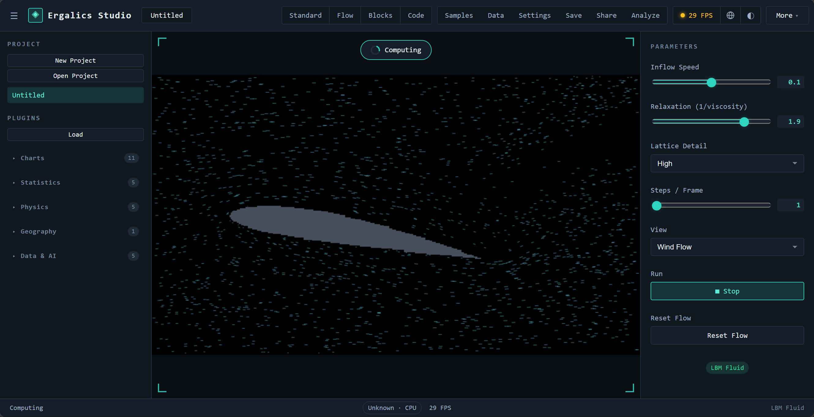

*Fluid simulation: D2Q9 lattice Boltzmann channel flow, stepped on GPU with CPU fallback.*

```card
Lattice Boltzmann Fluid
What it is｜Fluid simulation using mesoscopic particle collision-and-streaming rules: 2D channel flow and flow around a cylinder on a D2Q9 lattice.
Research context｜Lattice Boltzmann is a mainstream computational fluid dynamics method, widely used for porous-medium flow, microfluidics and multiphase simulation.
```

### Parametric Studies {#参数化研究}

The parameter-sweep tool runs a model at each point on a specified parameter grid and aggregates output metrics as heatmaps and curves, revealing sensitivity, identifying stable ranges and defining input ranges for later uncertainty analysis.

A single simulation asks what happens at one parameter value; a parametric study asks how behavior changes with parameters, marking the transition from demonstration to research. Handwritten loops and spreadsheet aggregation spend time on boilerplate. This tool combines grid definition, point-by-point execution, metric extraction and heatmap aggregation in one workflow; results are saved with the project and can be rerun as a group. Sweep plans expand into deterministic design points: full-grid and list axes use the complete Cartesian product, Latin hypercube axes sample by strata in each dimension, and plans mixing the two are explicitly rejected because there is no accepted definition of sample count in that case. Response surfaces can be inspected after execution.

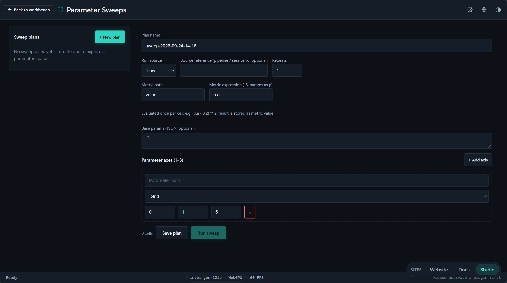

*Parameter sweep: metric heatmap and response curves over a parameter grid.*

```card
Parameter Sweep
What it is｜A systematic experiment tool that runs a model across a parameter grid and aggregates output metrics.
Research context｜A general method for sensitivity analysis and phase diagrams; candidate ranges from sweeps define inputs for subsequent uncertainty quantification.
```

The six examples share the same operating conditions: all computation happens in a browser tab without a server; parameters and random seeds are reproducible, and identical inputs necessarily yield identical outputs. Key metrics enter the readout strip at the top of the canvas through a common scientific output bus and, together with figures and tables, feed subsequent reports and reproduction records. Numerical results can be compared directly with theory—for example, susceptibility peaks against Onsager's exact critical temperature, and accretion-disk redshift against relativistic formulas—so systematic deviations can be traced back as clues to model or parameter problems.

No code is needed to operate these examples: sliders, dropdowns and file controls suffice. For finer control, switch to Code mode and continue using the same parameters in scripts.

## III. Product Structure and Working Modes {#三、产品构成与工作模式}

The product centers on a complete chain: data entry, exploration, modeling and inference, publication-quality figures, report delivery and reproducibility throughout. Each stage is handled by research tools, with the entire chain closed inside the browser.


*The chain from data to delivery: independent research tools handle each stage, all within the browser.*

The workbench offers four modes for different levels of use. Flow, Block and Code share one intermediate representation (IR) and can be converted back and forth; Python, R and JavaScript can also be translated between one another.

| Mode | Intended use | How it works |
| --- | --- | --- |
| Standard | Quick inspection | Drag a dataset into a plugin to plot it |
| Flow | Pipeline construction | 63 built-in blocks form dataflow graphs, executed topologically with per-node inspection |
| Block | Learners and imperative programming | Scratch-like block editor, scriptable |
| Code | Real scripts | Monaco editor; Python uses CPython (Pyodide), R can upgrade to the full webR runtime |

Switch freely between modes while project data and run records remain unchanged; different phases of an analysis can use different modes, for example Flow for organizing data, Code for fine-tuning scripts and Standard for inspecting results.

### Standard Mode {#标准模式}

The welcome page checks WebGPU, OPFS and runtimes, and its results determine the compute tier: kernels use GPU acceleration when WebGPU is available and mathematically consistent CPU implementations otherwise. A launch grid lists all research tools and sample projects. Dragging a data file into any plugin produces a plot, the quickest path when you have data and want an initial look.

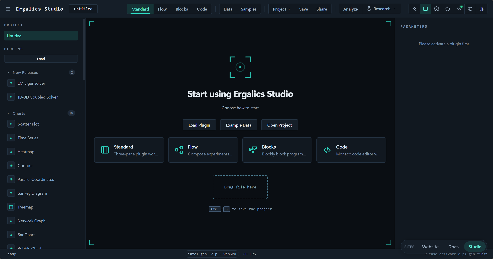

*Standard mode: environment checks on the welcome page and a launch grid for all research tools.*

```card
Standard Mode
For｜Users new to data who want to see results immediately.
How｜Drag a file into any plugin and adjust sliders; environment checks select GPU acceleration or the mathematically consistent CPU tier.
Boundary｜Multistep preparation and script control are handled by Flow and Code modes respectively.
```

The host automatically generates localized parameter forms from each plugin manifest, with eight control types: range sliders, dropdowns, numbers, checkboxes, text, files, buttons and switches. Changing parameters re-renders immediately without code. The ScienceOutputStrip above the canvas displays key readings such as convergence criteria, residuals and statistics in real time, with the same conventions across research-grade plugins.

**Two export levels:** The canvas-level Export menu downloads the current plugin's 2D canvas or 3D scene as PNG (with an additional transparent-background option for 3D) or saves it under the workspace `figures/` directory. At data level, each plugin declares button actions in its parameter panel to export its tables as RFC-4180 CSV.

**Plugin canvases are honest about data:** Simulation plugins start empty and run only after data is loaded; starting empty produces an explicit prompt instead of silently running without data. Each core plugin includes a one-click sample dataset that reproduces the documented view.

### Flow Mode {#流程模式}

For multistep pipelines, connected blocks form a directed acyclic graph executed incrementally in topological order. Node-level caching and dirty-value invalidation mean that changing one block reruns only it and its downstream nodes. Runs support cancellation and concurrent deduplication: repeated triggers do not run in parallel, and cancellation actually terminates the active computation node. Each node's output and diagnostics can be inspected separately.

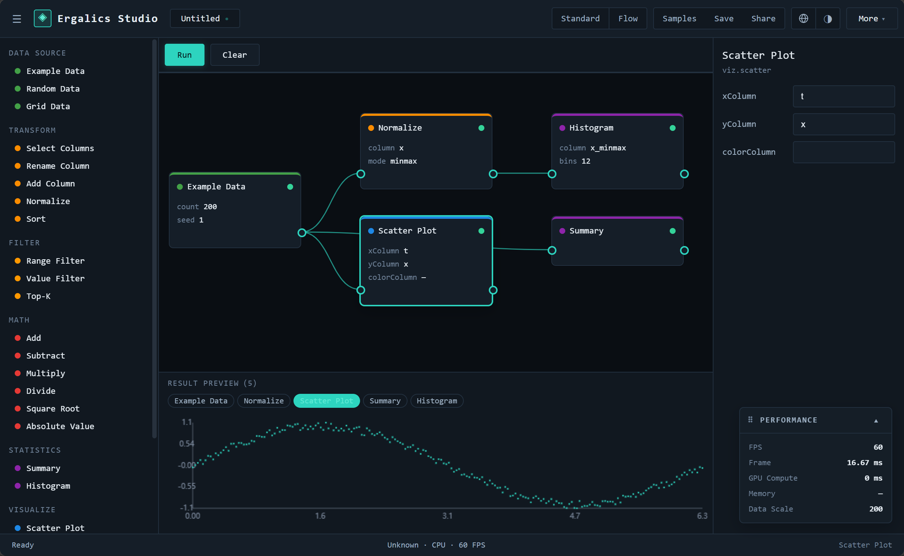

*Flow mode: connected blocks form a pipeline executed incrementally in topological order.*

```card
Flow Mode
For｜Analysts organizing multistep data pipelines and repeatedly tuning parameters.
How｜Connect 63 built-in blocks into a directed acyclic graph; preview each node's output and diagnostics separately.
Value｜Node-level incremental caching recomputes only affected downstream nodes after a parameter change, greatly reducing tuning cost for large pipelines.
```

The 63 blocks fall into data sources, transforms, filters, mathematics, statistics, units, visualization and plotting—covering common paths from reading CSV to group aggregation and plotting. Intermediate results can be expanded into table or figure previews, and an error node leads directly to its upstream cause. The whole graph can be saved as part of the project and edited later.

### Block Mode {#积木模式}

Blockly provides an imperative programming entry point with loops, branches, variables, events and plotting. Block programs share the same intermediate representation with Flow and Code, allowing conversion among all three without locking logic into one form. The editor is delivered as a lazy-loaded bundle and does not affect initial loading in Standard or Flow mode.

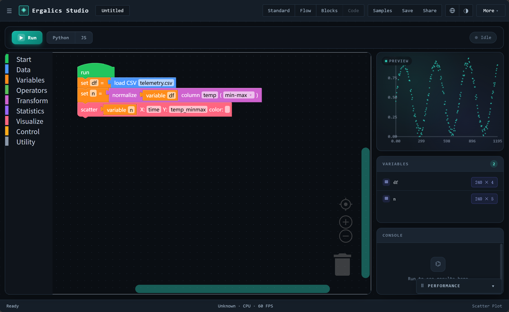

*Block mode: block programs share an intermediate representation with Flow and Code.*

```card
Block Mode
For｜Programming beginners and classroom teaching.
How｜Build loops, branches, variables and plotting logic with Scratch-like blocks, then upgrade to JavaScript / Python for further editing in one click.
Value｜A bridge from graphical imperative thinking to text code; the shared intermediate representation preserves work across all three forms.
```

Block programs can be upgraded at any time to readable JavaScript or Python and edited further, and scripts can be downgraded back to blocks; unit tests fix the semantics of three-way round trips. In teaching, one exercise can begin with blocks, proceed to code and end as a Flow pipeline, with the same data and run records across all stages.

### Code Mode {#代码模式}

The Monaco editor supports Python / R / JavaScript: Python runs on real CPython, while R uses the full runtime when the webR distribution is present. Switching languages translates the entire buffer through a confirmation preview, with round trips covered by unit tests.

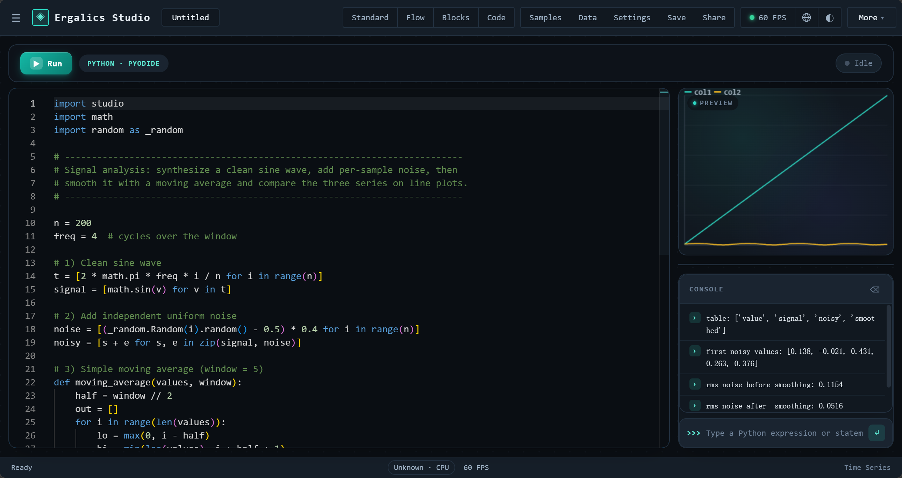

*Code mode: language switches are confirmed in a preview, and three-language round trips are covered by unit tests.*

```card
Code Mode
For｜Researchers familiar with Python / R / JavaScript.
How｜Call the studio interface in Monaco to read and write project data and run records directly.
Value｜Custom analysis and batch processing beyond plugin panels are performed here, with results also entering the experiment ledger and data lineage.
```

The Python `studio` module exposes project data to scripts: DataFrames can read and write project files, and saved results automatically enter the experiment ledger and data lineage. R and JavaScript access the same data through the shared IR engine. `studio.plot` uses a rendering bridge to the exact plugin renderer used by Flow visualization blocks. Stopping execution terminates and restarts the Worker so runaway loops cannot freeze the page; `Ctrl+Enter` runs the current buffer. All three languages see the same project, differing only in expression.

## IV. End-to-End Analysis Workflow {#四、端到端分析流程}

Each project is also a **Git repository** (browser-side isomorphic-git), with branch switching and conventional commits in the sidebar; the whole project can be exported as a `.clproj` file for offline transfer. Data is stored in IndexedDB / OPFS, with no account or cloud copy.

A typical analysis follows data → profiling → cleaning → modeling and inference → figures → report, with each step's output feeding the next. Two record streams run throughout: every run enters the experiment ledger, and every file read and write enters data lineage.

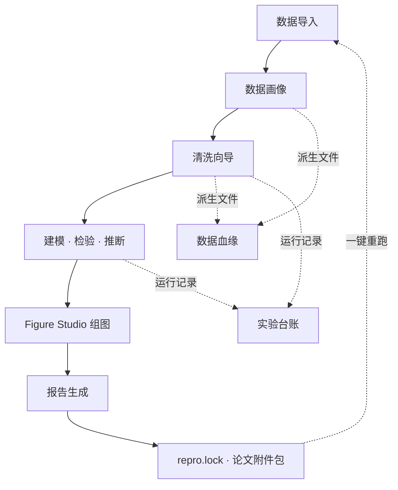

*End-to-end analysis: solid lines show data flow, dotted lines record flow; the endpoint seals reproduction fingerprints for one-click reruns.*

### Data Profiler {#数据画像-profiler}

After a CSV is dropped in, the Data Profiler reports column types, missing-value distributions, correlation matrix and quality score, with an issue list identifying outliers and high-missingness columns. Results can be exported as CSV for reports and later steps. Computation is streaming and single-pass: numeric columns use Welford's recurrence for exact mean and variance, reservoir sampling for quantiles, and modified z-scores for outliers; text columns use HyperLogLog for cardinality; table-level Pearson / Spearman correlations and duplication rates combine into a deterministic 0–100 quality score.

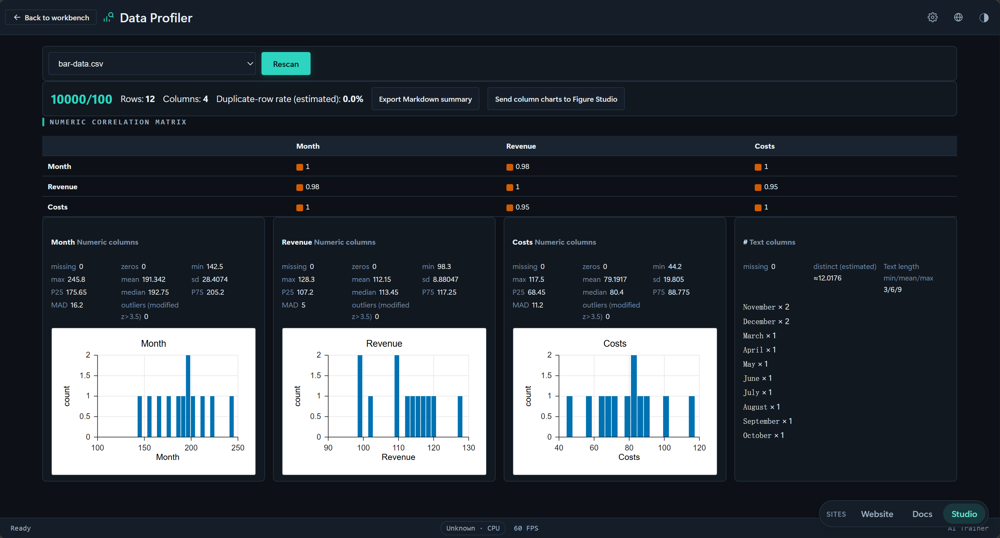

*Data Profiler: correlation matrix, quality score and issue list.*

```card
Data Profiler
Function｜Column types, missingness, correlation matrix, 0–100 quality score and issue list; single-pass Welford mean and variance, reservoir-sampled quantiles and HyperLogLog cardinality.
Research use｜The first step with any data: assess quality and prioritize cleaning; export profiles to CSV for reports.
Why it matters｜Real data almost always has missing values, outliers and type errors; profiling before cleaning prevents defects from propagating to conclusions.
```

Profiling is read-only throughout: original data files are never modified at any stage; all derived results are written to the project as new files.

### Cleaning Wizard {#清洗向导}

The Cleaning Wizard deduplicates, corrects types, fills missing values and handles outliers. Each rule provides row-count and affected-column summaries before and after execution, and each step can be rolled back; cleaned data is written as a new project file while the original remains read-only.

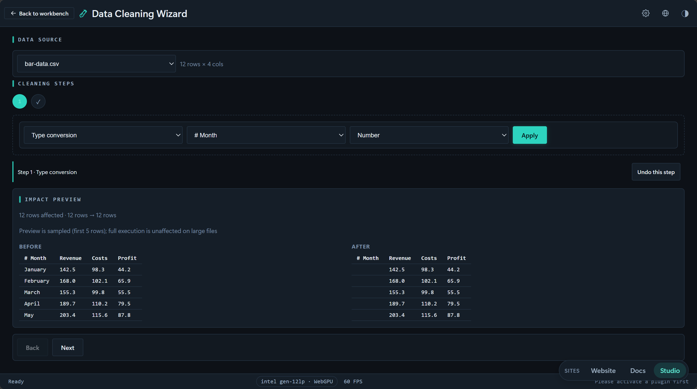

*Cleaning Wizard: each rule can be rolled back and the operation sequence enters data lineage.*

```card
Cleaning Wizard
Function｜Five rule types: type conversion, missing-value strategies, outlier labeling, deduplication and column renaming; execute step by step with rollback.
Research use｜Prepare raw records for modeling; the operation sequence enters data lineage as a run record.
Why it matters｜Misreading one column as text can remove all its numbers from analysis; rule-based, reversible cleaning is itself reproducible and auditable.
```

Rules are saved as run records in application order so the treatment and before/after differences for a dataset can be traced step by step. The step model consists of five serializable operations: type conversion, missing-value strategies (delete / mean / median / zero / forward fill), outlier labeling (IQR / z-score), deduplication and column renaming. No step ever overwrites its input table, so users can move forward, back, jump or undo a single step.

### SQL Data Workbench {#sql-数据工作台}

For direct SQL inspection, the SQL Data Workbench registers project data files in the DuckDB-WASM virtual filesystem and exposes them as tables for queries against project files. The engine is lazy-loaded and supports timeouts and cancellation so a runaway query cannot overwhelm the page.

Data inspection is among the most frequent analysis activities; browser data previously had to be exported to external tools for SQL. DuckDB-WASM compiles a columnar analytical engine into the browser, and this project directs queries at project files themselves: register and query without an export/import detour, with results always remaining local.

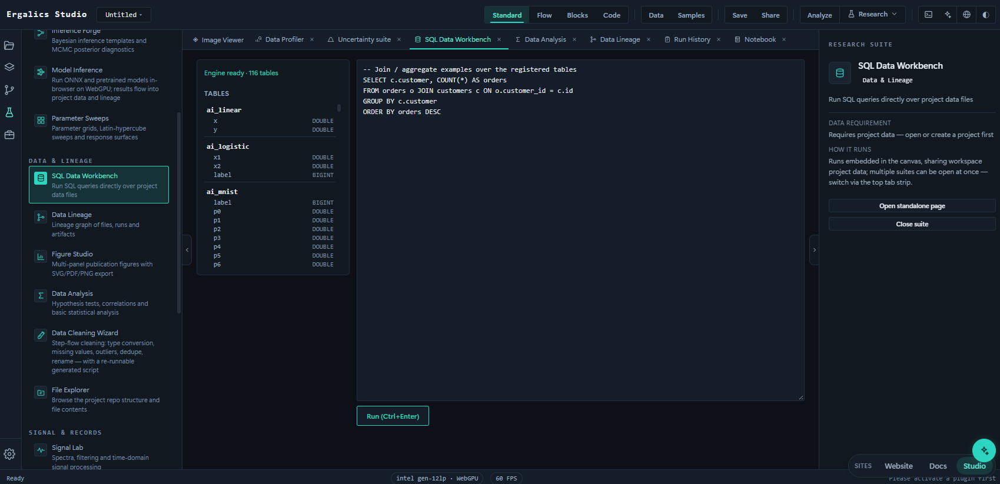

*SQL Data Workbench: project files exposed directly as DuckDB tables, with query timeouts and cancellation.*

```card
SQL Data Workbench
Function｜Register project data files as DuckDB tables for direct SQL; lazy-loaded engine with timeouts and cancellation.
Research use｜Joins, aggregation and sample checks—replace multiple rounds of clicking with a query.
Why it matters｜Detailed inspection of large datasets requires set-based queries; running in the browser sandbox also keeps data local.
```

### Model Workbench {#模型工作台}

The Model Workbench fits OLS / logistic / ridge / polynomial regression: OLS uses Householder QR, logistic regression uses IRLS, and ridge selects its regularization parameter by K-fold cross-validation. Coefficient tables contain estimates, standard errors, p-values and confidence intervals, alongside 2×2 residual diagnostics (residuals versus fitted, QQ, scale-location and residuals versus leverage). For parametric uncertainty, use Inference Forge for NUTS inference; fits are saved as runs and multiple models can be compared in the experiment ledger.

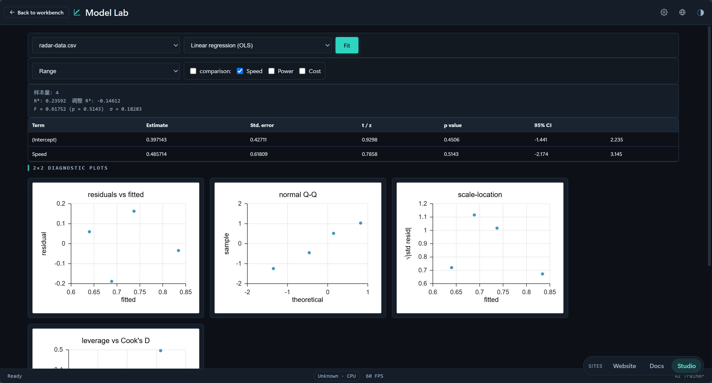

*Model Workbench: coefficient table, residual diagnostics and fit-quality readings.*

```card
Model Workbench
Function｜OLS / logistic / ridge / polynomial regression, Householder QR and IRLS solvers, K-fold cross-validation for parameter selection; coefficient tables (estimates, standard errors, p-values, confidence intervals) and 2×2 residual diagnostics.
Research use｜Quantitative relationships such as dose-response and factor analysis, with coefficient tables ready for papers.
Why it matters｜Fits require diagnostics to be credible: residual structure exposes failed assumptions, and point estimates without uncertainty are difficult to defend in review.
```

### Data Analysis {#数据分析}

The Data Analysis tool is the conventional entry point for hypothesis tests and basic statistics: the t-test family, one-way ANOVA, Mann-Whitney U, chi-square independence tests and Cohen's d effect size, with Bonferroni and Benjamini-Hochberg multiple-comparison corrections. Results can be converted directly into publication-quality Chinese and English sentences.

Choosing an inappropriate test, omitting effect sizes and failing to correct multiple comparisons are three common mistakes in applied statistics. This tool puts test selection, effect sizes and Bonferroni / BH correction in one interface and converts results directly to publication-quality sentences, embedding statistical practice in the workflow rather than relying on memory.

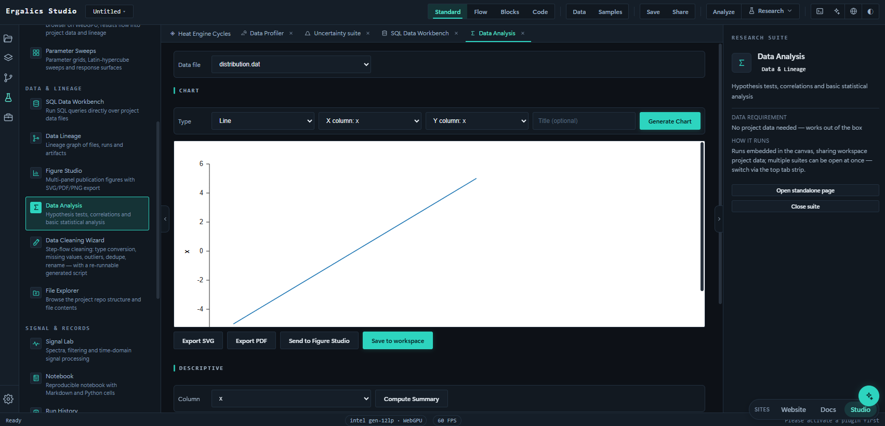

*Data Analysis: t-tests, ANOVA and multiple-comparison correction, expressed as publication-quality sentences.*

```card
Data Analysis
Function｜t-test family, one-way ANOVA, Mann-Whitney U, chi-square independence test, Cohen's d effect size; Bonferroni / Benjamini-Hochberg corrections.
Research use｜Whether two treatments differ or categorical variables are independent: a starting point for experimental and control group comparisons.
Why it matters｜Significance needs appropriate tests and effect sizes; uncorrected multiple comparisons generate false positives.
```

### Quick Stats {#快速统计}

Quick Stats provides accessible descriptive statistics: paste a column to obtain mean, standard deviation and confidence interval, and send it to the Uncertainty Suite in one click for interval estimation.

Descriptive statistics are the first step of analysis, yet are often skipped or approximated in a spreadsheet for lack of a convenient tool. Quick Stats reduces the step to paste and calculate, taking seconds from data to an initial conclusion; deeper analysis can be handed to the Uncertainty Suite without occupying a heavyweight tool or leaving a half-finished draft.

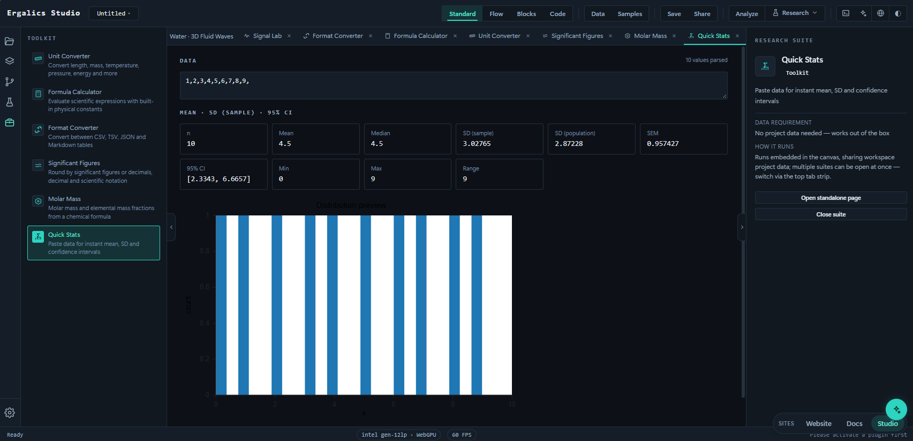

*Quick Stats: paste a column to obtain mean, SD and confidence interval.*

```card
Quick Stats
Function｜Paste-to-compute descriptive statistics: mean, standard deviation and confidence interval; one-click handoff to the Uncertainty Suite for interval estimation.
Research use｜Classroom demonstration, quick data inspection and calculation checks.
Why it matters｜An entry point with no learning curve bridges a quick look at a column and formal modeling.
```

### Uncertainty Suite {#不确定性套件}

The Uncertainty Suite makes “how certain is this number?” computable: Bootstrap confidence intervals, Monte Carlo propagation and MCMC provide convergence diagnostics including R-hat, effective sample size ESS, HDI and MCSE. With sufficiently large samples it automatically switches to the WGSL GPU engine; below the threshold or without a suitable device it falls back to CPU, with consistent results for the same random sequence.


*Uncertainty Suite: percentile confidence intervals from Bootstrap resampling and Monte Carlo propagation.*

```card
Uncertainty Suite
Function｜Bootstrap confidence intervals, Monte Carlo error propagation and MCMC; R-hat / ESS / HDI / MCSE convergence diagnostics, with numerically consistent GPU and CPU paths.
Research use｜Provide an interval rather than a single point before measurement errors and sampling fluctuations enter conclusions.
Why it matters｜Every inference from sample to population carries uncertainty; point-estimate-only conclusions are readily questioned in review.
```

### Inference Forge {#inference-forge}

Inference Forge provides complete Bayesian modeling: a NUTS sampler with Dual Averaging step-size adaptation, without manually setting the number of steps, plus WAIC and PSIS-LOO model comparison, posterior predictive checks and per-chain diagnostics.

Bayesian inference has long been limited by the difficulty of tuning samplers: poor step sizes can prevent convergence and invalidate conclusions. NUTS greatly lowers this barrier with dual-averaging step-size adaptation and is standard in platforms such as Stan. This tool brings the same algorithm into the browser without local installation for inference, diagnostics or model comparison.


*Inference Forge: NUTS sampling and R-hat / ESS posterior diagnostics, with WAIC / PSIS-LOO model comparison.*

```card
Inference Forge
Function｜HMC / NUTS Bayesian inference with Dual Averaging step-size adaptation; WAIC / PSIS-LOO model comparison and posterior predictive checks.
Research use｜Move from a single parameter value to an interval, with posterior distributions and prediction intervals directly in reports.
Why it matters｜Modern journals commonly require uncertainty; convergence diagnostics such as R-hat and ESS are prerequisite checks for publishable Bayesian results.
```

### Signal Lab {#信号实验室}

Signal Lab processes time series with radix-2 FFT and amplitude spectra (mathematically consistent with the GPU FFT kernel), Hann / Hamming / Blackman windows, Welch power spectra for dominant frequencies, Savitzky–Golay smoothing, ACF/PACF and classical additive decomposition (trend + seasonality + residual). Detected dominant frequencies and filter parameters are recorded; filtered columns are saved as derived project files and automatically enter the lineage graph.


*Signal Lab: Welch PSD, windows and filtering chain; results can be saved to the project.*

```card
Signal Lab
Function｜Radix-2 FFT and amplitude spectrum, Hann / Hamming / Blackman windows, Welch power spectrum, Savitzky–Golay smoothing, ACF/PACF and additive time-series decomposition.
Research use｜Time-varying observations such as vibration, physiological signals and prices: find dominant frequencies, denoise and separate trend and seasonality.
Why it matters｜Frequency components mixed in the time domain are clear in the spectrum; decomposition is a standard prerequisite for identifying structure and selecting models.
```

### Notebook {#notebook}

Notebook records analysis as reproducible experiments combining Markdown and Python cells. Cells run on the same Pyodide runtime as Code mode, and notebooks and scripts see the same `studio` interface. The cell list is saved with the project and can be replayed one cell at a time.

Experiment records are valuable because they can be replayed: text without code cannot be verified, while code without narrative does not reveal motivation. Notebook combines narrative and execution in one document; replaying cells reproduces the analysis and provides self-contained evidence for collaboration and review.

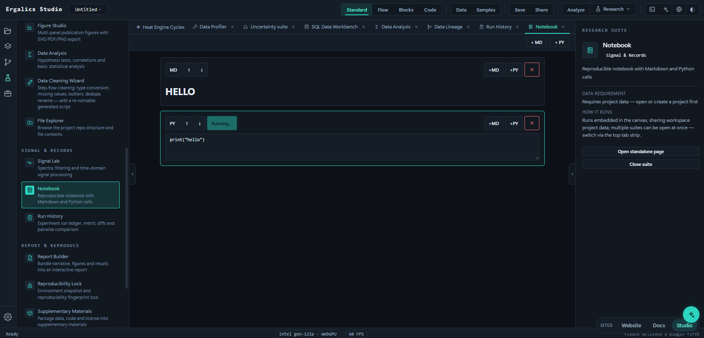

*Notebook: Markdown and Python cells share the runtime used by Code mode.*

```card
Notebook
Function｜Combine Markdown and Python cells; execution shares Code mode's Pyodide runtime and studio interface. Cells are saved with the project and replayable.
Research use｜A notebook for exploratory analysis, keeping hypotheses, code, results and notes together.
Why it matters｜Analysis scattered across scripts and chat logs is hard to trace; a notebook records why a choice was made.
```

### Figure Studio {#figure-studio}

Figure Studio arranges multipanel figures on IEEE / Elsevier journal templates. Thirty-two research-grade plugins support one-click Send to Figure Studio; bilingual captions and formula annotations are drafted automatically, with SVG / PDF / 600-dpi PNG export. Pre-submission checks list problems with resolution, font embedding and oversized dimensions.

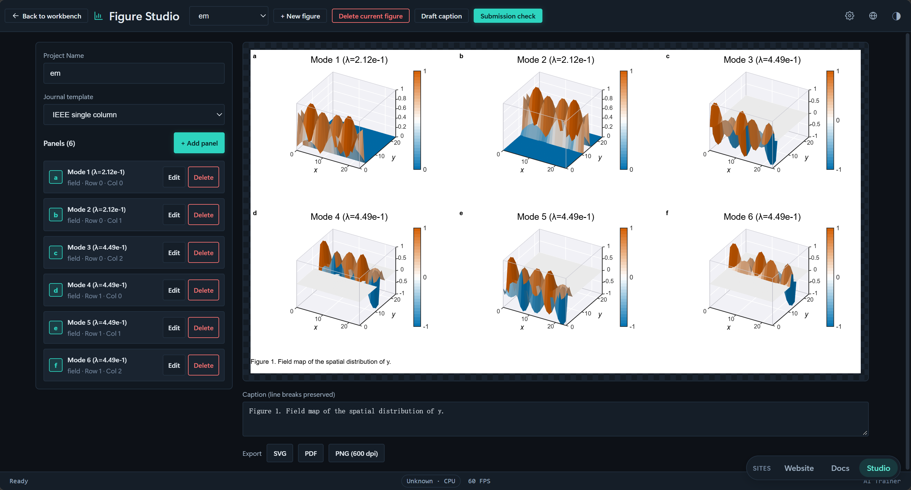

*Figure Studio: multipanel electromagnetic figures on an IEEE template.*

```card
Figure Studio
Function｜Arrange multipanel figures on IEEE / Elsevier templates, group from 32 research-grade plugins in one click, bilingual captions and formula annotations, SVG / PDF / 600-dpi PNG export and pre-submission checks.
Research use｜A/B/C/D multipanel figures for papers and presentations, refreshed in the same layout as data changes.
Why it matters｜Journals impose resolution, font-size and dimension requirements; templates bring checks forward into figure preparation and reduce manual rework.
```

### Report Builder {#报告生成器}

Report Builder assembles narrative, figures, tables and interactive filters into a single self-contained HTML file with inline CSS, inline SVG, inline JSON data and a zero-dependency controller; figures update when the analysis is rerun. All user strings are escaped and embedded JSON uses Unicode escapes to prevent script escape, so reports can be sent directly and safely. Exported files depend on no external service and can be distributed for immediate viewing.

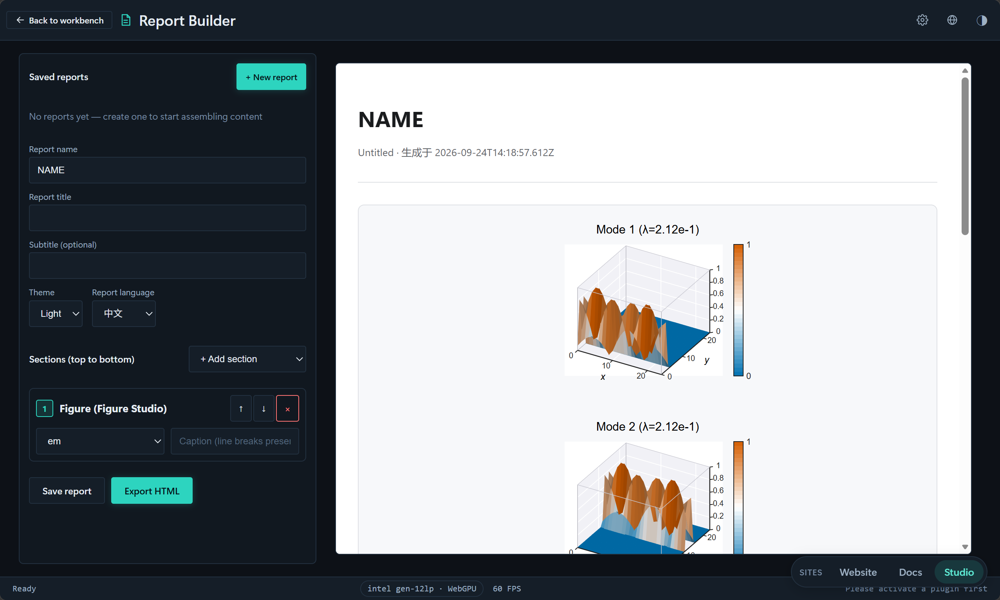

*Report Builder: narrative, figures and filters assembled into self-contained HTML.*

```card
Report Builder
Function｜Assemble narrative, figures, tables and interactive filters into one self-contained HTML file: inline styles and data, escaped strings, zero external dependencies.
Research use｜Deliver results to supervisors, collaborators or reviewers, who can open them in a browser and interactively filter figures.
Why it matters｜Results dependent on a particular viewing environment are costly to distribute and archive; a self-contained file opens immediately and can be sent directly.
```

### Reproducibility Lock (repro.lock) {#复现锁-repro-lock}

repro.lock records five fingerprint categories: data fingerprints, parameter hashes, random seeds, code snapshots and environment snapshots. Drift can be checked at any time; when an old project is loaded, a mismatch with the current environment is reported before execution so historical analyses can be assessed for reproducibility and rerun.

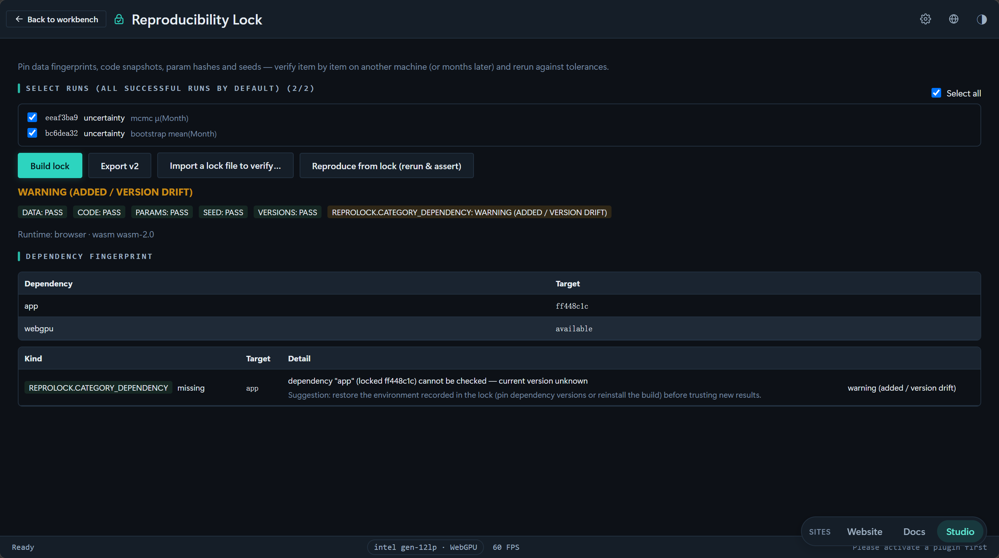

*Reproducibility Lock: recording five fingerprint categories and checking drift status.*

```card
Reproducibility Lock (repro.lock)
Function｜Record data fingerprints, parameter hashes, seeds, code and environment snapshots; identify drift and warn before a run on mismatch.
Research use｜Archive projects, rerun months later and prepare reproducibility materials for reviewers.
Why it matters｜How a paper's numbers were computed is central to reproducibility; fingerprint drift reveals stale conclusions before rerunning.
```

The five categories correspond to data, parameters, randomness, code and environment. Checks mark each category separately, leaving users to judge which change occurred and whether it affects conclusions. Environment snapshots (versions, platform and kernel availability) are included in the lockfile, making it clear whether drift occurred in data or environment.

### Supplementary Materials Package {#论文附件包}

The final delivery step packages project metadata, runs, lineage, selected data and code sessions, and an optional repro.lock into a ZIP for submission with a paper, allowing reviewers and readers to inspect and rerun the work.

Submission materials often risk version inconsistencies: figures from old data or parameters that differ from the final manuscript. The package captures the current project state in one operation with a manifest, giving reviewers exactly what the author sees and making the data and code availability statement a tangible deliverable.

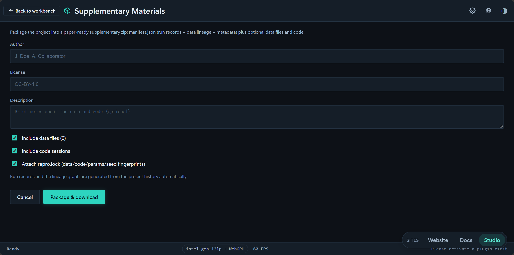

*Supplementary materials: manifest, runs, lineage, data and code packaged as a submission ZIP.*

```card
Supplementary Materials Package
Function｜Package figures, tables, data, parameters, manifest and environment inventory into a paper supplementary ZIP for submission.
Research use｜Supplementary materials and the data and code availability statement at submission.
Why it matters｜Manual collection can mix inconsistent versions; automatic packaging matches the current project state.
```

### Experiment Ledger {#实验台账}

Every run is recorded in the experiment ledger with parameters, input files, output metrics and duration. History can be filtered by parameters and any two runs compared A/B.

Experiment management often relies on scattered screenshots and notes, leaving users to remember which settings produced a result. The ledger makes recording automatic: records are established as analysis proceeds without later backfilling, while A/B comparison places settings side by side for assessment.

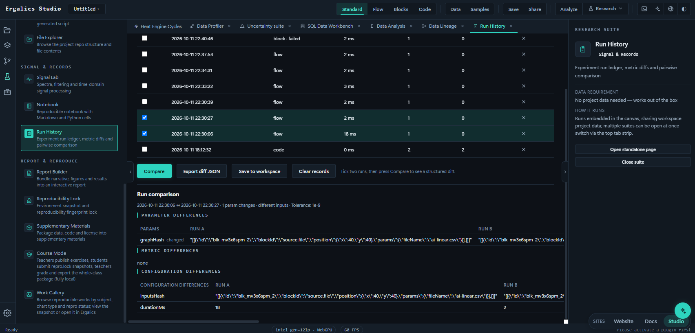

*Experiment ledger: compare run history by parameters; select two runs to inspect differences.*

```card
Experiment Ledger
Function｜Automatically record each run's parameters, input files, output metrics and duration; filter by parameters and compare any two runs A/B.
Research use｜Parameter sweeps, ablation comparisons and explaining to collaborators which settings produced which result.
Why it matters｜Memory and scattered screenshots are major causes of untraceable results; the ledger makes every run searchable and comparable.
```

### Data Lineage {#数据血缘}

While the ledger records runs, Data Lineage reconstructs files, runs and dependencies as a layered graph. A conclusion can be traced back to the data files and parameter combination that produced it, with each movement through cleaning and transformation recorded.

The graph is reconstructed automatically from file and run records rather than drawn by hand, so it needs no manual backfilling and does not become stale. The layered graph shows who processed data and what was derived; it also lets repro.lock drift checks connect changed fingerprint categories to particular files.

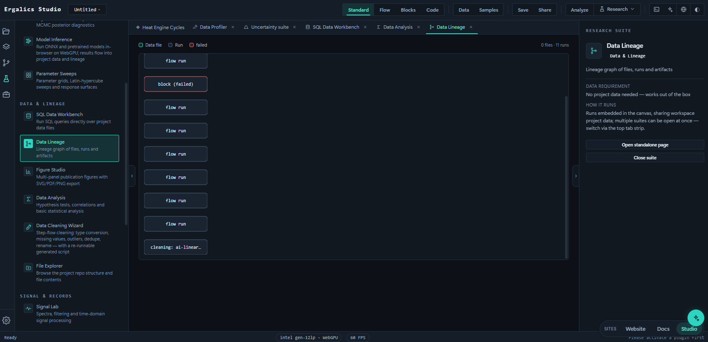

*Data lineage: files, runs and dependencies automatically reconstructed into a layered DAG.*

```card
Data Lineage
Function｜Automatically reconstruct files, runs and dependencies as a layered DAG, marking every movement through cleaning and transformation.
Research use｜Explain in a review response how Figure 3's data was processed, or find the upstream file behind an unexpected result.
Why it matters｜The origin of a number in a multistep chain is difficult to recall; lineage turns the answer into a searchable structured record.
```

<!-- pagebreak -->

Inputs and outputs form a closed artifact chain:

| Stage | Tool | Output | Destination |
| --- | --- | --- | --- |
| Profiling | Data Profiler | Column profiles, quality score, issue list (CSV export) | Report reference, cleaning decisions |
| Cleaning | Cleaning Wizard | New cleaned file and rule runs | Data lineage nodes |
| Modeling | Model Workbench | Coefficient tables, diagnostics, runs | Comparison in experiment ledger |
| Inference | Inference Forge | Posterior distributions, convergence diagnostics, model comparison | Comparison in experiment ledger |
| Signal | Signal Lab | Filtered derived files and spectral parameters | Lineage graph and runs |
| Figures | Figure Studio | Multipanel figures on journal templates | Supplementary materials package |
| Delivery | Report Builder | Self-contained HTML | Direct distribution |
| Reproduction | repro.lock | Five fingerprint categories and drift checks | One-click rerun |
| Archive | Supplementary materials package | Manifest and data/code ZIP | Uploaded with paper |

Every step takes place in one browser tab and all functions continue offline. The two dotted lines in the diagram are record streams throughout the main chain: every run enters the experiment ledger, and every file read/write enters data lineage.

## V. Key Technical Implementation {#五、关键技术实现}

**One source for three modes, translation among three languages:** Block, Flow and Code share one intermediate representation. Three forms of the same program can be converted without changing semantics, while translation of entire Python, R and JavaScript programs is applied after confirmation in a preview. Dedicated unit tests cover three-language round trips (`tests/editor/roundtrip-all-langs.test.ts`), and end-to-end tests cover language switching. The same pipeline can therefore be taught at different levels and collaborators can work in familiar paradigms on one project.

**Browser runtimes:** Python runs in CPython in a Pyodide Worker and can import `studio` to operate on project data. R has a vendored webR 0.6.0 runtime (falling back to the shared IR engine when absent); DuckDB-WASM provides SQL queries. All runtimes are self-hosted with the application and work offline.

**GPU computation and fallback:** Fourteen reusable WGSL kernels (all-pairs N-Body, D2Q9 lattice Boltzmann, wave-equation leapfrog, FFT, K-means, SpMV and others) execute on WebGPU. Each has a mathematically consistent CPU implementation; unit tests compare both paths numerically (measured passing limit approximately 2e-6 under headless SwiftShader), and stochastic kernels use the same random sequence on both paths. Below the data-size threshold or when WebGPU is unavailable, the engine falls back automatically to CPU and records the choice in the run.

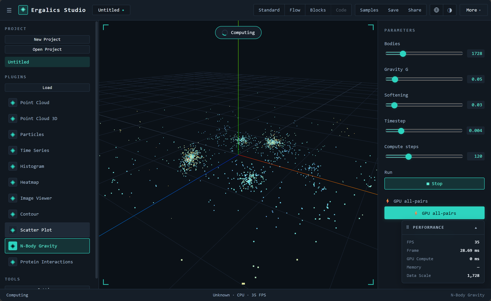

*Gravitational N-body simulation: 3D direct-summation gravity accelerated by a GPU all-pairs kernel with a consistent CPU fallback.*

**Security boundary:** Plugins run in Worker sandboxes (isolated mode communicates through OffscreenCanvas RPC); third-party `.cspkg` packages pass manifest validation and an Ed25519 signature gate. The `new Function` fallback for older environments is explicitly labeled in the UI and is not used as a security boundary.

**Privacy boundary:** The application has no account system or proprietary server: data and analysis records are stored only in local IndexedDB / OPFS. Network access occurs only for two explicit actions: Git remote synchronization configured by the user (through a CORS proxy), and user-initiated online update checks. No other outbound traffic is generated.

**Failure isolation:** Error boundaries catch individual plugin runtime errors without affecting the host or other plugins and show a retry prompt on the canvas; runner-level timeouts and retries provide additional protection.

**Local storage layers:** Data files are stored in chunks in Origin Private File System for large-file support; project metadata and runs remain in IndexedDB, and migration logic upgrades historical data smoothly. A virtual filesystem exposes both layers to plugins, scripts and Git, with version objects and workspace files in one storage stack. Physical data location, access paths and version management thus converge on one path.

**Self-hosted runtimes:** Python, R and SQL runtimes are distributed with the application and static assets, without public CDNs. After initial loading all enter the local cache and are available offline. Runtime versions are locked with the repository and referenced by repro.lock's environment snapshot, so versions can be checked before rerunning on another device.

**Plugin contract:** Each plugin declares parameter controls, sample data and research-readiness badges in its manifest; the host automatically generates localized forms. Key plugin readings enter the strip through the scientific output bus and each run enters the experiment ledger. Built-in and third-party `.cspkg` packages use the same contract and loading path, with no privileged host channel for built-ins.

**Tests and regression:** 4,078 unit tests (4,076 passing, 2 skipped) across 263 files and 14 end-to-end suites cover key user paths; type checking and all unit tests run in CI on every commit. Dedicated tests secure GPU/CPU kernel consistency, three-language round trips, report escaping, signature gates and more; a separate benchmark workflow guards performance baselines. Compliance issues such as citation-metadata drift and dependency vulnerabilities fail CI rather than relying on memory.

**Performance budgets and threading:** CI performance budgets expose bundle-size and critical-path regressions before merging. File parsing and computation run in Workers, leaving the main thread responsive; rendering uses WebGPU or a Canvas fallback. The thread boundary is also a security boundary: sandboxed plugins and host run in different Workers.

## VI. Built-in Capabilities {#六、内置能力全景}

The 165 built-in plugins are organized into 19 disciplines: 155 load at startup and 10 fun tools load on demand. The table lists all plugins (Chinese and English names come from their manifests); numbers in parentheses are counts per discipline:

| Discipline (count) | Plugins |
| --- | --- |
| Charts（22） | Scatter Plot、Time Series、Histogram、Box Plot、Heatmap、Contour、Error Band、QQ Plot、Violin Plot、Parallel Coordinates、Sankey Diagram、Treemap、Network Graph、Bar Chart、Bubble Chart、Polar Plot、Point Cloud、Point Cloud 3D、3D Surface、3D Voxel Field、3D Model Viewer、Image Viewer |
| Mathematics & Statistics（21） | Fourier Series Lab、Domain Coloring、ODE Vector Field & Streamlines、Linear Algebra Lab、Probability Distribution Lab、Numerical Analysis Lab、Graph Theory Visualizer、Topology Visualizer、Game Theory Lab、Central Limit Theorem Bench、Markov Chains & Stationary Analysis、Zipf's Law Word Frequencies、Design of Experiments (DOE)、Time Series Analysis、Multivariate Analysis、Nonparametric Tests、Survival Analysis、Meta-Analysis、Bayesian Inference、Conformal Prediction、Monte Carlo Simulation |
| Physics（18） | N-Body Gravity、LBM Fluid、3D Fluid Flow、Wave Equation、Double Pendulum、Electromagnetism、Optics Lab、EM Eigensolver、1D-3D Coupled Solver、1-D Schrödinger Solver、2-D Ising Model、Heat Engine Cycles、Diffusion Equation Lab、Diffraction Lab、Trajectory Kinematics Lab、Physics-Informed Neural Network、Agent-Based Modeling、Particles |
| Chemistry（5） | Crystal · 3D Unit Cell、Reaction · MD 3D、Titration Curve Lab、Reaction Order & Arrhenius、Gray–Scott Turing Patterns |
| Biology（6） | Enzyme Kinetics、Sequence Alignment、Population Genetics、Mendel F2 χ² Tests、Hodgkin–Huxley Neuron、Protein Interactions |
| Medicine & Public Health（6） | Epidemic Modeling、Pharmacokinetics、ECG Analyzer、Medical Image Viewer、Biostatistics Toolkit、Genomics Visualizer |
| Geography（16） | GeoJSON Map、Solar Elevation & Day Length、Climatograph、Population Pyramid、Spatial Interpolation、Distance & Area Measure、Projection Distortion (Tissot)、DEM Terrain Analysis、GPX Track Analysis、Interactive Globe (3D)、Radiocarbon Dating Lab、Soil Water Retention Fit、SCS Runoff Event、Seismic Wave Propagation、Mineral Identification Lab、Hydrogeology Workbench |
| Environmental（8） | Air Quality (AQI)、Water Quality、Greenhouse Effect、Carbon Cycle、Biodiversity Indices、Pollutant Dispersion、3-D Global Environment、Predator–Prey (Lotka–Volterra) |
| Astronomy（3） | Astronomy CCD Pipeline、Exoplanet Transit Fitting、Hertzsprung–Russell Diagram |
| Materials（3） | XRD Pattern Analysis、Stress-Strain Analysis、Thermal Analysis (DSC/TGA) |
| Engineering（11） | Structural Mechanics、DC Circuit Node Analysis、Plane Truss FEA、Control Systems Lab、FEM Lab（有限元实验室）、Fluid Mechanics Lab、Vibration Analysis、Heat Transfer Analysis、Mechanism Kinematics、System Dynamics Studio、Discrete Event Simulator |
| Economics（2） | Black-Scholes Option Lab、Spatial Prisoner's Dilemma |
| Psychology（2） | Signal Detection ROC / d′、Reaction Time Lab |
| Social Science（5） | Population Forecasting、Voting System Simulator、Social Network Analyzer、Inequality Analyzer、Public Opinion Diffusion |
| Music & Art Science（5） | Acoustics Lab、Tuning System Calculator、Synthesizer Lab、Keyboard Performance、Color Science Lab |
| Computer Science（7） | Algorithm Visualizer、Data Structure Lab、Automata & Regular Expression Engine、Cryptography Lab、Neural Network Visualizer、Complexity Analyzer、Network Protocol Simulator |
| Data & AI（8） | AI Trainer、Vector Database、AutoML Pipeline、NLP Workbench、Recommender System Simulator、Reinforcement Learning Lab、Model Interpreter、Image Processing |
| Visual FX（7） | Black Hole · 3D Ray Tracer、Water · 3D Fluid Waves、Volumetric Clouds · Sky Renderer、Daylight Sky · Atmosphere、Starfield · Night Sky、Ocean Swell · Sunrise & Sunset、Misty Peaks · Layered Ridges |
| Fun & Utility（10） | Fractal Explorer、Spirograph、Lissajous、Conway's Game of Life、Harmonograph、Palette Explorer、Koch Snowflake、Barnsley Fern、Fireworks、Truchet Tiles |

Simulation plugins start empty and run only after data is loaded; Reset only replays loaded data. The 189 sample datasets (`examples/data/`) can be loaded in one click through the sample-data dialog. Research-grade plugins declare research-readiness badges, physical units and validation benchmarks in their manifests, and key metrics enter the strip at the top of the canvas through the scientific output bus.

The 33 research tools are organized into seven groups, all embeddable in the workbench canvas: measurement and uncertainty (Data Profiler, Bootstrap / Monte Carlo propagation / MCMC); modeling and inference (regression workbench, NUTS Bayesian inference, ONNX inference, parameter sweeps); data and graphs (DuckDB SQL, data lineage, Figure Studio, Cleaning Wizard, quick analysis, schema inspection, synthetic data, workspace file browser); signals and records (Signal Lab, Notebook, experiment ledger); reporting and reproduction (report generation, reproducibility lock, supplementary materials package, reproducible works gallery, course mode); writing and publication (LaTeX editor, citation manager, collaborative notebook, preprint); toolbox (unit conversion, calculator, format conversion, significant figures, molar mass, Quick Stats). Formats include CSV / JSON / GeoJSON / GPX / HDF5 / NetCDF / FITS / Zarr / Parquet / CIF / POSCAR / DEM and others, dispatched by a unified importer.

Plugins and tools share the same data path: plugin readings enter the strip via the scientific output bus, tool runs enter the experiment ledger, and file I/O uses one virtual filesystem under Git version control. They differ in interface, not data ownership: results on plugin canvases, scripts, reports and reproducibility locks all see the same project.

The following eight figures show plugins from eight different disciplines after sample data is loaded.

**Materials science:** The XRD plugin detects diffraction peaks, converts 2θ angles to Bragg d values, and refines lattice parameters by least squares.


*XRD analysis: peak detection, conversion to Bragg d values and lattice parameter refinement.*

**Geography:** The radiocarbon dating plugin maps conventional Libby carbon-14 ages to the IntCal20 calibration curve, producing likelihood profiles and credible intervals for age.


*Radiocarbon dating lab: likelihood profile of conventional Libby age calibrated with IntCal20.*

**Biology:** The compartment model plugin integrates SIR / SEIR equations with RK4 and reports R₀, peak infection time and the herd-immunity threshold.


*Epidemic compartment models: RK4 integration of SIR / SEIR and the herd-immunity threshold.*

**Environmental science:** The Gaussian plume plugin calculates ground-level concentration from a continuous point source using Pasquill–Gifford stability classes, with adjustable wind speed, source strength and emission height.


*Pollutant dispersion: Gaussian-plume ground concentration under Pasquill–Gifford parameters.*

**Physics:** The Schrödinger plugin solves the 1D stationary Schrödinger equation by finite differences, with infinite well, harmonic oscillator, finite well and double well potentials; energy levels and wavefunctions are shown together.


*One-dimensional quantum solver: finite-difference eigenvalues across four typical wells.*

**Economics and finance:** The options plugin provides Black-Scholes analytical prices and Greeks, cross-validated by fixed-seed geometric Brownian motion Monte Carlo, and reports the put-call parity residual.


*Black-Scholes option pricing lab: analytical prices cross-validated by seeded Monte Carlo.*

**Astronomy:** The HR diagram plugin shows a stellar sample as a color–magnitude scatter plot (B−V versus V), overlays an empirical main-sequence reference and solar anchor, and can linearly fit the main sequence.


*HR diagram: B−V color–magnitude scatter with main-sequence reference and solar anchor.*

**Chemistry:** The acid-base Titration Lab solves the full ionic equilibrium system and computes pH at each volume by Newton–Raphson, directly marking equivalence points, buffer regions and indicator color-change intervals on the curve.


*Acid-base titration: full ionic equilibrium solved per volume, marking equivalence and color-change intervals.*

## VII. Governance and Roadmap {#七、治理与路线图}

The project is released under MIT, with source, 263 test files and five CI workflows publicly available. Releases are archived and assigned DOIs through Zenodo; software citations are maintained in `CITATION.cff` and checked in CI; SECURITY, CONDUCT, CHANGELOG and bilingual README files are provided. Third-party and built-in plugins use the same contract and loading path, so extensions do not require host changes.

**Sustainability rests on several designs:** Every compute kernel has a mathematically consistent CPU implementation, maintaining full functionality without WebGPU; data moves freely in open formats and projects can be exported for offline transfer; repro.lock's five fingerprint categories allow historical analyses to be checked for drift and rerun long afterwards.

**The roadmap targets a clear end state:** **Analysis as a citable, first-class scientific artifact**—each analysis carries reproduction fingerprints and a DOI, so anyone reproducing or questioning a conclusion need not request anything from the author. Near-term work hardens existing capabilities, medium-term work opens the third-party ecosystem, and long-term work advances that end state through every scientific workflow stage. Delivered capabilities are covered by code and tests; unfinished work is listed honestly, with architecture reserved for it.

| Stage | Item | Current-state anchor |
| --- | --- | --- |
| Near term (hardening) | Git panel diff review and conflict wizard | Branches, commits, cloning and remote sync delivered |
| Near term (hardening) | Per-kernel GPU performance telemetry | 14 kernels and GPU/CPU consistency tests delivered |
| Near term (hardening) | Broader error handling and fallback coverage | Error boundaries and retries in place, marked Partial |
| Near term (hardening) | Marketplace registry and in-app install / update flow | .cspkg Ed25519 signature gate live |
| Medium term (ecosystem) | Self-service third-party package submission–review–installation pipeline | Signing and sandbox infrastructure ready; self-service channel missing |
| Medium term (ecosystem) | Connect the gpu.* block family to Block and Flow modes | Worker runner and kernel dispatch interfaces reserved |
| Medium term (ecosystem) | Open plugin validation benchmarks as public scientific benchmarks | Benchmarks already declared in manifests and rerunnable on canvas |
| Long term (vision) | **Analysis as artifact:** headless repro.lock projects rerun in CI, automatically regenerating reports and figures | Tests already run the same code path outside the browser |
| Long term (vision) | **Citable analysis:** archive each analysis as a DOI citation object, allowing mutual references between paper conclusions and the analyses that produced them | Release pipeline already archives Zenodo DOIs and maintains citations via CITATION.cff |
| Long term (vision) | Real-time collaboration and project sharing (a synchronization layer over local-first architecture) | Projects are standard Git repositories with an exchange format |
| Long term (vision) | **Disciplinary depth:** more fields gain complete workflows from data import to paper submission under one contract | 165 built-in plugins across 19 disciplines are existing examples of the contract |
| Long term (vision) | **Real-world adoption:** offline bulk deployment for universities and labs, with adoption in actual teaching underway | Complete single-machine offline capability delivered |
| Long term (vision) | **Full submission-standard coverage:** more journal templates and export formats | IEEE / Elsevier templates and submission checks delivered |

**Known boundaries:** Sandbox Workers and the host share origin storage, so the final defense against malicious packages is the signature gate. Without WebGPU, CPU fallback retains functionality with different performance. Boundaries and mitigations are documented in the security documentation.

**Mitigations are layered:** The sandbox isolates runtime behavior, the signature gate determines what enters it, and error boundaries limit the impact of crashes from code that has entered. All three layers have test coverage; failure of any single layer does not directly expose host data. CPU and GPU paths are constrained by the same unit tests for numerical consistency, and fallback engine choice is recorded so performance differences can be attributed afterwards.

**CI carries out daily governance:** Five workflows cover 4,078 unit tests (4,076 passing, 2 skipped), 14 end-to-end suites, builds and documentation generation. Two classes of test fix key semantics in the pipeline: GPU/CPU consistency tests bind 14 WGSL kernels and their CPU implementations to the same numerical tolerance, and three-mode translation tests bind Block, Flow and Code to one intermediate representation. Commits breaking consistency or translation semantics fail in the pipeline rather than relying on human discovery.

**Supply chain and compliance also enter the pipeline:** An SBOM is generated in CycloneDX 1.5 format; the security workflow rescans weekly, high and critical vulnerabilities block merging, and exemptions require reasons and follow-up records. A script compares citation metadata with `package.json`, and drift fails CI.

## VIII. Getting and Running {#八、获取与运行}

- **Online:** Open the GitHub Pages version (see the repository README badge), with no installation or registration.
- **Local development:** Run `npm install` then `npm run dev`; `npm run build:web` builds the pure web version; `npm run verify` runs strict type checking and all unit tests; `npm run test:e2e` runs the end-to-end suites.
- **Examples:** 189 sample datasets and 11 sample projects are built in and loadable; nine sample programs cover three languages.
- **Contribute:** Issues and Pull Requests are welcome; third-party plugin contract documentation is in the repository.
- **Cite:** `CITATION.cff` supplies standard citation formats, and formal releases receive Zenodo DOIs.

**Browser requirements:** Browsers supporting WebGPU (including Chrome / Edge 113 and later) receive the full GPU pipeline. Other modern browsers automatically use CPU, with consistent functionality and different performance. After the first complete load, runtimes and data files are cached locally and all features can be used offline.

Three deployment forms use the same purely static build, selected by scenario:

| Form | Scenario | Description |
| --- | --- | --- |
| GitHub Pages | Quick use and review | Deploy workflow builds and deploys with site-integrity checks |
| Local development | Further development and plugin authoring | `npm install` then `npm run dev` for hot reload |
| Self-hosted static deployment | Teaching labs and intranets | Build consists of static files; HashRouter works with any static server |

**Take data away at any time:** Export a project as one `.clproj` file; data files retain their original formats and Git history travels with the project. Uninstalling or clearing browser data removes all local copies, with no cloud residue requiring an export request.

**No personal data is needed for a first use:** Eleven sample projects cover complete analysis scenarios across disciplines, and 189 sample datasets can be loaded into any plugin in one click through the sample-data dialog. Starting with an example and replacing it with one's own file is the practical path for most new users.

## IX. Appendices {#九、附录}

### Appendix A: Plugin Reference {#附录-a-插件速查}

The table lists IDs and disciplines for all 165 built-in plugins; Chinese and English names appear in Chapter VI. The authoritative mapping is `src/plugins/categories.ts`; unmapped third-party plugin IDs default to chart visualization.

| Discipline | Plugin IDs |
| --- | --- |
| Discipline | Plugin IDs |
| --- | --- |
| Charts（22） | `example.scatter`、`example.timeseries`、`example.histogram`、`example.boxplot`、`example.heatmap`、`example.contour`、`example.errorband`、`example.qqplot`、`example.violin`、`example.parallel`、`example.sankey`、`example.treemap`、`example.network`、`example.bar_chart`、`example.bubble`、`example.polar`、`example.point-cloud`、`example.point-cloud-3d`、`example.surface-3d`、`example.voxel-3d`、`example.model3d`、`example.image` |
| Mathematics & Statistics（21） | `example.math-fourier`、`example.math-domaincolor`、`example.math-odefield`、`example.math-linalg`、`example.math-dist`、`example.math-numerics`、`example.math-graph`、`example.math-topology`、`example.math-game`、`example.stats-clt`、`example.stats-markov`、`example.stats-zipf`、`example.stats-doe`、`example.stats-timeseries`、`example.stats-multivariate`、`example.stats-nonparametric`、`example.stats-survival`、`example.stats-meta`、`example.stats-bayes`、`example.stats-conformal`、`example.sim-montecarlo` |
| Physics（18） | `example.nbody`、`example.fluid`、`example.fluid3d`、`example.wave`、`example.pendulum`、`example.electromag`、`example.optics`、`example.em-eigensolver`、`example.fluid-cfd-coupler`、`example.physics-schrodinger`、`example.physics-ising`、`example.physics-heatengine`、`example.physics-diffusion`、`example.physics-diffraction`、`example.physics-trajectory`、`example.physics-pinn`、`example.sim-abm`、`example.particles` |
| Chemistry（5） | `example.chem-crystal`、`example.chem-reaction`、`example.chem-titration`、`example.chem-reaction-order`、`example.chem-turing` |
| Biology（6） | `example.bio-enzyme`、`example.bio-seqalign`、`example.bio-popgen`、`example.bio-mendel`、`example.bio-neuron`、`example.protein` |
| Medicine & Public Health（6） | `example.bio-epidemic`、`example.bio-pk`、`example.med-ecg`、`example.med-imaging`、`example.med-biostat`、`example.med-genomics` |
| Geography（16） | `example.geomap`、`example.geo-solar`、`example.geo-climograph`、`example.geo-pop-pyramid`、`example.geo-interp`、`example.geo-measure`、`example.geo-tissot`、`example.geo-terrain`、`example.geo-gpx`、`example.geo-globe`、`example.geo-carbondating`、`example.geo-soilwater`、`example.geo-hydrology`、`example.geo-seismic`、`example.geo-minerals`、`example.geo-hydrogeology` |
| Environmental（8） | `example.env-aqi`、`example.env-water`、`example.env-greenhouse`、`example.env-carbon`、`example.env-biodiversity`、`example.env-plume`、`example.env-earth3d`、`example.env-predator-prey` |
| Astronomy（3） | `astro.pipeline`、`example.astro-transit`、`example.astro-hrdiagram` |
| Materials（3） | `example.mats-xrd`、`example.mats-mech`、`example.mats-thermal` |
| Engineering（11） | `example.structure`、`example.eng-circuit`、`example.eng-truss`、`example.eng-control`、`example.fem-lab`、`example.eng-fluid`、`example.eng-vibration`、`example.eng-heat`、`example.eng-mechanism`、`example.sim-sd`、`example.sim-des` |
| Economics（2） | `example.econ-blackscholes`、`example.econ-evogame` |
| Psychology（2） | `example.psych-sdt`、`example.psych-rt` |
| Social Science（5） | `example.socio-popforecast`、`example.socio-voting`、`example.socio-sna`、`example.socio-inequality`、`example.socio-opinion` |
| Music & Art Science（5） | `example.acoustics`、`example.tuning`、`example.synth`、`example.keys`、`example.color-science` |
| Computer Science（7） | `example.algorithms`、`example.datastructures`、`example.automata`、`example.crypto`、`example.neuralviz`、`example.complexity`、`example.netproto` |
| Data & AI（8） | `example.ai-training`、`ai.vectordb`、`ai.automl`、`ai.nlp`、`ai.recsys`、`ai.rl`、`ai.xai`、`example.data-imageproc` |
| Visual FX（7） | `fx.blackhole`、`fx.water`、`fx.cloud`、`fx.sky`、`fx.stars`、`fx.ocean`、`fx.misty` |
| Fun & Utility（10） | `fun.mandelbrot`、`fun.spirograph`、`fun.lissajous`、`fun.life`、`fun.harmonograph`、`fun.palette`、`fun.koch`、`fun.barnsley`、`fun.fireworks`、`fun.truchet` |

### Appendix B: Research Tool Reference {#附录-b-科研工具速查}

The 33 tools use one registry and can all be opened from the research launcher and welcome-page tool grid. Tools with project context embed in the workbench canvas; the six toolbox items are available on demand.

| Group | Tools |
| --- | --- |
| Measurement and uncertainty | Uncertainty (Bootstrap / Monte Carlo / MCMC), Data Profiler |
| Modeling and inference | Model Workbench, Inference Forge (NUTS), ONNX model inference, parameter sweep |
| Data and graphs | SQL Data Workbench, Data Lineage, ETL pipeline, schema inspector, synthetic data, Figure Studio, quick analysis, Cleaning Wizard, file explorer |
| Signals and records | Signal Lab, Notebook, experiment records |
| Reports and reproducibility | Report Builder, reproducibility lock, supplementary materials package, works gallery, course mode |
| Writing and publication | LaTeX editor, citation manager, collaborative notebook, preprint packaging |
| Toolbox | Unit conversion, calculator, format conversion, significant figures, molar mass, Quick Stats |

### Appendix C: Data Format Reference {#附录-c-数据格式速查}

The unified import dispatcher detects file types and sends them to the corresponding parser on reading; original files remain read-only throughout:

| Format | Typical content |
| --- | --- |
| CSV / TSV | Tabular data, column types automatically detected at import |
| TXT / DAT | General text and numeric lists |
| JSON / GeoJSON | Structured records and geographic features |
| HDF5 / NetCDF / Zarr | Multidimensional scientific arrays and climate / remote-sensing datasets |
| NPY / NPZ | NumPy arrays |
| Parquet | Large columnar tables |
| FITS | Astronomical images and spectra |
| XYZ / PDB | Molecular and protein structure coordinates |
| CIF / POSCAR | Crystal structures and materials-computation inputs |
| FASTA / VCF | Nucleic-acid or protein sequences and genomic variant records |
| XY / XYE | X-Y data pairs and diffraction spectra |
| MTX | Sparse matrices (Matrix Market) |
| OBJ / STL / GLB / glTF | 3D mesh models |
| GPX / KML / DEM (ASC) | Tracks, geographic annotations and elevation terrain |

Image and container files (PNG / JPEG / WebP / GIF, ZIP) are identified by magic numbers and sent to their respective handlers, rather than parsed as data tables.

Exports and derived artifacts likewise use open formats without proprietary wrapping:

| Artifact | Source | Format |
| --- | --- | --- |
| Publication-quality figures | Figure Studio | SVG / PDF / PNG (600 dpi) |
| Self-contained report | Report Builder | Single HTML file |
| Profile results | Data Profiler | CSV |
| Interactive project | Workbench | Single `.clproj` file |
| Pipelines and block programs | Flow / Block modes | `.flow.json` / `.block.json` |
