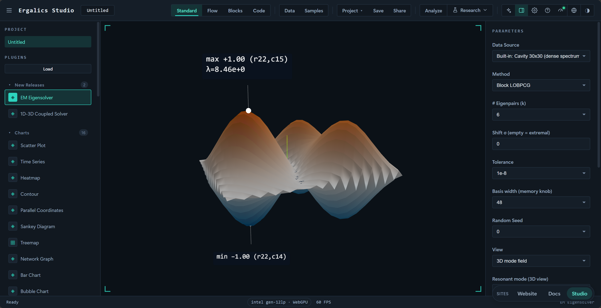
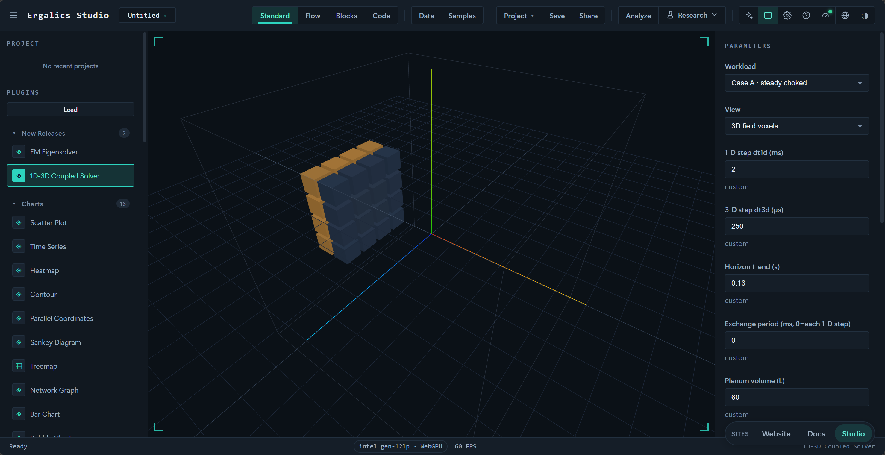
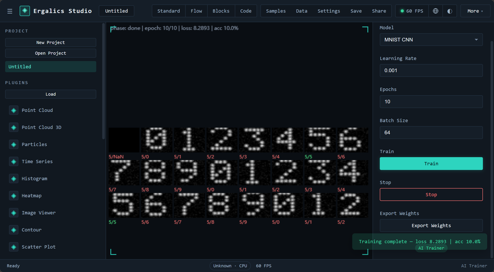

# Ergalics Studio Product Introduction

Ergalics Studio is a professional scientific computing workstation that runs entirely in the browser: interactive data exploration, GPU compute scheduling, a sandboxed plugin system, and four working modes for different users are integrated into one web application. No local software installation is required; open the website to use it. Data is stored locally in the browser (IndexedDB / OPFS) and stays on the machine. The project is open source under the MIT license, with source code, tests, and continuous integration all public. This document provides reviewers with an overview of the project, technical innovations, functionality, application scenarios, open-source governance, and long-term development. The accompanying *Application Scenario Library* (article 11, a standalone topic) contains 81 scenarios — 79 detailed entries plus two screenshot indexes; engineering details are in the other technical documents in this directory.

## I. Project overview {#一、项目概览}

- **A full-stack scientific computing workbench with zero browser-side installation.** From dragging in a CSV to view a plot, building dataflow pipelines, and assembling blocks to writing Python / R / JavaScript, the entire workflow runs in the web page and supports offline use.
- **Local-first; data stays on the machine.** Projects and data live in browser IndexedDB / OPFS and can be exported as `.clproj` files for offline exchange; there is no cloud copy. A project is also a Git repository, with its version history kept locally.
- **MIT open source.** All source code, 263 test files, and 5 CI workflows are publicly accessible; releases are archived through Zenodo and assigned a DOI.

| Area | Current state |
| --- | --- |
| Built-in plugins | 165 (155 scientific and analysis plugins automatically loaded at startup, 10 fun tools loaded on demand), grouped into 19 disciplines |
| Research tools | 33, organized into seven groups: measurement and evaluation, modeling and inference, data and lineage, signals and records, reporting and reproduction, writing and publication, and toolbox |
| Flow blocks | 63, covering data sources, transforms, filters, math, statistics, units, visualization and plotting |
| Working modes | Four modes: Standard / Flow / Block / Code; the three scripted modes share one intermediate representation (IR) |
| GPU kernels | 14 reusable WGSL compute kernels, each with a mathematically consistent CPU implementation |
| Competition-grade solvers | 2: a sparse Hermitian eigensolver for matrices of order 100,000, and a 1D pipe-network–3D field bidirectional coupling solver |
| Tests and CI | 4,076 passing unit tests (2 skipped without a GPU) in 263 test files, 14 end-to-end suites, and 5 CI workflows |

*Electromagnetic resonance eigensolver: three kernels solve sparse Hermitian eigenpairs of order 100,000 and certify true residuals; the image shows a microwave cavity's 3D mode field.*

*1D–3D bidirectional coupling solver: transient simulation of a bidirectionally coupled 1D pipe network and 3D field; the image shows a voxel rendering of the coupled field.*

## II. Technical innovations {#二、技术创新}

- **Four modes, shared IR.** Block, Flow, and Code modes convert bidirectionally through one intermediate representation, with dedicated round-trip unit tests; the `verify-lang-modes` end-to-end suite checks lossless Flow ⇄ Block ⇄ Code cycles. Code-mode buffer contents can be parsed back into IR, and Python / R / JavaScript can be freely translated back and forth. The same analysis logic can exist as blocks, a flowchart, or a script and switch forms at any time.
- **Full-stack runtime in the browser.** Python runs on a real CPython in a Pyodide Worker (`studio` is injected as an importable module); R runs on the vendored webR 0.6.0 runtime (falling back to the IR engine when assets are missing); persistence uses IndexedDB and OPFS. The Python / R runtimes are vendored and self-hosted locally, require no public CDN, and can be used offline.
- **Real GPU computation and graceful degradation.** Fourteen real WGSL compute kernels (including D2Q9 fluid, all-pairs N-Body, wave equation, FFT, K-means, and SpMV) run on the GPU when WebGPU is available. Each has a mathematically consistent CPU implementation, and unit tests check numerical consistency between the two paths. Data sizes below a threshold or a missing device trigger automatic CPU fallback; engine selection is written to the run record for traceability.
- **Two competition-grade solvers.** The electromagnetic resonance eigensolver targets indefinite sparse Hermitian matrices of order 100,000, providing thick-restart Lanczos, block LOBPCG, and Jacobi-Davidson kernels, with eigenpairs certified by true residuals. The 1D–3D bidirectional coupling solver uses multi-rate time-step coordination and coarse–fine time subcycling to drive transient simulation of a 1D pipe network and 3D field, with forward and reverse boundary coupling and conservation audits.
- **Sandbox + signature as independent defenses.** Third-party packages run in an isolated Web Worker sandbox by default and communicate with the host via typed RPC; canvas rendering uses transferred OffscreenCanvas. `.cspkg` loading validates the manifest (required fields, id format, entry-path traversal protection, etc.) and supports Ed25519 signatures and a trust registry (implemented in pure TypeScript without depending on WebCrypto). The sandbox constrains “what can be done”; signatures answer “who published it.” The two defenses are independent.

## III. Functional overview {#三、功能全景}

The 165 built-in plugins are divided into 19 discipline groups (155 loaded at startup and 10 fun tools on demand); the complete per-plugin table is the generated [12 Plugin Catalog](./12-plugin-catalog):

| Discipline | Count | Representative plugins |
| --- | --- | --- |
| Charts charts | 22 | Scatter, heatmap, 3D surface |
| Mathematics and statistics math | 21 | Histogram, violin plot, Fourier series approximation |
| Physics physics | 18 | Electromagnetic resonance eigensolver, 1D–3D bidirectional coupling solver, lattice Boltzmann fluid |
| Chemistry chem | 5 | 3D unit cell preview, 3D reaction kinetics, acid–base titration curve |
| Biology bio | 6 | Sequence alignment, population genetics, protein interactions |
| Medicine and public health med | 6 | ECG analyzer, medical image viewer, biostatistics toolkit |
| Geography geo | 16 | GeoJSON map, DEM terrain analysis, radiocarbon dating lab |
| Environment env | 8 | Air quality AQI, carbon cycle simulation, Gaussian plume dispersion |
| Astronomy astro | 3 | Astronomy CCD pipeline, transit light-curve fitting, Hertzsprung–Russell diagram |
| Materials materials | 3 | XRD pattern analysis, DSC/TGA thermal analysis, stress–strain analysis |
| Engineering engineering | 11 | Plane truss FEM, control systems lab, FEM Lab |
| Economics and finance econ | 2 | Black–Scholes option pricing, spatial prisoner's dilemma evolutionary game |
| Psychology and behavior psych | 2 | Simple reaction time lab, signal detection theory ROC / d′ analysis |
| Social science socio | 5 | Population forecasting, social network analyzer, inequality analyzer |
| Music and art science artsci | 5 | Acoustics lab, tuning system calculator, color science lab |
| Computer science cs | 7 | Algorithm visualizer, cryptography lab, network protocol simulator |
| Data and AI data | 8 | AI trainer, AutoML pipeline, model interpreter |
| Effects rendering fx | 7 | 3D black-hole ray tracing, 3D water-wave fluid, volumetric-cloud sky rendering |
| Fun tools fun | 10 | Koch snowflake, Barnsley fern, Game of Life |

The research workflow is served by 33 task-oriented tool pages, organized into seven groups (see article 05):

| Group | Count | Representative tools |
| --- | --- | --- |
| Measurement and evaluation | 2 | Uncertainty suite (Bootstrap / Monte Carlo / MCMC), data profiling |
| Modeling and inference | 4 | Model workbench, Inference Forge (HMC / NUTS), model inference (ONNX), parameter sweep |
| Data and lineage | 9 | SQL workbench (DuckDB-WASM), data lineage, Figure Studio, cleaning wizard, workspace file browser |
| Signals and records | 3 | Signal lab (FFT / Welch PSD / ACF-PACF), Notebook, run history |
| Reporting and reproduction | 5 | Report building, reproducibility lock repro.lock, supplement packaging, course mode, project gallery |
| Writing and publication | 4 | LaTeX editor, citation manager, collaborative notebook, preprint |
| Toolbox | 6 | Unit conversion, calculator, format conversion, significant figures, molar mass, quick statistics |

Flow mode uses 63 built-in blocks (data sources / transforms / filters / math / statistics / units / visualization / plotting) as its “vocabulary”: the compiler performs structural validation, port matching, and cycle detection; the executor caches incrementally per node; statistical blocks include fourteen types such as the t-test family, analysis of variance, Bootstrap, and MCMC sampling.

## IV. Application scenarios {#四、场景落地}

Scenario validation follows the principle that “each scenario corresponds to a real plugin or research tool”: all simulation plugins are strictly data-driven—initially empty and never fabricating default scenarios—and every core plugin includes sample data loadable with one click. The *Application Scenario Library* (article 11) organizes 81 scenarios — 79 detailed entries plus two screenshot indexes — from advanced research to basic teaching, each with a real screenshot and explanation; it can be cross-referenced with 03 *Plugin System* and 05 *Research Toolset*. The table samples 13 scenarios across this range, listing the plugin/tool and verifiable output:

| Scenario | Plugin / tool | Verifiable output |
| --- | --- | --- |
| Microwave cavity mode solving | Electromagnetic resonance eigensolver | Eigenpairs + true-residual certification |
| Pipe-network–3D field coupled transient | 1D–3D bidirectional coupling solver | Field voxels and time series, conservation audit |
| NUTS Bayesian inference | Inference Forge | Posterior summary (HDI / R-hat / ESS), WAIC, PSIS-LOO |
| Welch PSD harmonic identification | Signal lab | PSD power spectrum; filtered columns saved back to lineage |
| Bootstrap confidence interval | Uncertainty suite | Confidence interval + HDI / R-hat / ESS diagnostics |
| Publication-grade multi-panel figures | Figure Studio | IEEE / Elsevier template figures, SVG / PDF / 600dpi export |
| Result reproduction and drift checking | Reproducibility lock repro.lock | Drift checks for data / parameters / seed / code / environment; one-click rerun |
| SEIR epidemic curve | Infectious-disease compartment model | R₀, herd immunity threshold, peak time, total infection rate |
| XRD phase analysis | XRD diffraction pattern analysis | Peak detection, d-spacing conversion, lattice constant refinement |
| Radiocarbon calibration | Radiocarbon dating lab | Calibration curve and age interval |
| MNIST CNN training | AI trainer | Live loss curve, prediction grid |
| Transit light-curve fitting | Transiting exoplanet light-curve fitting | BLS period, 1σ parameter errors, phase-folded plot |
| Course mode workflow | Course mode | Assignment distribution, repro.lock submission, grading and class-wide export |

*Figure Studio: multi-panel figure using an IEEE single-column template, exported as SVG / PDF / 600dpi.*

*Inference Forge: NUTS sampling posterior summary and WAIC, PSIS-LOO model comparison.*

*Uncertainty suite: Bootstrap confidence interval and HDI, R-hat, ESS convergence diagnostics.*

*Signal lab: identifying the main peak and harmonics in Welch PSD.*

*Transit light-curve fitting: BLS period search and trapezoidal model phase folding.*

*AI trainer: in-browser CNN training and MNIST prediction grid.*

## V. Open-source governance and quality {#五、开源治理与质量}

- **License and compliance.** MIT license; the security workflow scans dependencies for security issues and produces an SBOM. A script compares CITATION.cff author/license metadata with `package.json`; drift causes a nonzero exit and fails CI.
- **Unit test coverage.** 263 test files and 4,078 unit tests (4,076 pass, 2 are skipped without a GPU); `npm run verify` combines strict `tsc --noEmit` type checking and all unit tests, and the contribution guide requires this combined check to remain green.
- **End-to-end.** Fourteen Playwright suites (1 smoke + 13 verify scripts) drive a real headless browser against a production preview, asserting real pixels and zero console errors.
- **Five CI workflows.** ci (citation metadata, types, ESLint, unit tests, build, performance budget), bench (performance baselines), security (dependency security + SBOM), release (release archive, Zenodo DOI), deploy (build/deployment and site integrity checks).
- **Environment-specific performance baseline files.** Performance and size are compared with baselines rather than fixed thresholds; baselines are stored in separate files by execution environment so noise on shared runners is not mistaken for a regression.
- **Documentation.** Eight articles in the 01–08 series; standalone solver topics 09 and 10 (including a container deployment manual); the *Application Scenario Library* quick-reference appendix; bilingual Chinese/English README; a collected PDF of all documentation. CONTRIBUTING, SECURITY, CODE_OF_CONDUCT, and CHANGELOG are included.
- **Third-party package conventions.** The `.cspkg` manifest specification, Ed25519 signing, and marketplace catalog are built in (organized into scientific / fun / utility categories). Third-party and built-in plugins use the same loading path, allowing the ecosystem to grow under controlled conditions.

## VI. Long-term development {#六、长期发展}

- **The plugin contract is the extension path.** Third-party and built-in plugins use the same loading, rendering, parameter, and data access paths. Capabilities can grow without modifying the host; a stable contract can continue to accommodate new disciplines.
- **GPU / CPU paths span hardware lifetimes.** Every compute kernel has a mathematically consistent CPU implementation. Older devices without WebGPU retain full functionality, so hardware differences do not exclude users.
- **Results remain replayable over the long term.** The reproducibility lock repro.lock locks data fingerprints, parameter hashes, seeds, code snapshots, and environment snapshots for five categories of drift checks; even years later, any analysis can be checked for drift and rerun in one click.
- **Open data, no lock-in.** Local-first, no account; open formats such as CSV / JSON / HDF5 / NetCDF / FITS / Zarr / Parquet can be freely imported and exported, and projects can be exported as `.clproj` for offline exchange.
- **Maintainable solvers.** Each competition-grade solver has its own standalone topic (articles 09 and 10) and container deployment manual, with documented acceptance criteria and deployment procedures.

## VII. Running and obtaining the project {#七、运行与获取}

- Online demo: GitHub Pages (see the badge link in the repository README); open and use.
- Local development: run `npm install`, then `npm run dev`; `npm run build:web` performs a web-only build (the native core is delivered as Rust source, the browser build artifact is a placeholder stub, and runtime computation is entirely handled by WebGPU / CPU); `npm run build` is the full build.
- Quality checks: `npm test` runs unit tests, `npm run verify` runs strict `tsc --noEmit` type checking followed by unit tests, and `npm run test:e2e` runs the end-to-end suites.
- Open-source license: MIT; contributions through Issues and Pull Requests are welcome.
