# 05 Research Toolset

The workbench (article 04) solves the problem of “turning data into a plot,” but a complete research workflow goes much further: data must first be examined and cleaned, models fitted and compared, and results delivered in a package that locks the environment and can be rerun by someone else. Ergalics Studio provides these stages as the **research toolset**: 33 standalone tools, organized into seven groups under the `/studio/:toolId` route. When selected from the launcher they open **embedded in the workbench central area** by default through `openToolEmbedded` (the right panel introduces the suite); standalone full pages remain accessible through the right panel's “独立页面打开” action and `/studio/<id>` deep links.

The toolset and workbench share the same foundation: the same `.clproj` project, data files, `src/core` kernels, and plugin rendering path. They differ only in interface: the workbench is a general-purpose plugin canvas (modular shell plus parameter panel), while the toolset provides **task-oriented tool pages**, each taking one research task through to completion.

| Dimension | Workbench | Research toolset |
| --- | --- | --- |
| Entry | `/workbench` | `/studio/<toolId>` or an embedded workbench tab |
| Form | Modular shell + parameter panel, with freely switchable plugins | Task-oriented pages, each with a clear research goal |
| Organization | By plugin (165; see article 03) | By discipline (7 groups, 33 tools) |
| Data | Project data files + drag-to-route | Reuses the same project data files |
| Modes | Standard / Flow / Block / Code (see article 04) | No mode switching; pages have their own interactions |
| Suitable for | Exploration, “which plugin should I use?” | Delivery, “which step must I complete?” |

## I. Unified registry {#一、统一注册表}

`src/pages/research/toolRegistry.ts` is the toolset's **single source of truth**: each standalone research interface is declared once and consumed by the `/studio` route, top-bar launcher, and welcome-page launch grid. Adding a tool costs “one registry record + two i18n keys for title and description”; no routing, navigation, or launcher changes are required.

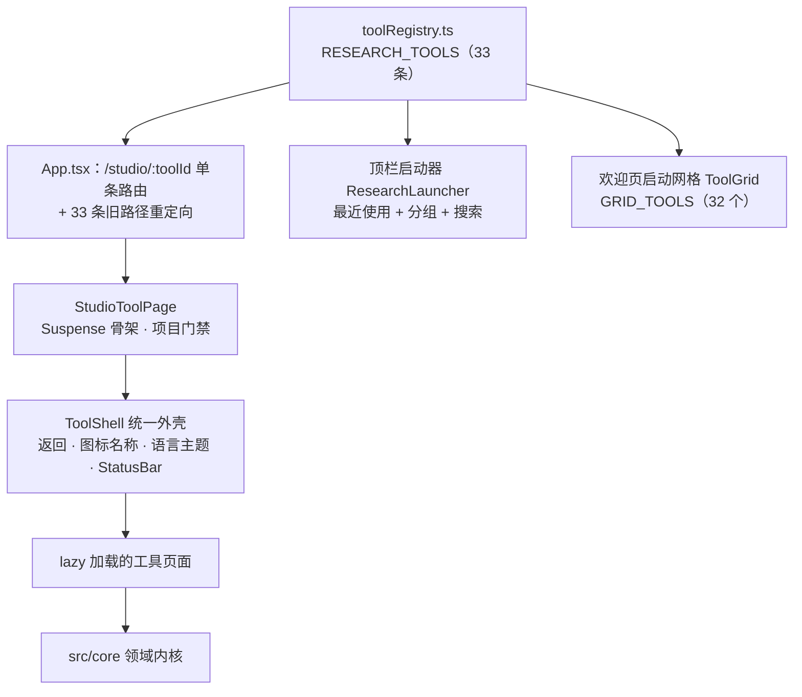

Fields of a `ResearchTool` record:

| Field | Meaning |
| --- | --- |
| `id` | Stable identifier and the path segment in `/studio/<id>` |
| `path` | Canonical route `/studio/<id>`, derived from id |
| `legacyPath` | Pre-redesign hash path (default `/<id>`), retained as a client-side redirect so old bookmarks remain valid |
| `icon` | `ToolIconKind` icon type |
| `titleKey` / `descKey` | i18n keys; description defaults to `tool.<id>.desc` |
| `group` | One of seven discipline groups |
| `inGrid` | Whether shown in the welcome launch grid and top-bar launcher (default yes) |
| `requireProject` | Whether to render the `EmptyProject` gate when no project is active (default no) |
| `component` | Page component wrapped in `React.lazy`, one separate chunk per tool |

Related exports: `GRID_GROUPS` (display order of seven groups), `GRID_TOOLS` (the grid subset, 33 minus 1 = **32**), `getTool(id)`, `TOOLS_BY_LEGACY_PATH`, and `openToolEmbedded` (open the tool in the central canvas of Standard mode: switch to Standard, record the embedded tool id in appStore, and navigate to `/workbench` if needed).

**Routing.** `App.tsx` declares only six explicit routes: `/` (welcome), `/workbench`, `/studio/:toolId` (all research tools), `/settings`, `/plugin/:pluginId`, and `/share/:payload`; everything else falls back to welcome. Redirects for 33 legacy paths are **generated automatically** from `RESEARCH_TOOLS` at module load, so their number always matches the registry and no manually maintained redirect table exists. The app uses `HashRouter`, so deep links look like `#/studio/uncertainty`.

**Project gate.** `StudioToolPage` does three things: provide a `Suspense` skeleton for lazy pages; restore the most recent project **once** on deep links or cold starts (matching the workbench); and, for tools declaring `requireProject`, render `EmptyProject` with explicit “new / open” actions when no project is active, instead of automatically creating an empty project and surprising users arriving through deep links. An unknown `toolId` renders `EmptyState` (“tool does not exist”), rather than a blank page or error.

**Shell.** All tool pages share `ToolShell`: the top has a return-to-workbench action, tool icon and name (with an optional tool-specific action area on the right), plus settings, language, and theme controls; the body contains the tool's content (centered column, page-level scrolling); the bottom uses the same persistent `StatusBar` as the workbench, showing GPU / WASM / storage status and frame rate. Tabs embedded in the workbench central area are determined by route and render only the tool body and a compact action bar (the workbench supplies the top and status bars), for a consistent experience. Visiting a tool page itself counts as recent use for launcher ordering.

## II. 33 tools in seven groups {#二、七个分组的-33-个工具}

The discipline groups are mutually exclusive and exhaustive. The following is the complete registry list (names and purposes are taken from the actually published Chinese i18n text):

| Group | Tool id | Name | Route | Purpose | Requires project |
| --- | --- | --- | --- | --- | --- |
| **Measurement and evaluation** (2) | `uncertainty` | Uncertainty suite | `/studio/uncertainty` | Bootstrap / Monte Carlo propagation / MCMC confidence intervals and convergence diagnostics | |
| | `profiler` | Data profiler | `/studio/profiler` | Column profiling, correlation matrix, quality score and issue list | |
| **Modeling and inference** (4) | `model-lab` | Model workbench | `/studio/model-lab` | OLS / logistic / ridge / polynomial regression + coefficient tables + residual diagnostics | |
| | `inference` | Bayesian inference | `/studio/inference` | HMC/NUTS Bayesian inference + WAIC/LOO/PPC | |
| | `model-inference` | Model inference | `/studio/model-inference` | In-browser WebGPU inference for ONNX models | |
| | `sweeps` | Parameter sweeps | `/studio/sweeps` | Grid / list / Latin hypercube sweeps + response surface | ● |
| **Data and lineage** (9) | `sql` | SQL data workbench | `/studio/sql` | Run DuckDB-WASM SQL directly against project data files | ● |
| | `lineage` | Data lineage | `/studio/lineage` | File → run DAG lineage graph | |
| | `etl` | ETL pipeline | `/studio/etl` | Immutable filter / map / join / group / pivot steps with per-step statistics, exporting pandas, dplyr or SQL | |
| | `schema` | Schema inspector | `/studio/schema` | Column typing, regex fingerprints, key and dependency candidates, JSON Schema export and drift checks | |
| | `synth` | Synthetic data | `/studio/synth` | Seeded marginal fitting and Gaussian-copula synthesis with AR(1) time series and ε-DP privacy | |
| | `figures` | Figure workbench | `/studio/figures` | Figure Studio publication-grade multi-panel figures | ● |
| | `analysis` | Data analysis | `/studio/analysis` | Quick plots + descriptive statistics + t / Mann–Whitney tests | |
| | `cleaning` | Data cleaning wizard | `/studio/cleaning` | Guided table transformation, cleaning, and deduplication | ● |
| | `files` | File explorer | `/studio/files` | Browse directories and file contents in the project workspace VFS | ● |
| **Signals and records** (3) | `signal` | Signal lab | `/studio/signal` | FFT / Welch PSD / window functions / Savitzky–Golay / ACF-PACF / seasonal decomposition | ● |
| | `notebook` | Notebook | `/studio/notebook` | Reproducible experiment records with Markdown + Python cells | ● |
| | `runs` | Experiment records | `/studio/runs` | Run history ledger, automatic recording, and A/B comparison | |
| **Reporting and reproduction** (5) | `report` | Report builder | `/studio/report` | Narrative + figures + tables + interactive filters → self-contained HTML | ● |
| | `reprolock` | Reproducibility lock | `/studio/reprolock` | repro.lock import/export + drift checks + one-click reproduction | |
| | `supplement` | Supplement packaging | `/studio/supplement` | Paper-attachment ZIP: manifest + runs + lineage + data/code + optional repro.lock | |
| | `course` | Course mode | `/studio/course` | Assign, collect, and grade work offline | ● |
| | `gallery` | Project gallery | `/studio/gallery` | Browse and reopen reproducible work | |
| **Writing and publication** (4) | `latex-editor` | LaTeX editor | `/studio/latex-editor` | Structured manuscript model, journal templates and dependency-free live preview | ● |
| | `citation-manager` | Citation manager | `/studio/citation-manager` | BibTeX parsing and deduplication, DOI metadata resolution, citation styles and CITATION.cff | ● |
| | `collab-notebook` | Collaborative notebook | `/studio/collab-notebook` | Serverless RGA CRDT text with BroadcastChannel sync between tabs | ● |
| | `preprint` | Preprint packaging | `/studio/preprint` | arXiv-ready ZIP: main .tex, bibliography, figures, repro.lock, badge and CITATION.cff | ● |
| **Toolbox** (6) | `unit-convert` | Unit conversion | `/studio/unit-convert` | Convert units for common physical dimensions | |
| | `calc` | Calculator | `/studio/calc` | Scientific calculator | |
| | `format-convert` | Format conversion | `/studio/format-convert` | Convert data file formats | |
| | `sigfig` | Significant figures | `/studio/sigfig` | Round and represent significant figures | |
| | `molar-mass` | Molar mass | `/studio/molar-mass` | Calculate molar mass from chemical formulas | |
| | `quick-stats` | Quick statistics | `/studio/quick-stats` | Paste-and-calculate descriptive statistics | |

Total: measurement and evaluation 2 + modeling and inference 4 + data and lineage 9 + signals and records 3 + reporting and reproduction 5 + writing and publication 4 + toolbox 6 = **33**. Thirteen require a project (`sweeps`, `sql`, `figures`, `signal`, `notebook`, `report`, `course`, `cleaning`, `files`, `latex-editor`, `citation-manager`, `collab-notebook`, `preprint`). `analysis` is excluded from the launch grid (`inGrid: false`) because it also has a separate workbench top-bar button, avoiding duplicate entries, so the grid shows 32 tools. All six toolbox tools work without a project.

### 2.1 Measurement and evaluation {#_2-1-测量与评估}

- **Uncertainty suite (`uncertainty`)** turns “how certain is this number?” into something computable. It provides Bootstrap confidence intervals, Monte Carlo propagation, and MCMC sampling, with convergence diagnostics including R-hat, effective sample size ESS, HDI, and MCSE. When the sample size is large enough it automatically switches to a WGSL GPU engine (one workgroup per chain); below the threshold or without a device it falls back to CPU. With the same random-number sequence, results agree within numerical tolerance (kernel details in article 07).

*The uncertainty suite produces percentile confidence intervals with Bootstrap resampling, combining Monte Carlo propagation and MCMC with diagnostics such as HDI, R-hat, ESS, and MCSE.*

- **Data profiler (`profiler`)** examines data health in one streaming pass: numeric columns use Welford's recurrence for exact mean and variance, reservoir sampling for quantiles and MAD, and modified z-scores to mark outliers; text columns use HyperLogLog for cardinality estimation and Space-Saving for Top-K. At table level it provides Pearson / Spearman correlation and duplicate rate, combining them into a deterministic 0–100 quality score and issue list, cached by content fingerprint for reopening.

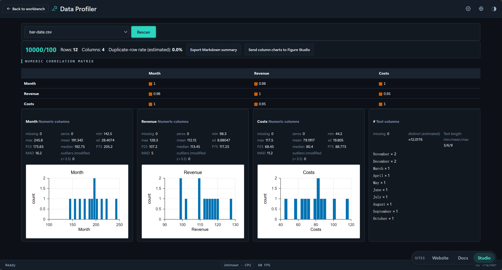

*The data profiler produces a correlation matrix, column histograms and missing-value statistics for a CSV, combining them into a deterministic 0–100 quality score and issue list.*

### 2.2 Modeling and inference {#_2-2-建模与推断}

- **Model workbench (`model-lab`)** handles fitting and diagnostics. It supports ordinary least squares (Householder QR), logistic regression (IRLS), ridge regression (K-fold cross-validation for parameter selection), and polynomial fitting. It produces a coefficient table with estimates, standard errors, p-values and confidence intervals, plus a 2×2 residual diagnostic figure (residuals–fitted, QQ, scale–location, residuals–leverage), and supports side-by-side comparison of multiple models.

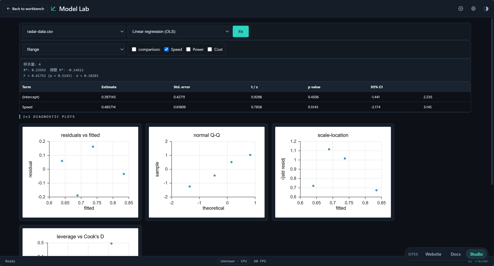

*The model workbench fits linear models with 2×2 residual diagnostics (residuals–fitted, QQ, scale–location, residuals–leverage); the coefficient table includes estimates, standard errors, p-values and confidence intervals.*

- **Bayesian inference (`inference`)** is Inference Forge. It provides HMC / NUTS samplers (NUTS uses a U-turn criterion and Dual Averaging step-size adaptation, so no manual step count is required), declarative likelihood templates with weak priors scaled to the data, posterior diagnostics including R-hat and bulk / tail-ESS, and WAIC / PSIS-LOO model comparison.

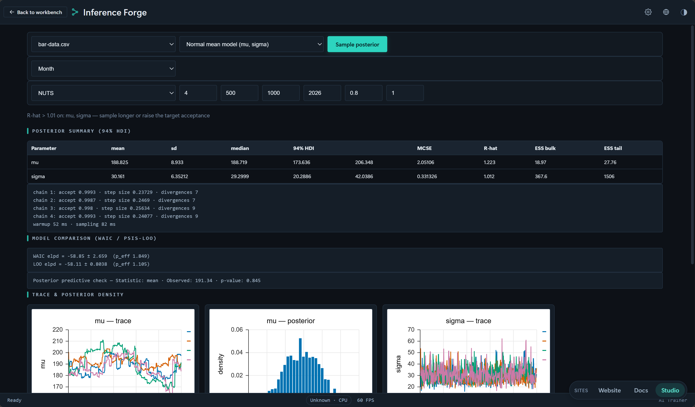

*Inference Forge runs NUTS sampling in the browser (WebAssembly) and provides a complete convergence picture: posterior summaries with 94% HDI, MCSE, R-hat and ESS, per-chain diagnostics, WAIC / PSIS-LOO model comparison, posterior predictive checks, and trace and posterior-density plots.*

- **Model inference (`model-inference`)** brings trained models into the browser: run an ONNX model with WebGPU and inspect inference results, for cases where “the model is trained elsewhere and the conclusion must be reproduced here.”

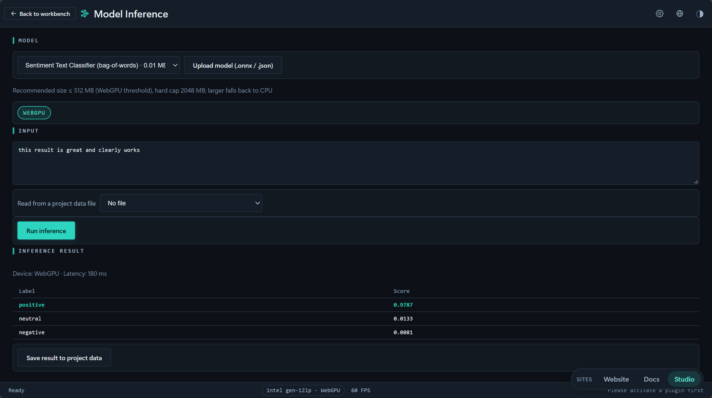

*Model inference runs an ONNX sentiment classifier with WebGPU in the browser and reports per-sample predictions, confidence, and end-to-end latency.*

- **Parameter sweeps (`sweeps`)** use `expandPlan` to expand a sweep plan into deterministic design points: all-grid / list axes use the full Cartesian product, while all Latin hypercube axes use stratified sampling by dimension. Plans mixing lhs and grid are explicitly rejected because sample count has no unambiguous definition in that case. A response surface is available after execution.

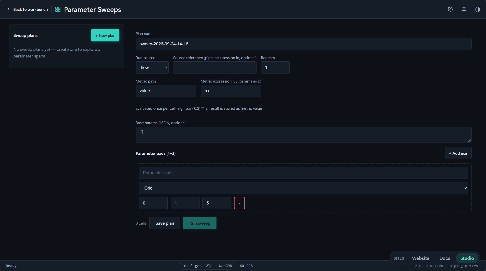

*Parameter sweeps expand plans into deterministic design points (full grid / Latin hypercube stratified sampling by dimension); the response surface can be viewed after execution.*

### 2.3 Data and lineage {#_2-3-数据与谱系}

- **SQL data workbench (`sql`)** uses DuckDB-WASM, lazy-loaded on first use. Project data files are registered in DuckDB's virtual file system and exposed directly as tables, so SQL can query files in `.clproj`. Queries support timeouts and `AbortSignal`; aborting or timing out terminates the Worker and discards the singleton, rebuilding it on the next call so a runaway query cannot overwhelm the page.
- **Data lineage (`lineage`)** connects project files (sources) to runs (transformations) by file id on run records and draws a Sugiyama-style layered DAG (longest-path layering, single-pass barycenter ordering, centered rows). The domain layer has no React / store / DOM dependencies, and the canvas is independently testable.
- **ETL pipeline (`etl`)** builds an explicit, serializable transform pipeline on top of the immutable `EtTable` model: CSV / JSON ingestion with type inference, then filter, map, reduce, join, groupBy, pivot, melt, impute, normalize and coerceType steps. Every step returns a new table, so the pipeline is deterministic and unit-testable; the runner records row counts and wall-clock time per step, and the same step list can be exported as pandas, dplyr or SQL.
- **Schema inspector (`schema`)** covers what the profiler deliberately leaves out: date / datetime typing, regex fingerprints of fixed-format strings, primary-key candidates, functional dependencies (A → B) and numeric correlations. It emits draft-07 JSON Schema, validates rows with error / warning grading, diffs schema drift, and serialises data contracts. Like all `src/core` kernels it uses no clock or randomness, so identical input yields identical output.
- **Synthetic data (`synth`)** generates shareable data without exposing the original: seeded marginals (normal / lognormal / uniform / exponential chosen by minimal KS statistic, categorical and boolean by frequency), multivariate Gaussian-copula synthesis with PSD-corrected correlations and Cholesky sampling, AR(1) time-series mode, and Laplace ε-differential-privacy noise. The seed alone replays a dataset bit-for-bit.

- **Figure workbench (`figures`)** creates publication-grade multi-panel figures. `FigureSpec` is a multi-panel container on a journal-template grid (IEEE / Elsevier column widths, colorblind-friendly palette); `composeFigure` renders one standalone SVG (nested panel viewports and a / b / c labels); `exportFigure` handles SVG / PDF / PNG-600dpi downloads. Composition only resizes and never modifies the original `PlotSpec`.

*The figure workbench arranges a 2×3 eigenvalue mode-field figure on an IEEE single-column template, with per-panel layout, shared color scale, pre-submission checks, and SVG / PDF / 600dpi PNG export.*

- **Data analysis (`analysis`)** is a general entry point for hypothesis tests, correlation and basic statistics: the t-test family, one-way ANOVA, Mann-Whitney U, chi-square test of independence, Cohen's d, and Bonferroni and Benjamini-Hochberg multiple-comparison corrections. Results can be rendered directly as publication-grade Chinese and English sentences.
- **Data cleaning wizard (`cleaning`)** provides step-by-step guidance. Its step model contains five serializable operation types: type conversion, missing-value policy (delete / mean / median / zero / forward fill), outlier marking (IQR / z-score), deduplication, and column renaming. No step ever rewrites the input table, so users can advance, go back, jump, or “undo this step”; the quality expectation contract is provided by `data-quality` (see article 07).

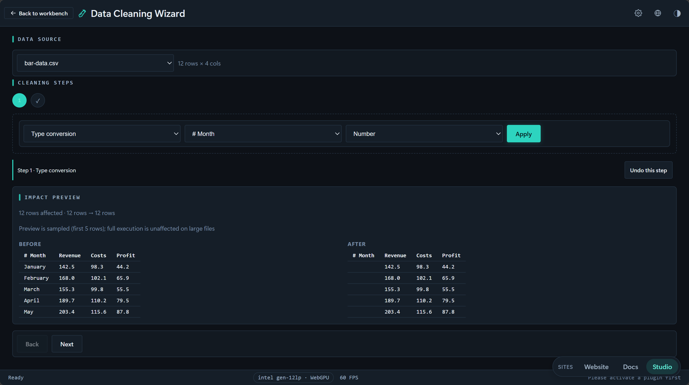

*The cleaning wizard uses step cards for type conversion, missing-value handling, deduplication, and column renaming, previewing before/after differences at each step without rewriting the original table.*

- **File explorer (`files`)** answers “where are my run records, figures and scripts stored?” It directly browses the project workspace through the Git-independent VFS (`src/core/vfs/`): a lazily loaded directory tree on the left and previews with downloads for UTF-8 text (md / txt / json / csv / code, etc.) on the right; other files are treated as binary. The page also includes a static directory guide to the standard project skeleton (`project.clproj`, `runs/`, `figures/`, `data/`, `code/`, `manuscript/`, `.ergalics/`, `.git/`, etc.), with one-line descriptions.

### 2.4 Signals and records {#_2-4-信号与记录}

- **Signal lab (`signal`)** handles spectra, filtering and time-domain processing. It offers radix-2 FFT and amplitude spectra (mathematically consistent with the GPU `fftKernelWGSL`), Hann / Hamming / Blackman and other windows, Welch power spectra, Savitzky-Golay smoothing and moving averages, autocorrelation ACF and partial autocorrelation PACF, and classical additive time-series decomposition x = trend + seasonality + residual. Filtered columns can be saved back as derived project files and automatically enter the lineage graph.

*The signal lab analyzes an acceleration time series: the Welch PSD (rectangular window, nfft=256, 7 segments) has a main peak around 0.02 Hz with harmonics. It supports FFT amplitude spectra / windows / filtering and time-domain processing, and can send plots to Figure Studio or save them back to project files.*

- **Notebook (`notebook`)** is a reproducible experiment record mixing Markdown and Python cells. Execution uses the same Pyodide runtime as Code mode, so notebooks and scripts see the same `studio` API; the cell list is persisted in `project.state.notebook`.
- **Experiment records (`runs`)** form a run ledger across all tools. Every execution of Flow, Block, Code, notebook, sweeps, uncertainty, modeling, and inference automatically leaves a durable snapshot (parameters, metrics, duration, source), with metric differences and paired A/B comparison. Records live in IndexedDB's `runs` store and are **not** written into `.clproj`, keeping project files small; they are cleaned up when the project is deleted.

### 2.5 Reporting and reproduction {#_2-5-报告与复现}

- **Report builder (`report`)** uses `buildReport` to build ordered sections (headings, Markdown, figures from the figure workbench, data tables, run summaries, interactive filters) into **one self-contained HTML file**: inline CSS, inline SVG, inline JSON data, and a zero-dependency native-JS controller. All user strings are escaped first; embedded JSON is emitted as `` payload escape, so the report can safely be sent directly to others.

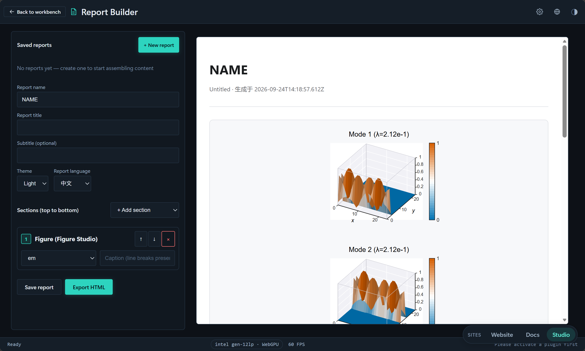

*The report builder combines headings, multi-panel figures, data tables and run summaries into one self-contained HTML file with a zero-dependency controller, suitable for safe delivery.*

- **Reproducibility lock (`reprolock`)** exports and validates `repro.lock`: data fingerprints, parameter hashes, seeds and code snapshots support five categories of drift checking and one-click reruns. An environment snapshot (version, platform, kernel availability) is also included so it is clear whether drift occurred in data or environment.

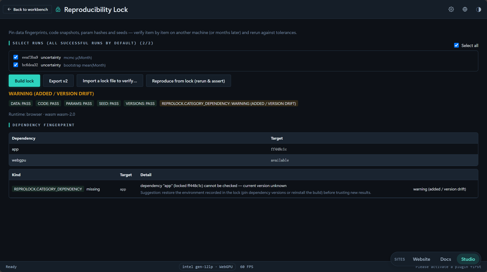

*The reproducibility lock checks data fingerprints, parameter hashes, seeds and code snapshots and includes an environment snapshot to determine whether drift occurred in data or environment.*

- **Supplement packaging (`supplement`)** uses fflate to package `manifest.json` (project metadata, run records, lineage graph, author and license forms), optional raw data files and code sessions, and an optional repro.lock into a ZIP researchers upload with a paper.

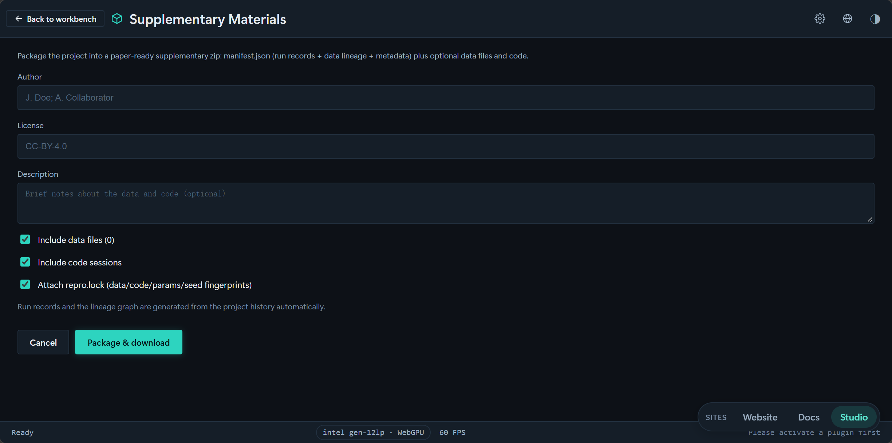

*Supplement packaging uses fflate to bundle the manifest, raw data and code sessions into a ZIP for uploading with a paper.*

- **Course mode (`course`)** is a local-first teaching loop: a teacher creates a course (identified by a local identity string, with no account system) and publishes assignments bound to discipline templates; students claim tasks, work in projects and submit `repro.lock` snapshots of run results; the teacher views a student × assignment matrix, records grades and comments, and exports the whole class as a package with one directory per student. Data is persisted in IndexedDB's `courses` store.

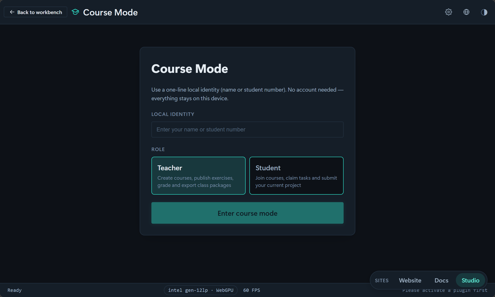

*Course mode implements a local-first loop of teacher assignments, student repro.lock snapshot submissions, grading, and class-wide export.*

- **Project gallery (`gallery`)** uses local “My Shares” storage (localStorage) to record metadata for shared work and sanitized snapshot HTML, allowing details dialogs to reopen offline. v1 uploads nothing; delisting only marks the item (preserving an audit trail) and filters it from all lists.

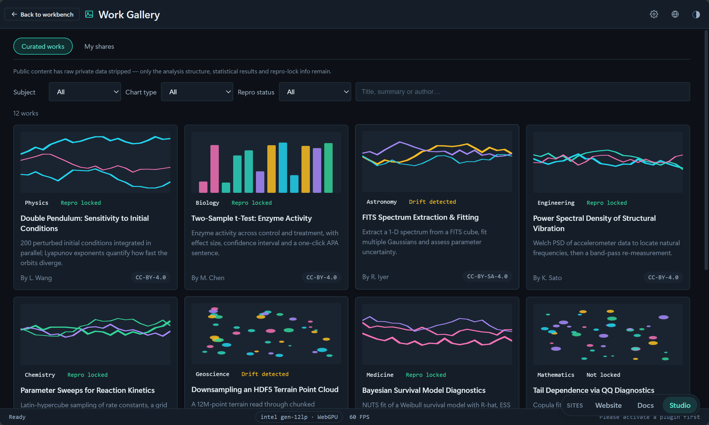

*The gallery displays reproducible works by discipline, each marked with topic, reproducibility-lock state (locked / drift detected / unlocked), author and license for discovery and citation.*

### 2.6 Writing and publication {#_2-6-写作与发表}

- **LaTeX editor (`latex-editor`)** edits a structured `LatexDocument` rather than raw source: sections, paragraphs, inline / display maths, figures, tables, lists, verbatim blocks, `\cite` and `\ref`. `renderLatex()` emits a complete compilable `.tex` file, while `latexPreview()` renders the same model to dependency-free HTML with KaTeX, so authors get live feedback without a TeX distribution. Journal templates supply preamble, column widths and figure sizing.
- **Citation manager (`citation-manager`)** parses BibTeX tolerantly (braced entries, parenthesised entries, quoted values, `#` concatenation, brace-protected capitalisation), detects duplicates, and resolves DOI metadata through the CSL-JSON content-negotiation endpoint (`doi.org` → Crossref / DataCite). It renders citation styles from the same normalised `BibEntry` model used by the LaTeX editor, so the manuscript bibliography and the manager cannot disagree, and exports `CITATION.cff`.
- **Collaborative notebook (`collab-notebook`)** is a serverless real-time editor built on a pure-TypeScript RGA CRDT: every character carries a globally unique id and an insertion reference, concurrent inserts are ordered by `(logical clock, site)`, and deletes leave tombstones, so replicas converge without a central server. `BroadcastChannel` synchronises same-origin tabs, and the snapshot format can be relayed by any transport later.
- **Preprint packaging (`preprint`)** assembles exactly the file set arXiv expects — `main.tex`, bibliography, figure assets and optional metadata — together with the studio's reproducibility artifacts (`repro.lock`, a reproducibility badge and `CITATION.cff`), as a local ZIP. Nothing is uploaded.

### 2.7 Toolbox {#_2-7-工具箱}

Six lightweight tools, none requiring an open project, cover common small research tasks:

- **Unit conversion (`unit-convert`)** converts units for common physical dimensions using the same conversion kernel as the global unit system (see chapter V).

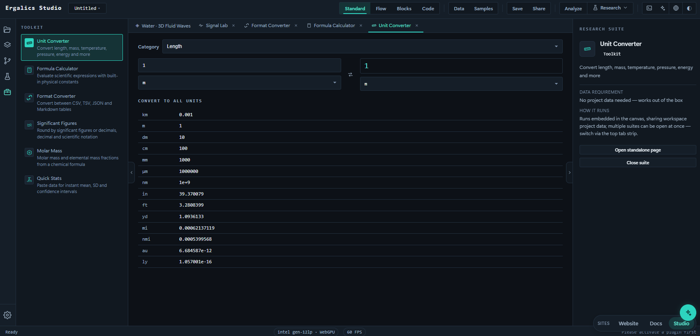

*Unit conversion produces a table converting length in meters to all common units.*

- **Calculator (`calc`)** is a scientific calculator supporting expression evaluation.

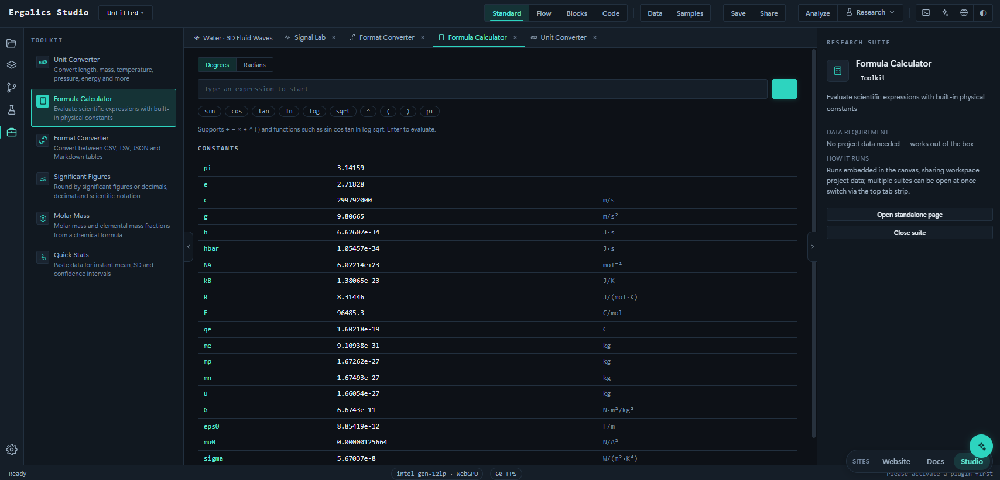

*The scientific calculator evaluates an expression containing physical constants and displays the result.*

- **Format conversion (`format-convert`)** converts among supported tabular and scientific data formats.

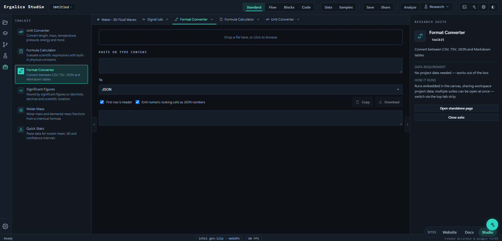

*Format conversion works between CSV, JSON and other tabular and scientific data formats.*

- **Significant figures (`sigfig`)** rounds and represents values according to significant-figure rules.

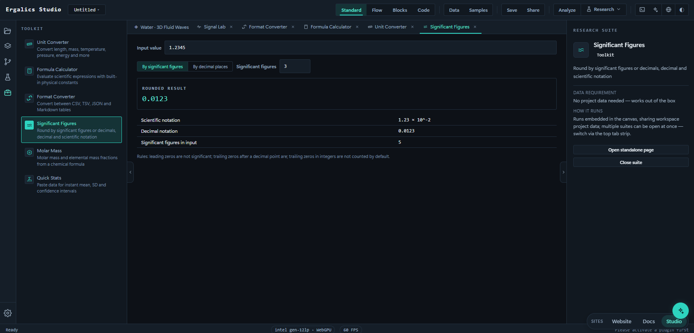

*Significant figures applies rounding rules and expresses the result in scientific notation.*

- **Molar mass (`molar-mass`)** computes molar mass from a chemical formula.

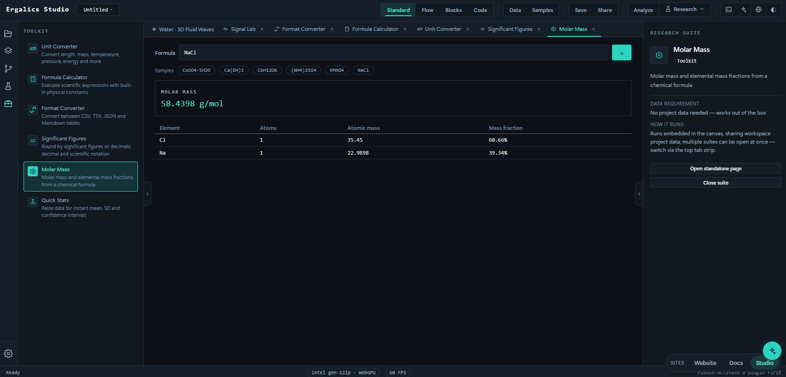

*Molar mass calculates 58.44 g/mol from NaCl and lists elemental proportions.*

- **Quick statistics (`quick-stats`)** calculates descriptive statistics such as mean and standard deviation from a pasted column, with one-click access to the uncertainty suite for interval estimation.

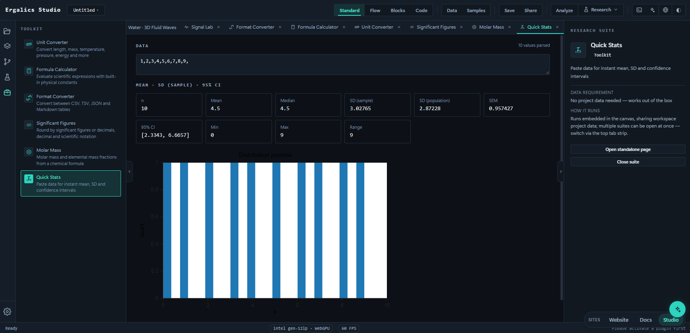

*Quick statistics computes mean, SD and confidence intervals from a pasted column.*

## III. Entry points and navigation {#三、入口与导航}

The same registry drives several entry points with consistent behavior:

| Entry | Behavior |
| --- | --- |
| Welcome launch grid (`/`, `ToolGrid`) | Displays 32 tool cards in seven groups with a filter box; searching flattens groups into one list. Clicking records use and opens the tool embedded in the workbench central area through `openToolEmbedded`. |
| Top-bar research launcher (“科研▾” in the workbench, `ResearchLauncher`) | A “recently used” group at the top (latest 3, with badges), then all tools grouped by discipline; each shows an icon, name and one-line description so it can be recognized before opening. Supports filtering and full keyboard navigation. Selection opens the tool embedded in the workbench central area by default. |
| Command palette and sidebar | Both consume the registry and open selected tools embedded. |
| Legacy redirects | Pre-redesign bookmarks such as `#/uncertainty` are sent to `#/studio/uncertainty` by automatically generated redirects. |
| Standalone full page | Any tool can be opened as a standalone page through the right panel's “独立页面打开” action or a `/studio/<id>` deep link; its shell is consistent with the embedded state. |

Recent use is maintained by `src/core/recentTools.ts` in localStorage (key `ergalics:recent-tools`), retaining at most 8 entries while the UI displays only the first 3—the extra room prevents trimming from ever leaving an empty slot.

## IV. Flow between tools {#四、工具之间的流转}

Tools are separate pages, but **not islands**. They collaborate through three shared channels, which is the practical reason for placing all 33 capabilities under one registry:

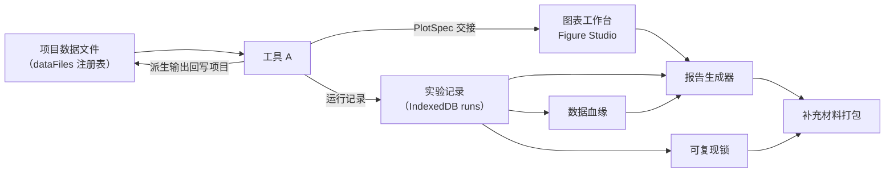

| Channel | Mechanism |
| --- | --- |
| Shared data-file registry | `src/core/dataFiles.ts` gives project-owned files, built-in examples and Code mode `_FILES` the same resolution logic. `src/pages/research/researchUi.ts` is thin glue above this layer (no React dependency), responsible for “load a table and identify numeric columns,” “send a PlotSpec to the figure workbench,” and “assemble derived output as CSV and save it back to the project.” Thus cleaning results can be read directly in the signal lab, and filtered columns can then be fitted in the model workbench. |
| PlotSpec handoff | Every tool's plot uses the same `PlotSpec` structure and can be received by the figure workbench as one panel, reusing journal templates, panel labels and vector export. Research-grade workbench plugins likewise use “Send to Figure Studio” to push multi-panel figures into the figure workbench (see article 03). |
| Experiment records as backbone | Every execution enters the `experiment` ledger; lineage uses it to connect files and runs into a DAG; the report builder then takes run summaries from it. Reproducibility in the toolset is therefore not a few isolated features, but a data flow spanning every tool. |

## V. Supporting kernels {#五、配套内核}

Under the tool pages is a set of domain kernels (`src/core/`) decoupled from specific tools and reused by multiple tools and plugins:

- **Unit system (`units`)**: the Quantity / convert / check trio constructs dimensional quantities, performs dimension-safe conversions, and checks unit consistency. The unit-conversion tool and plugins needing units share the implementation.
- **Chunked reading (`chunked`)**: row-window reading and content fingerprints for large files, providing a memory-conscious ingestion path for profiling, cleaning and file routing.
- **Figure engine (`figure`)**: a `FigureSpec` multi-panel container on journal-template grids (`JOURNAL_TEMPLATES`: IEEE / Elsevier single- and double-column sizes, Okabe-Ito colorblind-friendly palette, millimeter column-width conversion); `composeFigure` outputs one standalone SVG (nested per-panel viewports + a/b/c labels), and `exportFigure` handles SVG / PDF / 600dpi PNG downloads. The figure workbench also supplies pre-submission checks, bilingual caption drafting and 3D field panels. Composition only resizes and never modifies the original `PlotSpec`.
- **Run → lineage → attachment chain**: the `experiment` ledger records parameters, metrics and duration for every execution; `lineage` connects sources and transformations into a DAG by file id; `supplement` packages manifest, run records, lineage, data and code into a paper-attachment ZIP; `repro.lock` drift checking and one-click reproduction run throughout.

## VI. Summary {#六、小结}

The 33 tools cover the entire path from data ingestion to paper delivery: **measurement and evaluation** answers “how certain is the result”; **modeling and inference** asks “what conclusion does the data support”; **data and lineage** asks “where did the data come from and what changed”; **signals and records** asks “was the process fully recorded”; **reporting and reproduction** asks “can someone else rerun it unchanged”; **writing and publication** turns results into a manuscript and an arXiv-ready package; and the **toolbox** handles common small tasks such as unit conversion, rounding and quick lookup. They share the same project, data files, `src/core` kernels and plugin rendering path, so context is preserved when moving from workbench to toolset or back.

For the algorithmic kernels, dependencies and export formats behind each tool, see article 07, *Scientific Computing Subsystems*. For how testing and gates constrain the run-record, lineage and reproduction chain, see article 08, *Testing and Quality Assurance*.
