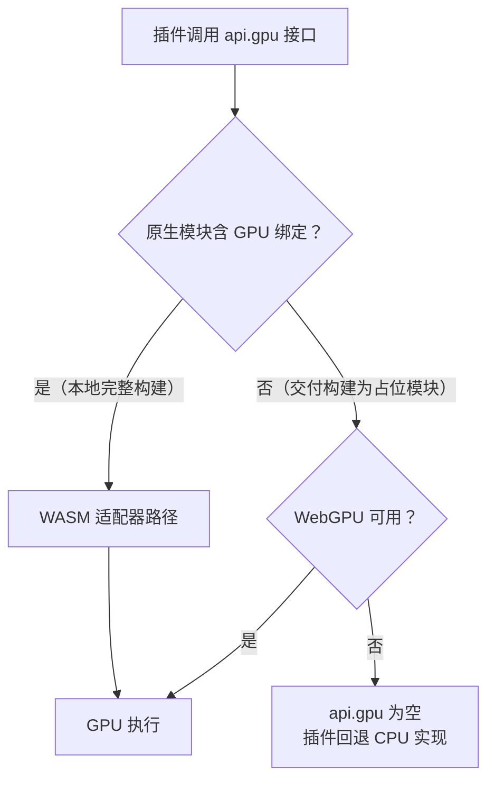
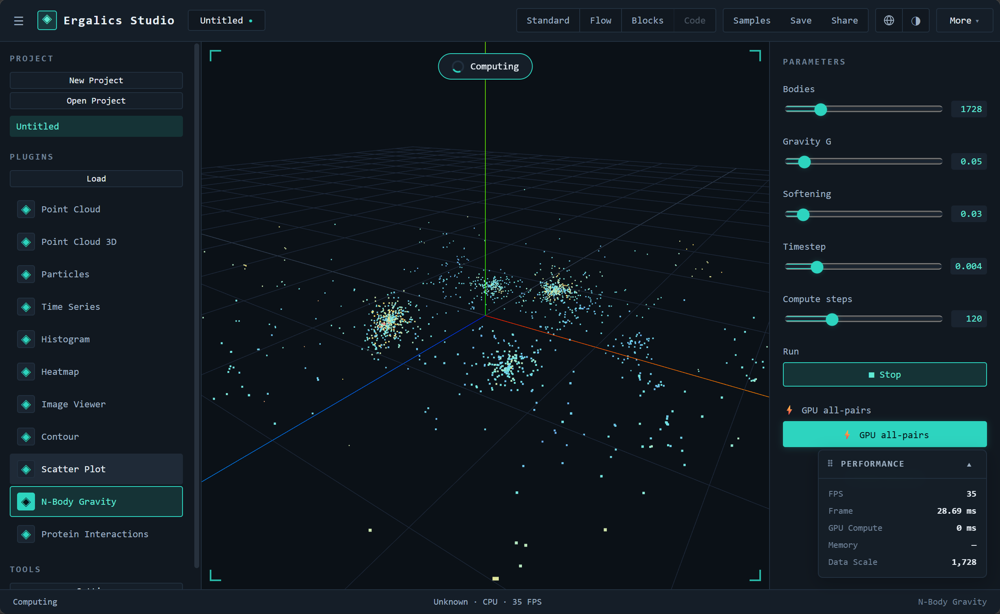
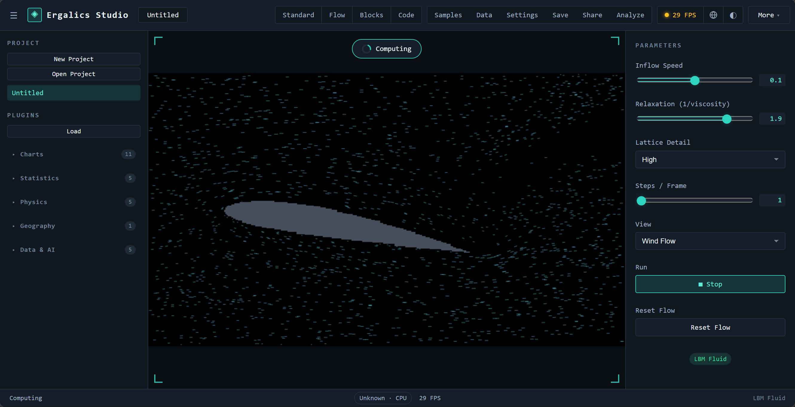

# 06 GPU Computing and the Native Core

Ergalics Studio's compute acceleration has two layers: the Rust native core **delivered as source** with the repository (`native/ergalics-core`), and host-side compute services (`src/core/gpu.ts`, `src/core/compute.ts`, `src/core/wgsl.ts`). The delivery distinction must be clear: the Web build shipped with the release **does not contain Rust compilation artifacts**. CI and the default Web build produce a functional placeholder module using the stub generator (`scripts/make-wasm-stub.mjs`); all actual runtime computation uses **browser-native WebGPU**, with progressive fallback to a pure CPU path that is mathematically consistent with the GPU kernels when WebGPU is absent.

## I. Rust native core (source delivery) {#一、rust-原生核心-源码交付}

`native/ergalics-core` (crate version 0.1.0, edition 2021, `crate-type = ["cdylib", "rlib"]`) targets `wasm32-unknown-unknown` and is bound to `src/native` through wasm-bindgen 0.2. WebGPU bindings depend on web-sys's experimental GPU API surface (approximately forty features explicitly enabled, including GpuAdapter, GpuDevice, GpuBuffer, GpuComputePipeline, and GpuBindGroup). Dependencies are wasm-bindgen, wasm-bindgen-futures, js-sys, web-sys, console_error_panic_hook, serde, and serde_json; the release profile enables `lto`, `codegen-units = 1`, and `opt-level = 3`. Rust source is divided into five modules by responsibility:

| Source file | Responsibility |
| --- | --- |
| lib.rs | Public exports, version query (`core_version`), and initialization |
| device.rs | GpuDeviceManager and GpuInfo: adapter and device acquisition, `webgpu_available` detection, and a CPU fallback option |
| buffer.rs | GpuBuffer: create storage / read-only / uniform buffers with explicit usage masks, upload with write, and read back through a dedicated readback buffer with read |
| compute.rs | KernelDescriptor and BindingDescriptor, ComputeKernel compilation, bind-group materialization and dispatching, and ComputeQueue wrapper |
| utils.rs | Helpers such as detect_file_kind (magic-number-based file type detection) and logging |

The crate is delivered as source with the repository and can be compiled locally; it does not participate in the production compute path. Release builds generate a placeholder module (see section V), and browser-native WebGPU performs the actual computation.

## II. Host-side compute services {#二、宿主侧计算服务}

`src/core/gpu.ts` owns adapter and device lifecycle: `initGpu(mode)` (supports `auto` and `cpu-fallback`, with concurrent-request coalescing and epoch guards to prevent an in-flight initialization from overriding an explicit device release), `getGpuBackend` / `resetGpu` / `subscribeGpu`. Backend state `GpuBackend` tracks availability, adapter information (vendor / architecture, etc., read through `adapter.info`), the device reference, CPU fallback flag, and out-of-memory status (`oom`, set by uncaptured device errors).

Above it, `src/core/compute.ts` is the plugin-facing compute surface (`PluginApi.gpu`): `createBuffer`, `write`, `read`, `compileKernel`, `compilationInfo`, and one-shot `run`. `getGpuCompute()` returns the compute service or `null` based on device availability; plugins fall back to CPU implementations when it is `null`. The `backend` field distinguishes execution paths: the direct native WebGPU path (`NativeCompute`, `backend = 'webgpu'`) uses `GPUDevice` directly to create buffers, compile WGSL pipelines, and dispatch, routing read-only buffers to direct `mapAsync` mapping or a `COPY_SRC → MAP_READ` readback copy according to usage. When a local build compiles a real native module, the `WasmCompute` adapter (`backend = 'wasm'`) forwards through `src/native` bindings using the same interface. Both paths expose exactly the same primitives:

> When WebGPU is unavailable, `api.gpu` is `undefined` and plugins fall back to CPU implementations—behavior remains consistent and no GPU is required.

This design makes accelerated computing available in both development and production: direct browser-native WebGPU is the actual compute path in release builds, and each built-in plugin's CPU fallback uses an implementation mathematically consistent with the GPU kernel.

## III. Reusable WGSL kernels {#三、可复用-wgsl-内核}

`src/core/wgsl.ts` contains reusable WGSL compute kernels and host-side packing / unpacking helpers mathematically consistent with the kernels for CPU fallback (such as `packParticles` / `unpackParticles` / `advanceParticleCPU`, `packBodies` / `unpackBodies` / `advanceNBodyCPU` and `nbodyTotalEnergy`, and `histogramCPU`). There are currently **14 kernels**:

| Kernel | Mathematics | Primary users |
| --- | --- | --- |
| particleKernelWGSL | Interleaved [x, y, vx, vy] single-buffer integration | Particles plugin |
| nbodyKernelWGSL | Direct O(N²) summation for 3D all-pairs gravity | N-Body gravity plugin |
| histogramKernelWGSL | Bin counts + logarithmic scale | Histogram plugin and statistics blocks |
| heatmapKernelWGSL | Grid scalars to color mapping (viridis stops) | Heatmap plugin |
| pointCloudKernelWGSL | Point-cloud projection and density output | Point-cloud plugin, million-point enhancement |
| fluidCollideKernelWGSL | D2Q9 lattice Boltzmann collision | Fluid plugin |
| fluidStreamKernelWGSL | D2Q9 streaming | Fluid plugin |
| fluidCurlKernelWGSL | Vorticity calculation (vortex street visualization) | Fluid plugin |
| waveKernelWGSL | 2D wave-equation leapfrog time stepping | Wave-equation plugin |
| matmulKernelWGSL | Tiled matrix multiplication (TILE = 16) | Linear algebra acceleration in domain kernels |
| fftKernelWGSL | Stage-wise radix-2 FFT (maximum N = 4096) | Signal lab |
| kmeansKernelWGSL | K-means assignment and centroid accumulation | Data profiling and clustering |
| binningKernelWGSL | Key-value bin aggregation (sum / mean / count) | Binning statistics and sweeps |
| spmvKernelWGSL | Sparse matrix–vector multiplication (CSR row-wise) | Host-side sparse linear algebra kernel library (no built-in plugin calls it directly yet; em-eigensolver instead solves with NumPy on Pyodide) |

Two typical kernel invocation paths:

1. **Single-buffer path** (particles demo): upload interleaved data and uniform parameters, dispatch the WGSL integrator, read back results, and report actual GPU time.
2. **Ping-pong buffer path** (N-Body, fluid, and wave-equation demos): paired buffers alternate reads and writes; every integration step stays entirely on the device, with no per-step readback overhead.

Step-by-step flow using N-Body as an example:

*N-Body gravity all-pairs summation on the GPU: 3D gravitational trajectories of several bodies orbiting a central mass, computed by a WGSL kernel and read back once for Three.js rendering.*

*Lattice Boltzmann fluid: WGSL derives the three D2Q9 collision / streaming / vorticity kernels at compile time and computes them step by step; the flow around the airfoil and Kármán vortex street are clearly visible. Small workloads automatically fall back to CPU.*

### 3.1 Engine selection and data-size thresholds {#_3-1-引擎选择与数据规模阈值}

The GPU's benefit comes from compute power, but upload and readback have fixed overhead, so small datasets can be slower on GPU. `src/core/gpu-kernels.ts` therefore provides a unified dispatch layer and data-size thresholds; in `auto` mode, workloads below a threshold automatically use CPU:

| Kernel | Threshold unit | Threshold |
| --- | --- | --- |
| matmul | Output element count (m × n) | 16384 (128 × 128) |
| fft | Complex sample count | 1024 |
| kmeans | Point count | 2048 |
| binning | Row count | 10000 |
| spmv | Nonzero element count (nnz) | 65536 |

Kernel descriptor binding layouts come directly from the `*_BINDINGS` constants in `wgsl.ts`, preventing drift between host descriptors and shader text. Threshold checks also incorporate live device availability (`getGpuBackend()`). On top of this, `src/core/pointcloud-gpu.ts` provides budget control, deterministic downsampling, and a WebGPU height-coloring kernel for million-point clouds; `src/core/mesh3d.ts` provides a pure-function implementation of the 3D mesh data pipeline (shared by surface/volume plugins).

### 3.2 Uncertainty WGSL engine {#_3-2-不确定度-wgsl-引擎}

The uncertainty kernel (`src/core/uncertainty`) includes two WGSL acceleration paths, both reusing the compute surface in this section:

- `gpu-engine.ts`: Percentile Bootstrap resampling on WebGPU. A fixed family of statistics (mean / median / variance / standard deviation / correlation / OLS slope) uses GPU kernels; custom JS statistics always use CPU. Resampling proceeds in chunks no larger than `blockSize` (default 65,536), reporting progress and responding to `AbortSignal` between chunks. The random source is the WGSL version of PCG32 (`PCG32_WGSL` in `pcg.ts`), sharing the same seed-sequence definition with the CPU path.
- `gpu-mcmc.ts`: Multi-chain random-walk Metropolis–Hastings. The caller supplies a WGSL log-density body (fixed dimensions baked into the kernel); after compilation, each thread carries one chain, chain state remains in buffers across dispatches, and million-step runs do not block the device or interface. The CPU path uses independent-chain parallel batches driven by mulberry32.

Engine selection (`auto` / `gpu` / `cpu`) follows the device availability rules in §3.1 and writes the selection to the run record. When GPU is unavailable it automatically falls back to CPU; for the same seed, results of the two paths agree within numerical tolerance, and convergence diagnostics (split-R-hat, ESS) are equally available for both.

## IV. End-to-end numerical verification {#四、端到端数值验证}

The GPU path is not decorative: the `verify-webgpu` end-to-end suite drives a real WebGPU path in headless Edge (the SwiftShader software adapter), validating in two stages. Stage A requests a real WebGPU device via `tests/e2e/webgpu.html`, drives the native core module interface (buffer creation, kernel compilation, dispatch, `mapAsync` readback) using real WGSL kernels from `src/core/wgsl.ts`, and compares GPU results with the CPU integrator for strict and boundary scenarios respectively (tolerances 5e-3 and 0.02). Stage B loads the particles plugin and galaxy sample in the workbench, clicks “GPU 计算,” and asserts that the success notice reports the actual engine and measured GPU time. Unit tests cover each WGSL template's generation, parameter packing, output size and CPU fallback consistency, as well as numerical comparisons between GPU and CPU paths at both kernel and domain levels.

## V. Build and fallback {#五、构建与降级说明}

The build command chain is: `npm run build` runs `build:wasm` (local Rust toolchain compiles into `src/native`) → `tsc --noEmit` → Vite production build → docs build. For frontend-only builds, use `npm run build:web`, which starts with `make-wasm-stub.mjs`: when real build artifacts are absent, this script creates a functional placeholder module (`core_version` returns `'wasm-stub'`, `detect_file_kind` falls back to extension detection, and no GPU bindings are included), ensuring the dynamically imported chunk exists at bundle time. CI environments do not install the Rust toolchain (except the deploy workflow), so **release builds run the placeholder module**.

Runtime fallback is handled by the loader in `src/core/wasm.ts`: if dynamic import fails, it retries 3 times (1 second apart) and eventually marks the module unavailable. Summary of the three paths:

| Tier | Condition | Compute path |
| --- | --- | --- |
| Local full build (optional) | Run `build:wasm` locally to compile the real module | WASM bindings path |
| Actual release build path | Build contains only the placeholder module and WebGPU is available | Browser-native WebGPU |
| Fallback path | WebGPU unavailable | CPU implementation mathematically consistent with the kernels |

At every tier, the welcome page's hardware self-check reports WebGPU, WASM, and IndexedDB availability accurately; plugins perform the same mathematics on CPU without a GPU, with consistent behavior.

### 5.1 3D scene host and missing WebGL {#_5-1-3d-场景宿主与-webgl-缺席}

3D rendering is managed centrally by the host: `createScene3D(container)` in `src/core/scene3d.ts` lazily creates a Three.js scene container and caches it per session. The host owns the rendering loop, OrbitControls, zoom, and GPU resource cleanup; plugins implement `renderToScene(scene)` (`Scene3DHandle`) to attach their meshes and lights to the scene. Only plugins declaring `renderToScene` materialize a WebGL scene on activation, so 2D plugins do not pay the WebGL context cost. When WebGL is unavailable or the 3D container is absent, affected plugins display an explicit 2D notice and continue using a 2D canvas. The AI training plugin's TF.js backend likewise falls back to CPU without WebGL—functional degradation is always explicit and observable.
