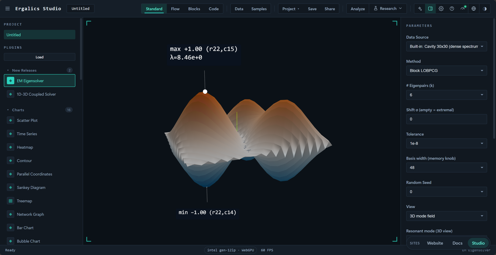
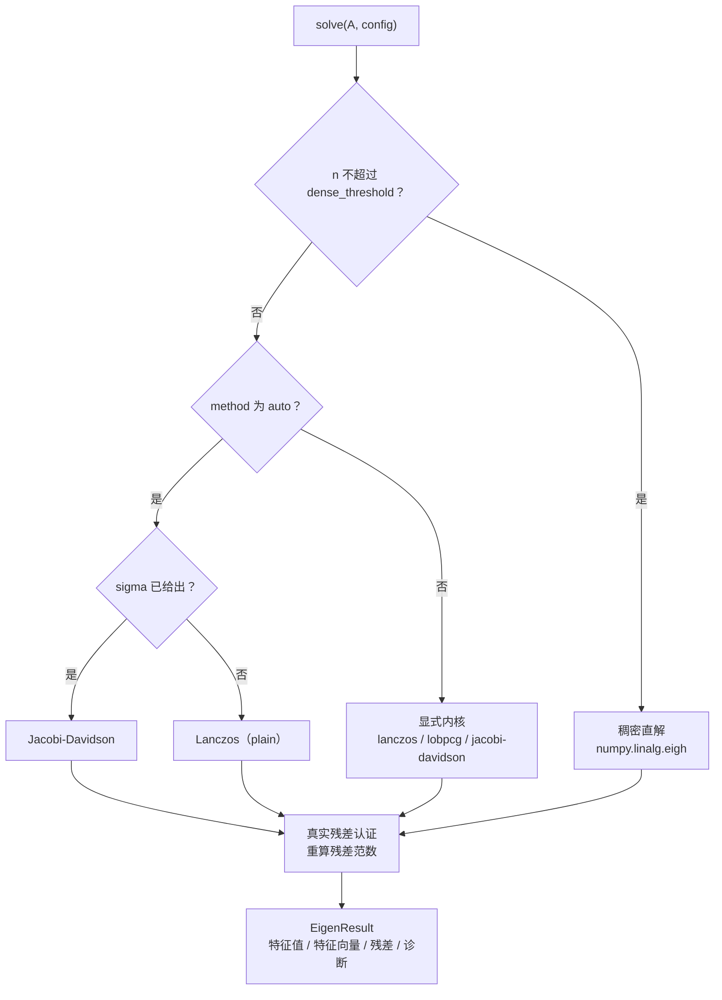
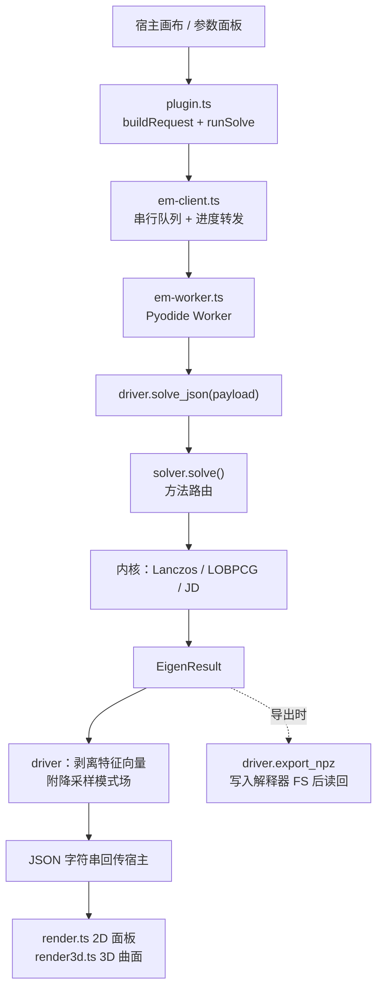
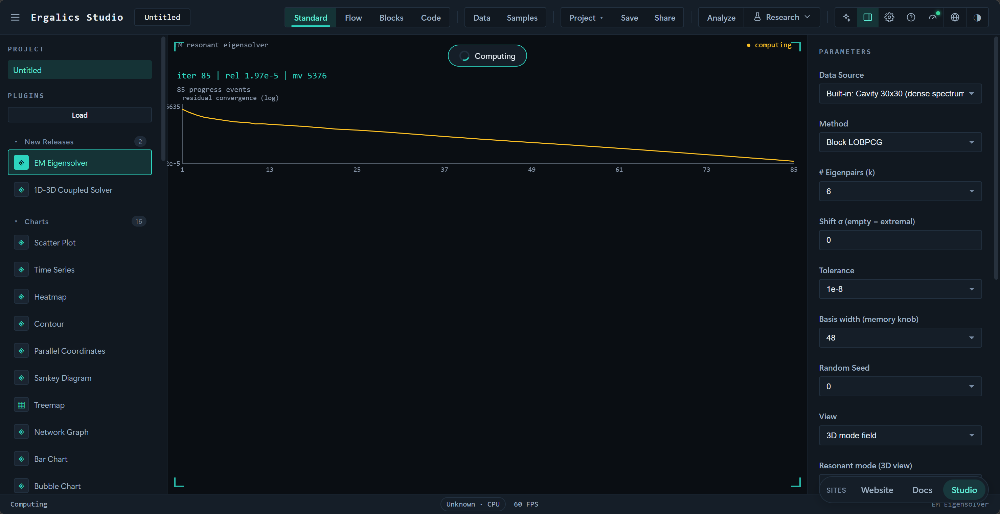
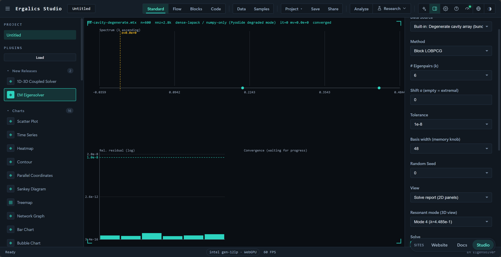
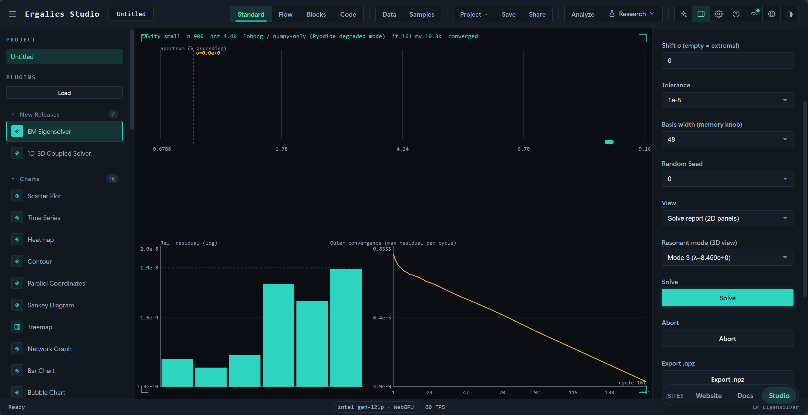
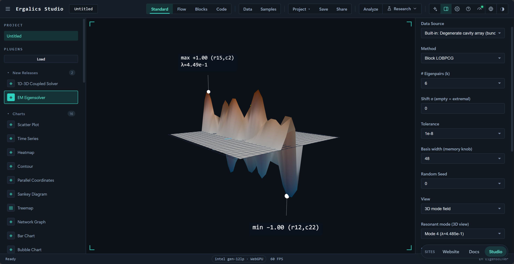

# Electromagnetic Resonance Eigensolver



*3D mode field after solving `cavity_small` (30 × 30) with block LOBPCG: spatial displacement surface for mode λ = 8.42e+0, with an Okabe-Ito diverging scale using vermilion for positive peaks and blue for negative troughs, on the rendering path described in 8.3.*

The EM Eigensolver is a built-in plugin (`src/plugins/builtin/em-eigensolver/`, registered id `example.em-eigensolver`, category “physics simulation physics,” sandbox level `trusted`) solving **large sparse indefinite Hermitian matrix eigenvalue problems** `A x = λ x` obtained by FEM or MoM discretization in microwave devices, antennas, electromagnetic compatibility and photonic crystals. The host provides a parameter panel and solve report; an independent Web Worker runs the accompanying pure Python package `em_eigensolver` in Pyodide and renders spectra, true residuals, outer-iteration convergence traces and resonance mode fields to the canvas or a Three.js scene.

The solver uses no closed-source components: core algorithms are pure Python + NumPy; SciPy, when present, is used only for more mature sparse storage and vector kernels. The flow never constructs or densifies an `n × n` operator; the only dense decomposition acts on a projected matrix no larger than `basis_dim`.

## I. Problem definition and applicability limits {#一、问题定义与适用边界}

### 1.1 From Maxwell's equations to a Hermitian eigenproblem {#_1-1-从麦克斯韦方程到厄密本征问题}

After discretization, electromagnetic resonance analysis reduces to a sparse Hermitian eigenproblem. This plugin handles the **standard form** `A x = λ x`, with `A` an `n × n` sparse Hermitian matrix (real symmetric or complex Hermitian) and `n` up to order 100,000. Material dispersion, complex boundaries such as PML, and high-/low-frequency effects make `A` indefinite; the shift `σ` for a target frequency may lie inside the spectrum, making `A − σI` nearly singular—distinguishing the plugin from tools that handle only positive-definite matrices.

### 1.2 Three difficult scenarios {#_1-2-三类困难场景}

| Scenario | Mathematical form | Failure of naive methods |
| --- | --- | --- |
| Dense spectrum near zero (low-frequency breakdown) | Many eigenvalues crowd near `σ`, even `σ = 0` | Shift-invert inner linear systems become ill-conditioned, causing exploding iteration counts or wrong results |
| Repeated eigenvalues | One eigenvalue has multiplicity (degenerate modes) | Single-vector iteration converges repeatedly to one vector and loses other degenerate modes |
| Nearly singular shift | `σ` nearly coincides with an eigenvalue | `(A − σI)⁻¹` entries become large, amplifying residuals and distorting convergence criteria |

Built-in examples cover all three: `cluster_zero` has 153 eigenvalues with `abs(λ) < 0.05` out of order 720; each eigenvalue in `degenerate_pair` has multiplicity at least two, and both default shifts lie inside the spectrum. The plugin addresses them with block iteration and deflation, adaptive shifts, and convergence criteria certified by true residuals.

### 1.3 Applicability limits {#_1-3-适用边界}

| Dimension | Supported scope | Notes |
| --- | --- | --- |
| Matrix type | Real symmetric or complex Hermitian (`A = Aᴴ`) | Non-Hermitian, nonsymmetric matrices are out of scope |
| Problem form | Standard eigenproblem `A x = λ x` | Generalized `A x = λB x` is not implemented; users must first transform using a factor of `B` |
| Size | `n` from single digits to order `1e5` | Built-in `cavity_large`: `n = 102400`, `nnz = 510720` |
| Spectrum location | Extreme eigenvalues or interior target shift | Shift specified by `σ`, with adaptive offset |
| Storage | `.mtx` (Matrix Market), `.npz` (SciPy sparse or dense archive), `.npy` (dense, size-guarded); local CPython additionally supports optional direct reads of `.h5`/`.hdf5` (h5py), `.fits` (astropy), `.nc` (SciPy NetCDF) | Dense input is immediately sparsified and accepted only if `n² ≤ 4×10⁶`; missing packages for engineering formats raise `MatrixIOError` naming the missing package |
| Runtime | CPython + NumPy (SciPy optional); browser Pyodide | CPython uses SciPy sparse storage and vector kernels; pure NumPy includes row-chunk multithreaded matvec (section VI); WebGPU SpMV is a platform-level kernel |

## II. Solver kernels {#二、求解内核}

Three iterative kernels plus a dense direct fallback are routed through `SolverConfig` and the `solve()` facade (`python/em_eigensolver/solver.py`).

| Kernel | Implementation | Recurrence and projection space | Main use |
| --- | --- | --- | --- |
| Thick-restart Lanczos | `lanczos.py` | Tridiagonal Krylov subspace, thick restart retaining `k` Ritz vectors plus the last Lanczos vector | Extreme eigenvalues; shift-invert when target lies in a spectral gap |
| Block LOBPCG | `lobpcg.py` | Three-block Rayleigh-Ritz in `span{X, R, P}` (block width `B`) | Extreme eigenvalues with clusters or multiplicity |
| Jacobi-Davidson | `jacdavid.py` | Search space `V` plus projected correction equation and deflation locking | Targets in dense interior clusters, nearly singular shifts |
| Dense direct | `solver.py` | `numpy.linalg.eigh` | Small problems `n ≤ dense_threshold` (default 800) |

### 2.1 Method routing {#_2-1-方法路由}

With `method = auto` (default), routing depends on whether a shift is supplied; explicitly selecting a kernel calls it directly. Without a shift, `which` selects the end (`LM` largest magnitude, `LA` largest algebraic, `SA` smallest algebraic).



The UI algorithm dropdown explicitly exposes this route (“auto: σ → JD, no σ → Lanczos”) and allows forcing any of the three kernels. The plugin always requests `which = 'LM'` and offers no extreme-type selector; the full `which` range is available only in the Python package and CLI.

### 2.2 Thick-restart Lanczos (Krylov-Schur) {#_2-2-厚重启-lanczos-krylov-schur}

Each `lanczos_solve()` cycle expands the Krylov basis to width `m = max(basis_dim, k + 8)` (capped at `n`), performs Rayleigh-Ritz on the `m × m` tridiagonal projection, then rebuilds the basis using Wu & Simon thick restart: retain the `k` target Ritz vectors and last Lanczos vector, carrying converged information forward instead of discarding the whole Krylov space. The projected matrix is forcibly symmetrized (`H = (H + Hᴴ)/2`) to offset accumulated floating-point non-Hermiticity.

- **Orthogonalization**: two-pass full DGKS reorthogonalization each step (`for pas in (0, 1)`), accumulating projection coefficients into `H` across both passes. A basis-vector norm below `1e-14` indicates an invariant subspace; expansion continues with a random direction and the column's subdiagonal entry is set to 0.
- **Two spectral transforms**: without `sigma`, repeatedly compute `A q` (plain, extreme eigenvalues); with `sigma`, repeatedly use MINRES to solve `(A − σI)⁻¹ q` (shift-invert), mapping Ritz values back as `λ = σ + 1/θ`.
- **Convergence**: each cycle recomputes `‖A y − λ y‖` with true matvec and divides by the maximum `|λ|` returned in that solve; all must be below tolerance.
- **Diagnostics**: cycle count, basis width, current shift and maximum residual-estimate upper bound (last-row coupling `|lastrow · S|`) are written to `diagnostics`.

### 2.3 MINRES inner solver {#_2-3-minres-内层求解器}

Shift-invert and the JD correction equation both require Hermitian **indefinite** linear solves, where conjugate gradients are no longer applicable, so MINRES (`minres.py`) is used throughout.

| Design point | Approach |
| --- | --- |
| Minimization | Hermitian Lanczos three-term recurrence builds the basis, solving least squares `min ‖β₁e₁ − T_k y‖` on the `(k+1) × k` tridiagonal projection |
| Solve | Call LAPACK `lstsq` every `check_every = 4` steps; `T_k` is bounded by `restart` (default 80), so cost is negligible |
| Restart | Stop when basis reaches `restart` or least-squares residual meets target, materialize the incremental solution and **recompute true residual with an extra matvec** |
| Criterion | True residual, not accumulated recurrence quantities; return `converged` / `maxiter` |
| Preconditioning | Deliberately omitted by default; reasons below |

The inner solve is **deliberately inexact**: outer Rayleigh-Ritz reorthogonalization recovers accuracy while near-singular `A − σI` consumes a bounded number of inner iterations. For shift-invert the effective outer tolerance is relaxed to `max(tol, 20 × minres_rtol)`. Conversely, if the user sets tolerance to `1e-12` but the inner relative residual is `1e-6`, the outer accuracy limit is `2×10⁻⁵`—an inherent cost of inexact shift-invert and the reason convergence reports may show about two orders of magnitude between residual and tolerance.

Inner preconditioning is deliberately omitted after testing both alternatives: Jacobi `M = diag(A)` for an indefinite operator is not positive definite, so a negative `M` inner product produces NaN; symmetric diagonal scaling `A' = PAP` (`P = diag(1/√|d|)`) can worsen conditioning near zero diagonal entries—a measured case changed from clean convergence to failure after 400 MINRES iterations. For matrices with suitable diagonal structure, the documentation recommends an explicit symmetric transformation before solving rather than automatic inner preconditioning. Block LOBPCG retains the SPD `precond` hook, but facade `solve()` currently passes no preconditioner.

### 2.4 Block LOBPCG {#_2-4-块-lobpcg}

`lobpcg_solve()` implements classical three-basis Rayleigh-Ritz in `span{X, R, P}`: `X` is the current Ritz block, `R = AX − X·diag(θ)` the residual block, and `P` the previous direction block. The facade chooses block width `B = max(basis_dim // 3, k + 4)`; the projected matrix is `3B × 3B`, keeping dense work at `O(B³)`.

The block form handles repeated eigenvalues: multiple orthogonal modes for one degenerate eigenvalue can coexist in `X` and converge together without deflation. Orthogonalization uses modified Gram-Schmidt with reorthogonalization; linearly dependent columns are replaced by random directions, and when the space is exhausted the implementation **narrows the block rather than filling it with noise**. Convergence requires all `k` smallest-residual columns not yet selected to meet tolerance; afterward, Rayleigh-Ritz on `XᴴAX` and a recomputation of `k` true residuals complete the solve.

This kernel finds only extreme eigenvalues: the facade maps `which != 'SA'` to the largest or smallest side, and shift `σ` has no effect. If LOBPCG is selected in the UI with `σ` supplied, `σ` is ignored.

### 2.5 Jacobi-Davidson {#_2-5-jacobi-davidson}

`jd_solve()` is the main kernel for dense interior clusters and near-singular shifts, following the standard Sleijpen & van der Vorst iteration:

1. Perform Rayleigh-Ritz on search space `V` (`H = VᴴAV`, symmetrize then `eigh`), selecting the Ritz pair nearest `σ`.
2. Compute exact residual `r = A u − θ u` with explicit `AV` columns.
3. Approximately solve `(I − uuᴴ − WWᴴ)(A − θI)(I − uuᴴ − WWᴴ) t = −r'`, where `W` is the locked-eigenvector basis. The two oblique projections remove `θ` from the spectrum, so the correction system remains solvable even for `θ ≈ λ`; MINRES is still inexact because JD only needs a descent direction.
4. Expand `V` with the orthogonalized correction; at `basis_dim`, restart by retaining the best Ritz vectors and filling gaps with random directions.

**Deflation and degenerate modes**: converged pairs are locked into `W` and projected out of subsequent search. A Ritz pair is considered already locked only if **both** its eigenvalue relatively matches (`|θ − λ_locked| ≤ 1e-9 · max(scale, |θ|)`) and its vector has parallelism above 0.9 with a locked vector. An eigenvalue-only criterion would skip orthogonal copies of a repeated eigenvalue as already found, losing degenerate modes.

Effective inner budget: the facade passes `minres_rtol = max(cfg.minres_rtol, 1e-4)` (inner tolerance never stricter than `1e-4`—JD needs only a descent direction and tighter solves waste iterations) and `minres_maxiter = min(cfg.minres_maxiter, 160)`. With default `minres_rtol = 1e-6`, JD actually uses `rtol = max(1e-6, 1e-4) = 1e-4` and `maxiter = min(250, 160) = 160`. The test `test_jd_inner_tolerance_is_relaxed` asserts this `max(·, 1e-4)` tightening logic.

### 2.6 Dense direct path {#_2-6-稠密直解路径}

When `n ≤ dense_threshold` (the plugin fixes 800) and the matrix provides `todense()` or `toarray()`, `solve()` directly uses `numpy.linalg.eigh`. This is a **bounded** path, not a violation of the rule against explicitly densifying sparse matrices: it triggers only for problems small enough that dense eigendecomposition is cheaper than iterative paths, with `O(n²)` workspace (about 5 MB at `n = 800`) smaller than the iterative `n × basis_dim` basis block. It returns `method = 'dense-lapack'`, with `iterations` and `matvecs` both 0.

This affects user experience: built-in `em-cavity-degenerate.mtx` has order 600, below 800, so selecting it in the sample dropdown and solving uses dense direct solve; the algorithm field reports `dense-lapack`, not any of the three iterative kernels.

## III. Shift strategy and adaptive shifts {#三、位移策略与自适应位移}

Shift `σ` is a core input for electromagnetic resonance: it corresponds to the target frequency, and the goal is the eigenvalues nearest `σ`. When `σ` numerically lands on an eigenvalue, `A − σI` is nearly singular, causing inner MINRES iterations to rise sharply or fail within budget.

`lanczos_solve()` monitors this at outer cycle boundaries and shifts `σ` automatically:

| Trigger | Criterion |
| --- | --- |
| Excessive inner iteration rate | More than 30% of the latest 16 inner solves reach `near_singular_threshold = 120` steps |
| Inner non-convergence | Any MINRES call returns unconverged |

On triggering, it moves in a fixed direction with doubling step: initial `step = max(1e-3 × ‖A‖, 1e-2 × |σ|)`, direction `sign(σ)` (positive when `σ = 0`), then double the step on each trigger. At most `max_shift_moves = 5` moves occur; each is appended to `shift_history` and the Krylov basis is rebuilt because the transformed operator differs and the old basis is invalid. The inner-count window is cleared and `inner_converged` reset after a move.

Two rejected alternatives have measured reasons: a proportional step approaches zero when `σ ≈ 0`, leaving the shift nearly stationary; alternating positive/negative direction oscillates around the spectrum without escaping the singular region.

Adaptive shifts apply only to **shift-invert Lanczos**. Jacobi-Davidson's projected correction naturally avoids near singularity (`θ` is projected out of the spectrum), so it needs no `σ` offset; LOBPCG does not use shifts. In the plugin's “shift σ (blank = extreme eigenvalues)” field, blank means no shift and extreme eigenvalues instead.

## IV. Convergence control and accuracy certification {#四、收敛性控制与精度认证}

All three kernels use **true residuals**: recompute `‖A y − λ y‖` with a fresh matvec rather than a projected-space estimate. This is a hard implementation rule: Lanczos `exact_residuals()` performs one matvec per target Ritz vector per cycle; LOBPCG uses the current `AX` to calculate `R = AX − Xθ`; JD checks each output vector with a new matvec after locking.

| Kernel | Residual | Relative denominator | Convergence condition | Iteration count |
| --- | --- | --- | --- | --- |
| Lanczos | `‖A y − λ y‖` | Maximum `\|λ\|` returned in the solve | All `k` residuals ≤ effective tolerance | Outer restart cycles |
| LOBPCG | `‖A x − θ x‖` | Maximum absolute current Ritz value | All selected `k` columns ≤ tolerance | Iteration steps |
| Jacobi-Davidson | `‖A u − θ u‖` | `max(max\|λ_locked\|, 1e-3 × scale)` | Every locked pair meets target, at least `k` locked | Outer expansion steps |
| Dense direct | `‖A y − λ y‖` | Maximum absolute eigenvalue | All residuals ≤ tolerance | 0 (not applicable) |

Using the **maximum** `|λ|` returned in a solve rather than a separate denominator for each eigenvalue makes the relative-residual criterion for small eigenvalues stricter and more conservative. This choice makes reported residuals slightly larger and avoids inflated accuracy claims.

Users should know two effective-tolerance details: shift-invert Lanczos relaxes outer tolerance to `max(tol, 20 × minres_rtol)` (default inner `1e-6`, so lower bound `2×10⁻⁵`); LOBPCG and JD use `tol` directly. `SolverConfig.normalized()` also rejects `k < 1`, `tol ≤ 0`, and unknown `method`, and supplies `σ = 0` for `jacobi-davidson` if no shift is specified (JD needs a target).

Every result's `diagnostics` dictionary contains `k`, `n`, `tol`, `sigma`, `inner_iterations` (total inner MINRES iterations), `shift_history`, `memory_hint_mb` (basis-block estimate), and kernel-specific fields (Lanczos `cycles` / `basis` / `backend_shift` / `residual_estimate_max`; LOBPCG `block`; JD `locked` / `last_rel`).

## V. Memory and complexity {#五、内存与复杂度}

Each iteration concentrates cost in an `O(nnz)` sparse matrix–vector multiplication and orthogonalization of a width-`m` basis (`O(n × m)`). The only dense eigendecomposition is `m × m` (`m = basis_dim`, default 48, selectable 16–200), so an `n × n` operator is never constructed or densified through the flow.

| Quantity | Expression | Value for `n = 102400`, `basis_dim = 48` (real matrix) |
| --- | --- | --- |
| Operator storage | CSR, `nnz × (value + index)` | 6.5 MB (`nnz = 510720`, real values) |
| Krylov / search basis block | `n × basis_dim × 8` (16 for complex) | 39.3 MB |
| Projected matrix | Order `basis_dim²` | About 18 KB |
| Inner basis block | `n × restart × 8` (`restart = 80`, shift-invert only) | 65.5 MB |

`solver.py` calculates `n × basis_dim × (16 or 8)` and writes `diagnostics.memory_hint_mb`; `csr.py: sparse_memory_bytes()` estimates sparse storage, with sample values in section IX. The main memory control is `basis_dim` (“basis width (memory tier)” in the UI), which jointly determines basis memory, per-cycle orthogonalization cost and convergence speed.

No densification is a hard rule expressed in three places: CSR construction (`csr_from_coo` / `_coo_reduce`) uses only `O(nnz log nnz)` workspace; `NumpyCSR.dot()` iterates columns for multi-column right-hand sides (peak memory `O(nnz + n·k)`) without a dense intermediate matrix; dense input has an explicit `max_dense_cells = 4×10⁶` guard and raises `MatrixIOError` rather than allocating beyond it.

## VI. Parallelism and execution environments {#六、并行与运行环境}

The same solver source runs in two environments, detected at import by `backend.py`:

| Environment | Sparse storage | Backend label | Threads |
| --- | --- | --- | --- |
| CPython (local CLI / scripts) | `scipy.sparse.csr_matrix` | `scipy <version> (CPython)` | Automatic NumPy/BLAS multithreading (`OMP_NUM_THREADS` / `MKL_NUM_THREADS`) |
| Browser (Pyodide) | `scipy.sparse.csr_matrix` if SciPy is available, otherwise `NumpyCSR` (pure NumPy) | `scipy <version>…` when `HAVE_SCIPY`, otherwise `numpy-only (Pyodide degraded mode)` | Single-threaded WASM |

The browser now vendors and loads scipy with numpy (`em-worker.ts` runs `py.loadPackage(['numpy','scipy'])`; the scipy wheel is `public/pyodide/scipy-*.whl`, loaded locally by Pyodide's channel rather than a CDN). Thus browser `backend.py` normally has `HAVE_SCIPY` true and uses SciPy sparse storage; only failed or missing scipy falls back to pure-NumPy `NumpyCSR`. This is a designed fallback rather than a failure path: `csr.py` implements required CSR operations (`A @ x`, `A.H`, `diagonal`, `coo_of`, etc.), and both backends expose the same duck-typed interface and consistent numerical results.

The parallelism boundary must be stated accurately: **there is no MPI path**. Multithreading comes from NumPy/BLAS vector kernels (automatically used by `matvec` and small `eigh`) and row-chunk multithreaded matvec in the pure NumPy backend (`NumpyCSR.dot`). Large matrices are partitioned by rows and run in `ThreadPoolExecutor` (large NumPy ufuncs release the GIL); `EM_EIGENSOLVER_THREADS` can override the thread count. **Row-chunk multithreading exists only in the pure NumPy degraded backend** (the browser fallback without scipy); the SciPy backend (local CPython and browser with scipy loaded) relies on NumPy/SciPy's own vector threading. In a diagnostic that temporarily lowered the threshold and forced small problems down the parallel path, 10,201 rows measured only 0.25× due to pool submission/synchronization overhead. Production routing enables the pool at 40,000 rows with modest gains (about 1.06–1.4× at 4e4–1e5; section 9.4), so `_PARALLEL_MIN_ROWS = 40000` keeps smaller problems serial: the pool starts only around n ≳ 4×10⁴.

**Another independent MatVec optimization is block sparse multiplication** (`lobpcg.py::_mat_cols`): for operators accepting a 2D right-hand side, one `A @ X` (`X` is an `n × B` block) traverses CSR indices once, combining `B` single-column calls and avoiding repeated Python column extraction, stack frames and memory traffic. On CPython + SciPy with block width `B = 10`, measured pre-convergence speedup over per-column calls is 1.2–3.8× (about 2.4× at n = 1e4, 3.8× at n = 1e5; section 9.4). It does not change computational work, only matvec wall time per iteration. In the pure NumPy degraded backend (with scipy never loaded, such as tests deliberately blocking imports), a 2D `reduceat` block kernel was measured 1.1–1.8× slower than per-column, so that backend retains the per-column path; results are numerically identical.

WebGPU: the host platform (`src/core/wgsl.ts` + `src/core/gpu-kernels.ts`) provides a CSR SpMV compute kernel (one thread per row, 6-binding layout, automatic CPU fallback) as a platform GPU asset alongside matmul/FFT/k-means/binning, fully covered by Vitest. The accurate public statement is: **the GPU SpMV kernel is implemented and exposed as an independent API, while the main solver loop remains on the CPU f64 precision path**. Python solving in Pyodide is synchronous and blocks the event loop, whereas WebGPU readback is asynchronous, making synchronous GPU delegation per matvec infeasible in the present architecture; the browser solve loop cannot currently use it. Python retains a general synchronous bridge hook (`csr.set_gpu_spmv`) for a future synchronous host; `SolverConfig.gpu_spmv` diagnostics report this boundary when enabled. Accordingly, there is no “fallback due to missing specific GPU hardware”: GPU is not a prerequisite and behavior is consistent across environments.

Online solving uses Pyodide (single-threaded WASM), subject to browser memory limits and network loading of kernel packages, and suits small/medium demonstrations; large solves around order 100,000 are recommended via local CLI.

## VII. Plugin runtime architecture {#七、插件运行时架构}

### 7.1 File responsibilities {#_7-1-文件职责}

| File | Responsibility |
| --- | --- |
| `index.ts` | Factory export for lazy loading by the built-in registry |
| `plugin.ts` | `Plugin` implementation: manifest, parameter definitions and updates, solve orchestration, state machine, exports and Figure Studio bridge |
| `types.ts` | Plugin ⇄ client ⇄ Worker protocol types (configuration, requests, events, result payloads, mode fields) |
| `em-client.ts` | Worker lifecycle and RPC: first-use spawn, serial queue, progress forwarding, termination and recreation |
| `em-worker.ts` | Pyodide bootstrap, Python source written to interpreter file system, progress callback bridge, solve and export entry points |
| `render.ts` | 2D report panels (spectrum, residuals, convergence trace); geometry helpers are pure functions |
| `render3d.ts` | 3D mode-field displacement surface and extrema annotations; color scale, extremum location and buffer construction are pure functions |
| `python/em_eigensolver/` | Solver package (14 modules below; browser loads 13 excluding `cli.py`, see 7.2) |

The Python package separates responsibilities: `backend.py` (backend detection), `csr.py` (pure-NumPy CSR and sparse primitives, including row-chunk multithreaded matvec and synchronous GPU SpMV bridge hook), `io_matrix.py` (`.mtx`/`.npz`/`.npy` I/O and optional local `.h5`/`.fits`/`.nc` direct reads, triangular reconstruction, Hermitization and result writing), `minres.py` (inner solver), `lanczos.py`, `lobpcg.py`, `jacdavid.py` (three kernels), `samples.py` (parameterized examples), `solver.py` (facade and configuration), `sweep.py` (parameter-sweep diagnostics, 9.5), `driver.py` (JSON bridge), `repro.py` (reproducibility credential, 11.4), `cli.py` (command line), and `__init__.py` (package exports).

### 7.2 Data flow {#_7-2-数据流}



### 7.3 Cross-language boundary and lifecycle {#_7-3-跨语言边界与生命周期}

Only JSON strings cross the boundary. Browser Worker `postMessage` cannot structured-clone PyProxy objects, so Python progress, reports and metadata are serialized to JSON text; the `n × k` eigenvector block remains in the Python process and is written to compressed `.npz` and read back from the interpreter file system only on explicit export. This keeps the largest data block off the message channel: reports carry eigenvalues, residuals, diagnostics and downsampled mode fields only.

Stability-related design:

- **Bootstrap and timeout**: the Worker is created on first use; `em-worker.ts` dynamically imports `pyodide.mjs` (module Workers cannot use `importScripts`), loads `numpy`, writes 13 Python sources excluding `cli.py` into `/lib/em_eigensolver/`, inserts `/lib` into `sys.path`, and imports the package. Host bootstrap timeout is 120 seconds; failure is retryable by clearing the cached bootstrap Promise.
- **Progress bridge**: Python `driver.set_progress_sink()` accepts a JS callback and pushes JSON progress dictionaries to the host each restart cycle; callback exceptions are swallowed so progress reporting never affects solving.
- **Serial queue**: client solve/export requests share a Promise chain, with only one job at a time; jobs recheck Worker identity to prevent a terminated instance from returning results.
- **Termination semantics**: “Terminate Solve” rebuilds the entire compute stack rather than soft-canceling—terminate Worker, rebuild client, reset status bar and button labels, and restart the interpreter on the next solve. Stale rejections arriving after abort are identified and discarded with an incrementing epoch, without contaminating current state.
- **Rendering and scene**: the host scene handle for 3D arrives through `renderToScene`. The host scene is rebuilt after workbench unmount (e.g. switching to Figure Studio), so cached meshes must be checked against both mode field and scene handle. Returning to the 2D report explicitly hides the 3D surface and frees mesh and annotation resources.

## VIII. Interface and interaction {#八、界面与交互}

### 8.1 Parameter panel {#_8-1-参数面板}

The manifest-driven panel is localized by the host. Numeric parameters all use **dropdown selections** rather than free numeric input, restricting meaningful choices and avoiding the input-field trap where the default cannot be deleted.

| Control | Key | Values |
| --- | --- | --- |
| Data source | `matrix` | Six built-in sample entries (including the built-in sample file) + import-file entry (only when imported) |
| Algorithm | `method` | Auto / thick-restart Lanczos / block LOBPCG / Jacobi-Davidson |
| Number of eigenvalues k | `k` | 1, 2, 3, 4, 5, 6, 8, 10, 12, 16, 20, 24, 32, 48, 64 |
| Shift σ | `sigma` | Text; blank means extreme eigenvalues |
| Convergence tolerance | `tol` | 1e-4, 1e-6, 1e-8, 1e-10, 1e-12 |
| Basis width (memory tier) | `basisDim` | 16, 24, 32, 48, 64, 80, 96, 128, 160, 200 |
| Random seed | `seed` | 0–9 |
| View | `view` | Solve report (2D panel) / 3D mode field |
| Resonance mode (3D view) | `modeIndex` | One entry per returned mode, labeled with λ |
| Run solve / terminate solve | `run` / `abort` | Action buttons |
| Export .npz | `exportNpz` | Action button (after results) |
| Export diagnostic report | `exportReport` | Action button (after results) |
| Export reproduction credential | `exportRepro` | Action button (after results) |
| Send to Figure Studio | `sendToFigure` | Action button (after results) |
| Reset plugin | `reloadPlugin` | Action button |

Data source uses a single dropdown (`sample:<id>` or `file`), replacing the earlier two-level “matrix source + sample” selection; old `source` / `sample` keys remain accepted for saved projects and top-bar sample imports. The `file` option is valid only when a `File` object exists: files do not survive refresh, so restoring a project containing only `source: 'file'` without the file must fall back to the sample path rather than show an option guaranteed to fail.

`buildRequest()` assembles the request: `which` fixed to `LM`, `maxCycles = 60`, `maxIter = 400`, `denseThreshold = 800`; the rest comes from UI state. Keys accept both camelCase (UI) and snake_case (CLI), e.g. `maxCycles`/`max_cycles`, a compatibility convention pinned by `test_driver_config_accepts_camel_case`.

### 8.2 2D solve report {#_8-2-2d-求解报告}

Before results, the canvas displays a progress row, kernel-log tail (up to 8 lines), and live convergence mini-chart. After results it has three panels:

| Panel | Content |
| --- | --- |
| Spectrum (top, 55% height) | Ascending eigenvalue scatter, five x-axis ticks, labeled dashed `σ` |
| Relative residual (bottom left, 45% width) | One bar per eigenvalue, colored by pass/fail, with logarithmic tolerance line |
| Outer-iteration convergence (bottom right, 55% width) | Maximum relative residual per cycle as a line, logarithmic y-axis and about 8 x-axis ticks |

The top row shows sample / n / nnz / algorithm / backend / iterations / matvecs / convergence. All geometry helpers (spectrum domain, value-to-pixel mapping, ticks, progress summary) are exported pure functions for unit testing.

During solving the parameter panel also shows progress: the canvas switches to live convergence (current iteration, maximum relative residual, matvec count), the bottom button becomes “Computing…,” and “Terminate Solve” stays available.



*The canvas displays live convergence (iter / rel / mv), the parameter button reads “Computing…,” and termination remains available so progress and responsive interaction can be observed.*

After solving, the upper scatter is the ascending spectrum with dashed σ, the lower left shows per-eigenvalue relative residual bars and logarithmic tolerance, and the lower right holds the outer convergence trace. The top row reports sample, n, nnz, algorithm, backend, iteration count and convergence.



*Completed dense-direct report: ascending spectrum and dashed σ above, relative residual bars with logarithmic tolerance below left. This size uses dense direct solve with no outer iterations, so the lower-right convergence panel remains empty with a waiting notice.*

When sample size excludes dense direct solve and an iterative path such as block LOBPCG runs, the lower-right convergence trace is genuinely populated:



*LOBPCG report: the lower-right panel shows maximum relative residual falling across outer cycles; the top row reports iteration count (e.g. 161) and matvecs for convergence inspection.*

### 8.3 3D mode field {#_8-3-3d-模式场}

The selected mode field is drawn as a displacement surface: grid values determine both height and vertex color. The Okabe-Ito diverging scale is blue for negative, white at zero, vermilion for positive; positive peak and negative trough each get a marker sphere, vertical line and floating label (value, grid coordinates `(r, c)`, with λ additionally on the dominant side). Vertex colors are converted from sRGB to linear before writing; otherwise the renderer's later linear-to-sRGB transform washes intermediate tones into pastels and makes them inconsistent with SVG export.

Two host details: `heightScale` is fixed at 0.35 and height scales as `value × heightScale × max(rows, cols)` for consistent appearance across grid sizes; camera distance derives from bounding extent (`extent × 2.1 + 2`) and is reframed on each mesh rebuild.

`driver.mode_fields()` generates fields by **block-mean downsampling** the first 6 eigenvectors of the last solve to at most 64 cells per axis (equal partitions, last block possibly wider). Complex vectors use magnitude; real vectors retain sign to show nodal structure; values are normalized to maximum absolute value 1. Grid shape comes from the nearest factor pair of `n`: square-grid samples such as `cavity_*` recover the true grid (`approx: false`), while band-assembled samples give only an approximate layout (`approx: true`), honestly reflected in the report flag. Primes (and very small n < 4) have no factor pair with both sides ≥ 2; forcing `(1, n)` degenerates the surface into an empty sheet with zero quads. `_nearest_grid` therefore falls back to an approximate two-row layout and `mode_fields` zero-pads excess cells, marked `approx: true`.

Pyodide runs in a Worker, while 3D needs the main-thread host scene. If the scene is not mounted, the plugin returns to the 2D report and displays a one-time reason-deduplicated notice to reset the plugin and solve again.

The image shows mode 4 (λ = 4.485e-1) of the built-in `em-cavity-degenerate.mtx`: surface height and vertex color come from the same downsampled grid; both positive and negative extrema have a sphere, vertical line and label with value, coordinates `(r, c)` and λ.



*3D mode field: the fourth mode's height and color share one downsampled grid, peak +1.00 and trough −1.00, with marker spheres, vertical lines and labels including values, grid coordinates and λ.*

The small `cavity_small` sample (30 × 30) with block LOBPCG gives mode fields near extreme eigenvalues in the same view, as in the opening image.

### 8.4 Toolchain integration {#_8-4-与工具链的衔接}

- **Export `.npz`**: write eigenvalues and eigenvectors from the last solve to a NumPy archive (`eigenvalues`, `eigenvectors`, `residuals`—true residuals consistent with CLI; optional `meta` JSON text). Complex eigenvectors with imaginary parts entirely below `1e-14` are automatically reduced to real arrays. Filename is the input name plus `.eigen.npz`.
- **Export diagnostic report**: generate self-contained HTML (`ergalics.em-diag-report`, `<name>.diag-report.html`) with inline SVG for solve parameters, matrix information, eigenvalue spectrum (including σ), per-eigenpair relative-residual bars (log axis + tolerance), outer convergence trace and all mode-field heatmaps (blue negative, red positive). No scripts or external resources; recipients can open offline by double-clicking, providing deliverable engineering diagnostics.
- **Export reproduction credential**: download the credential generated with every solve report (`ergalics.em-repro`) verbatim as `repro.json`—matrix fingerprint + parameter hash + seed + code snapshot + result summary (11.4).
- **Send to Figure Studio**: create a three-column figure panel per mode field, labels in spreadsheet style (a, b, c…), diverging scales and λ titles, plus a whole-figure caption. The figure store is lazily imported: static import would create a `plugin → figureStore → projectStore → pluginStore → builtin registry → plugin` cycle, leaving registry entries undefined during initialization.
- **Top-bar sample**: `examples/data/em-cavity-degenerate.mtx` is also registered in the global sample library (id `em-cavity-degenerate`, bound to this plugin), so top-bar import and plugin dropdown use the same file path.

The image shows “Send to Figure Studio”: 6 mode fields in a 2 × 3 layout on an IEEE single-column template, each with diverging scale and λ title, plus a plugin-written caption for the user to continue. The modes come from the built-in degenerate sample; λ repeats twice at 2.12e-1 and four times at 4.49e-1, corroborating the measured multiplicities in 9.2.


*Six mode fields arranged 2 × 3 on an IEEE single-column template with a figure caption; each panel has a diverging scale and λ title, whose multiplicities corroborate the measured degeneracy.*

## IX. Built-in examples and benchmark data {#九、内置样例与基准数据}

### 9.1 Five parameterized samples {#_9-1-五个参数化样例}

Constructors in `samples.py` generate sparse matrices Hermitian by construction, with size and parameters controlled by knobs such as `(n_cells, bandwidth, seed, ...)`, without hard-coding problem-statement sizes or answers. The table reports measurements from default constructions.

| Sample | n | nnz | CSR storage | Recommended σ | Recommended k | Spectrum (measured) | Scenarios |
| --- | --- | --- | --- | --- | --- | --- | --- |
| `cavity_small` | 900 | 4380 | 0.06 MB | — (extreme) | 6 | 0.5153 … 8.4847 | Small smoke test, low-memory environments |
| `cluster_zero` | 720 | 2148 | 0.03 MB | 0.0 | 8 | −0.2836 … 0.3040 | Dense spectrum near zero + near-singular shift |
| `degenerate_pair` | 300 | 894 | 0.01 MB | −1.0 | 6 | −1.2511 … 2.2942 | Repeated eigenvalues (deflation and block iteration) |
| `cavity_complex` | 576 | 2784 | 0.06 MB | 1.2 | 6 | 1.0282 … 8.9718 (complex Hermitian) | Complex Hermitian operator |
| `cavity_large` | 102400 | 510720 | 6.54 MB | — (extreme) | 6 | Five-point difference grid, theoretical range 0 … 8 | Order 100,000, controlled memory |

Construction:

- `cavity_small`, `cavity_complex`, `cavity_large` are 2D five-point-difference grid Laplacians (`_grid_laplacian`) with deterministic material inhomogeneity added to the shifted spectrum; `cavity_complex` adds constant phase `e^{iφ}` to horizontal couplings while remaining Hermitian.
- `cluster_zero` assembles six narrow tridiagonal blocks whose centers are evenly spaced between ±0.2 with half-width 0.03, packing 720 eigenvalues near zero. Measured: 153 satisfy `|λ| < 0.05`, 35 satisfy `|λ| < 0.01`; the default `σ = 0` lies inside the dense spectrum and `A − σI` is nearly singular.
- `degenerate_pair` assembles three tridiagonal blocks, the first two identical (same array repeated), so every eigenvalue in that band is exactly double.

`cavity_large` demonstrates order 100,000: `n = 102400` (320 × 320 grid), `nnz = 510720`, CSR about 6.5 MB; default basis width 48 gives a Krylov block of about 39.3 MB, consistent with the repository's hundreds-of-megabytes budget.

### 9.2 Built-in sample file (measured structure) {#_9-2-内置示例文件-实测结构}

`examples/data/em-cavity-degenerate.mtx` is a repository Matrix Market file registered globally and selectable in the plugin dropdown. Independent parsing and spectral analysis measured:

| Property | Measurement |
| --- | --- |
| Dimensions and size | 600 × 600, `nnz = 2760` (real, symmetric) |
| Structure | Block diagonal: six 100 × 100 blocks, each `nnz = 460`, no inter-block coupling |
| Blocks | Standard five-point Laplacians on 10 × 10 grids; diagonal constants 4.05, 4.6, 5.4 respectively, all off-diagonals −1 |
| Repetition | Each parameter appears twice (block 0≡3, 1≡4, 2≡5), so every eigenvalue is at least double |
| Single-block spectrum | 51 distinct among 100 eigenvalues; multiplicities 1 (10), 2 (40), 10 (1), from grid p↔q symmetry |
| Global spectrum | 153 distinct among 600, range 0.2120 … 9.2380; multiplicities 2 (30), 4 (120), 20 (3) |
| Default solve path | 600 ≤ `dense_threshold`(800), so dense direct solve reports `dense-lapack` |

The 10 × 10 grid itself has internal degeneracies of multiplicity 2 and 10; global multiplicities are 2 / 4 / 20 (all even, not “exactly two”). The global sample-library description uses this measured distribution.

### 9.3 Benchmarks and reproduction {#_9-3-基准与复现}

Three environments use the same sample construction code, making benchmarks comparable:

```bash
# 本地 CPython（SciPy 后端）
cd src/plugins/builtin/em-eigensolver/python
python -m em_eigensolver.cli --sample cluster_zero --sigma 0 --k 8 --verbose --out eigen.npz
python -m em_eigensolver.cli --sample cavity_large --k 6 --config config.example.json --out large.npz

# 浏览器：插件面板选择样例与参数，点"运行求解"
```

The CLI prints backend, input description, method, shift, k, convergence, iterations, matvec count, maximum relative residual, time and eigenvalues, and writes eigenvalues, eigenvectors and **true residuals** to the `.npz` specified by `--out` (`eigenvalues` / `eigenvectors` / `residuals`; `meta` contains JSON metadata including method, backend, iterations, matvecs, time, shift and kernel diagnostics). `--config` loads full JSON; `config.example.json` under `python/` lists fields and defaults. Fields without standalone options such as `basis_dim` must use `--config`; there is no direct `--basis_dim` switch. Exit codes: 0 converged, 1 unconverged, 2 configuration/input error.

Parameter sweeps (`--sweep KIND:PARAM=V1,V2,...`) extend single solves into diagnostic curves: e.g. `--sweep cavity:size=12,16,20,24` rebuilds and solves each matrix and outputs JSON with eigenvalues, true residuals, convergence, time and captured errors; see 9.5.

`--repro PATH` additionally writes a reproducibility credential after solving (`repro.json`, `ergalics.em-repro` v1): matrix fingerprint + parameter hash + seed + code snapshot + result summary. A third party rerunning identical inputs can compare `matrix.hash` / `params_hash` / `result.eigenvalues_hash` to assert reproduction (11.4). The browser plugin also exports it: each report carries a credential downloadable with “Export Reproduction Credential.”

Without explicit `--sigma`/`--config`, `--sample` applies the sample's recommended shift: samples with `— (extreme)` (`cavity_small` / `cavity_large`) default to extreme eigenvalues (`which=LM`, Lanczos, convergence in seconds); those with recommended shifts (`cluster_zero` / `degenerate_pair` / `cavity_complex`) enter `auto` routing with their respective σ (interior targets go to Jacobi-Davidson). This matches the plugin panel's default behavior.

### 9.4 Measured performance (3.2 / 3.3) {#_9-4-性能实测-3-2-3-3}

Measurements from `python/benchmarks/perf_bench.py` on a local machine (Windows, 8 logical cores, CPython 3.x + numpy 2.2.6 + scipy 1.15.3). SpMV and both solve curves use the benchmark's forced pure-NumPy CSR path `_numpy_csr_grid`, including row-chunk multithreaded matvec in the solve chain; timings are `best-of-5`, with tracemalloc peak memory for solves. Raw JSON is `bench/em-eigensolver-results.json`; the SciPy block-MatVec comparison is `bench/em-eigensolver-block-matvec.json`.

**SpMV row-chunk multithreading** (pure NumPy, production routing, no forcing: pool enabled only for `n ≥ _PARALLEL_MIN_ROWS = 40000`):

| Grid n | nnz | Actual path | Time | Speedup |
| --- | --- | --- | --- | --- |
| 1 024 | 4 992 | Serial | 0.026 ms | 1.00× |
| 4 096 | 20 224 | Serial | 0.063 ms | 1.00× |
| 10 201 | 50 601 | Serial | 0.385 ms | 1.00× |
| 40 000 | 199 200 | Parallel (8 threads) | 1.127 ms (serial 1.19 ms) | 1.06× |
| 102 400 | 510 720 | Parallel (8 threads) | 2.682 ms (serial 3.791 ms) | 1.41× |

The candid conclusion: row-chunk `reduceat` vectorization is already fast, and pool submission/synchronization overhead dominates for small problems. A diagnostic forcing the parallel path at 10,201 rows measured only 0.25× (four times slower than serial). This motivated `_PARALLEL_MIN_ROWS = 40000`: the pool starts around n ≳ 4×10⁴, with modest 1.06–1.41× gains above it (1.09–1.41× at 1e5 depending on load), and serial below. Production solves below 40,000 rows never touch the pool, so the first three rows are actual solve performance.

**Block MatVec comparison** (CPython + SciPy, B = 10, `lobpcg.py::_mat_cols` block path versus per-column calls; numerically bit-identical):

| Grid n | nnz | One `A @ X` (B=10) | B single-column calls | Speedup |
| --- | --- | --- | --- | --- |
| grid-100×100 | 49 600 | 0.175 ms | 0.422 ms | 2.42× |
| grid-200×200 | 199 200 | 1.31–1.41 ms | 1.61–2.02 ms | 1.23–1.44× |
| grid-320×320 | 510 720 | 3.080 ms | 11.701 ms | 3.80× |

**Solve scaling** (thick-restart Lanczos, k=6, tol=1e-8, extremal, pure-NumPy CSR with row-chunk multithreaded matvec):

| Sample | n | Converged | Max true residual | Cycles | matvec | Time | Peak memory |
| --- | --- | --- | --- | --- | --- | --- | --- |
| grid-32×32 | 1 024 | Yes | 7.2e-09 | 6 | 295 | 0.16 s | 0.7 MB |
| grid-64×64 | 4 096 | Yes | 1.3e-08 | 13 | 631 | 0.49 s | 2.4 MB |
| grid-101×101 | 10 201 | Yes | 1.4e-08 | 13 | 631 | 3.05 s | 5.8 MB |
| grid-200×200 | 40 000 | Yes | 8.4e-09 | 25 | 1 207 | 12.8 s | 22.5 MB |
| grid-320×320 | 102 400 | Yes | 2.1e-08 | 25 | 1 207 | 32.5 s | 57.4 MB |

**Two paths for cavity_large (n = 102400)** (headline is extremal; tolerance archived as `tol_requested` / `tol_effective` / `certified_rel_residual`; residuals are absolute ‖Ay − λy‖₂):

| Path | Converged | Max true residual (relative certified) | matvec | Time | Peak memory |
| --- | --- | --- | --- | --- | --- |
| extremal (`which=LM`, Lanczos) | Yes | 3.4e-08 (4.3e-09) | 1 207 | 25.2 s | 57.4 MB |
| Interior shift-invert (`σ = 0.5`, comparison) | Yes | 5.9e-05 (7.4e-06) | 41 017 | 797.2 s | 122.2 MB |

Two distinctions matter for the same matrix and k:

1. **Tolerance**. Shift-invert requests `tol = 1e-8`, but deliberately inexact MINRES (`rtol = 1e-6`) relaxes effective outer tolerance to `max(tol, 20 × minres_rtol) = 2×10⁻⁵`. The absolute residual ‖Ay − λy‖₂ is divided by the maximum returned `|λ|` for convergence: 5.9e-05 / 8.04 ≈ 7.4e-06 ≤ 2×10⁻⁵, so `converged = true` is consistent. Requested and certified tolerances are distinct, archived separately in `tol_requested` / `tol_effective` / `certified_rel_residual` (2.3).
2. **Adaptive-shift escape**. This row returns **not eigenpairs near σ = 0.5**, but eigenvalues 8.0424 … at the spectral top. Dense interior targets keep MINRES busy and trigger doubling shifts out of the spectrum. A diagnostic at n = 4096 records `shift_history`: 0.5 → 0.815 → 1.446 → 2.708 → 5.231 → 10.277, beyond the 8.51 spectral top. The outer solver converges to certified **spectral-end** pairs nearest the final shift. This is why 2.1 routes interior σ targets to Jacobi-Davidson by default (its projected correction avoids near singularity without shift escape), and why section XIV lists dense-interior shift-invert as a mechanism limit and recommends JD.

The headline therefore uses extremal: 25.2 seconds, 1,207 matvecs, certified 4.3e-09 relative residual and 57.4 MB peak—evidence for no densification, memory linear in nnz and convergence at order 100,000. Shift-invert is only a comparison illustrating why JD is appropriate for interior targets.

### 9.5 Parameter-sweep diagnostics (4.2) {#_9-5-参数扫描诊断-4-2}

`sweep.py` (CLI `--sweep KIND:PARAM=V1,V2,...`, Worker `sweep_json` bridge) scans a geometry/material knob, rebuilding and solving each matrix and recording a parameter → resonance-frequency-band trajectory.

| Knob | Samples | Meaning | Default scan values |
| --- | --- | --- | --- |
| `size` | cavity family | Square-grid side (`n = size²`) | 12, 16, 20, 24 |
| `mu` | cavity family | Material bias, shifts the whole spectrum | 0, 0.5, 1, 1.5 |
| `scale` | cavity family | Coupling strength | 0, 0.5, 1, 1.5 |
| `seed` | All other samples | Rebuild seed | 0, 0.5, 1, 1.5 |

Each point outputs `value`, eigenvalues, true residuals, convergence, iterations, matvecs, separate timing and `n`/`nnz`; a point exception is captured in its `error` field and **does not kill the whole sweep** (configuration errors still fail explicitly). Same parameter list + seed rebuilds the same matrices. `test_parameter_sweep_curves` checks pointwise size convergence and residual ≤ 1e-6 with spectra in the theoretical interval, validates that the minimum eigenvalue's mu shift equals the 1.0 step with `which='SA', k=1`, and checks invalid knobs error.

### 9.6 Correctness validation and adversarial benchmarks (4.3 / 4.4) {#_9-6-正确性验证与对抗基准-4-3-4-4}

`python/benchmarks/validate_correctness.py` produces two tables in one run (`--fast` skips two large cases; `--json` writes the raw report, archived as `bench/em-eigensolver-validate.json`):

**4.4 Dense reference** compares each small/medium case against `numpy.linalg.eigh` (LAPACK), selecting the same reference eigenvalues according to target rules and reporting maximum eigenvalue error and residual recomputed from reference vectors through the sparse operator. Measured on scipy:

| Case | Method | max\|dλ\| | Max residual | matvec | Status |
| --- | --- | --- | --- | --- | --- |
| cavity_small k=6 (extremal) | lanczos | 2.3e-14 | 2.5e-09 | 295 | PASS |
| cavity_complex k=4 (extremal) | lanczos | 5.2e-14 | 8.3e-10 | 245 | PASS |
| degenerate_pair k=4 σ=−1 | jacobi-davidson | 2.1e-13 | 9.9e-09 | 27 688 | PASS |
| cluster_zero k=4 σ=0 | jacobi-davidson | 4.1e-18 | 3.5e-09 | 40 137 | PASS |
| cavity_small k=4 σ=8.3 (interior near top) | jacobi-davidson | 5.3e-15 | 4.4e-09 | 89 215 | PASS |

Eigenvalue errors are all below order 1e-12 (most around 1e-14, floating-point consistent with LAPACK), and true residuals all ≤ 1e-8.

**4.3 Adversarial stress bench**: eight numerical adversarial cases, all certified by true residuals or required to fail cleanly:

| Case | Focus | Max residual | Status |
| --- | --- | --- | --- |
| near_singular_shift (σ=0, dense near zero) | Near-singular shift + adaptation | 3.5e-09 | PASS |
| dense_spectrum_interior (σ=0.05) | Dense interior target | 5.0e-09 | PASS |
| repeated_eigenvalues (σ=−1) | Deflation of repeated eigenvalues | 9.9e-09 | PASS |
| ill_conditioned_scale_1e9 (matrix ×1e9) | Extreme scale invariance | 1.5e-09 | PASS |
| ill_conditioned_scale_1e-9 (matrix ×1e-9) | Extreme scale invariance | 7.3e-09 | PASS |
| complex_hermitian (σ=1.2) | Complex Hermitian operator | 2.8e-09 | PASS |
| large_scale_cavity_1e5 (extremal, n=102400) | Order-100,000 convergence certification | 8.9e-09 | PASS |
| nonfinite_input (injected NaN/Inf) | Explicit failure rather than silent “convergence” | — (unconverged, flagged as expected) | PASS |

The `--fast` subset (first four reference cases + stress cases except 1e5) runs in CI via `test_validate_correctness_fast_subset`; the full version measured 13 cases, 0 failures, about 92 seconds locally. In reference comparisons `sigma=None` strictly means an extremal request (no recommended shift substituted), and fewer than k eigenvalues is FAIL—the benchmark does not swallow short returns.
## X. Failure Scenarios and Remedies {#十、故障场景与处置建议}

| Symptom | Cause | Remedy |
| --- | --- | --- |
| Inner MINRES reaches `maxiter` | `σ` is almost exactly an eigenvalue, so `A − σI` is nearly singular | Adaptive shifting intervenes automatically; otherwise increase the basis width or inner iteration limit. |
| Still unconverged at `max_cycles` | A dense interior cluster with insufficient basis width | Increase the basis width, relax the tolerance, or use Jacobi-Davidson. |
| Shift-invert Lanczos reports convergence but eigenvalues are far from `σ` | The spectrum near the interior target is too dense; sustained high inner load triggers adaptive shifts that gradually move `σ` outside the spectrum (`diagnostics.shift_history` follows a doubling trajectory), eventually locking the spectral-end eigenpairs closest to the final shift instead of the targets near `σ` | This follows from the mechanism: use Jacobi-Davidson for dense interior targets (the default `auto` routing); explicit shift-invert is recommended only for targets in spectral gaps. |
| Slow progress on random sparse matrices | Their spectra approximate a Wigner semicircle and are dense around any interior target | This is a property of the problem, not a defect; use structured examples or matrices from physical problems. |
| Shift has no effect with LOBPCG selected | This kernel only computes extremal eigenvalues | Use Jacobi-Davidson or shift-invert Lanczos for interior targets. |
| A `1e-12` tolerance stops at approximately `2e-5` | Shift-invert Lanczos has an effective tolerance floor of `20 × minres_rtol` | Relax expectations or use another kernel. |
| No convergence and residuals do not decrease | The desired accuracy exceeds what the inexact inner solve can provide | For higher accuracy, reformulate the problem rather than relying on ordinary parameter tuning. |
| `MatrixIOError: unsupported extension` | Core formats accept only `.mtx` / `.npz` / `.npy`; `.h5`/`.fits`/`.nc` are available only in local CPython with the corresponding optional packages | Convert the format in the browser or select a built-in sample; locally use `pip install h5py` / `astropy` (`.nc` comes with SciPy). |
| Report says the result contains non-finite values | Divergence produces NaN/Inf; the `driver` sanitizes them to null and sets the `nonfinite` flag, and the host refuses to render | Adjust the shift σ or tolerance and retry. |
| Dense file rejected | Exceeds `max_dense_cells = 4×10⁶` | Use sparse `.npz` or `.mtx`. |
| 3D view falls back to 2D | The host scene is not mounted, or this result contains no mode fields | Reset the plugin as prompted and solve again. |

## XI. Testing and Reproducibility {#十一、测试与可复现性}

### 11.1 Python Test Suite {#_11-1-python-测试套件}

`python/tests/test_all.py` contains 26 tests, runnable independently (`python tests/test_all.py`) or with pytest. Coverage:

| Test | Coverage |
| --- | --- |
| `test_csr_matvec_and_hermiticity` | Pure NumPy CSR matvec, Hermiticity measurement and storage estimate |
| `test_numpy_csr_backend_matches_scipy` | Backend agreement: construct `NumpyCSR` through `csr_from_coo`, compare matvec / conjugate transpose / composite matrices with SciPy CSR, error < 1e-12 |
| `test_numpy_csr_parallel_matvec_matches_serial` | Row-block multithreaded matvec matches serial bit for bit (including CSR with empty rows); monkeypatched thread count and threshold force the parallel branch |
| `test_hermiticity_measure_defaults` | `hermiticity_measure` can be called without `rng`; `sample_size` sets the number of probe columns; a non-Hermitian matrix has a measure significantly above zero |
| `test_mtx_npz_roundtrip` | `.mtx` and sparse `.npz` write/read round trips, error < 1e-12 |
| `test_hermitize_and_materialize` | Triangle reconstruction and Hermitian projection, drift estimate |
| `test_minres_indefinite` | MINRES convergence and true residual on indefinite systems |
| `test_lanczos_plain_and_shift_invert` | Extremal and shift-invert paths against dense LAPACK reference |
| `test_lobpcg_extremal_and_repeated` | Extremal eigenvalues, block convergence of repeated eigenvalues, eigenvector orthogonality |
| `test_jacobi_davidson_dense_interior_and_deflation` | Interior targets, degenerate-mode deflation, orthogonality |
| `test_jd_inner_tolerance_is_relaxed` | JD inner tolerance is deliberately inexact at `max(minres_rtol, 1e-4)` (spy verification) |
| `test_samples_hermitian` | Hermiticity of each constructed sample |
| `test_solver_facade_all_methods` | Facade routing (including mandatory `dense-lapack` return for dense fallback) |
| `test_driver_config_accepts_camel_case` | Driver accepts both UI camelCase (`basisDim`/`maxCycles`, etc.) and equivalent internal snake_case |
| `test_export_npz_contains_residuals` | Export archive contains `eigenvalues` / `eigenvectors` / `residuals` |
| `test_parameter_sweep_curves` | Parameter sweep: size curve converges at each point with acceptable residuals, mu translation exactly equals the sweep step, invalid parameters report errors without killing the sweep (Section 9.5) |
| `test_validate_correctness_fast_subset` | Fast subset of 4.3 + 4.4: dense-reference and adversarial benchmarks all PASS, eigenvalue error < 1e-8 |
| `test_cli_end_to_end` | CLI end to end: write matrix → solve → check output `.npz` |
| `test_driver_solve_json_flat_payload` | Worker bridge flat payload contract and report structure (nested payloads must fail explicitly) |
| `test_driver_mode_fields` | Mode-field downsampling: square-grid reconstruction, approximate layout for banded samples, 64 cells per axis maximum, magnitude of complex eigenvectors |
| `test_nearest_grid_prime_falls_back` | Fallback layout for prime/very small n (both sides ≥ 2 + zero padding), with exact factors still reconstructing square grids |
| `test_sanitize_json_replaces_nonfinite` | NaN/Inf → null sanitization and `nonfinite` flag prevent invalid JSON from entering the host parser |
| `test_repro_credential_determinism` | Credential determinism: all digests agree across two builds with identical input, all kernel modules participate in the code snapshot, lossless JSON round trip (Section 11.4) |
| `test_repro_fingerprint_sensitivity` | Matrix fingerprint sensitivity: different matrices/parameters change the digest, identical reconstruction does not, dense matrices use the dense path |
| `test_driver_report_carries_repro` | Worker bridge report carries the credential, which `export_repro` can save verbatim |
| `test_cli_repro_export` | CLI `--repro` end to end: written credential contains matrix shape, k eigenvalues and schema marker |

Numerical results from all three kernels are compared with the dense LAPACK reference, including repeated eigenvalues and interior targets. `python/README.md` has been rewritten in Chinese and synchronized with the test count and behavior (including prime-layout fallback and non-finite sanitization). Note that there is no separate implementation of verification by blocking SciPy imports for the fallback backend: Pyodide covers the browser backend together with vendored numpy and scipy; forcing the pure NumPy fallback in CPython requires a separate script that blocks scipy imports.

### 11.2 Frontend Unit Tests {#_11-2-前端单元测试}

`tests/emEigensolver.test.ts` contains 11 groups and 37 cases. It does not start a Worker and covers only pure logic and state machines: manifest and registry parsing; empty and invalid `parseSigma` inputs; boundary behavior of spectral-domain and pixel mapping; 3D color scale (clamping, NaN safety, white at zero, distinguishable arms); locating extrema (sign preserved, one side empty); surface buffers (vertex count, centering, height scaling, color consistency); 3D view state machine (string parameters, ignoring out-of-range values, exception-free 2D fallback without results); parameter handling (whitelist semantics for numeric dropdowns, rejection of unsupported files, acceptance of `.mtx` and source switching, merged data-source dropdown, fallback of `source: 'file'` after refresh); Figure Studio panel construction (column layout, labels, field sequence, title containing λ); and diagnostic report construction (inline SVG for all sections, zero scripts and external resources, escaping adversarial matrix names, Chinese and English, omission of empty traces, per-eigenvalue spectral points and diverging color scale, both export buttons exposed in the panel).

### 11.3 Minimum Reproduction Environment and Commands {#_11-3-最小复现环境与命令}

| Item | Requirement |
| --- | --- |
| Python | 3.10+ (browser-side CPython is supplied by Pyodide) |
| Required dependency | `numpy >= 1.24` (BSD-3-Clause) |
| Optional dependency | `scipy >= 1.10` (BSD-3-Clause); falls back to the pure NumPy backend when absent |
| Execution | Standalone: `python -m em_eigensolver.cli ...`; plugin: select a sample or import a matrix in the application and click Run Solve |
| Determinism | All random initialization uses `np.random.default_rng(seed)`; `seed` is a UI parameter and configuration field, and identical configurations and seeds reproduce results |
| Result archive | Eigenvalues and eigenvectors are written to `.npz` (directly readable by `numpy.load`); report diagnostics include iterations, matvec count, shift history and memory estimate |
| Execution characteristics | `main()` runs all 26 tests alphabetically without a filtering argument. Jacobi-Davidson and large-sample tests account for most of the time; the full suite takes minutes to tens of minutes under CPython. To debug one test, use `pytest -k <test name>` or temporarily keep only that test. When `stdout` is redirected to a file, buffering delays `[PASS]` lines; consult kernel logs on `stderr` for live progress. |

### 11.4 Reproducibility Credential (`ergalics.em-repro`) and Diagnostic Report {#_11-4-可复现凭证-ergalics-em-repro-与诊断报告}

**Credential contents.** Each solve (CLI `--repro PATH`, plugin Export Reproducibility Credential, or the `repro` field carried in the Worker report) produces a self-contained JSON credential with schema `ergalics.em-repro` v1:

| Field | Contents | Reproduction use |
| --- | --- | --- |
| `matrix` | Representation (csr/dense), shape, nnz, complex flag + SHA-256 fingerprint (`indptr` widened to int64, `indices`, values widened to float64/complex128 and hashed byte for byte) | Compare `matrix.hash` to assert the same matrix: bytewise hashing of the entire matrix, O(nnz), milliseconds at 100,000 dimensions, with no densification or sampling |
| `params` / `params_hash` | All resolved `SolverConfig` fields (canonical JSON: sorted keys, no whitespace) + digest | Any parameter drift, including seed, changes `params_hash` |
| `seed` | Random initialization seed (original value) | Same configuration and seed → same initial block |
| `code` | Package, Python and NumPy versions, backend, per-file source digests and aggregate for all kernel modules | Any kernel change alters `code.aggregate`; the credential does not pretend the old code was used |
| `result` | Method, convergence, iterations, matvec count + eigenvalue list (full precision), `eigenvalues_hash` (hash of numeric bytes), maximum residual | Assert the digest after rerunning (or compare the eigenvalue list bit for bit) |

Implemented in `repro.py` (pure NumPy/stdlib, no scipy dependency), the same code produces structurally equivalent credentials on CPython and Pyodide. Fingerprinting only widens values (int32→int64, float32→float64) to eliminate backend index/numeric dtype differences without changing the values themselves. The limitation is explicit: the credential proves “same input, code and seed → same output digest”; it does not promise bitwise agreement across BLAS implementations (different inner-product order may change eigenvalues at the 1e-14 scale, changing `eigenvalues_hash`, while maximum-residual certification remains valid).

**Diagnostic report.** The plugin's Export Diagnostic Report produces self-contained `ergalics.em-diag-report` v1 HTML: a solve-parameter and matrix-information table, eigenvalue spectrum strip (dashed line marking σ), per-eigenpair relative residual bars (log axis + tolerance line, yellow warnings for entries over tolerance), outer convergence history (maximum residual per round, log axis) and all mode-field heatmaps (diverging color scale). All graphics are inline SVG, with zero scripts and external resources—suitable as an engineering diagnostic output submitted as an attachment, consistent with PRD REQ-G acceptance criteria.

### 11.5 One-Command Reproduction {#_11-5-一键复现}

The plugin also has a standalone one-command reproduction script linking environment → tests → benchmark regeneration → verification:

```bash
# 完整保真（含十万阶全量求解验证；慢机器用 --fast）
node scripts/repro-plugins.mjs --only=em

# 快速模式：跳过十万阶全量验证
node scripts/repro-plugins.mjs --only=em --fast
```

For the plugin the script runs, in order: `env` (locate usable python and read numpy / scipy versions) → `tests` (run the `python/tests/test_all.py` suite in Section 11.1) → `gen` (regenerate benchmark JSON in a temporary directory through the same `solver.py` entry point) → `verify` (compare fields of the new JSON against committed baseline `bench/em-eigensolver-validate.json`). Exit code `0` = tests pass and deterministic scientific fields agree; `1` = tests fail or deterministic scientific fields drift.

Manual reproduction can also be performed step by step:

```bash
cd src/plugins/builtin/em-eigensolver/python

python -m em_eigensolver.cli --sample cavity_large --k 6 --out ./large.npz   # 样例矩阵单次求解（推荐极值路径，约 25 s；位移逆路径约 13 min，见 bench 归档）
python tests/test_all.py                                                                    # 期望 ALL PASS
python benchmarks/validate_correctness.py --json ./em-validate.json                         # 校验报告
python benchmarks/perf_bench.py --json ./em-perf.json                                       # 性能曲线
```

`validate_correctness.py` writes the raw report to the specified `--json` path and the stress artifact to `bench/em-eigensolver-stress.json` (archiving adversarial-case evidence). `--fast` skips the 1e5 case in `validate_correctness.py`; the equivalent for `perf_bench.py` is `--skip-large`. The commands above write reports to the current directory for comparison with committed baselines; committed files under `bench/` are compared with regenerated files from the script's temporary directory and are not directly overwritten.

### 11.6 Decision Criteria {#_11-6-判定口径}

The script's deterministic-field comparator classifies benchmark JSON fields into four categories:

| Category | Criterion | Example |
| --- | --- | --- |
| Exact assertion | Strings / booleans must match exactly | `converged`, `status`, `all_pass` |
| Deterministic numbers | Relative error ≤ 1e-6 | `max_eigenvalue_error` fields |
| Convergence-scale values (absolute tolerance) | Absolute difference ≤ 1e-6; FAIL only above the limit | `max_residual`, `eigenvalues`, `reference_eigenvalues` |
| Machine-dependent | Ignore or use soft tolerance (note does not cause FAIL) | `seconds`, `peak_memory_mb`, `iterations`, `matvecs` |

- `max_residual` / `eigenvalues` use absolute tolerance: on ill-conditioned samples these convergence values are 1e-9~1e-14 (far below the 1e-8 certification tolerance), so relative error can be magnified to hundreds of percent. Equality uses absolute difference ≤ 1e-6; genuinely degraded residuals (above tolerance) still trigger FAIL. Exact assertions on `converged` / `status` / `max_eigenvalue_error` independently guard solve convergence.
- Eigenvalue differences in adversarial cases (`stress` array) are notes: with ill-conditioned scaling (1e-9~1e10) or nearly degenerate spectra, JD may lock adjacent eigenvalues; the eigenvalues themselves are dust-level floating-point noise and are not reproduction assertions. Certification is guarded by the exact assertions above. The deterministic `reference` array retains strict absolute-tolerance checks.
- Arrays of different lengths (`reference` / `stress`) are aligned by semantic key: elements with a `case` name are paired by composite `case@method@sigma` identity rather than by index. Thus `--fast` (which skips the 100,000-dimension row) compares only generated cases and does not falsely report missing rows.
- Soft items (notes) do not count toward FAIL; only violations of exact assertions or deterministic numbers fail the suite.

### 11.7 Interpreting Output {#_11-7-输出解读}

Example successful output for `--only=em --fast`:

```
=== em-eigensolver (eigen) reproduction: env → tests → regenerate → verify ===
python 3.10.11 | numpy 2.2.6 | scipy 1.15.3

[em-eigensolver]
  ok   em-eigensolver: standalone test suite passed
  ok   em-eigensolver: fresh bench matches committed baseline on all deterministic scientific fields

==========================================
RESULT: PASS — em-eigensolver reproduces and match committed baselines
==========================================
```

- `ok ... matches committed baseline`: newly computed results agree with the committed baseline on all deterministic scientific fields.
- Investigate `FAIL` lines in order: ① whether the test suite passed; ② whether the baseline file exists; ③ whether regeneration failed; ④ which scientific fields differ (the script prints field paths and old/new values).

### 11.8 Troubleshooting {#_11-8-故障排查}

| Symptom | Remedy |
| --- | --- |
| Python discovery fails | Install Python 3.10+ or set `PYTHON=/path/to/python` |
| numpy `<none>` | `pip install numpy` |
| scipy `<none>` | Optional; the kernel automatically uses the pure NumPy CSR backend with consistent results |
| Full em validation is too slow | Add `--fast` (skips 1e5 case), or use `perf_bench.py --skip-large` |
| A scientific field FAILs | Investigate in the order in Section 11.7 |

### 11.9 Deliverables {#_11-9-交付物对照}

| Deliverable | Location |
| --- | --- |
| One-command reproduction script | `scripts/repro-plugins.mjs` (`--only=em`) |
| Numerical kernels + validation | `src/plugins/builtin/em-eigensolver/python/` |
| Solution description | `src/plugins/builtin/em-eigensolver/SOLUTION.md` |
| Reproduction baselines | `bench/em-eigensolver-validate.json` (validation), `bench/em-eigensolver-results.json` (performance), `bench/em-eigensolver-stress.json` (adversarial cases) |

## XII. Security and Compliance Design {#十二、安全与合规设计}

| Concern | Design |
| --- | --- |
| No hard-coding | All thresholds (`tol`, `basis_dim`, `dense_threshold`, `near_singular_threshold`, `minres_rtol/maxiter`, block width, seed) are `SolverConfig` fields or kernel parameters; sample matrices are generated by constructors with explicit dimensions, with no special branches for any input |
| No reference results read | The code contains no reference answers, expected eigenvalue tables or paths to external result files; convergence is determined entirely by true residuals computed at runtime |
| No tuning for public cases | Kernels have no parameter branches conditional on input name or size |
| No densification | See Section V; the dense path is strictly bounded by `dense_threshold`, and input-side dense paths by `max_dense_cells`, with errors above the limit |
| Compute location and data boundary | Matrices are parsed and computed only in the local process: in the browser, inside the interpreter filesystem of a dedicated Worker; exports use local downloads. There is no network upload path |
| Process isolation and reset | Solving runs in a dedicated Worker; termination rebuilds it entirely. Input-size guardrails apply before parsing to prevent maliciously large files from exhausting memory |
| Dependency licenses | numpy / SciPy (BSD-3-Clause), Pyodide (MPL-2.0), Three.js (MIT); the plugin and Python package are both MIT |
| Input parsing considerations | `.npy` explicitly disables pickle (`allow_pickle=False`); `.npz` uses `allow_pickle=True` for compatibility with SciPy sparse and dense archives, so only trusted archives should be loaded |
| Redaction and access control | The plugin collects or sends back no matrix contents or metadata; parameters and results exist only in the local session and files explicitly exported by the user |

## XIII. Mapping to Competition Requirements {#十三、与赛题要求的对应}

The competition problem “Efficient and Stable Solving for Electromagnetic Resonance and Microwave Device Simulation” (AI + industrial software track) calls for a reproducible, low-memory, high-accuracy eigenvalue solution for large non-positive-definite Hermitian sparse matrices. The table maps each deliverable requirement to its implementation.

| Requirement | Corresponding implementation |
| --- | --- |
| a. Unified matrix reading, preprocessing, core iteration, convergence control and output | `io_matrix.py` (reading and preprocessing), `solver.py` (routing and convergence control), three kernels, `write_eigen_npz` and `driver.py` (output); CLI and plugin share the same facade |
| b. NumPy / SciPy input, efficient sparse storage, reconstruction of triangular/full matrices on demand | `.npy` / `.npz` (SciPy sparse and dense payloads) / `.mtx` (general, symmetric, hermitian, skew-symmetric, pattern, array); local CPython can also read `.h5`/`.hdf5` (h5py), `.fits` (astropy), `.nc` (SciPy NetCDF), raising a `MatrixIOError` naming a missing package; `csr_from_coo(hermitian_fill=True)` and `materialize_triangle(part='lower' / 'upper')` reconstruct triangles without densification |
| c. Krylov or modern iterative algorithms for non-positive-definite/indefinite Hermitian matrices | Thick-restarted Lanczos (Krylov-Schur), block LOBPCG and Jacobi-Davidson; kernels are independent files and can be imported separately |
| d. Shift strategy and adaptive shifts | `σ`-driven shift-invert transformation (`λ = σ + 1/θ`) + adaptive shifting in `lanczos_solve` (triggered by inner iteration rate, fixed-direction step doubling, recorded history); JD avoids near singularity through its projected correction equation |
| e. Convergence control and accuracy | All kernels converge by true-residual criteria and recertify at the end; `diagnostics` reports iteration and matvec counts, inner iterations, shift history and residual estimates |
| f. Resource and performance optimization, peak memory control, no densification | `basis_dim` as a memory knob, `memory_hint_mb` and CSR storage estimates, dual `dense_threshold` and `max_dense_cells` guardrails; multithreaded BLAS + row-block multithreaded matvec in the pure NumPy backend (threshold routing, Section 9.4); WebGPU SpMV kernel as a platform asset (delegation boundary in the synchronous browser solve loop explicitly stated, Section VI) |
| Solution documentation | This document (algorithm principles, complexity, preprocessing tradeoffs, convergence, current parallelism, samples and benchmarks, failures, security design) |
| Runnable prototype | `python -m em_eigensolver.cli` (input `.npy/.npz/.mtx`, output `.npz`) and the built-in plugin GUI; both use the same solver core |
| Core algorithm components and open-source dependency description | Separate kernel files by algorithm; dependencies and licenses in Section XII, invocation in `python/README.md` and command examples in Section IX |
| Sample data, benchmarks and default configuration | Five parameterized samples + one `.mtx` example distributed with the repository; `config.example.json` provides the full default configuration |
| Failure scenarios and validation | Section X; tests cover repeated eigenvalues, interior targets, indefinite systems and downsampling boundaries |
| Reproducible materials | Source, `requirements.txt`, `python/README.md` (Chinese), 26 Python tests and 11 groups of 37 frontend cases, `benchmarks/` (performance and correctness scripts + measured JSON results), same-seed reproducible random initialization, reproducibility credential `repro.json` (CLI `--repro` / one-click plugin export, Section 11.4) |
| Unverifiable closed-source services must not be core capabilities | Core algorithms are pure Python + NumPy, without closed-source dependencies or network calls |
| Basic sensitive information protection | Section XII: no uploads or collection, exports only to local files, risk of loading untrusted `.npz` documented |

By evaluation dimension, evidence is distributed as follows: task definition and generality in Sections I and XIII; algorithm correctness and accuracy in IV and XI (true-residual certification + LAPACK reference comparisons); performance and resource efficiency in V and IX (`n = 102400` sample, memory estimates, no-densification implementation constraints); stability and robustness in III and X (dedicated mechanisms and samples for nearly singular shifts, dense spectra near zero, and repeated eigenvalues); innovation and engineering delivery in II and VII (inexact shift-invert, dual-criterion deflation, adaptive shifts, and running the same solver in the browser); reproducibility and documentation in this document and Sections IX and XI.

## XIV. Known Boundaries and Future Work {#十四、已知边界与后续工作}

| Item | Current state | Impact and suggested direction |
| --- | --- | --- |
| Generalized eigenproblems | Only `A x = λ x` is supported | A common electromagnetic form is `A x = λB x` (`B` is the mass matrix). Users must transform it first; a future facade could accept `B` and use the `B` inner product for inner systems |
| Inner preconditioning | Not applied by default; only LOBPCG retains a hook | Without preconditioning, iteration counts for dense interior targets are high; shift-dependent SPD preconditioning could be enabled where the shift interval can be established as positive definite |
| Parallelism and hardware acceleration | Multithreaded BLAS + row-block multithreaded matvec in the pure NumPy backend (thread pool enabled only at n ≳ 4×10⁴; measured crossover in 9.4); no MPI; GPU SpMV kernel implemented and exposed as an independent platform API | The synchronous browser solver loop cannot delegate each matvec to an asynchronous GPU; its main loop remains on the exact CPU f64 path (Section VI). Performance for 100,000+ dimensions or large batches is still limited by single-threaded WASM; a synchronous host can bridge it through `csr.set_gpu_spmv` |
| Performance and scaling roadmap | Current main loop is CPU f64 + BLAS/row-block multithreading; GPU SpMV compute shader kernel exists but has not entered the synchronous hot loop | Evolution: ① **Mixed-precision GPU acceleration**—attach the existing WebGPU f32 SpMV in `csr` to the synchronous host bridge (`csr.set_gpu_spmv`) for approximate multiplication, with CPU f64 mathematical-component residual checks to retain certified accuracy while amortizing 100,000-dimension matvec cost; ② **Native sidecar**—move sparse paths for large spectral sweeps/larger matrices to multicore native CPython/OpenMP through WASIX or a native Node extension, bypassing the WASM single-thread ceiling; ③ **MPI distribution**—kernels are decoupled from the backend, so block Krylov can be partitioned across processes for large cluster spectral sweeps; ④ **Shift-dependent SPD preconditioning**—enable inner preconditioning in shift intervals established as positive definite to reduce iterations for dense spectral targets |
| Accuracy ceiling and adaptive-shift escape in large interior shift-invert | At `n = 102400`, `σ = 0.5`, the interior spectrum near the target is too dense. Sustained high MINRES load on the huge indefinite system triggers adaptive shifts that move σ outside the spectrum (measured `shift_history` for n = 4096: 0.5 → 0.815 → … → 10.277, past the spectral top; the 1e5 comparison returns the spectral top eigenvalue 8.0424, Section 9.4). The outer iteration converges to a certified spectral-end eigenpair nearest the final σ rather than the target near σ, with true residual approximately `5.9e-5` (`3.4e-8` on the same matrix's extremal path) | Locking the σ neighborhood of a dense interior spectrum is unreachable for shift-invert; this is why `auto` routes interior targets to JD (whose projected correction naturally avoids near singularity). Explicit shift-invert is recommended only for spectral-gap targets; use JD for interior targets. Future inner preconditioning could be introduced in shift intervals established as positive definite |
| JD locking speed for dense clusters at spectral top/bottom | For `cavity_small` (dimension 900), `σ = 8.3`, seeking six modes near the top locks only five in 400 steps (k=4 converges in 284 steps, benchmark 4.4) | Slow deflation when a dense top cluster is combined with degeneracy is known behavior; reduce k or increase `max_cycles` |
| Frontend end-to-end coverage | The plugin has pure-logic unit tests only, no e2e suite | The solve chain (including Pyodide bootstrap) has no automated regression; add an end-to-end case that clicks a sample and asserts a convergence status |
| Extremal type selection | Plugin fixes `which = 'LM'` | The UI cannot directly request largest/smallest algebraic eigenvalues; add a parameter-panel dropdown (Python package and CLI already support `LM`/`LA`/`SA`) |
