# Application Scenario Library

This companion appendix to overview document 01, *Product Introduction*, expands Studio's capabilities into 79 detailed application scenarios ordered from advanced research to basic teaching. Each corresponds to an actual built-in plugin or research tool; scenario names can be used as search terms and cross-referenced with 03 *Plugin System* and 05 *Research Toolset*. All simulation plugins are strictly data-driven—initially empty and never fabricating default scenes—and every core plugin includes one-click sample data. Scenarios 80 and 81 at the end provide quick-reference screenshot indexes for 13 basic chart types and domain plugins not given separate sections.

### I. Computational physics and high-fidelity simulation (advanced) {#一、计算物理与高保真仿真-硬核}

#### Scenario 1. Sparse Hermitian eigenvalues — microwave cavity mode fields {#场景-1-稀疏厄密特征值求解——微波腔体模式场}

The electromagnetic resonance eigensolver targets sparse indefinite Hermitian matrices of order 100,000, offering thick-restart Lanczos, block LOBPCG and Jacobi-Davidson kernels; computed eigenpairs are certified by true residuals. The image shows a microwave cavity's 3D mode field, recomputed live when the resonance mode changes.

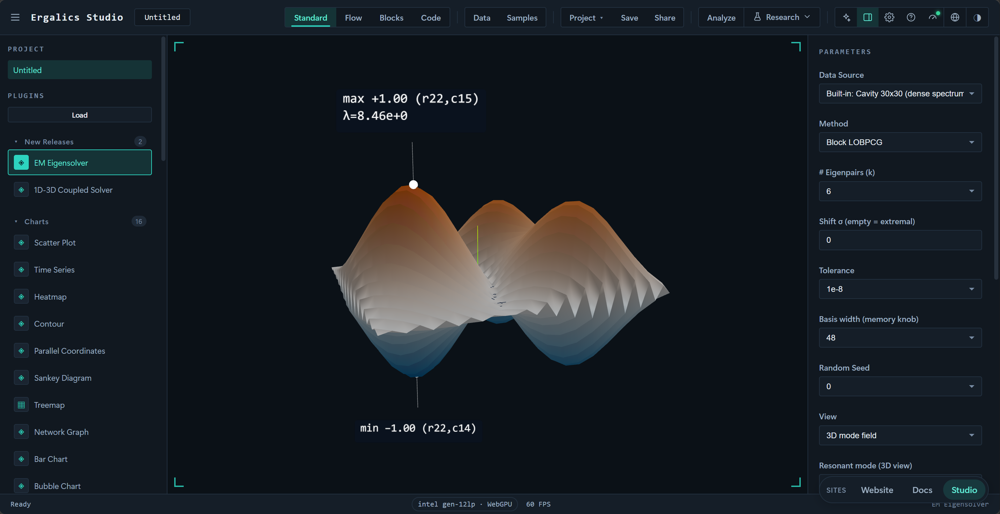

*Eigensolver: three kernels solve sparse Hermitian eigenpairs and certify true residuals.*

#### Scenario 2. Bidirectionally coupled 1D pipe-network–3D field transient simulation {#场景-2-1d-管网–3d-场双向耦合瞬态仿真}

The 1D-3D bidirectional coupling solver couples a 1D pipe network and a 3D field, driving transients with multi-rate time-step coordination, coarse–fine subcycling and millisecond valve control. Forward/reverse boundary coupling and conservation audits ensure conservation.

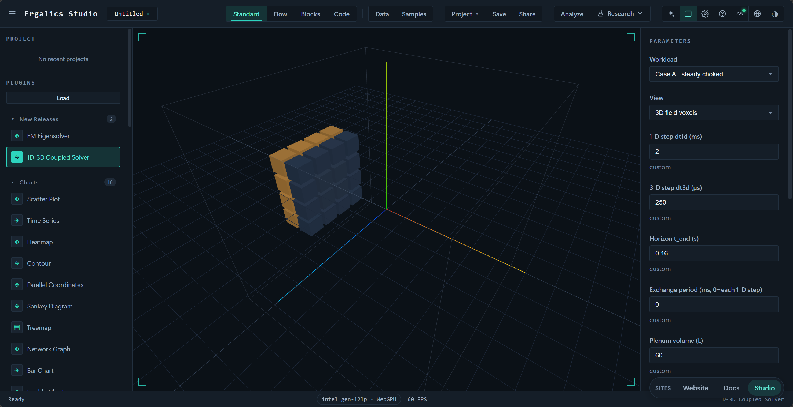

*Coupled solver: 1D pipe-network–3D field bidirectional coupling, with multi-rate subcycling for transient simulation.*

#### Scenario 3. GPU all-pairs N-Body gravitational evolution {#场景-3-gpu-全对-n-body-引力演化}

N-Body Gravity directly sums three-dimensional all-pairs gravity for 4096 bodies, accelerated by a WGSL compute kernel and automatically falling back to a mathematically consistent CPU implementation when WebGPU is unavailable.

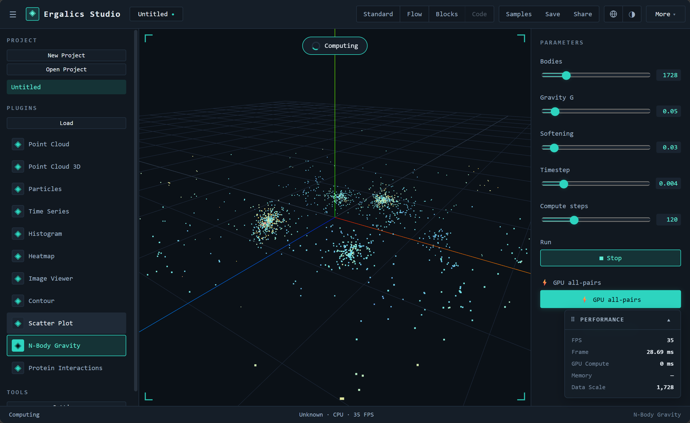

*N-Body: 4096-body all-pairs direct gravitational summation accelerated by a WGSL kernel.*

#### Scenario 4. Lattice Boltzmann Kármán vortex street {#场景-4-格子-boltzmann-卡门涡街}

The LBM fluid simulation models channel flow around an obstacle on a D2Q9 lattice, with GPU kernels computing collision and streaming step by step and CPU fallback, showing a Kármán vortex street and flow around an airfoil.

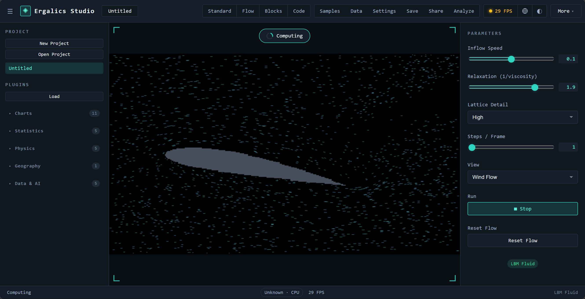

*LBM fluid: D2Q9 channel flow around an obstacle, with GPU stepping showing a Kármán vortex street.*

#### Scenario 5. Double-slit diffraction and interference in the wave equation {#场景-5-波动方程双缝衍射干涉}

The wave-equation plugin uses finite differences for 2D waves, providing Gaussian pulse, twin-source interference and double-slit diffraction scenarios integrated step by step by a leapfrog kernel.

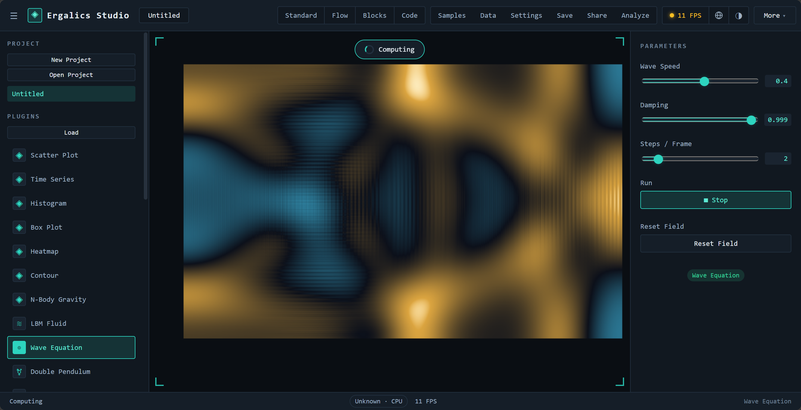

*Wave equation: leapfrog integration; the image shows double-slit diffraction and interference.*

#### Scenario 6. Single-slit diffraction intensity and fringes {#场景-6-单缝衍射强度与条纹}

The diffraction lab numerically evaluates the Fresnel–Kirchhoff integral, uniformly treating near and far fields for single slits, double slits, N-slit gratings and circular apertures. The image shows single-slit intensity and fringes.

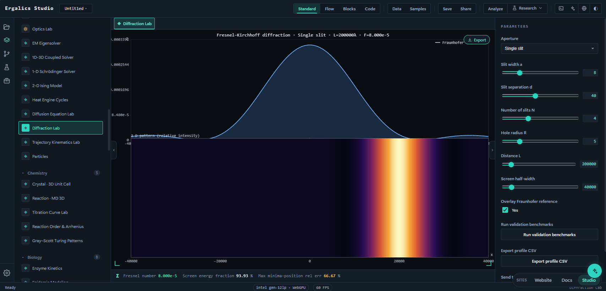

*Diffraction lab: single-slit fringes calculated with the Fresnel–Kirchhoff integral.*

#### Scenario 7. Ising phase transition and heat-capacity peak {#场景-7-伊辛相变与热容峰}

The 2D Ising model runs Metropolis and Wolff single-cluster algorithms on a periodic lattice, measuring susceptibility, specific heat and Binder cumulant; fitting the χ(T) peak yields the Onsager critical temperature.

*2D Ising model: spin configuration and the heat-capacity peak as temperature varies.*

#### Scenario 8. Comparing numerical and analytical diffusion solutions {#场景-8-扩散方程数值与解析解对照}

The heat-conduction / diffusion lab solves using explicit FTCS (with stability checks) and implicit Crank–Nicolson schemes, supports Dirichlet/Neumann boundaries, and reports the maximum relative error between numerical and analytical solutions in real time.

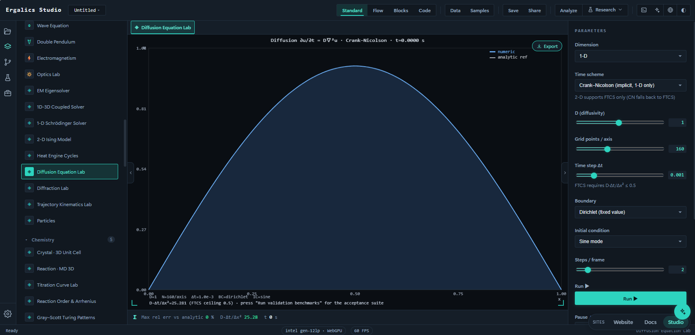

*Diffusion equation: FTCS and Crank–Nicolson compared with the analytical solution.*

#### Scenario 9. Trajectory kinematics fitting and energy decomposition {#场景-9-轨迹运动学拟合与能量分解}

The trajectory-kinematics lab analyzes (t, x[, y]) data using three-point Lagrange numerical differentiation, optional Savitzky-Golay smoothing, kinetic/potential energy decomposition and linearized least-squares projectile fitting.

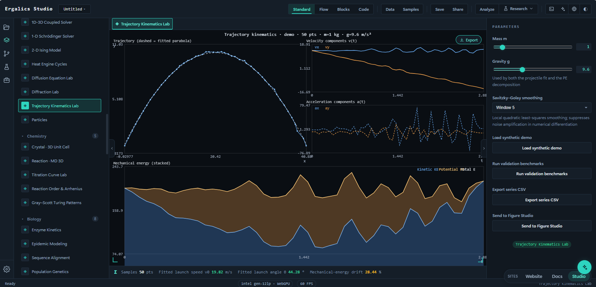

*Trajectory kinematics: numerical differentiation for velocity, projectile fitting and kinetic/potential energy decomposition.*

#### Scenario 10. Chaotic double pendulum {#场景-10-混沌双摆}

The double-pendulum plugin uses RK4 to evolve a main pendulum and a “ghost” differing in initial angle by only 0.001 rad in parallel. Their trajectories rapidly diverge, illustrating chaos's sensitive dependence on initial conditions.

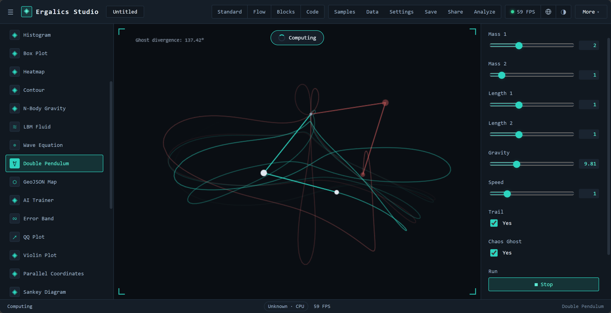

*Double pendulum: RK4 integration and rapidly diverging main/ghost trajectories demonstrate chaos.*

#### Scenario 11. Coulomb–Lorentz cyclotron motion {#场景-11-电磁场库仑–洛伦兹回旋}

In the electromagnetic-field plugin, charges are dragged and released on the canvas; Coulomb force and Lorentz force from a uniform magnetic field jointly produce cyclotron motion. Field strength and direction are separately adjustable.

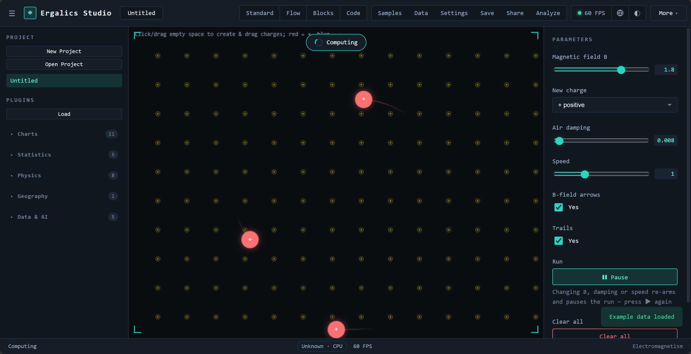

*Electromagnetism: charges undergo cyclotron motion under combined Coulomb and Lorentz forces.*

### II. Statistical inference, modeling and uncertainty (advanced) {#二、统计推断、建模与不确定性-硬核}

#### Scenario 12. Bootstrap/MCMC uncertainty suite {#场景-12-bootstrap-mcmc-不确定性套件}

The uncertainty suite provides Bootstrap confidence intervals, Monte Carlo propagation and MCMC sampling, with convergence diagnostics such as HDI, R-hat, ESS and MCSE. Large enough samples automatically use the WGSL GPU engine; below the threshold or without a device it falls back to CPU. Results agree under the same random-number sequence.

*Uncertainty suite: Bootstrap intervals and HDI, R-hat and ESS diagnostics.*

#### Scenario 13. NUTS Bayesian inference {#场景-13-nuts-贝叶斯推断}

Inference Forge performs Bayesian inference with HMC / NUTS (U-turn criterion and Dual Averaging step-size adaptation, without manually setting a step count). Posterior summaries include 94% HDI, MCSE, R-hat and ESS, with WAIC and PSIS-LOO model comparison and posterior predictive checks.

*Bayesian inference: NUTS sampling with WAIC, PSIS-LOO and PPC checks.*

#### Scenario 14. OLS coefficient table and residual diagnostics {#场景-14-ols-系数表与残差诊断}

The model workbench supports OLS (Householder QR), logistic regression (IRLS), ridge regression (K-fold cross-validation for parameter selection) and polynomial fitting. It produces coefficient tables with estimates, standard errors, p-values and confidence intervals, plus 2×2 residual diagnostics, and supports side-by-side model comparison.

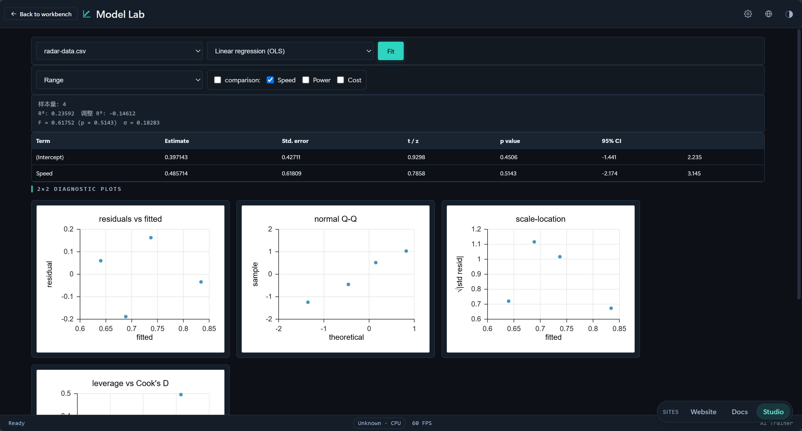

*Model workbench: OLS coefficients and 2×2 diagnostics including residuals–fitted and QQ plots.*

#### Scenario 15. Parameter sweeps and response surfaces {#场景-15-参数扫描与响应面}

Parameter sweeps expand a plan into deterministic design points: all-grid axes use the full Cartesian product, and Latin hypercube axes use stratified sampling by dimension. A response surface can be viewed after execution.

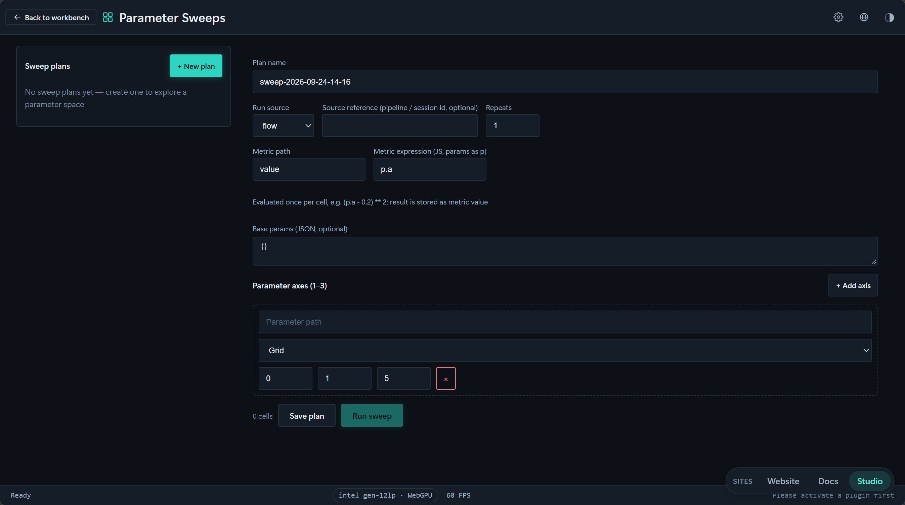

*Parameter sweeps: grid and Latin hypercube design points, followed by response-surface viewing.*

#### Scenario 16. Hypothesis testing and multiple-comparison correction {#场景-16-假设检验与多重比较校正}

Data analysis is the regular entry for hypothesis tests: the t-test family, one-way ANOVA, Mann-Whitney U, chi-square independence and Cohen's d, with Bonferroni and Benjamini-Hochberg corrections. Results can be rendered directly as publication-grade Chinese and English sentences.

#### Scenario 17. Markov chains and Zipf's law {#场景-17-马尔可夫链与-zipf-律}

Markov-chain analysis uses the power method for stationary distributions (L1 residual < 1e-12), plus ergodicity, absorbing-chain and PageRank-with-damping-0.85 analyses. Zipf word-frequency analysis tokenizes and ranks a real corpus (public-domain *Emma*), fits exponent s by log(rank)–log(freq) least squares and compares it with the ideal 1.

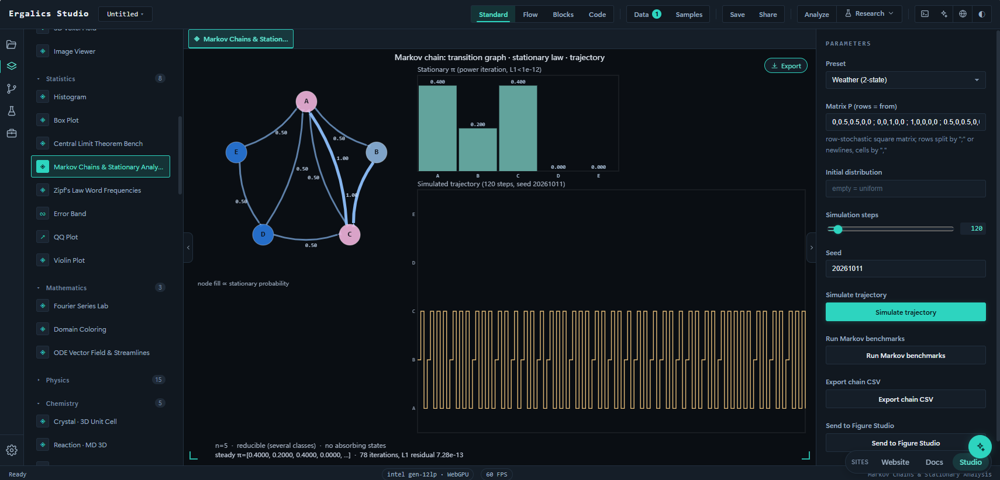

*Markov chains: power-method stationary distribution and trajectory simulation.*

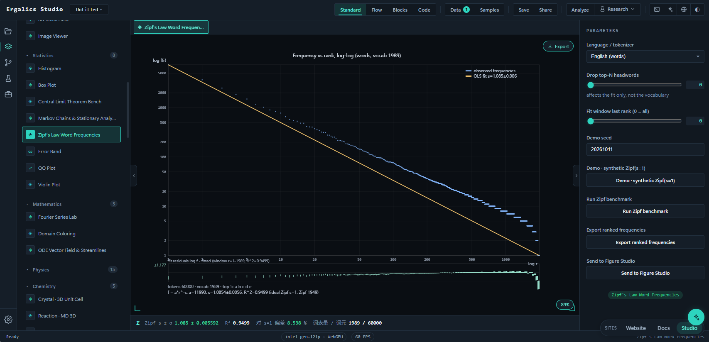

*Zipf's law: log–log fit of real-corpus frequencies against the ideal exponent.*

### III. Signal processing and time–frequency analysis (advanced) {#三、信号处理与时频分析-硬核}

#### Scenario 18. Welch PSD and harmonic identification {#场景-18-welch-psd-与谐波识别}

The signal lab offers radix-2 FFT amplitude spectra, Hann/Hamming/Blackman windows, Welch power spectra, Savitzky-Golay smoothing, ACF/PACF and seasonal decomposition. Filtered columns can be saved as derived project files and enter lineage automatically. The vibration signal's Welch PSD peaks near 0.02 Hz with harmonics.

*Signal lab: Welch PSD main peak and harmonics; filtered columns can return to lineage.*

#### Scenario 19. Fourier series approximation {#场景-19-傅里叶级数逼近}

The Fourier series lab calculates coefficients with piecewise Simpson quadrature at discontinuities, compares ordinary partial sums with Fejér averages, and compares Gibbs overshoot with the classical constant 2·Si(π)/π ≈ 1.17898.

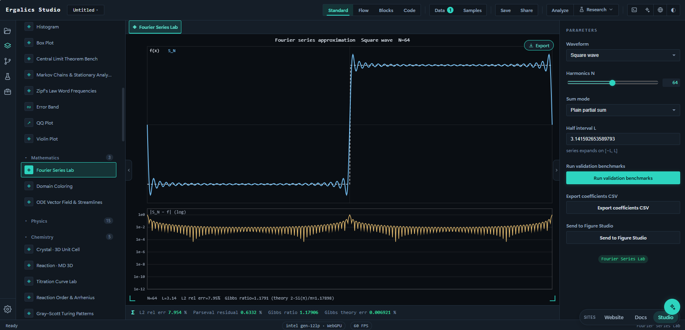

*Fourier series: partial sums and Fejér averages approximating a square wave.*

#### Scenario 20. ODE vector fields and streamlines {#场景-20-ode-向量场与流线}

The ODE vector field and streamline plugin is a phase-plane bench for 2D autonomous systems: bidirectional RK4 streamline integration, Newton's method for equilibria, and classification by Jacobian eigenvalues.

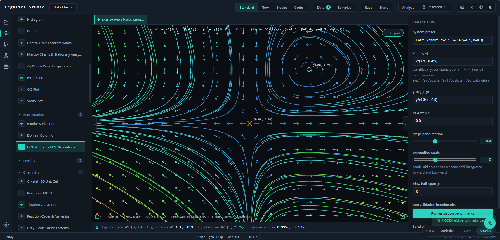

*ODE vector field: bidirectional RK4 streamlines and equilibrium classification.*

### IV. Data engineering and lineage governance {#四、数据工程与谱系治理}

#### Scenario 21. Data profiling health check {#场景-21-数据画像体检}

Data profiling uses one streaming pass: Welford recurrence for exact numeric-column mean and variance, reservoir sampling for quantiles, HyperLogLog for text cardinality, and table-level Pearson / Spearman correlation, producing a deterministic 0–100 quality score and issue list.

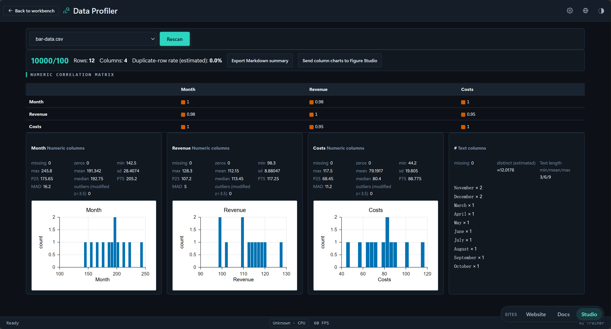

*Data profiler: column statistics, correlation matrix and deterministic 0–100 quality score.*

#### Scenario 22. Stepwise cleaning pipeline {#场景-22-清洗向导分步管道}

The cleaning wizard guides five serializable operations with step cards: type conversion, missing-value policy, outlier marking, deduplication and column renaming. Each previews before/after differences and never rewrites the input table; users can advance, go back or undo a step.

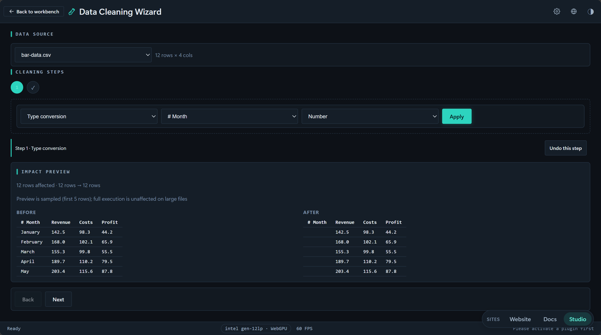

*Cleaning wizard: five operation types previewed step by step, without rewriting the input table.*

#### Scenario 23. DuckDB-WASM SQL workbench {#场景-23-duckdb-wasm-sql-工作台}

The SQL workbench includes DuckDB-WASM, registers project data files in its virtual file system and exposes them directly as tables for SQL queries. Queries support timeouts and abort signals; either terminates the Worker and rebuilds the instance, so a runaway query cannot overwhelm the page.

#### Scenario 24. Data-lineage DAG and experiment-record comparison {#场景-24-数据血缘-dag-与实验记录对比}

Data lineage connects project files (sources) to runs (transformations) by file id in run records, drawing a Sugiyama-style layered DAG (longest-path layers, single-pass barycenter ordering). The experiment ledger automatically retains durable snapshots of parameters, metrics and duration for each run, supporting metric differences and paired A/B comparisons.

### V. Publication, delivery and reproducibility {#五、出版交付与可复现}

#### Scenario 25. Publication-grade multi-panel figures {#场景-25-图表工作台出版级组图}

The figure workbench places multi-panel figures on IEEE / Elsevier journal-template grids (Okabe-Ito colorblind-friendly palette), labels panels a/b/c, performs pre-submission checks, and exports SVG, PDF and 600dpi PNG.

*Figure workbench: IEEE single-column figure with SVG/PDF/600dpi export.*

#### Scenario 26. Report builder {#场景-26-报告生成器}

The report builder combines headings, Markdown narrative, figure-workbench plots, data tables and run summaries into one self-contained HTML file: inline CSS, SVG and data, a zero-dependency native-JS controller, and escaped user strings for safe direct delivery.

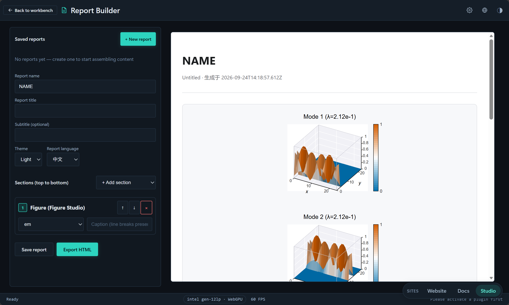

*Report builder: narrative and figures packaged as one self-contained HTML file.*

#### Scenario 27. Reproducibility lock {#场景-27-可复现锁}

The reproducibility lock exports and checks repro.lock: data fingerprints, parameter hashes, seeds and code snapshots, plus environment snapshot (version, platform and kernel availability), supporting five drift categories and one-click reruns.

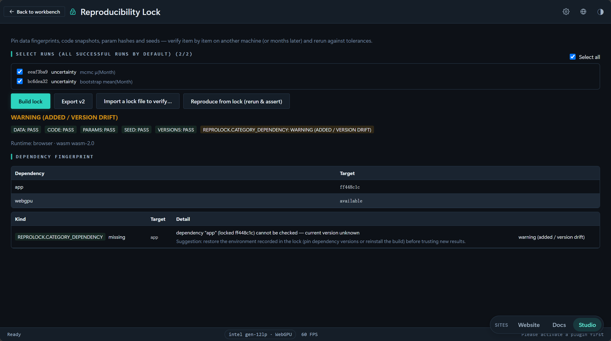

*Reproducibility lock: drift checks for data, parameters, seed, code and environment.*

#### Scenario 28. Supplement packaging {#场景-28-补充材料打包}

Supplement packaging uses fflate to bundle a manifest (project metadata, run records, lineage, author and license forms), raw data, code sessions and optional repro.lock into a ZIP uploaded with a paper.

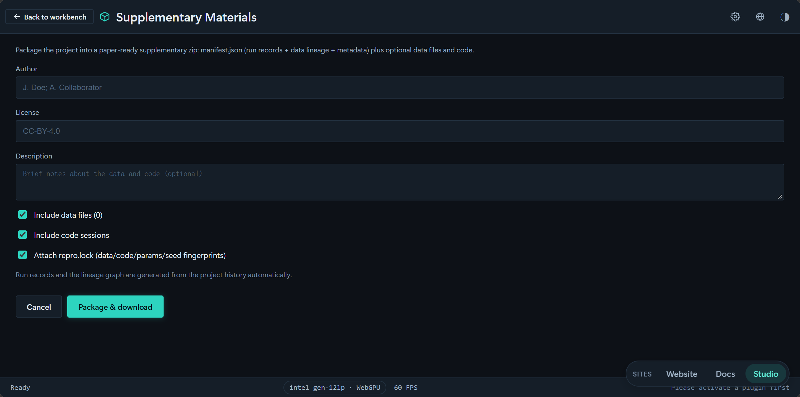

*Supplement packaging: manifest, data and code bundled as a paper-attachment ZIP.*

#### Scenario 29. Project gallery {#场景-29-作品画廊}

The local gallery displays reproducible works by discipline, marking each with topic, author, license and reproducibility-lock state (locked / drift detected / unlocked); the details dialog can reopen offline.

*Gallery: reproducible work organized by discipline and marked with lock status.*

#### Scenario 30. Notebook and run records {#场景-30-notebook-与运行记录}

Notebook mixes Markdown and Python cells and executes with the same Pyodide runtime as Code mode, so notebooks and scripts see the same studio API. The run ledger automatically leaves a durable snapshot for each execution, stored in IndexedDB `runs` rather than `.clproj`.

### VI. Geography, earth science and astronomy {#六、地理、地学与天文}

#### Scenario 31. GeoJSON choropleth {#场景-31-geojson-分级设色}

The GeoJSON map renders vector data offline, supports choropleth coloring by numeric attributes, offers Albers (China), Web Mercator and equirectangular projections, and includes a Chinese provinces sample.

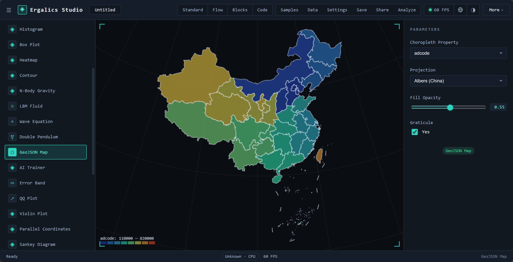

*GeoJSON map: offline choropleth, Albers/Mercator/equirectangular.*

#### Scenario 32. Interactive 3D globe {#场景-32-交互-3d-地球仪}

The globe places Natural Earth 110m coastlines and graticule on a sphere with spherical Tissot indicatrices, drag rotation, scroll zoom and automatic rotation.

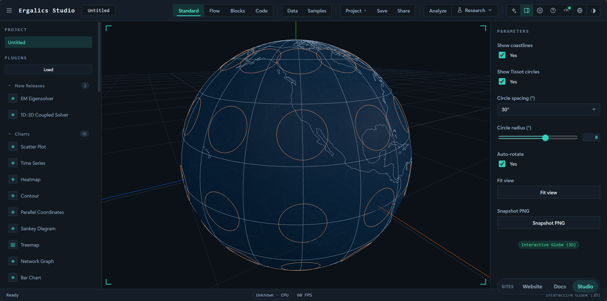

*Interactive globe: coastlines on the sphere, spherical Tissot indicatrices and rotation.*

#### Scenario 33. DEM terrain analysis {#场景-33-dem-地形分析}

DEM analysis parses ESRI ASCII Grid (.asc) elevation data, providing elevation coloring, hillshade, Horn-method slope and aspect, contour overlays and a 3D model view.

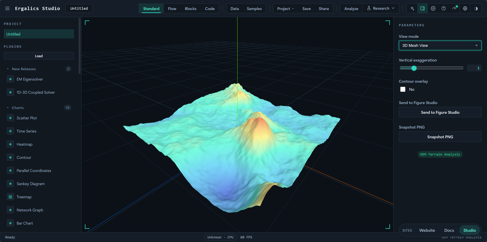

*DEM terrain analysis: ESRI ASCII Grid elevation rendered as a 3D surface.*

#### Scenario 34. GPX tracks {#场景-34-gpx-轨迹}

GPX analysis parses track points including elevation and time, calculates total distance and cumulative ascent/descent (2 m hysteresis filtering), and plots an elevation-colored track and elevation–distance profile.

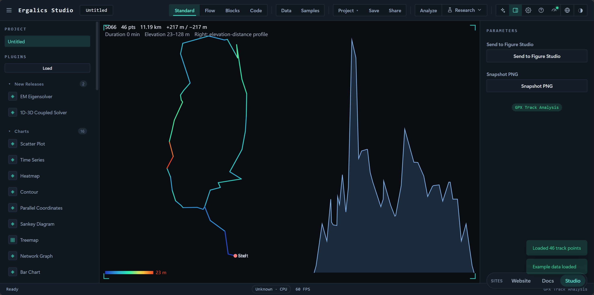

*GPX analysis: elevation-colored route and elevation–distance profile.*

#### Scenario 35. IDW spatial interpolation {#场景-35-空间插值-idw}

Spatial interpolation grids discrete station observations: IDW power is adjustable, ordinary kriging automatically fits spherical/exponential variograms, and outputs include heatmap, contours, station labels and LOOCV errors.

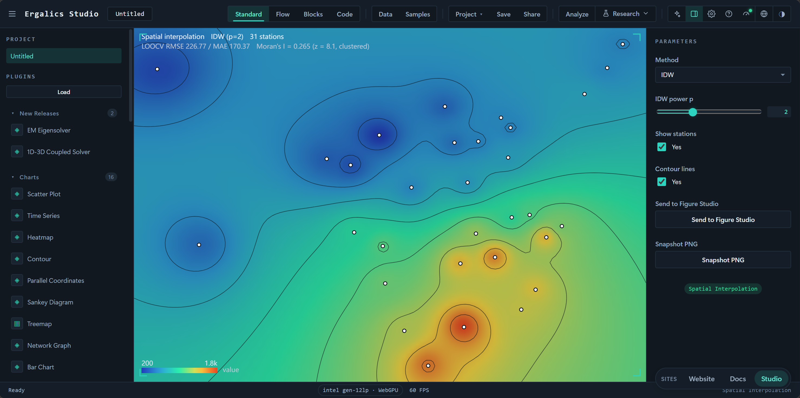

*Spatial interpolation: IDW and kriging gridding with LOOCV.*

#### Scenario 36. Standard-deviation ellipse {#场景-36-标准差椭圆}

Distance and area measure provides great-circle segment and cumulative distances, and calculates the semi-axes and azimuth of a standard-deviation ellipse for a point set, summarizing its center, orientation and dispersion.

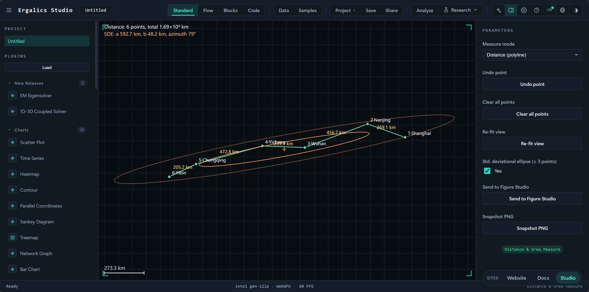

*Standard-deviation ellipse: semi-axes and azimuth summarize center and dispersion.*

#### Scenario 37. Tissot projection distortion {#场景-37-tissot-投影变形}

The projection-distortion plugin plots coastlines and Tissot indicatrices under seven projections including equirectangular, Mercator, sinusoidal and Mollweide. Circle area ratio represents area distortion and flattening represents angular distortion.

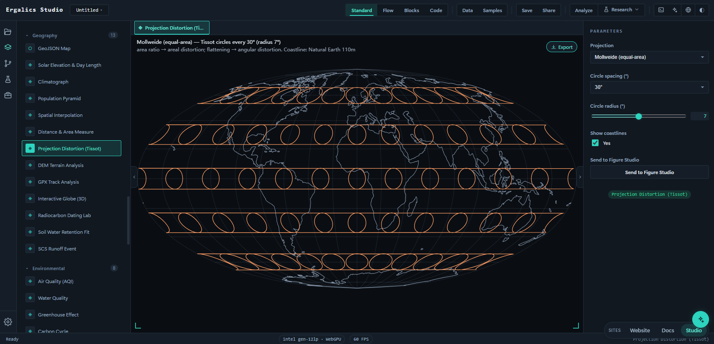

*Projection distortion: area-preserving Tissot indicatrices on Mollweide.*

#### Scenario 38. Climatographs and population pyramids {#场景-38-气候图与人口金字塔}

The climatograph plots monthly temperature lines and precipitation bars on dual axes, summarizes annual mean temperature, precipitation and temperature range, and classifies climate. The population pyramid uses back-to-back age/sex structure to calculate 0-14 / 15-64 / 65+ proportions and total sex ratio, classifying growing / stable / shrinking structures.

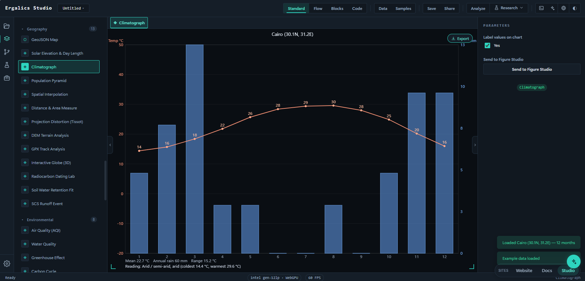

*Climatograph: Cairo monthly temperature lines and precipitation bars.*

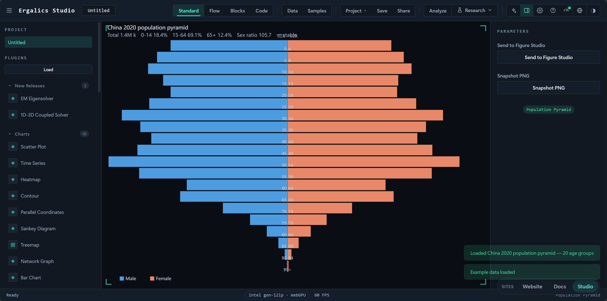

*Population pyramid: back-to-back age/sex structure and classification.*

#### Scenario 39. Solar elevation and day length {#场景-39-太阳高度与昼长}

Given latitude and date, the solar plugin calculates declination, noon elevation, day length and local sunrise/sunset times, and plots annual day-length and noon-elevation curves.

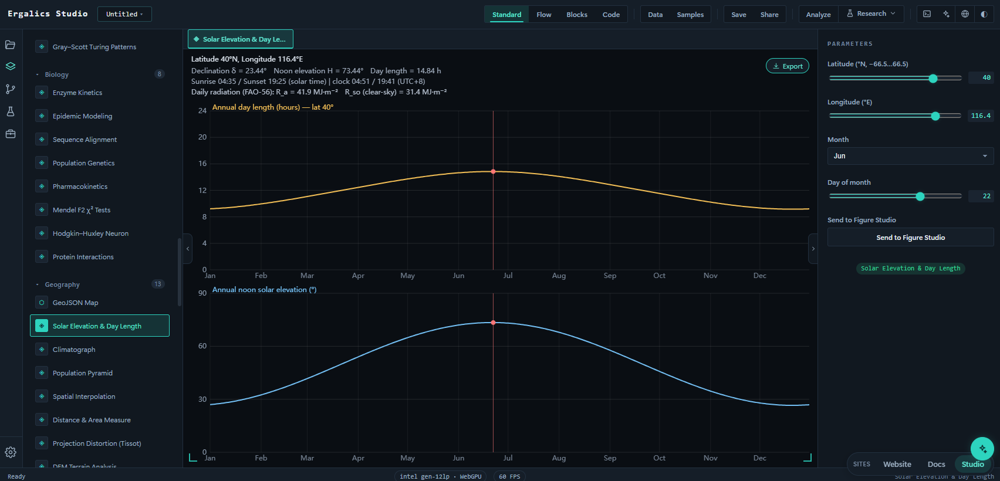

*Solar elevation and day length: annual day-length curve.*

#### Scenario 40. Contour rendering {#场景-40-等值线渲染}

The contour plugin renders a 2D scalar field (JSON grid) as color bands and isolines for data such as vortex fields and terrain. The twin-Gaussian example clearly shows valleys and ridges.

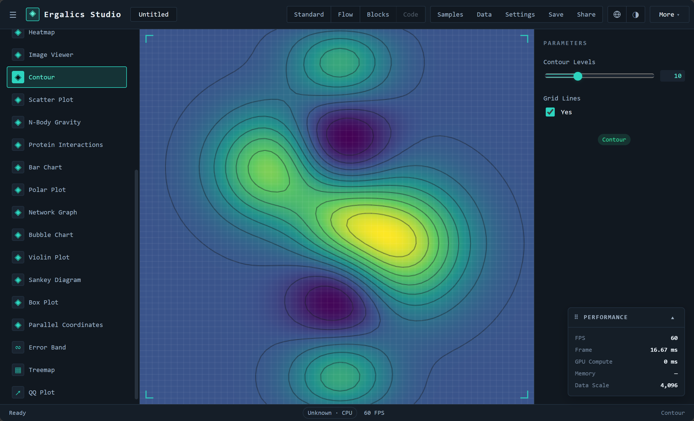

*Contours: color bands and isolines for a twin-Gaussian scalar field.*

#### Scenario 41. CCD photometry pipeline {#场景-41-ccd-测光管线}

The astronomy CCD pipeline performs research-grade image processing: FITS read/write, bias/dark/flat calibration and cosmic-ray rejection, σ-clipped background statistics, local-maximum star detection and aperture photometry.

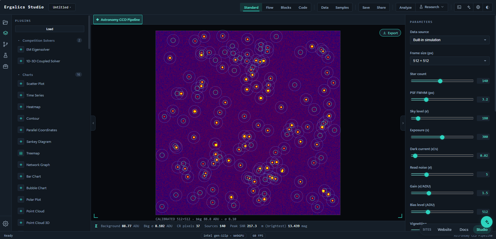

*CCD pipeline: calibration, star detection and aperture photometry.*

#### Scenario 42. Transit light curve and phase folding {#场景-42-凌星光变曲线与相位折叠}

Exoplanet transit fitting uses simplified BLS period detection and a Levenberg-Marquardt trapezoid fit (P, T0, depth, baseline, etc.), outputting 1σ parameter errors, a phase-folded plot and radius ratio √δ.

*Transit fitting: BLS period search and trapezoid-model phase folding.*

#### Scenario 43. Hertzsprung–Russell diagram {#场景-43-赫罗图}

The HR diagram plots B−V color index against magnitude (or absolute magnitude M_V calculated from Hipparcos parallax), with an empirical main-sequence reference and solar anchor, and supports linear fitting of the main sequence.

*HR diagram: color–magnitude scatter with empirical main-sequence reference.*

### VII. Chemistry, materials and life sciences {#七、化学、材料与生命科学}

#### Scenario 44. CIF/POSCAR unit cells {#场景-44-cif-poscar-晶胞}

The 3D unit-cell preview loads CIF / POSCAR / XYZ structures, displaying atoms, periodic bonds and cell frame as a ball-and-stick model, with effective composition and density estimates.

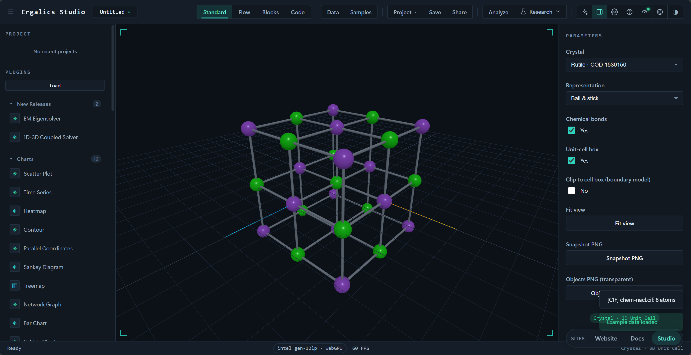

*3D unit-cell preview: atoms and periodic bonds in a ball-and-stick model.*

#### Scenario 45. Reactive molecular dynamics {#场景-45-反应分子动力学}

The reaction-dynamics plugin uses a built-in NumPy / Langevin engine to integrate real molecular trajectories at specified temperature and catalyst conditions: in esterification (ethanol + acetic acid), bonds cross Arrhenius barriers and break, and radicals recombine into bonds. Atomic motion comes from real physics, not scripted animation.

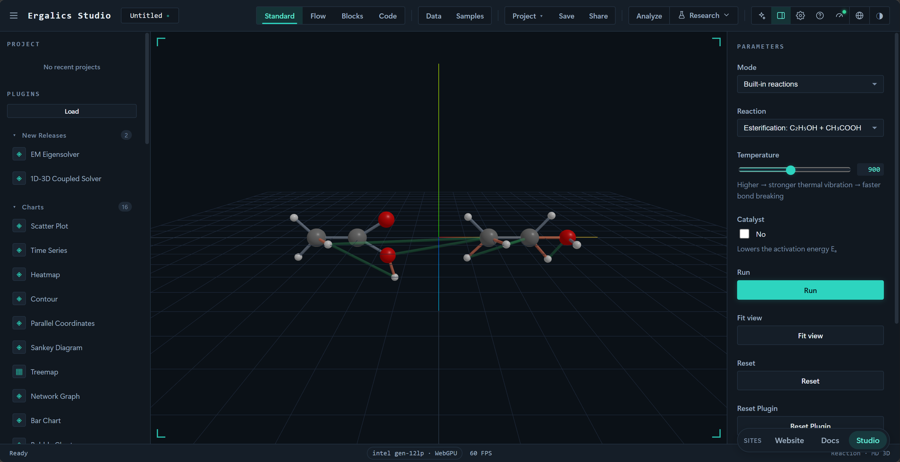

*Reaction dynamics 3D: Langevin trajectory integration and bond breaking across barriers.*

#### Scenario 46. Titration curves {#场景-46-滴定曲线}

The acid–base titration lab solves the full ionic-equilibrium system (charge + mass balance + Ka + Kw), using bisection-protected Newton–Raphson for [H⁺] at each volume and marking equivalence points, buffer regions and indicator color-change intervals.

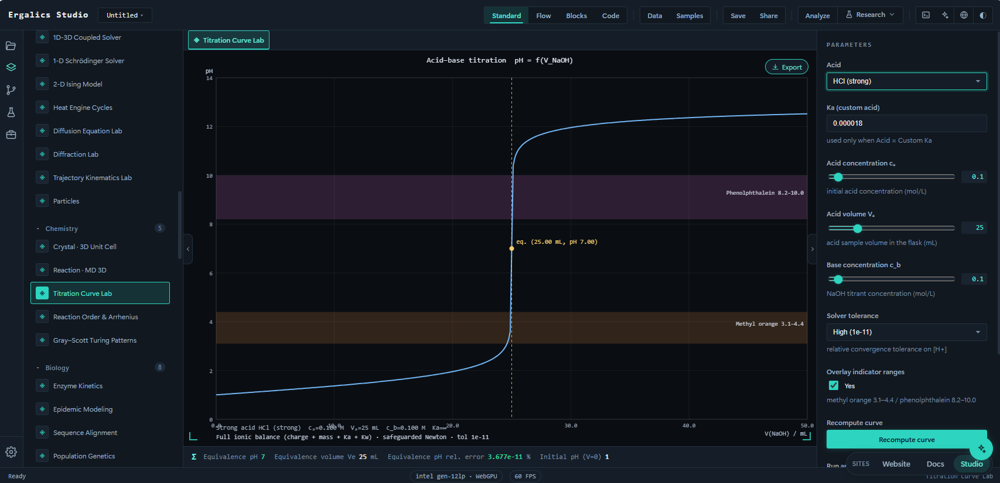

*Acid–base titration: pH jump from full ionic equilibrium.*

#### Scenario 47. Integral method for reaction order {#场景-47-反应级数积分法}

Reaction-order and Arrhenius analysis applies zero/first/second-order linearized least squares to [A]–t data, selects by R², cross-checks by half-life, and recovers activation energy Ea ± σ and pre-exponential factor A via Arrhenius regression.

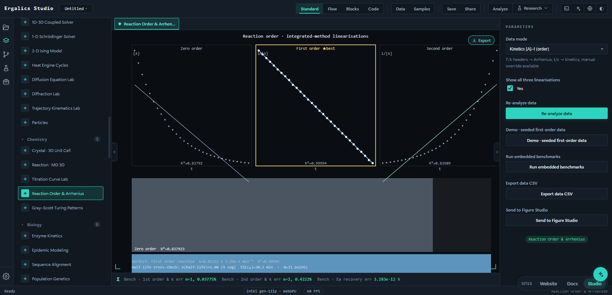

*Reaction order: select among zero/first/second-order linearized fits by R².*

#### Scenario 48. Gray–Scott Turing patterns {#场景-48-gray–scott-图灵斑图}

The Gray–Scott reaction–diffusion plugin evolves equations on a periodic grid using explicit FTCS differences, with Pearson (1993) classical region presets and a numerical mass-conservation benchmark.

*Turing patterns: Gray–Scott reaction–diffusion spots and stripes.*

#### Scenario 49. XRD patterns {#场景-49-xrd-图谱}

XRD analysis detects peaks by prominence in powder diffraction spectra (2θ–intensity), converts d-spacing with Bragg's law, refines cubic lattice constants by least squares, and compares common phase reference cards.

*XRD: peak detection, d-spacing conversion and phase-card comparison.*

#### Scenario 50. DSC/TGA thermal analysis {#场景-50-dsc-tga-热分析}

After baseline correction, thermal analysis detects peaks and extrapolated onset/peak temperatures: DSC integrates phase-transition enthalpy, while TGA decomposes weight-loss steps and reports onset temperature and residual mass.

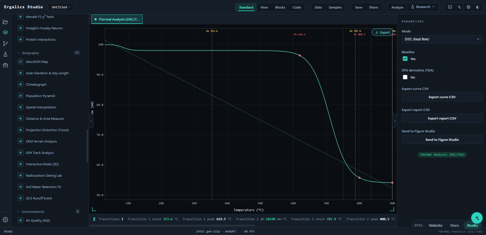

*Thermal analysis: DSC enthalpy integration and TGA weight-loss steps.*

#### Scenario 51. Four-case enzyme-kinetics fitting {#场景-51-酶动力学四情形拟合}

Enzyme kinetics compares no inhibition, competitive, noncompetitive and uncompetitive cases via v=f([S]) saturation curves; Levenberg-Marquardt recovers Vmax and Km from noisy initial velocities and reports kcat and catalytic efficiency.

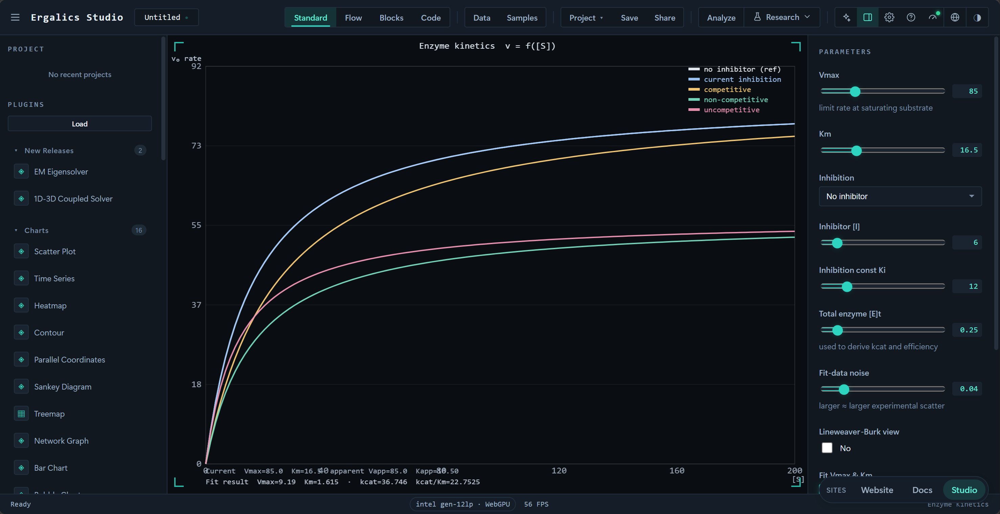

*Enzyme kinetics: compare four inhibition cases and fit Vmax and Km.*

#### Scenario 52. SEIR compartment model {#场景-52-seir-分室模型}

The epidemic compartment model integrates deterministic SIR / SEIR equations with classical RK4 and reports R₀, herd-immunity threshold, infection-peak time and total attack rate.

*Epidemic compartment model: RK4-integrated SEIR curves.*

#### Scenario 53. Sequence alignment {#场景-53-序列比对}

Sequence alignment offers pairwise alignment using BLOSUM62 or nucleotide matrices: global Needleman-Wunsch or local Smith-Waterman with affine gap penalties, plus base composition and sliding-window GC analysis; FASTA data is supported.

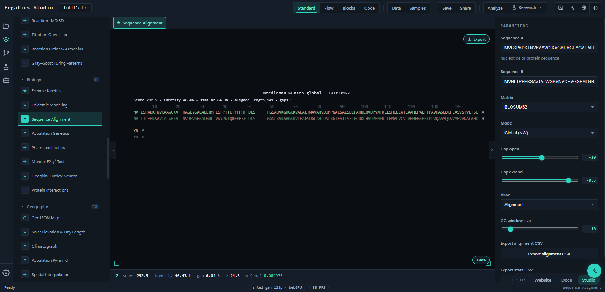

*Sequence alignment: BLOSUM62-scored NW global alignment.*

#### Scenario 54. Population genetic drift {#场景-54-群体遗传漂变}

Population genetics performs a Hardy-Weinberg equilibrium chi-square test and reproducible Wright-Fisher drift simulation with optional natural selection (recessive/additive/dominant), showing random walks in allele frequency across replicate populations.

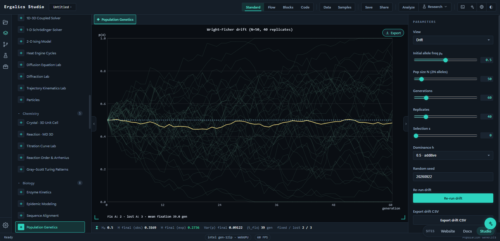

*Population genetics: 40 replicate Wright-Fisher drift trajectories.*

#### Scenario 55. Mendel χ² test {#场景-55-孟德尔-χ2-检验}

Mendel F2 segregation tests use chi-square goodness-of-fit for monohybrid 3:1 and dihybrid 9:3:3:1 ratios, include original F₂ counts for seven traits from the 1866 paper, and calculate p-values with a self-implemented incomplete gamma function.

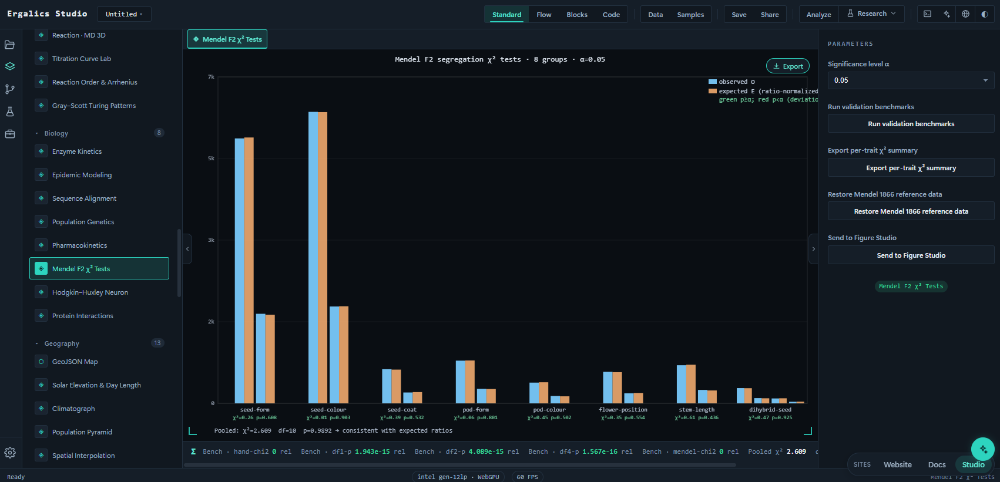

*Mendel F₂ test: chi-square assessment of 3:1 and 9:3:3:1.*

#### Scenario 56. Hodgkin–Huxley neuron {#场景-56-hodgkin–huxley-神经元}

The Hodgkin–Huxley plugin integrates four variables with RK4 using constants from the original 1952 publication, showing action potential V(t) and m/h/n gating waveforms with current pulses and Q10=3 temperature scaling.

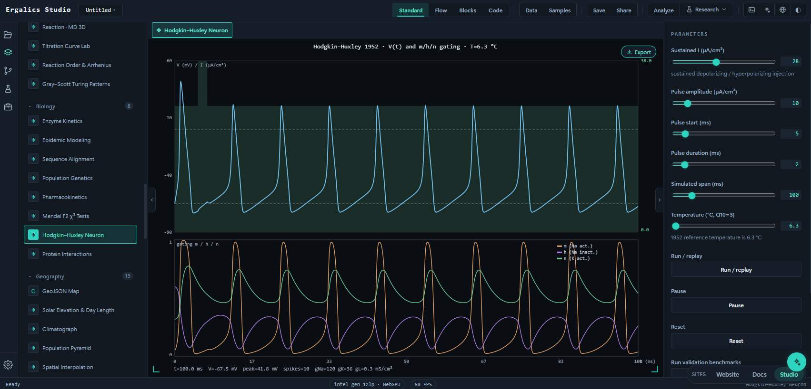

*HH neuron: action potential and gating waveforms with original 1952 constants.*

#### Scenario 57. Protein interaction network {#场景-57-蛋白质相互作用网络}

The protein interaction plugin computes a protein–protein interaction network and force-directed layout, reporting biological metrics such as degree distribution and connected components.

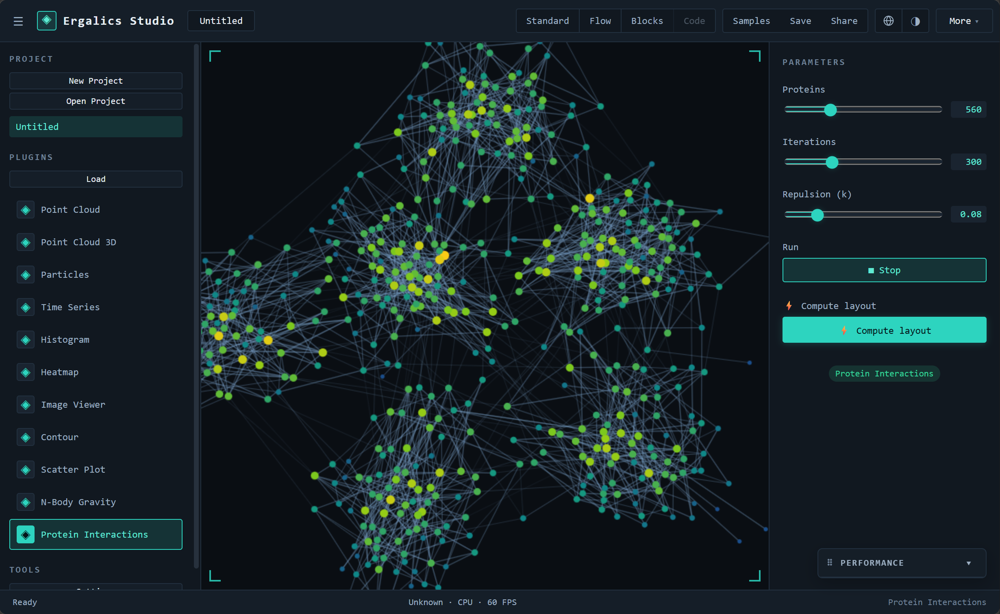

*Protein interaction network: force-directed layout and degree-distribution metrics.*

### VIII. Environment and Earth systems {#八、环境与地球系统}

#### Scenario 58. Air quality AQI {#场景-58-空气质量-aqi}

The air-quality plugin computes pollutant IAQI and daily AQI by piecewise linear interpolation under HJ 633-2012, reporting level, primary pollutant and health guidance; US EPA breakpoints can be selected for comparison.

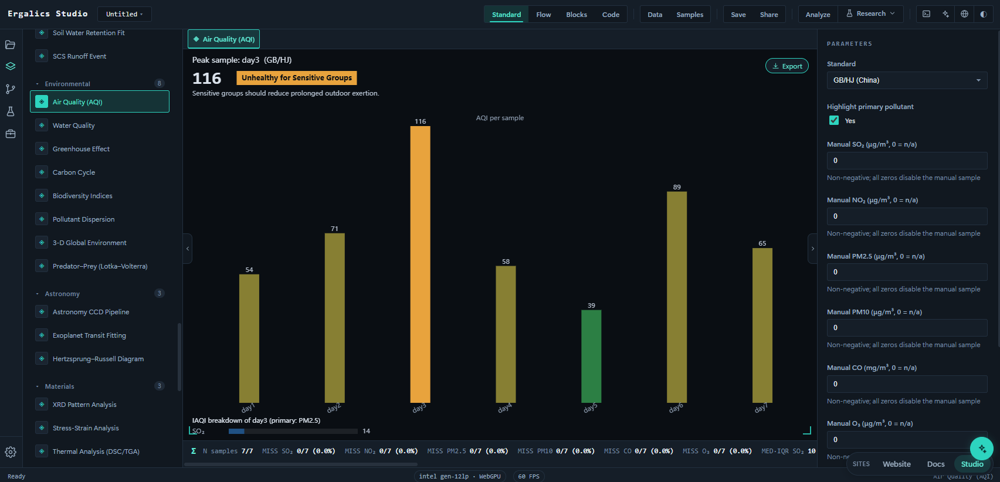

*Air quality: piecewise IAQI interpolation for AQI and health guidance.*

#### Scenario 59. Water-quality evaluation {#场景-59-水质评价}

The water-quality plugin classifies each sample indicator into grades Ⅰ–Ⅴ under GB 3838-2002, uses the worst grade as the single-factor overall result, and plots a radar chart relative to limits.

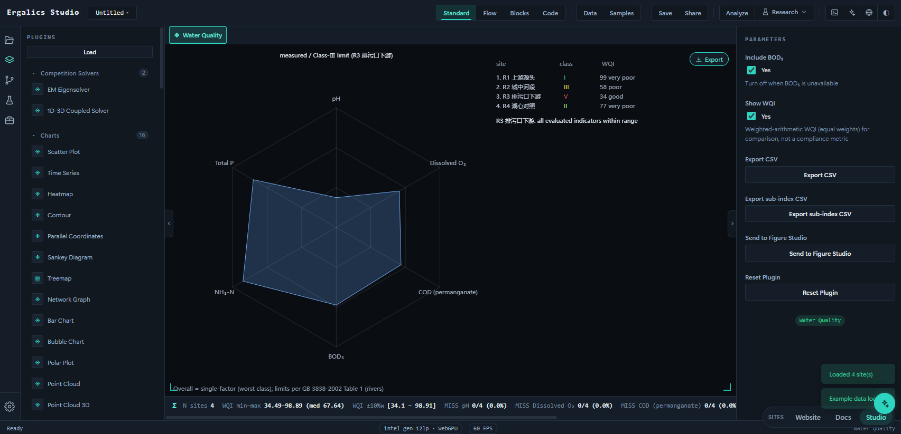

*Water quality: GB 3838-2002 single-factor classification and radar chart.*

#### Scenario 60. 0D greenhouse energy balance {#场景-60-0d-温室能量平衡}

The greenhouse simulation is a zero-dimensional radiative-balance teaching model: CO₂/albedo/cloud sliders estimate equilibrium warming using Myhre radiative forcing.

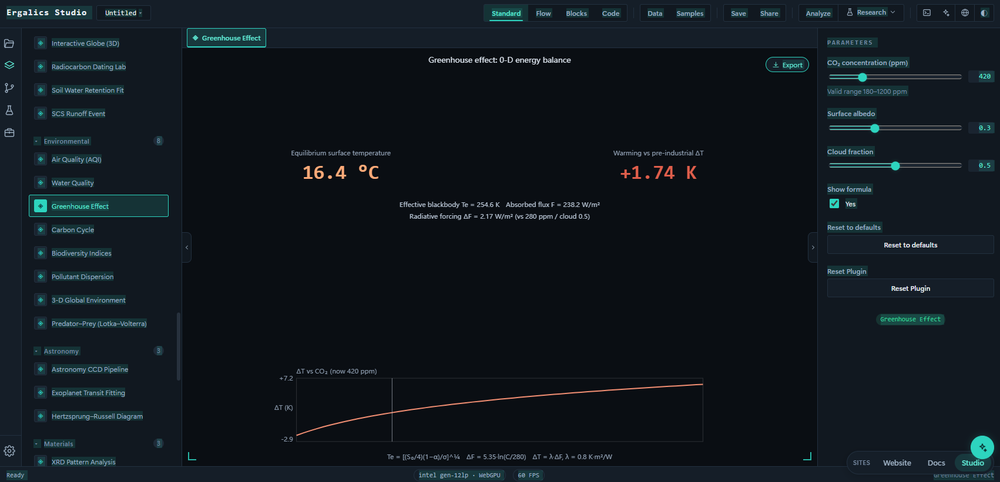

*Greenhouse effect: Myhre radiative forcing estimates equilibrium warming.*

#### Scenario 61. Carbon-cycle box model {#场景-61-碳循环箱式模型}

The carbon-cycle simulation uses four carbon pools (atmosphere/vegetation/soil/ocean, GtC), donor-controlled annual fluxes, and time stepping driven by anthropogenic-emission sliders and preset scenarios.

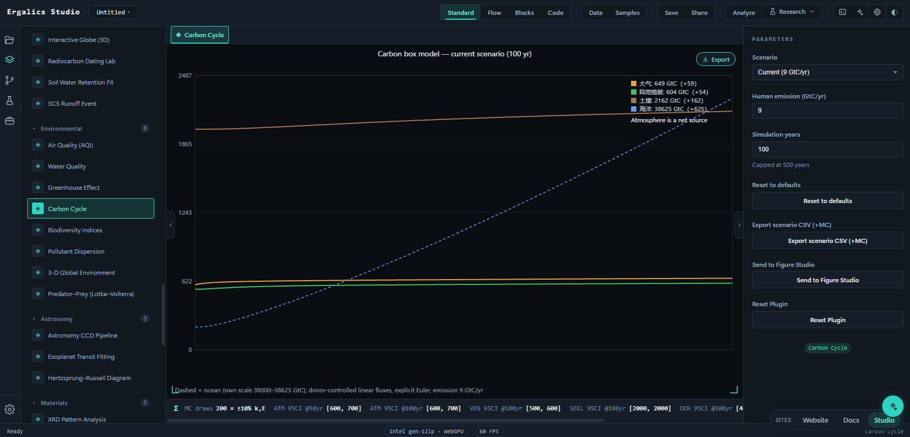

*Carbon cycle: atmosphere/vegetation/soil/ocean box model.*

#### Scenario 62. Biodiversity indices {#场景-62-生物多样性指数}

The biodiversity plugin uses a species-by-quadrat abundance matrix to calculate richness S, Shannon H′, Gini-Simpson and Pielou evenness J for each site, marking dominant species.

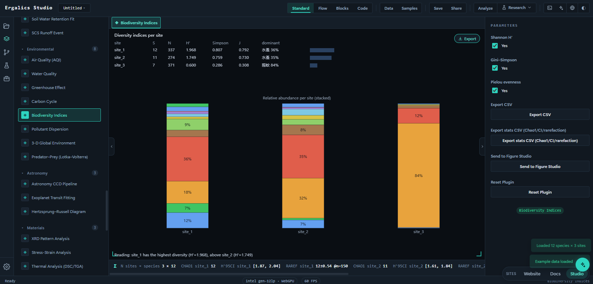

*Biodiversity: richness, Shannon, Simpson and evenness.*

#### Scenario 63. Gaussian plume dispersion {#场景-63-高斯烟羽扩散}

The pollutant-dispersion simulation calculates continuous point-source downwind ground concentrations from Pasquill–Gifford dispersion parameters and ground reflection, showing plume shape as a heatmap.

*Pollutant dispersion: downwind Gaussian-plume ground-concentration heatmap.*

#### Scenario 64. 3D global environment {#场景-64-3d-全球环境}

The 3D globe illustrates global CO₂ concentration bands (including seasonal breathing), a surface-albedo layer and major ocean-current direction arrows, with a month slider for seasonal changes.

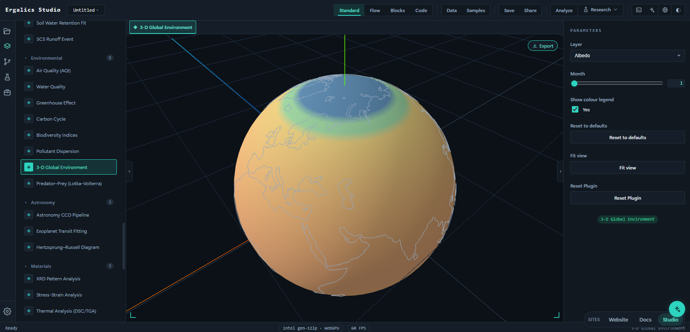

*3D global environment: CO₂ bands, albedo and current arrows.*

#### Scenario 65. Lotka–Volterra predator–prey {#场景-65-lotka–volterra-捕食者–猎物}

The predator–prey plugin integrates Lotka–Volterra equations with RK4, provides phase plots and time series, checks numerical accuracy through invariant drift and estimates α/β/γ/δ by log-space linear regression.

*Predator–prey: RK4 phase trajectories form closed loops.*

### IX. AI, data intelligence and engineering simulation {#九、ai、数据智能与工程仿真}

#### Scenario 66. MNIST CNN training {#场景-66-mnist-cnn-训练}

The TensorFlow.js AI trainer supports linear regression, nonlinear neural networks, logistic regression and convolutional neural networks. A loss curve updates above the canvas; below it, the view switches among a fit line, 2D decision boundary or MNIST digit prediction grid. Built-in samples cover linear, cubic plus sine, twin-Gaussian classification and a 200-image MNIST subset; TF.js loads lazily on the first training click.

*AI training: four TF.js model types and an MNIST prediction grid.*

#### Scenario 67. In-browser ONNX inference {#场景-67-onnx-浏览器内推理}

The model-inference tool runs ONNX models with WebGPU in the browser, reporting per-sample predictions, confidence and end-to-end latency for cases where a model is trained elsewhere and its conclusions must be reproduced here.

*Model inference: ONNX on WebGPU with per-sample confidence.*

#### Scenario 68. Image processing {#场景-68-图像处理}

The image-processing plugin uses self-implemented kernels for radix-2 2D FFT, spatial/frequency convolution, separable Gaussian blur, unsharp sharpening, Sobel edges, histogram equalization and PSNR/MSE metrics.

*Image processing: frequency-domain convolution, Sobel edges and PSNR.*

#### Scenario 69. Black-Scholes option pricing {#场景-69-black-scholes-期权定价}

The Black-Scholes lab provides analytical pricing and Greeks (Delta/Gamma/Vega/Theta), cross-checks with fixed-seed Monte Carlo geometric Brownian motion, and certifies put–call parity residuals with MC convergence bands.

*Option pricing: analytical and Monte Carlo cross-check.*

#### Scenario 70. Spatial prisoner's dilemma {#场景-70-空间囚徒困境演化博弈}

The Nowak-May spatial prisoner's dilemma runs C/D strategies on a 2D lattice against eight neighbors plus self. The next generation adopts the highest-scoring neighboring strategy, producing cooperation-rate time series and qualitative spatial-pattern criteria.

*Spatial prisoner's dilemma: cooperation-rate time series and spatial patterns.*

#### Scenario 71. Reaction time and signal detection {#场景-71-反应时与信号检测}

The reaction-time lab runs experiments in the browser and reports exact 95% t confidence intervals, two-condition Welch t-tests, Cohen's d and outlier screening. Signal-detection analysis in the same group calculates d′, β and AUC from hit and false-alarm rates and plots analytical ROC curves.

*Reaction-time experiment: confidence intervals, Welch t-tests and effect size.*

#### Scenario 72. Plane truss FEM {#场景-72-平面桁架-fem}

Plane-truss finite-element analysis assembles bar-element stiffness matrices with two DOFs per node, applies constraints by row method and solves by Gaussian elimination, reporting displacement, axial force (tension positive, compression negative), stress and support reactions with deformation overlay.

*Plane truss FEM: bar-element stiffness solution for displacement and axial force.*

#### Scenario 73. Structural load and collapse {#场景-73-结构力学承重垮塌}

The structural-mechanics plugin demonstrates a pinned truss carrying self-weight and a heavy load in real time: members are colored by axial force and break in sequence when material limits are exceeded, until overall collapse.

*Structural mechanics: force-colored members break under overload until collapse.*

### X. Teaching paths and algorithmic art (basic) {#十、教学路径与算法艺术-基础}

#### Scenario 74. Progressive teaching through four modes {#场景-74-四模式渐进教学}

The four modes form a progression from “no code” to “real code”: Standard shows plots as soon as data is dragged in; Flow builds a dataflow pipeline from 63 built-in blocks; Block lets users write a first program with variables and loops; Code uses Python in Monaco. The three scripted modes share one IR and round-trip while retaining logic.

*Standard mode: dragged files route automatically by format.*

*Flow mode: blocks connect into a DAG with incremental cached execution.*

*Block mode: a hat block starts a script compiled to IR.*

*Code mode: real CPython via Pyodide runs in Monaco.*

#### Scenario 75. Course-mode teaching loop {#场景-75-课程模式教学闭环}

Course mode implements a local-first loop: teachers create courses and publish assignments bound to discipline templates; students claim tasks, work in projects and submit repro.lock snapshots; teachers review a student × assignment matrix, record grades and comments, and export the whole class.

*Course mode: assignments, repro.lock submissions and grading.*

#### Scenario 76. 3D surfaces and complex domain coloring {#场景-76-3d-曲面与复变域着色}

The 3D surface plugin renders height field z=f(x,y) as a rotatable, zoomable mesh; complex domain coloring uses a built-in recursive-descent complex-expression parser to image f(z) per pixel, encoding argument as hue and modulus with logarithmic contour bands.

*3D surface: height-colored grid, rotatable for inspection.*

*Domain coloring: hue encodes argument, lightness encodes modulus.*

#### Scenario 77. Black-hole ray tracing {#场景-77-黑洞光线追踪}

The black-hole plugin performs real-time general-relativistic 3D ray tracing by per-pixel RK4 integration of Schwarzschild null geodesics, including a Doppler-beamed accretion disk, gravitational redshift and a gravitationally lensed star field.

*Black-hole ray tracing: gravitational lensing bends light around the accretion-disk halo.*

#### Scenario 78. 3D water and night sky {#场景-78-3d-水面与星空}

Water waves uses an FDTD wave-equation solver and a Gerstner sea with exact deep-water dispersion ω²=g·k; the starfield renderer synthesizes a night sky from procedural stars, a real galactic-plane Milky Way and diurnal stellar motion (GMST), with a Bortle light-pollution model.

*Water waves 3D: FDTD wave equation and Gerstner sea.*

*Starfield: night sky with Milky Way and diurnal stellar motion.*

#### Scenario 79. Fun mathematics toolbox {#场景-79-趣味数学工具箱}

Ten fun tools load on demand to keep the first screen light, covering fractals and curve art: Koch snowflake constructs a fractal from recursive polylines; Barnsley fern uses four affine transforms in an iterated function system (IFS); harmonograph superposes decaying sine waves; palette explorer previews two-color gradients.

*Koch snowflake: recursive polylines with adjustable depth.*

*Barnsley fern: four affine transforms iterated into a fern.*

*Harmonograph: curve art from superposed decaying sine waves.*

*Palette explorer: two-color gradient preview and palette examples.*

### XI. Quick-reference supplement {#十一、速览补遗}

#### Scenario 80. Basic chart quick reference {#场景-80-基础图表速览}

Thirteen basic chart types—scatter, heatmap, bar, radar, network, treemap, parallel coordinates, point cloud, histogram, box, violin, QQ and error band—render entirely in the browser with live-adjustable parameters. The following images show example plugin renderings.

*Heatmap: Viridis maps a 2D numeric grid.*

*Bar chart: monthly value comparison with labels atop bars.*

*Radar chart: five-dimensional indicator comparison.*

*Network graph: force-directed node relationships.*

*Treemap: area encodes hierarchical proportions.*

*Parallel coordinates: multidimensional comparison of four iris features.*

*2D point cloud: point density rendered with a color ramp.*

*Histogram: bin counts for a bimodal distribution.*

*Box plot: interquartile range and outliers.*

*Violin plot: distribution shape with embedded box plot.*

*QQ plot: sample quantiles deviate from the normal reference line.*

*Error band: mean line and confidence-interval band.*

#### Scenario 81. Domain-plugin quick reference {#场景-81-领域插件速览}

The following 11 domain plugins do not have individual sections in the first 79 scenarios, but also load at startup and work out of the box. Each has a screenshot as an index; see 03 *Plugin System* for details.

*Central limit theorem bench: sample-mean distribution with normal curve.*

*1D quantum solver: stationary square-well wavefunctions.*

*Heat-engine cycle p-V bench: Otto cycle.*

*Particle simulation: system driven by a WGSL integration kernel.*

*3D voxels: a cyan sphere rendered in a voxel field.*

*Control systems lab: step response and Bode plot.*

*DC circuit: node-voltage solution of circuit topology.*

*Pharmacokinetics: two-compartment concentration–time curve and therapeutic window.*

*Radiocarbon dating lab: calibration curve.*

*Soil-water retention fitting: van Genuchten model.*

*SCS rainfall–runoff model: precipitation–runoff hydrograph.*
