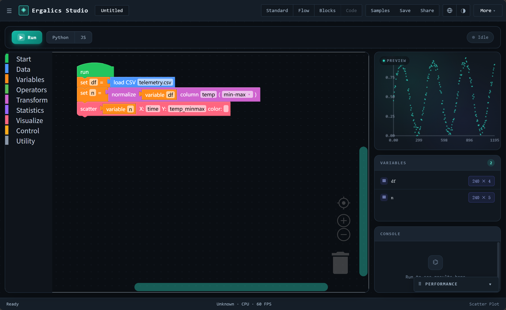

# 积木模式



**积木模式**是 Ergalics Studio 的第三种工作台模式，与[标准模式](/guide/introduction#standard-mode)和[流程模式](flow-mode)并列。它是 Scratch 风格的积木编辑器——在画布上将积木拼接起来，在顶部放置一个绿色的 **「运行时 / Run」帽子积木**，运行时便遍历其下的 IR。帽子积木是唯一的执行入口，因此游离积木不会运行，未完成的程序也不会“贯穿”执行到意料之外的代码。

它尤其适合：

- **学习者**（没有语法，也没有类型化端口——只需拼接并运行）；
- 相对于流程模式的 DAG，更喜欢命令式体验的**脚本编写者**；
- 希望在一个屏幕内紧密完成 `加载 → 变换 → 绘图` 循环的**数据探索者**。

工作台顶栏提供四模式切换组 `Standard | Flow | Blocks | Code`。四种模式均已可用——代码模式使用 Monaco 与 Pyodide（Python）运行时和已引入的 webR（R）运行时，两者编辑同一份 IR。

## 为什么增加新模式

流程模式已经可以“组合区块 → 运行 → 查看每个节点的输出”，但它使用声明式 DAG：节点和端口有类型，执行器使用拓扑排序。这对数据工程师很好，但对 10 岁儿童（或任何更愿意说“设置 df = 加载 telemetry.csv；归一化 df；对 df 绘制散点图”的人）不太友好。

积木模式是命令式、自顶向下的对应模式：积木拼接在帽子积木下方，解释器从上到下遍历，`studio.plot('scatter', df, ...)` 到达的散点图插件与流程模式的 `viz.scatter` 区块完全相同。两种模式共享运行时数据契约（`src/types/datatable.ts` 中的 `DataTable` / `Scalar` / `RenderedView`）和插件桥接（`src/blocks/render.ts` → `plugin.loadData(file)`），所以流程模式管线能产生的内容，积木模式脚本也能产生。

## 共享 IR

架构的核心是**共享中间表示**——`src/editor/ir/`。每个积木模式工作区都通过 `IRProgram`（`IRNode` 列表）往返转换，而未来的代码模式也会编辑同一份 IR。Blockly JSON ⇄ IR 转换位于 `src/editor/block/convert.ts`；系统其余部分只使用 IR。

IR 最初规模很小，随后随多语言解析器一起增长（Python/R/JS 均编译到它）：

| 节点族 | 成员 / 说明 |
| --- | --- |
| **语句节点** | `VarAssign`、`PlotScatter`、`PlotLine`、`PlotHistogram`、`PlotPointCloud`、`If`、`Repeat`、`While`、`ForEach`、`Break`、`Continue`、`FuncDef`、`Return`、`StudioCall`（如 `print`）、`Import`、`GpuRun`、`RawCode`（暂时无法表示时的降级节点）。 |
| **表达式节点** | `LoadCSV`、`LoadXYZ`、`Random`、`Range`、`Normalize`、`Sort`、`Select`、`Filter`、`AddColumn`、`Summary`、`Histogram`、`VarRef`、`Number`、`String`、`Boolean`、`Null`、`BinaryOp`、`UnaryOp`、`List`、`ListIndex`、`ListSlice`、`Dict`、`Ternary`、`FString`、`ListComp`、`Join`、`Lambda`、`Call`、`RawExpr`。 |
| **辅助函数** | `makeProgram(body, functions = [], sourceLang?)` 是唯一构造函数；`hashIR(program)`（FNV-1a，同步）为程序生成指纹以使缓存失效；`validateIR(program)` 遍历树并返回结构化 `diagnostics`，而不是抛出异常。 |

为什么用 FNV-1a 而不是 SHA-1？因为在 Blockly 工作区中，每次按键都会运行 IR 哈希。WebCrypto 的 SHA-1 是异步的，会迫使构造 / 校验 / 运行路径在微任务间跳转，却不会带来安全收益——`hashIR` 用于使缓存失效，而非安全目的。

## 管线

```
Blockly workspace JSON
        │
        ▼   src/editor/block/convert.ts (pure)
       IRProgram
        │
   ┌────┴────────────────────────┐
   ▼                              ▼
src/editor/runtime/        src/editor/codegen/
  interpreter.ts              js.ts · python.ts · r.ts
   │                              │
   ▼                              ▼
StudioApi                      emitted code
   │
   ▼
plugin.loadData(File)  ← src/blocks/render.ts bridge
   │
   ▼
the scatter / histogram / … plugin (already in use by Flow mode)
```

有三点值得注意：

1. **一个桥接，两处调用。** 流程模式的 `viz.*` 区块和积木模式的 `studio.plot(...)` 调用都到达 `render.ts` → `plugin.loadData(file)`。为流程模式添加可视化会自动在积木模式中提供对应的 `studio.plot` 形式。
2. **解释器与代码生成器共享 IR 结构，而不是源码。** `codegenJS` / `codegenPython` / `codegenR` 是遍历同一节点联合类型的纯函数；解释器在运行时进行相同遍历。由于它们解析同一份数据，因此不会产生偏差。
3. **积木模式按需加载。** `BlockEditor` 和 `CodeEditor` 在 `WorkbenchPage` 中通过 `React.lazy(...)` 导入，Blockly 本身是约 828 KB 的按需代码块。标准 / 流程模式的首次绘制不受影响。

## StudioApi——面向宿主的接口

`src/editor/runtime/studio-api.ts` 定义积木模式程序可见的 `StudioApi`：

```ts
studio.load(path) / loadCSV(text) / loadXYZ(text)   // data sources
studio.random(n, seed) / range(start, stop, step)   // generated tables
studio.normalize(df, column, mode)                  // transforms
studio.sort(df, column, dir) / select(df, cols) /
  filter(df, column, op, value) / addColumn(df, name, values)
studio.summary(df, column) / histogram(df, column, bins)  // statistics
studio.plot(type, df, opts)                         // viz → plugin bridge
studio.notify(kind, msg) / studio.print(...args)    // host interaction
studio.getParam(key) / studio.setParam(key, value)  // project-scoped
```

实现对每个变换和统计操作都**复用 `src/blocks/ops`**，因此 `studio.normalize` 与流程模式 `transform.normalize` 区块调用的是同一个 `normalize` 算子。“归一化做什么”只有一个事实来源，积木模式没有重复实现。

`studio.load` 通过 `src/core/dataFiles.ts`（`resolveDataFile`）解析文件：项目导入的文件在运行时通过 `setProjectFiles` 注册并优先使用，之后才按需获取内置的 `examples/data/`。流程模式的 `source.file` 区块通过同一函数解析，因此用户文件在两种界面中的行为一致。

可视化通过 `src/blocks/render.ts`（`renderView(view, host)`）路由：它根据按列序列化的文本构造 `File`，交给 `plugin.loadData`。绘图类型到插件 id 的映射集中在一处（`studio-api.ts` 中的 `PLOT_PLUGINS`）：`scatter → example.scatter`、`line → example.timeseries`、`histogram → example.histogram`、`pointcloud → example.point-cloud`。

## 解释器

`src/editor/runtime/interpreter.ts` 自顶向下遍历 IR：

| 节点类型 | 行为 |
| --- | --- |
| `VarAssign` | 写入变量表。 |
| `PlotScatter` / `PlotLine` / `PlotHistogram` / `PlotPointCloud` | 构造 `RenderedView`，调用 `studio.plot(...)`，再分发到插件。 |
| `If` / `Repeat` / `While` / `ForEach` | 在新的子作用域中按顺序执行其主体。 |
| `Break` / `Continue` / `FuncDef` / `Return` / `Import` / `Ternary` / `FString` / `ListComp` / `Join` / `Lambda` / `Dict` / `ListSlice` | 随多语言解析器（Python/R/JS）加入的一等支持。 |
| `StudioCall { method: 'print' }` | 写入控制台面板。 |
| `RawCode`（Blockly 的 `studio_raw` 积木） | 出现当前尚无法表示的 IR 结构时的降级形式（例如用户保存的程序中有特殊积木）；通过 `new Function` 原样运行。 |

解释器返回包含 `{ ok, variables, error? }` 的 `InterpreterResult`；控制台输出通过 `StudioApi.print` / `notify` 回调进入编辑器 store。右侧列的 **VariablePanel** 和 **ConsolePanel** 卡片直接读取该 store——无须同步 React 状态。

## IR ↔ Blockly

`src/editor/block/convert.ts` 负责双向转换，并由 `tests/editor/block-ir.test.ts` 在 Node 中测试：

| 函数 | 转换 |
| --- | --- |
| `blockJSONToIR(b)` | 一个积木 → 一个 IR 节点。 |
| `irToBlockJSON(node)` | 一个 IR 节点 → 一个积木。 |
| `workspaceJSONToIR(workspace)` | 完整工作区 → `IRProgram`。 |
| `irToWorkspaceJSON(program)` | `IRProgram` → 完整工作区。 |

双向往返是契约：用户在 Blockly 画布上能构建的任何程序，都可无损序列化和还原。游离积木（`studio_run` 帽子积木链之外的所有内容）在**序列化时丢弃**——只有活动 Run 帽子积木的主体进入 IR。这保证“损坏的代码不会运行”：画布上可能看得到散落的积木，但运行时只能看到已连接的内容。

当节点尚无对应 Blockly 积木时（即我们没有在 `blocks.ts` 中提供的内容），它会被包裹在 `studio_raw` 积木中，IR 序列化到多行文本字段中。目前由于提供了 40 个积木，这一兜底很少触发；它用于确保将来新增内容不会悄然破坏旧工作区。

## 内置积木

`src/editor/block/blocks.ts` 定义目录（40 项）。它们分布在十个工具箱类别（`src/editor/block/toolbox.ts`）中，每类颜色与 Scratch 约定一致：

| 类别 | 颜色 | 积木 |
| --- | --- | --- |
| 启动 / Start | 绿色 | `studio_run`（帽子积木——唯一入口） |
| 数据 / Data | 蓝色 | `studio_load_csv`、`studio_load_xyz`、`studio_random`、`studio_range`、`studio_list`、`studio_list_index` |
| 变量 / Variables | 橙色 | `studio_var`、`studio_var_assign` |
| 运算 / Operators | 绿色 | `studio_number`、`studio_string`、`studio_boolean`、`studio_null`、`studio_math_op`、`studio_compare`、`studio_logic_op`、`studio_unary` |
| 变换 / Transform | 粉色 | `studio_normalize`、`studio_sort`、`studio_select`、`studio_filter`、`studio_add_column` |
| 统计 / Statistics | 紫色 | `studio_summary`、`studio_histogram` |
| 可视化 / Visualize | 红色 | `studio_plot_scatter`、`studio_line`、`studio_plot_histogram`、`studio_plot_pointcloud` |
| 控制 / Control | 黄色 | `studio_repeat`、`studio_while`、`studio_for_each`、`studio_if`、`studio_break`、`studio_continue` |
| 函数 / Functions | 紫色 | `studio_function_def`、`studio_return`、`studio_call` |
| 工具 / Utility | 灰色 | `studio_print` |

所有积木名称、工具提示、下拉选项和工具箱类别名称都通过 Blockly 的 `%{BKY_*}` 消息系统（`src/editor/block/i18n.ts`）处理，底层有 `zh-CN` 和 `en-US` 字典。切换语言时会重建工作区，使每个积木重新标注——由 `tests/editor/block-i18n.test.ts` 验证。

## 主题

`src/editor/block/theme.ts` 提供自定义 Blockly 主题 `studio-kids`，与 Ergalics 的“仪器控制台”界面相匹配：深石墨色画布、选中光晕使用青绿色强调色，以及 `Inter` / `PingFang SC` 字体栈，使积木标签不会继承应用的等宽字体栈而变得过宽。

## 示例

`src/editor/block/samples.ts` 提供五个可从 **Examples** 对话框一键加载的程序（顶栏 `Samples` 按钮 → “Block samples”标签页）：

| 示例 id | 展示内容 |
| --- | --- |
| `galaxy-scatter` | `load XYZ galaxy.dat` → 散点图（X/Y 为文件中的列） |
| `telemetry-line` | `load CSV telemetry.csv` → 对一列进行 min-max 归一化 → 折线图 |
| `random-histogram` | `random 500` → 第一列的直方图 |
| `normalize-scatter` | `load XYZ` → 对一列归一化 → 对归一化结果绘制散点图 |
| `repeat-print` | `repeat 10` → `print "hello"`——典型的“这个循环是否在运行？”Hello World 示例 |

示例通过 `loadIRIntoWorkspace` 加载到工作区，也写入活动会话的 IR，因此关闭并重新打开项目后仍会保留。

## 持久化

积木模式会话使用标准项目机制：

| 字段 | 含义 |
| --- | --- |
| `ProjectState.editorSessions: EditorSession[]` | 每个积木 / 代码会话（及其 IR）都是项目的一部分。 |
| `ProjectState.activeEditorSession: string \| null` | 用户当前正在编辑的会话。 |
| `ProjectState.workbenchMode: 'standard' \| 'flow' \| 'block' \| 'code'` | 顶栏切换组上次使用的模式。 |

`projectStore.applyEditor()` 在保存前将 `editorStore` 快照写入项目；`restoreEditor()` 在打开时还原会话。积木程序还作为 `.block.json` **工作区文件**（`{ version, kind: 'ergalics-block', ir }`）持久化，通过工作区 VFS 写入，并由文件浏览器的逐文件编辑器（`src/components/editor/fileEditors/`）打开。由于 Blockly 13 是按需加载的，对于不使用积木模式的项目，这不会进入关键路径——只有恢复积木会话时才加载该代码块。

## 扩展：编写新积木

按以下顺序修改三个文件：

1. **`src/editor/block/i18n.ts`**——在 `zh-CN` 和 `en-US` 中都添加 `STUDIO_MY_BLOCK` 键（单元测试强制两份字典保持同步）。
2. **`src/editor/block/blocks.ts`**——在 `BLOCK_DEFS` 中追加一个 `BlockDef`（type、`message0`、args、`output` / `previousStatement` / `nextStatement`、颜色、tooltip）。`colour` 应与 Scratch 调色板一致，以保持工具箱统一。
3. **`src/editor/block/convert.ts`**——在 `blockJSONToIR` 中添加返回该 IR 节点的 `case 'studio_my_block':` 分支，并在 `irToBlockJSON` 中添加相反方向的 `case '<IRNodeKind>':`。

如果积木需要执行器侧辅助函数，须同时将其添加到 `studio-api.ts` 和解释器中——代码生成与运行时应以相同方式接受它，因此新的 IR 节点结构要同时加入两种遍历。运行 `tests/editor/` 确认所有内容都能往返转换。

## 已知限制

| 限制 | 细节 |
| --- | --- |
| 积木 ↔ 代码双向同步 | 仍在路线图上——代码模式运行时本身（通过 Pyodide 运行 Python、通过 webR 运行 R、通过 IR 引擎运行 JS）已完成。 |
| 积木名称仅在重建工作区时重新渲染 | 语言切换会卸载 / 重新挂载 Blockly 工作区，使新语言立即生效；这可行，但比纯字符串替换更重（对单用户应用可以接受；如果配置切换成为高频操作则再评估）。 |
| 尚无 GPU 执行路径 | 解释器运行在 CPU 上。IR 结构的设计允许 `gpu.*` 节点族接入而不破坏代码生成——与每个变换具有相同的 `data: IRNode` 结构——但 Worker 侧运行器和 GPU 调度尚未接通。 |
| 无法表示的节点降级为 `RawCode` | 如果使用未来的节点结构构建管线，它会被原样保留并作为 `new Function(...)` 运行。这是为向前兼容提供的显式回退——不是缺陷，但需要了解。 |
