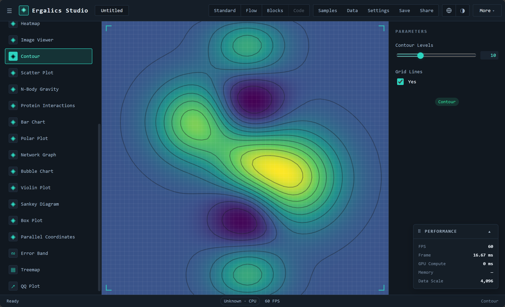
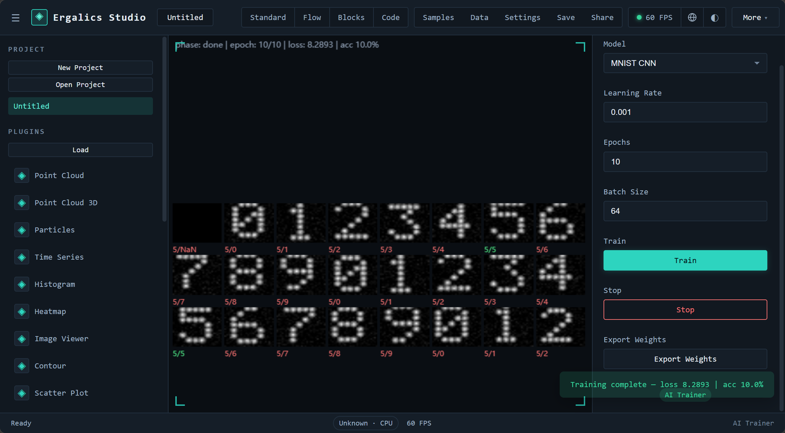
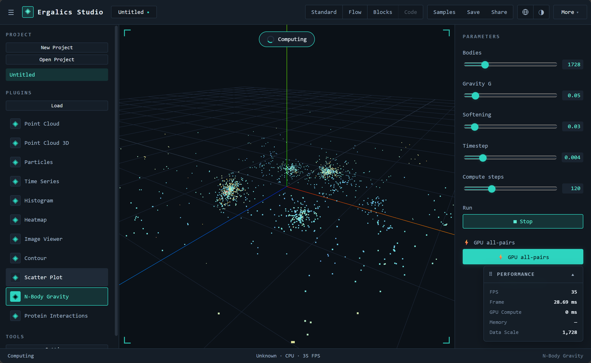
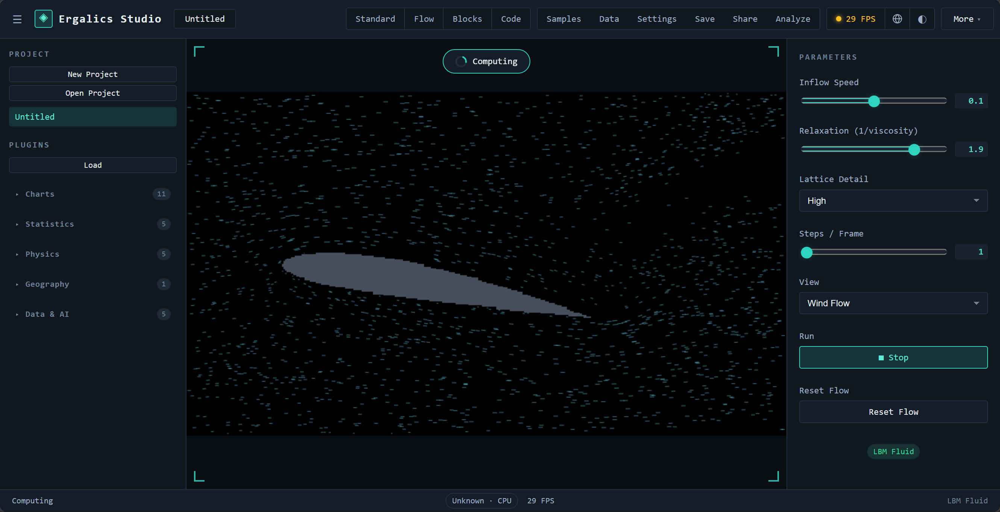
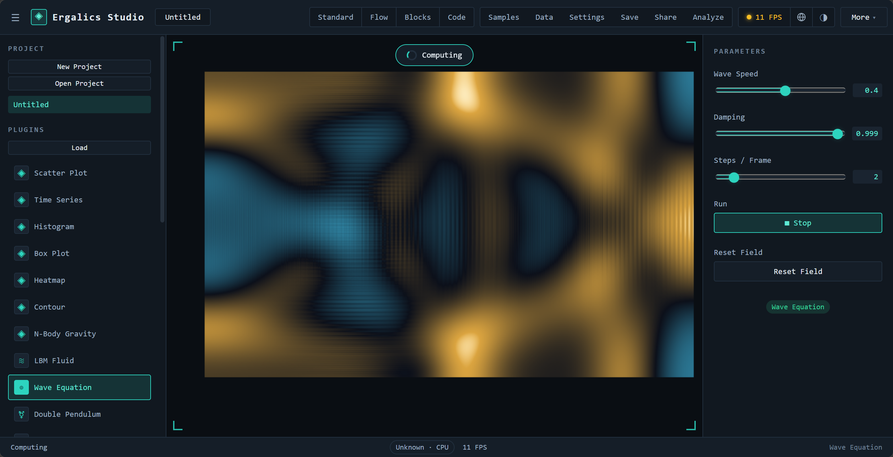
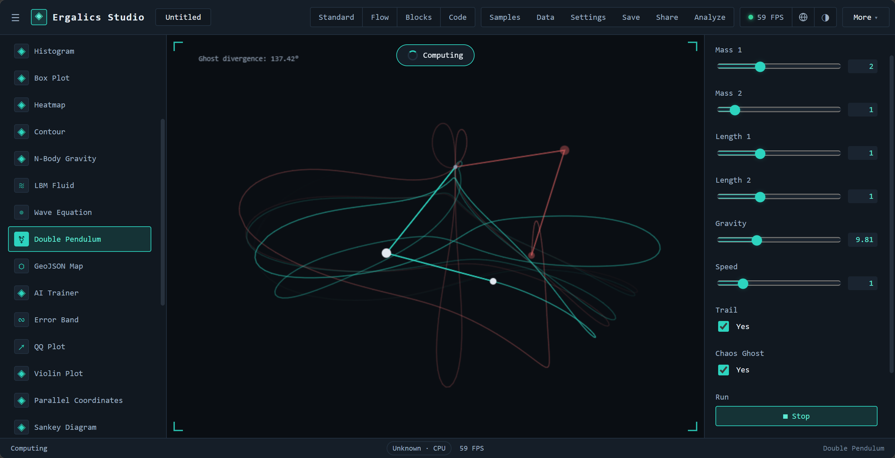
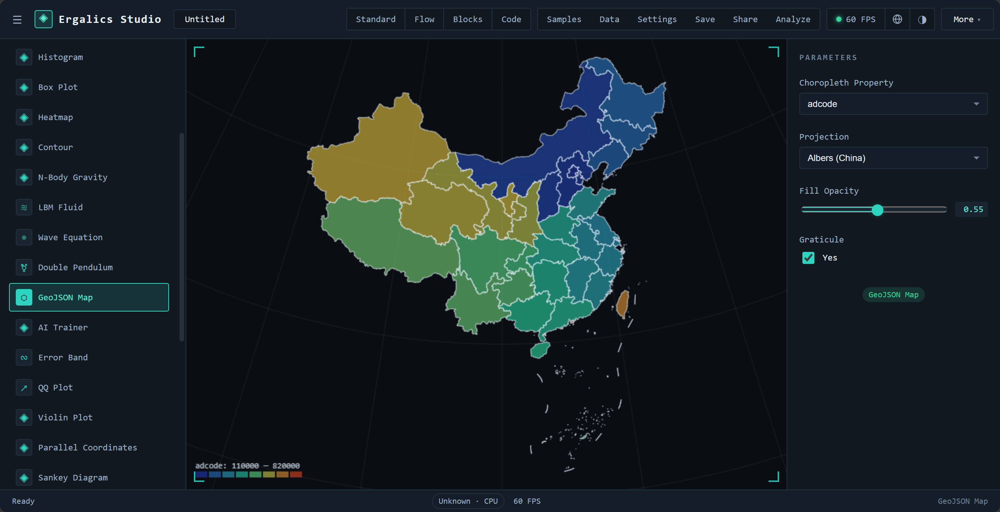

# 插件开发

## Plugin 接口

每个插件都实现 `Plugin` 契约（`src/types/plugin.ts`）：

```ts
interface Plugin {
  readonly manifest: PluginManifest;
  init(api: PluginApi): Promise<void> | void;      // required
  getParams(): ParamDefinition[] | Promise<...>;   // required
  destroy?(): Promise<void> | void;
  activate?(context: PluginRenderContext): Promise<void> | void;
  deactivate?(): Promise<void> | void;
  render?(container: ContainerCapabilities): Promise<void> | void;
  updateParams?(params: Record<string, unknown>): Promise<void> | void;
  compute?(input, onProgress?): Promise<ComputeResult>;
  loadData?(file: File): Promise<void> | void;
  loadValidatedData?(payload: ValidatedDataPayload): Promise<void> | void;
  getSupportedFormats?(): SupportedFormat[] | Promise<SupportedFormat[]>;
  renderToScene?(scene: Scene3DHandle): Promise<void> | void;
  onProjectSave?(): Promise<void> | void;
  onProjectLoad?(): Promise<void> | void;
}
```

只有 `manifest`、`init` 和 `getParams` 是必需的——没有它们，宿主无法注册、接线或配置插件。其他成员均为可选，调用前通过 `?.` 检测，因此最小第三方包可以只实现 `render`。

宿主驱动生命周期：

1. **加载**——运行模块工厂，然后使用宿主 `PluginApi` 调用 `init(api)`。
2. **激活**——插件接收 `{ container, api }` 并渲染到容器（2D 画布、DOM 或 Three.js 场景）。
3. **参数**——解析 `getParams()`（可能是异步的，例如沙箱插件通过 RPC 响应）并显示在右侧面板；用户编辑通过 `updateParams` 到达。
4. **停用 / 销毁**——插件不再处于激活状态时运行 `deactivate()`（停止计时器与动画循环，保留状态）；卸载时运行 `destroy()`，必须释放所有资源。卸载*已激活*的插件会按此顺序调用两者。
5. **项目钩子**——项目持久化成功后触发 `onProjectSave()`；项目插件状态恢复后触发 `onProjectLoad()`。两者均为尽力而为：钩子抛错会被记录，但绝不会中止触发它的保存/加载。

## 清单

```jsonc
{
  "id": "com.example.analyzer",
  "name": "Analyzer",
  "version": "1.2.0",
  "author": "Example Corp",
  "description": "…",
  "license": "MIT",
  "entry": "dist/index.js",
  "sandbox": "isolated",            // "isolated" (default) | "trusted"
  "formats": [{ "extension": ".csv", "mimeTypes": ["text/csv"] }],
  "dataSchema": { "preset": "ergalics:tabular/xy-series" }, // 或内联 JSON Schema
  "nameI18n": { "zh-CN": "分析器" }
}
```

`sandbox` 字段决定入口代码在哪里执行（见下文）。内置插件总是在宿主上下文中运行。

## 数据契约（`dataSchema`）与在线数据编辑

仅声明 `formats` 只能告诉宿主"接受哪些扩展名"，用户无法在界面上第一时间了解列结构与类型约束，导入错误 CSV 也容易触发裸异常。为解决该问题，插件可在清单中声明可选的 **`dataSchema`**（`src/types/dataSchema.ts`），**一份声明同时驱动五项宿主能力**：

1. **右侧面板数据契约卡片**：自动展示插件所需的必填/可选列、数据类型、物理单位、数值范围及 4 个快捷操作（**在线编辑 / 项目数据 / 上传文件 / 载入模板**）。
2. **Zod v4 运行时预检与精准报错**：导入前由宿主编译为 Zod 校验器执行检查，出错时不再抛裸异常，而是展示精确到 `行号 · 列名 · 原因 · 当前值` 的诊断表，并支持一键跳入在线编辑器修复或跳过无效行。
3. **智能列映射**：当用户 CSV 表头与插件字段名不同（如 `days, status` vs `time, event`）时，宿主按精确名、别名、类型推断与位置打分自动映射，低置信度时弹出交互式「列映射确认对话框」。
4. **双态在线数据编辑器**：用户无需切到外部软件生成数据——在插件内点击**在线编辑**默认以画布底部可拖拽抽屉打开（默认开启 300ms 防抖**实时联动**，改数即看画布与科学指标条更新），右上角可一键切换为大浮窗；表格类支持 Excel/CSV 块粘贴（`Ctrl+V`）、撤销/重做与单元格实时标红校验，JSON 类内置 Monaco JSON Schema 自动补全与波浪线诊断。编辑结果可一键保存到全局项目数据（覆盖或另存为），自动同步至工作区 `data/` 与其他关联插件。
5. **跨插件共享与全局兼容徽章**：全局「数据」弹窗会根据当前激活插件的 `dataSchema` 自动标注每个项目文件的 `✓ 兼容` / `⇄ 需映射` / `✕ 不匹配` 状态。

### 方式一：引用共享语义预设（推荐）

如果插件消费的是常见数据结构，直接引用共享预设（`src/core/data-schema/presets.ts`）即可，并可用 `overrides` 局部覆写标题、`minRows`、`liveSync`（重计算插件建议设为 `false`）：

```jsonc
{
  "dataSchema": {
    "preset": "ergalics:tabular/xy-series",
    "overrides": { "minRows": 3, "liveSync": true }
  }
}
```

常用共享预设包括：`ergalics:tabular/xy-series`、`xyz-points`、`xy-error`、`category-value`、`grouped-values`、`univariate`、`time-series`、`edge-list`、`survival-table`、`meta-analysis`、`doe-table`、`multi-numeric`、`geo-points`、`ergalics:json/node-link-graph`、`grid-2d`、`geojson` 等。引用同一预设的插件可直接共享项目数据文件。

### 方式二：内联 JSON Schema（Draft 2020-12）

自定义数据结构可在 `manifest.json` / `manifest.ts` 中直接声明纯 JSON Schema（支持 `tabular` / `json` / `text` / `binary` 四种 `kind`），并通过 `x-ergalics` 扩展字段提供多语言标签、列映射别名与物理单位：

```jsonc
{
  "dataSchema": {
    "id": "primary",
    "kind": "tabular",
    "title": "Calibration Curve",
    "titleI18n": { "zh-CN": "校准曲线表" },
    "extensions": [".csv", ".tsv"],
    "minRows": 2,
    "allowExtraColumns": true,
    "rowSchema": {
      "$schema": "https://json-schema.org/draft/2020-12/schema",
      "type": "object",
      "properties": {
        "conc": {
          "type": "number",
          "minimum": 0,
          "x-ergalics": { "labelI18n": { "zh-CN": "浓度" }, "aliases": ["c", "concentration"], "unit": "mg/L", "order": 1 }
        },
        "abs": {
          "type": "number",
          "x-ergalics": { "labelI18n": { "zh-CN": "吸光度" }, "aliases": ["a", "signal"], "order": 2 }
        }
      },
      "required": ["conc", "abs"]
    },
    "sampleRows": [
      { "conc": 0, "abs": 0.01 },
      { "conc": 5, "abs": 0.48 },
      { "conc": 10, "abs": 0.95 }
    ]
  }
}
```

> **安全边界（`.cspkg` 安装校验）**：第三方包清单中的 `dataSchema` 必须为纯 JSON，宿主 `validateManifest` 会拒绝外部 `$ref`、超过 12 层的嵌套、原型污染键名以及包含嵌套量词的 ReDoS 危险正则。

### JSON Schema ↔ Zod v4 双向生成与 `loadValidatedData`

- **双向转换**（`src/core/data-schema/`）：
  - **正向（Zod → JSON Schema）**：TypeScript 插件开发者可用 Zod v4 编写行/文档模型并用 `col(z.number().positive(), { unit: 'd', aliases: [...] })` 附加元数据，再通过 `defineTabularSchemaFromZod` / `defineJsonSchemaFromZod` 导出纯 JSON Schema（同时保留 `z.infer` 编译期类型）。注意：`manifest.ts` 本身应保持纯 JSON 数据，不要直接 `import 'zod'`，以免影响首屏 bundle 预算。
  - **反向（JSON Schema → Zod）**：宿主按需懒加载 `compileJsonSchemaToZod` / `compileTabularRowToZod`（基于 Zod v4 原生 `z.fromJSONSchema()` + 科学级严格单元格转换，空单元格与 `NA` 绝不会被静默转为 `0`）。
- **向后兼容的数据接收**：
  - 实现可选的 `loadValidatedData(payload)` 可直接获取已完成列映射与 Zod 校验的强类型 `payload.data`（无需自己手写 CSV/JSON 解析）。
  - **未实现 `loadValidatedData` 的既有插件也无需修改代码**：宿主会自动将校验/映射/在线编辑后的数据序列化为规范表头的 `File`，继续调用 `loadData(file)`。

## 容器能力

```ts
interface ContainerCapabilities {
  three?: Scene3DHandle;        // host-managed Three.js scene (3D plugins)
  canvas2d?: HTMLCanvasElement; // shared 2D canvas
  dom?: HTMLDivElement;         // generic DOM container
  reportDataScale(n: number): void; // feed the perf panel
}
```

声明 `renderToScene` 后，宿主会为插件物化 Three.js 场景——按照设计，2D 画布与场景互斥，宿主会代为切换可见性。

**相机控制由宿主提供，因此插件无须编写输入代码。**

- **3D 视口**——拖动环绕，右键拖动平移，滚轮缩放；方向键平移，**WASD** 沿视图轴移动（按住 **Shift** 加速），**Q/E** 使相机绕目标偏航。
- **2D 视口**——拖动平移共享画布，滚轮缩放；双击重置视图。

## PluginApi

插件通过精简的能力受限 API 与宿主交互：语言环境（`locale`、`t`、`onLocaleChange`）、状态/性能（`setStatus`、`reportGpuTime`、`reportDataScale`）、通知（`notify`）、**日志**（`log`）、**结果导出**（`exportFile`）、**中间结果缓存**（`cache`）、文件（`openFile`、`readText`、`readBinary`）、项目作用域持久化（`getParam`、`setParam`）、取消/前台状态探测（`onCancel`、`isActive`）及可选的自重载（`reload`），以及 WebGPU 设备可用时的 GPU 计算（`gpu`，见[原生核心与 WebGPU](native-core)）。

### 日志（`api.log`）

```ts
api.log('info', 'loaded 4096 bodies', { file: file.name, ms: 12.4 });
```

每行日志以 `plugin:<id>` 作用域记录在宿主的有界缓冲区中，并随参数快照和运行历史一起由**导出运行日志**（顶栏 → 项目下拉菜单）导出。请用它代替 `console.*`：控制台输出在重载后丢失，也不会进入问题报告。

| 级别 | 适用场景 |
| --- | --- |
| `debug` | 每步细节，通常隐藏 |
| `info` | 生命周期与数据里程碑 |
| `warn` | 已恢复的问题（跳过的行、被限制的参数） |
| `error` | 用户必须看到的失败 |

在隔离沙箱中，`log` 经 RPC 桥接传递，因此是发出即忘——不会抛错，也不会阻塞调用者。

### 结果导出（`api.exportFile`）

```ts
api.exportFile('cleaned-series.csv', csvText, 'text/csv');
```

将字符串、`ArrayBuffer` 或 `Blob` 交给宿主，由宿主触发下载并释放对象 URL。这是从插件导出派生数据（清洗后的表、拟合参数、指标）的规定方式。

### 中间结果缓存（`api.cache`）

```ts
const key = `${file.name}:${file.size}`;
const cached = await api.cache.get<Float64Array>(key);
if (cached) return cached;
const parsed = parseExpensive(file);
await api.cache.set(key, parsed, 60 * 60 * 1000); // 1 h
```

这是插件作用域、由 LRU 限制（默认 32 项）的临时空间，用于保存重新计算代价高但不应持久化的结果。所有方法都是异步的，因为沙箱内的缓存位于宿主侧。卸载插件时缓存自动清除——必须在重载后保留的内容应放入 `setParam`。

### 沙箱注意事项：返回 Promise 的成员

`getParam`、`setParam` 和 `cache.*` 在隔离 Worker 中跨越 RPC 桥，因此即使宿主签名是同步的，在那里仍以 Promise 解析。如果包需要在两种上下文中运行，始终对它们使用 `await`，不要依赖同步返回值。

### GPU 计算

`api.gpu` 仅在 WebGPU 可用时存在（在 Worker 沙箱中始终不存在），因此始终通过 `available` 检查：

```ts
const gpu = api.gpu;
if (!gpu?.available) {
  // CPU fallback — same math, no GPU.
}

const data = gpu.createBuffer(
  bytes,
  GPUBufferUsage.STORAGE | GPUBufferUsage.COPY_DST | GPUBufferUsage.COPY_SRC,
  'data',
);
const kernel = gpu.compileKernel({
  label: 'my.kernel',
  wgsl: myWgsl,                    // or a template from src/core/wgsl.ts
  workgroupSize: [64, 1, 1],
  bindings: [{ binding: 0, bufferType: 'storage' }],
});
data.write(particles);
gpu.run(kernel, [data], workgroups, 1, 1);   // bind group + dispatch + submit
const result = await data.read();            // readback copy (read() handles it)
```

> **缓冲区 usage 注意事项**——WebGPU 只允许 `MAP_READ` 与 `COPY_DST` 一起使用，因此不能直接映射计算用存储缓冲区。以 `STORAGE | COPY_DST | COPY_SRC` 创建；`read()` 在内部将结果复制到单独的 `MAP_READ | COPY_DST` 回读缓冲区。

## 可追溯性：运行、参数与日志

可复现性是一等关注点，因此宿主无需任何插件代码即可记录发生的事情：

| 记录 | 细节 |
| --- | --- |
| **运行历史** | 每次宿主驱动的数据导入通过 `pluginStore.beginRun()` / `finishRun()` 记录插件 id、插件版本、文件名、字节数、耗时与结果。 |
| **参数快照** | `exportParameterSnapshot()` 将每个已加载插件的*实时*参数与其版本一起冻结，使结果可追溯到生成它的准确配置。 |
| **日志缓冲区** | 宿主 logger 将每条 `logger` / `api.log` 日志保存在有界环形缓冲区（默认 500 条，可通过 `configureLogger({ bufferSize })` 调整）中。 |

**导出运行日志**（顶栏 → 项目下拉菜单）将三者打包到一个 JSON 文件中：

```jsonc
{
  "generatedAt": "2026-09-12T11:30:00.000Z",
  "plugins":     [{ "id": "example.scatter", "version": "1.0.0", "active": true }],
  "parameters":  { "example.scatter": { "version": "1.0.0", "params": { "size": 3 } } },
  "runs":        [{ "id": "run-1", "pluginId": "example.scatter",
                    "kind": "data-import", "label": "clusters.csv",
                    "startedAt": 1757681400000, "durationMs": 42, "ok": true }],
  "logs":        [{ "at": "...", "level": "info", "scope": "plugin:example.scatter",
                    "message": "loaded 4096 points" }]
}
```

## 内置插件约定

内置插件只通过 `src/core/` 共享框架级辅助工具：

| 约定 | 规则 |
| --- | --- |
| **共享工具** | 按钮工厂、通知、PNG/CSV 导出和空状态画布位于 `@/core/plugin-tools/`（`enhance.ts`、`table.ts`、`locale.ts`）。数据驱动解析辅助函数（`parseDelimited`、`stripHeaderIfNonNumeric`）位于 `@/core/plugin-tools/table.ts`。 |
| **禁止插件互相导入** | 内置插件绝不能导入另一个内置插件的模块。多个插件需要的共享逻辑应先放到 `src/core/`；如果逻辑足够专属于插件而应留在 `src/plugins/`，则放在该插件套件目录内的共享文件中，由套件中的插件从那里导入。 |
| **清单命名** | 每个插件的清单文件以插件入口文件命名（`scatter.ts` → `scatterManifest.ts`），入口导入一次且不重新导出。 |

## 内置示例插件

`src/plugins/builtin/` 提供 155 个科学/核心插件（另有 10 个声明 `autoload: false` 的 `fun.*` 趣味插件——共 165 个内置插件），覆盖完整插件契约接口：2D 画布、宿主 Three.js 场景、`loadData`、`compute` 和 `api.gpu` 加速路径。下表是具有代表性的截面；完整注册表为 `src/plugins/builtin/index.ts` 中的 `BUILTIN_PLUGINS`（侧边栏学科映射位于 `src/plugins/categories.ts`）；逐插件清单见自动生成的《[12 · 插件全表](../technical/12-插件全表.md)》：

| 插件 id | 数据 | 能力 |
| --- | --- | --- |
| `example.point-cloud` | `.xyz` | 2D 画布点云 |
| `example.point-cloud-3d` | `.xyz`, `.dat` | Three.js `Points`、高度渐变、自动适配 |
| `example.particles` | `.dat` | 2D 模拟 + 真实 WGSL 积分内核 |
| `example.timeseries` | `.csv` | 2D 多序列折线图 |
| `example.histogram` | `.dat` | 分箱 + 对数刻度 |
| `example.heatmap` | `.json`（网格） | viridis 渐变 |
| `example.image` | `.png` | base64 图像查看器 |
| `example.contour` | `.json`（网格） | 色阶 + marching-squares 等值线 |
| `example.scatter` | `.dat/.csv/.xyz` | 带颜色通道的 2D 散点图 |
| `example.nbody` | `.json`（天体） | 三维全对引力，GPU + CPU |
| `example.protein` | `.json`（网络） | 力导向布局 + 连通分量指标 |
| `example.bar_chart` | `.csv` | 分组柱状图、方向与调色板 |
| `example.polar` | `.csv` | 多序列雷达图 |
| `example.network` | `.csv`（边） | 力导向布局、按度数定尺寸 |
| `example.bubble` | `.csv` | 气泡大小 + 颜色通道 |
| `example.violin` | `.csv` | 核密度 + 箱线叠加 |
| `example.sankey` | `.csv`（边） | 比例流带 |
| `example.boxplot` | `.csv` | 四分位数、须线、离群点 |
| `example.parallel` | `.csv` | 平行坐标、按类别着色 |
| `example.errorband` | `.csv` | 折线周围的阴影置信带 |
| `example.treemap` | `.csv` | 层级矩形布局（扁平或嵌套） |
| `example.qqplot` | `.csv/.dat` | 正态分位数比较 + 参考线 |
| `example.ai-training` | `.csv`, `.json` | 4 种模型（线性 / 非线性神经网络 / 逻辑回归 / MNIST CNN）、实时损失曲线、散点+拟合 / 决策边界 / 数字网格 |
| `example.fluid` | `.json`（障碍掩码） | 二维格子 Boltzmann 通道流（D2Q9）、WGSL 碰撞 + 迁移内核、卡门涡街 |
| `example.wave` | `.json`（u / 驱动网格） | 二维有限差分波动方程（脉冲 / 双源 / 双缝）、WGSL 蛙跳内核 |
| `example.pendulum` | `.json`（初始条件） | RK4 双摆与偏移 0.001 rad 的混沌幽灵副本 |
| `example.geomap` | `.geojson`, `.json` | 离线矢量地图及分级设色；Albers（中国）/ Web Mercator / 等距圆柱投影 |
| `example.surface-3d` | `.json`（网格） | 按高度渐变着色的三维曲面及 OrbitControls |
| `example.voxel-3d` | `.json`（场） | 体素体积/实体渲染，支持透明度与切片 |
| `example.electromag` | `.json`（电荷 / 场） | 交互式电磁场与力可视化 |
| `example.optics` | `.json`（光线 / 介质） | 带透镜、镜面、介质与焦点读数的光线追踪光学实验室 |
| `example.structure` | `.json`（桁架杆件） | 铰接桁架：轴力着色、利用率读数及过载坍塌 |
| `example.em-eigensolver` | `.npz`, `.npy`, `.mtx` | 稀疏厄密特征值求解器（厚重启 Lanczos / LOBPCG / Jacobi-Davidson + MINRES 移位求逆）、二维谱报告与三维模式场、Pyodide Worker |
| `example.fluid-cfd-coupler` | `.json`（网络 + 三维场） | 1D 管网–3D 场双向耦合，含多速率时间步协调、粗细子循环与毫秒级阀门控制 |
| `example.geo-solar` | `.json`（地点） | 太阳高度角与昼长曲线 |
| `example.geo-climograph` | `.csv`/`.txt`（月、温度、降水） | 月常年值气候图 |
| `example.geo-pop-pyramid` | `.csv` | 人口金字塔 |
| `example.geo-interp` | `.csv`（点） | 空间插值 |
| `example.geo-measure` | `.json` | 距离与面积测量 |
| `example.geo-tissot` | `.json`（GeoJSON） | 投影变形（Tissot 指示椭圆） |
| `example.geo-terrain` | `.asc` | DEM 地形分析 |
| `example.geo-gpx` | `.gpx` | GPX 轨迹分析 |
| `example.geo-globe` | `.json`（GeoJSON） | 交互式三维地球仪 |
| `example.chem-crystal` | `.cif`, `.poscar`/`.vasp` | 三维晶胞 |
| `example.chem-reaction` | `.json`（反应场景） | 三维反应机理查看器 |
| `example.bio-enzyme` | `.csv`/`.tsv`/`.json`（底物、v₀） | 酶动力学（Michaelis–Menten） |
| `example.bio-epidemic` | `.json`/`.csv`/`.tsv` | 基于每日病例数的流行病建模 |
| `example.bio-seqalign` | `.fasta`/`.fa`/`.txt` | 序列比对 |
| `example.bio-popgen` | `.csv`/`.tsv`/`.json`（基因型计数） | 群体遗传学 |
| `example.env-aqi` | `.csv`/`.txt`（污染物行） | 空气质量指数 |
| `example.env-water` | `.csv`/`.txt`（站点行） | 水质 |
| `example.env-greenhouse` | — | 温室效应 |
| `example.env-carbon` | `.csv`/`.txt`（碳库 + 通量） | 碳循环 |
| `example.env-biodiversity` | `.csv`/`.txt`（丰度矩阵） | 生物多样性指数 |
| `example.env-plume` | — | 污染物扩散 |
| `example.env-earth3d` | — | 三维全球环境 |
| `fx.ocean` | `.json`（海况预设） | 离散 Pierson–Moskowitz 频谱生成的 Gerstner 波列、Fresnel 水体与海雾 |
| `fx.misty` | `.json`（场景预设） | 分层雾峰渲染器——脊状噪声山脊叠层、阳光照明、空气透视与 Koschmieder 能见度雾 |

另外 10 个**趣味 / 实用工具**插件（`fun.*`，例如 Mandelbrot、生命游戏、科赫雪花、烟花）声明 `autoload: false`，从内置面板或市场标签页按需加载。

### 等值线（`example.contour`）



*64×64 标量场以 viridis 渐变及 marching-squares 等值线渲染——示例双峰场。展示宿主将 `.json` 网格自动路由到插件的数据驱动加载。*

64×64 标量场查看器：viridis 色阶加 marching-squares 等值线。网格归一化逻辑由 `builtinPlugins.test.ts` 覆盖，内置示例（`field.json`）渲染上面的双峰场。

### AI 训练器（`example.ai-training`）



*浏览器内模型训练：10 个 epoch 后，MNIST CNN 网格显示每个数字的预测（绿）与真实值（红），旁边是实时更新的损失曲线。*

适用于“无需编写代码，在浏览器内训练小模型”。四类模型——`linear`、`nonlinear-nn`、`logistic`、`mnist`——共享 `Train` / `Stop` / `Export Weights` 按钮界面与实时损失曲线。它同时使用多个宿主功能，因此是插件作者的实用参考：

- **`loadData(file)`** 通过单一辅助函数解析表格 CSV，并接受 MNIST 的 785 列 `label,p0..p783` 格式。宿主路由器根据文件扩展名选择正确插件，因此将 CSV 拖到画布即可开始训练。
- **`button` 参数 + `updateParams`** 驱动训练流程。插件发布三个按钮，各自携带 `action` 字符串（`train` / `stop` / `export`），`updateParams` 读回并分发。无须自定义 `api.*` 调用。
- **长时间运行的 `compute` 回调**通过 `onProgress` 钩子持续输出进度，使训练期间损失曲线与下方面板重绘而不阻塞 UI。
- **重依赖动态导入。** TensorFlow.js 约 2 MB，自动加载步骤*不会*加载它——`loadTf()` 在首次使用时执行 `await import('@tensorflow/tfjs')`，然后优先 WebGL 后端、回退 CPU。携带大型原生依赖的插件作者可采用同样模式。
- **内置示例数据位于 `examples/data/ai/`**（线性、非线性、逻辑回归、MNIST），通过全局**示例**对话框而非各插件的“Load Sample”按钮提供，使该对话框保持为一键加载数据的唯一入口。

### N-Body 引力（`example.nbody`）



*4096 个天体组成的环面环绕中心质量：直接求和引力通过宿主 Three.js 场景以 THREE.Points 渲染，物理计算由 WGSL 全对内核在设备上推进。*

三维天体物理演示：每个天体都受到其他所有天体引力的直接求和——**每步 O(N²)**。它声明 `renderToScene`，因此宿主物化 Three.js 场景，插件将天体渲染为 `THREE.Points`（按速度着色，相机自动适配）。

- **数据**——JSON 初始条件，可以是 `[x, y, z, vx, vy, vz, mass]` 元组数组，也可以是带这些键的对象：
  ```json
  { "bodies": [[0, 0, 0, 0, 0, 0, 50], [0.9, 0.18, 0.0, 0.01, 0, -1.56, 1]] }
  ```
  内置示例（`nbody.json`）是 4096 个天体组成、环绕中心质量的**环面环**。
- **计算**——`GPU all-pairs` 按钮（或 `compute()`）将天体上传到交错排列的 `[x,y,z,vx,vy,vz,mass]` 存储缓冲区，调度 WGSL 全对内核。两个缓冲区以**乒乓方式**使用，使每个积分步骤都留在设备上，无逐步回读。在 CPU 上（或没有 `api.gpu` 时）回退到相同积分器（`src/core/wgsl.ts` 中的 `advanceNBodyCPU`）。
- **参数**——`Bodies`（重新采样数）、`Gravity G`、`Softening`、`Timestep`、`Compute steps`、`Run` 开关（实时动画）与 GPU 计算按钮。
- 插件是**数据驱动**的：加载 `.json` 文件或示例数据前渲染空场景，绝不伪造数据集。

### 蛋白质相互作用（`example.protein`）


*560 蛋白质 PPI 网络的力导向（Fruchterman-Reingold）布局，节点按度数着色并定尺寸；布局经退火收敛并报告连通分量。*

系统生物学演示。加载蛋白质–蛋白质相互作用（PPI）网络，计算**力导向布局**（Fruchterman-Reingold 弹簧–电模型）——每次迭代 O(V²) 斥力 + O(E) 引力，经退火收敛——然后报告与生物学相关的指标。

- **数据**——JSON，包含 `proteins`（`{id, name}`）与 `interactions`（`{source, target, weight}` 或 `[sourceIdx, targetIdx, weight]`）：
  ```json
  {
    "proteins": [{ "id": "P0", "name": "Protein-0" }],
    "interactions": [{ "source": "P0", "target": "P1", "weight": 0.8 }]
  }
  ```
  内置示例（`protein.json`）是包含 560 个蛋白质 / 约 1700 条相互作用的模块化网络。
- **计算**——`Compute layout` 按钮执行 `Iterations` 步布局，使用模拟退火温度衰减，然后通过 `ComputeResult.output` 报告**连通分量**数（潜在复合体/模块）及最大分量大小。
- **参数**——`Proteins`、`Iterations`、`Repulsion (k)`、`Run` 开关（实时松弛）与计算按钮。实时动画使温度退火，稳定后自动停止，避免节点抖动。
- 节点按度数着色并定尺寸；边带权重。

### LBM 流体（`example.fluid`）



*Wind Flow 视图中绕翼型掩码的格子 Boltzmann（D2Q9）通道流；碰撞与迁移作为 WGSL 内核运行，形成卡门涡街。*

绕用户提供的障碍掩码的二维格子 Boltzmann 通道流（D2Q9）。碰撞与迁移步骤作为 **WGSL 内核**运行（配有由测试保证的一致 `fluidStepCPU` 回退），长障碍物会形成卡门涡街。

- **数据**——JSON 障碍掩码，`1` 表示固体格点。内置示例（`fluid-obstacle.json`）是翼型轮廓。
- **参数**——`Inflow Speed`、`Relaxation (1/viscosity)`、`Lattice Detail`、`Steps / Frame`、`View` 选择器（`Wind Flow` / 涡量等），以及 `Run` / `Stop` 和 `Reset Flow`。
- 与所有模拟插件一样，它严格数据驱动：初始为空，绝不伪造默认场景。

### 波动方程（`example.wave`）



*网格上的二维有限差分波动方程（WGSL 蛙跳内核）：双源示例显示两列圆波干涉形成特征性的橙/蓝振幅网格。*

网格上的二维有限差分波动方程，由 **WGSL 蛙跳内核**积分（`waveStepCPU` 是经过测试的 CPU 回退）。

- **数据**——包含 `u` 网格和可选驱动网格的 JSON（`< 0` 为障碍，`> 0` 为波源振幅）。三个内置示例覆盖这些场景：`wave-pulse.json`、`wave-twin.json`（双源干涉）和 `wave-slit.json`（双缝）。
- **参数**——`Wave Speed`、`Damping`、`Steps / Frame`、`Run`/`Stop` 和 `Reset Field`。

### 双摆（`example.pendulum`）



*两个由 RK4 积分、初始角度仅差 0.001 rad 的双摆；轨迹分离时 HUD 显示实时幽灵偏差（137.42°）——直观展示混沌。*

混沌演示：两个由 **RK4** 积分的双摆，幽灵副本的初始角度仅偏移 **0.001 rad**。HUD 显示实时幽灵偏差，使轨迹分离时对初始条件的敏感依赖直观可见。

- **数据**——JSON 初始条件（角度 + 角速度）。内置示例：`pendulum-chaos.json` 和 `pendulum-flip.json`。
- **参数**——`Mass 1/2`、`Length 1/2`、`Gravity`、`Speed`、轨迹开关、`Chaos Ghost` 开关和 `Run`/`Stop`。

### GeoJSON 地图（`example.geomap`）



*离线 GeoJSON 中国省份分级设色图，按属性着色并采用 Albers（中国）投影——无需瓦片服务器、无需网络。*

**离线**矢量地图：加载 GeoJSON FeatureCollection，按所选属性为每个要素着色（分级设色）——无需瓦片服务器或网络。

- **数据**——`.geojson`（或 `.json`）文件。内置示例：`china-provinces.geojson`（带 `adcode` 的省份多边形）和 `choropleth-sample.geojson`。
- **参数**——`Choropleth Property`、`Projection`（Albers（中国）/ Web Mercator / 等距圆柱投影）、`Fill Opacity` 与经纬网开关。
- `parseGeoJSON`——几何与属性提取——在 `geoPhysicsPlugins.test.ts` 中与流体 / 波动 / 双摆逻辑一起进行单元测试。

所有内置插件通过 `src/plugins/builtin/index.ts` 的 `BUILTIN_PLUGINS` 注册，其示例数据通过 `src/core/examples.ts` 的 `BUILTIN_EXAMPLES` 注册。

## 构建 `.cspkg` 包

包是包含 `manifest.json` + 入口 + 资源的 ZIP：

```
my-plugin.cspkg
├── manifest.json
└── dist/
    └── index.js        # module whose default export is the plugin factory
```

入口源码是一个函数体，接收（沙箱中的）`api` 并返回一个 `Plugin` 对象。

### 签名与信任

安装流程验证嵌入清单的 **ed25519** 签名（`signature.fingerprint` / `sig` / `signer` / `signedAt`，可选 `pub`）。未签名或未知密钥的包只有在明确确认“信任此来源”后才安装；篡改的包始终被拒绝。签名密钥也可在注册表中限制为只能用于沙箱（`isolated`）包——以此类密钥签名的 `trusted` 清单会被拒绝。

## 沙箱

- **`isolated`（默认）**——入口在带 postMessage RPC 桥的 **Web Worker** 中运行（`src/core/sandbox.ts`）。无法访问宿主页的全局变量、DOM、`window` 或 store。画布渲染通过转移到 Worker 的 `OffscreenCanvas` 工作；`dom`/`three` 句柄有意不可用。
- **`trusted`**——直接在宿主上下文中执行，可完整访问 DOM。仅用于自己控制的包。

如果 Worker 不可用，加载器会回退到尽力而为的严格 `new Function` 并遮蔽全局变量，**警告用户**这不是安全边界。

> **如实说明的限制**：Worker 共享同源的 IndexedDB，因此恶意包仍可能通过它读取应用数据。应将沙箱视为与页面上下文隔离，而不是与同源存储隔离。
