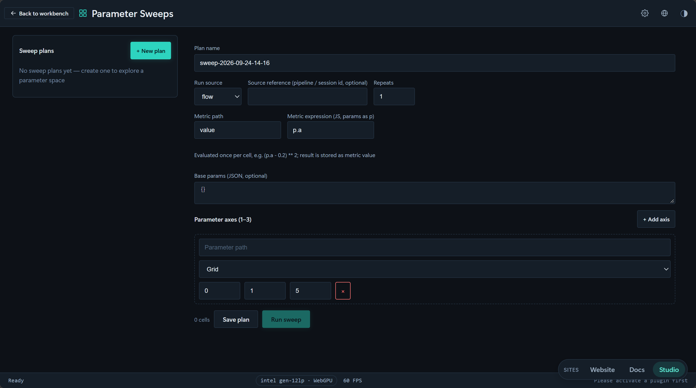
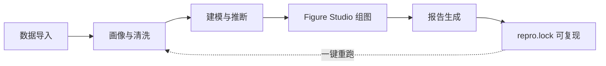
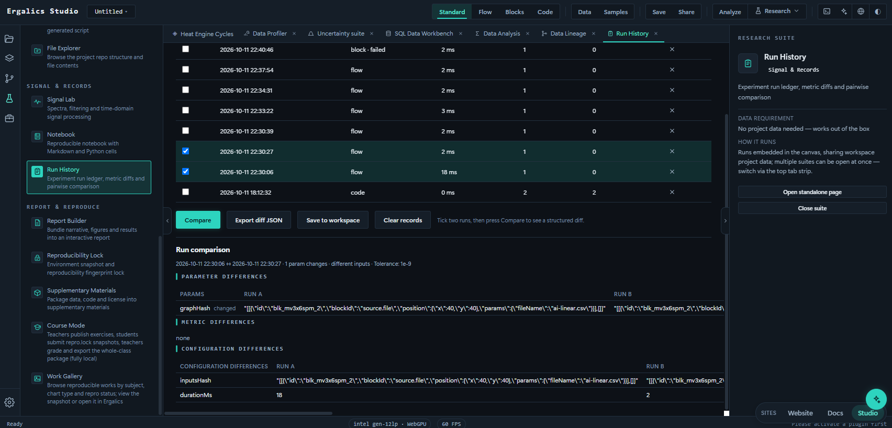
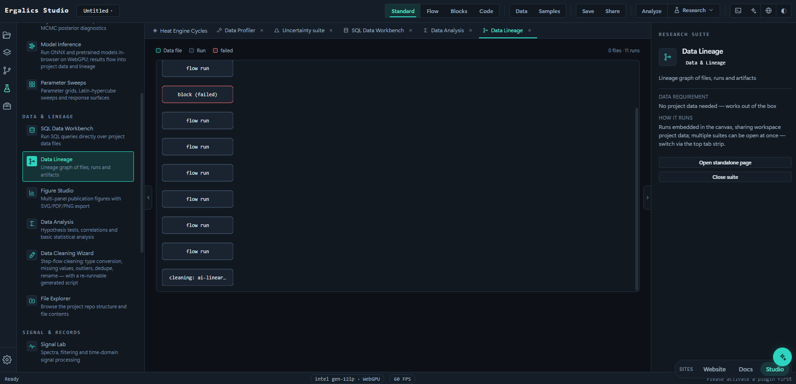
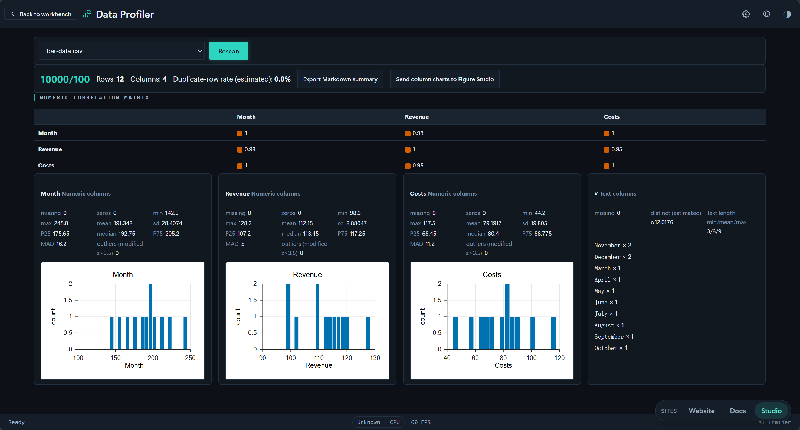
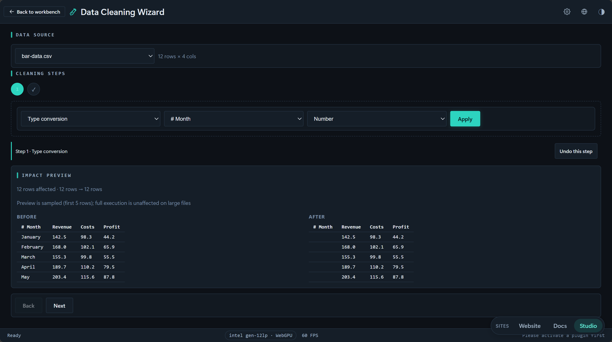
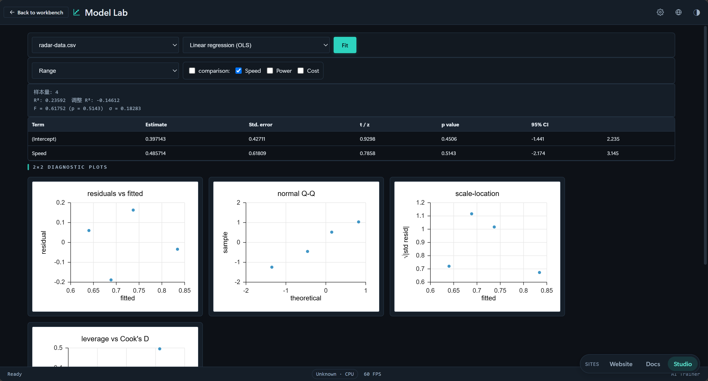
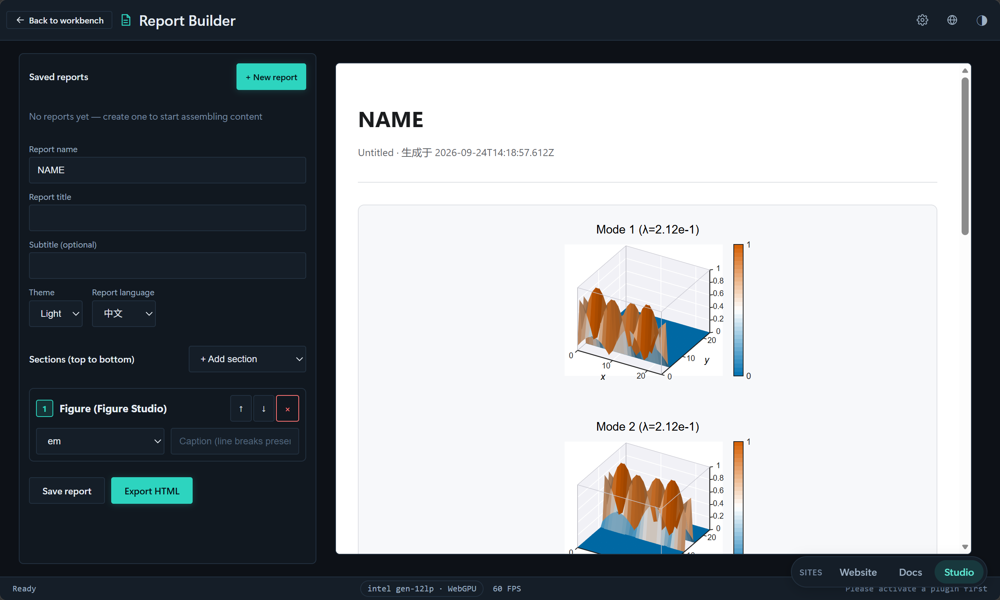
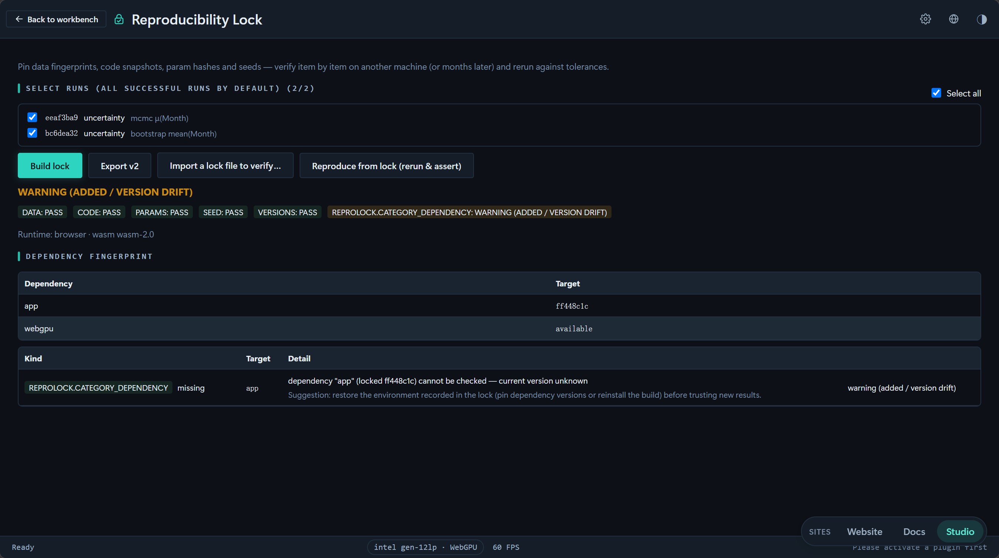

# Ergalics Studio

Ergalics Studio 是一个完全运行在浏览器中的科学计算工作站：数据导入、可视化、统计检验、数值仿真与报告生成在同一页面内完成；项目与数据保存在本机，源码与测试以 MIT 协议公开。

## 一、概述与定位

科学计算的实际工作常被三类成本拖慢：

- **环境成本。** 桌面软件需要安装、配置与许可，在公共机房或借用的电脑上往往无法快速重建自己的工作环境。
- **数据成本。** 云端平台免安装，但数据要上传到服务方，涉及未发表数据或受限样本时这一步直接不可行。
- **交付成本。** 分析做完只是开始，图要排成期刊格式、结论要写进报告，数月后需要重跑时，当初的参数与数据版本未必还在。

Ergalics Studio 把分析全程放进一个网页标签页，对上述三类成本的回答构成三个基本事实：运行环境只是一个网页标签页，`npm run dev` 或 GitHub Pages 皆可启动；数据全程留在浏览器本地存储（IndexedDB / OPFS），无账号、无上传；每一次分析自动记录参数、种子、代码与数据指纹，复现状态可以被显式检查。

| 维度 | 桌面科学软件（典型形态） | 云端计算平台（典型形态） | Ergalics Studio |
| --- | --- | --- | --- |
| 启动方式 | 安装并配置环境 | 打开网页，需注册 | 打开网页即用，无需注册 |
| 数据位置 | 本机 | 上传至服务方 | 始终在本机，可导出 `.clproj` 流转 |
| 离线可用 | 可用 | 通常不可用 | 全功能离线可用 |
| 计算内核 | 完整 | 由平台限定 | 14 个 WGSL 内核 + CPython / webR / DuckDB，均配一致回退 |
| 结果复现 | 取决于个人工作流 | 取决于平台快照 | repro.lock 五类指纹，漂移可判定 |
| 扩展方式 | 插件 / 脚本，门槛不一 | 平台限定 | `.cspkg` 与内置插件同契约、同沙箱 |

表中"典型形态"列描述各类方案的常见特征，非针对特定产品。

产品由四部分构成。其一是四模式工作台，从拖入数据查看结果，到流程管线、积木编程与真实脚本，共享同一份中间表示；其二是 107 个内置插件，覆盖 16 个学科的可视化、仿真与数据分析；其三是 26 个科研工具，承接画像、清洗、推断、组图、报告与复现各环节；其四是浏览器内运行时，包括 CPython（Pyodide）、webR、DuckDB-WASM 与 14 个 WGSL 计算内核。项目同时是一个 Git 仓库，版本历史与分析过程留在本机。

下表汇总本书引用的核心数字，各项均可在公开仓库中核查：

| 维度 | 现状 |
| --- | --- |
| 内置插件 | 107 个，覆盖 16 个学科（97 个随启动自动加载，10 个按需加载） |
| 科研工具 | 26 个，分六组，均可嵌入工作台画布 |
| 流程区块 | 38 个，覆盖数据源、变换、过滤、数学、统计、单位、可视化与绘图 |
| 计算内核 | 14 个 WGSL 计算内核，各配数学一致的 CPU 实现 |
| 脚本运行时 | CPython（Pyodide）、webR 0.6.0、DuckDB-WASM，随应用自托管 |
| 数据格式 | CSV / JSON / HDF5 / NetCDF / FITS / Zarr / Parquet 等统一导入 |
| 质量保障 | 2815 个单元测试（173 个文件）、14 套端到端测试、5 条 CI 工作流 |
| 开源治理 | MIT 协议；发版经 Zenodo 归档并铸造 DOI；SBOM 与引用元数据齐备 |

本书的阅读路径对应评审的关注顺序：第二至四章回答"它能做什么、用起来是什么样"，第五至六章回答"它是怎么实现的、能力边界在哪"，第七至八章回答"它是否可信、能否长期存在"。每一章的事实陈述都附有可核查的出处——测试文件、CI 工作流或源码位置，深入核对所需的技术文档系列在第九章附录 C 给出索引。

## 二、典型运行实例

以下实例分别对应五类典型计算：GPU 渲染、蒙特卡洛模拟、偏微分方程数值解、复分析可视化与参数化研究。画面均来自当前构建的内置插件与科研工具，加载示例数据或调整参数后即可重现；本节只描述各实例的计算内容，完整清单见第三章与第六章。

黑洞光线追踪：特效插件对视场内每条光线做 Schwarzschild 时空的测地线积分，光线在引力场中弯曲后采样吸积盘辐射；吸积盘的亮度与色移计入相对论性多普勒集束和引力红移，观察者倾角、盘半径与分辨率以滑块调节，渲染由 WebGPU 逐帧完成。

*黑洞 · 3D 光线追踪：逐像素测地线积分渲染的引力透镜与吸积盘。*

统计物理：二维伊辛插件在周期边界格点上运行 Metropolis 与 Wolff 团簇翻转两种蒙特卡洛算法；温度滑块扫过临界区域时，可以观察自发磁化的形成与消失。插件同时输出比热、磁化率与关联长度曲线，用于定位相变温度并检查有限尺寸效应，每次运行使用可复现的随机种子。

*二维伊辛模型：Metropolis / Wolff 蒙特卡洛的磁化构型与磁化率诊断。*

偏微分方程数值解：Gray-Scott 反应扩散插件以显式 FTCS 格式求解两种物质浓度的反应扩散方程，二维浓度场随时间演化出斑点、条纹与迷宫等图样；进料率与消去率两个参数决定图样类型，内置预设按 Pearson (1993) 的分类命名，也可从预设出发微调观察图样之间的转换过程。

*Gray-Scott 反应扩散：FTCS 数值解形成的图灵斑图，按 Pearson 分类标注。*

复分析可视化：域着色插件对复函数 f(z) 逐像素计算幅角与模，分别映射为色相与亮度；内置表达式解析器，支持缩放与平移，零点与极点的位置在色彩变化中直接可读，是复变函数教学与函数探索的直观工具。

*复变函数域着色：色相编码幅角、亮度编码模长，零点与极点清晰可辨。*

参数化研究：参数扫描工具对指定参数网格逐一运行模型并汇总输出指标，结果以热力图与曲线呈现，用于观察模型行为对参数的敏感性、定位稳定区间，也为后续的不确定性分析圈定输入范围。

*参数扫描：参数网格上的指标热力图与响应曲线。*

五个实例共享同一组运行条件：全部计算发生在浏览器标签页内，不依赖任何服务器；参数与随机种子可复现，同一组输入必然得到同一组输出；关键指标经统一的科学输出总线汇入画布顶部的读数条，与图、表一起进入后续的报告与复现记录。实例之间也可以组合——例如参数扫描圈定的输入范围，可以直接交给不确定性套件做 Bootstrap 传播与 MCMC 推断。

## 三、产品构成与工作模式

产品的核心是一条完整链路：数据进入、探索、建模推断、出版级组图、报告交付、全程可复现。每一段由对应的科研工具承接，且整条链在浏览器内闭合。

*从数据到交付的链路：各段由独立科研工具承接，全程留在浏览器内。*

工作台提供四种模式，对应不同的使用深度。三种脚本模式共享同一份中间表示（IR），积木、流程与代码之间可以往返互转，Python、R、JavaScript 三种语言亦可互译。

| 模式 | 面向 | 工作方式 |
| --- | --- | --- |
| 标准 Standard | 快速观察 | 数据集拖入插件即出图 |
| 流程 Flow | 管线搭建 | 38 个内置区块组成数据流图，拓扑执行、逐节点检查 |
| 积木 Block | 学习者与命令式偏好 | 类 Scratch 积木编辑器，可脚本化 |
| 代码 Code | 真实脚本 | Monaco 编辑器，Python 走 CPython（Pyodide），R 可升级到完整 webR 运行时 |

四种模式之间可以随时切换，项目数据与运行记录在切换后保持不变；一个分析的不同阶段可以在不同模式中完成——例如在流程模式整理数据、在代码模式微调脚本、再回到标准模式查看结果。图 1 的链路自左向右依次为：数据经导入或采集进入项目，画像与清洗建立分析基础，建模与推断给出结论，Figure Studio 与报告生成器完成出版交付，repro.lock 记录全程指纹并支持一键重跑。

标准模式是默认入口。欢迎页完成 WebGPU、OPFS 与各运行时的自检，启动网格列出全部科研工具与示例项目；数据文件拖入任意插件即出图，是"有数据、想先看看"时的最快路径。

*标准模式：欢迎页完成环境自检，启动网格通向全部科研工具。*

插件的参数面板由宿主依据插件清单自动生成本地化表单，覆盖范围滑杆、下拉、数字、复选框、文本、文件、按钮与开关八类控件；调整参数即时重新渲染，无需编写任何代码。画布顶部的 ScienceOutputStrip 条带实时显示当前插件的关键读数——收敛判据、残差、统计量——同一套读数口径贯穿全部科研级插件。

流程模式面向多步管线：区块按连线构成有向无环图，执行器按拓扑顺序增量运行，只有受参数变化影响的下游节点才会重算；每个节点可以单独查看输出与诊断信息。

*流程模式：区块连线成管线，按拓扑顺序增量执行。*

38 个内置区块分八类——数据源、变换、过滤、数学、统计、单位、可视化与绘图，覆盖从"读入 CSV"到"分组聚合再画图"的常见链路。每个区块的中间结果可以展开为表格或图形预览，出错时从报错节点直接定位上游；整张管线图可保存为项目的一部分，下次打开继续编辑。

积木模式用 Blockly 提供命令式编程入口，积木类型覆盖循环、分支、变量、事件与绘图；积木程序与流程、代码共享同一份中间表示，可以在三种形态之间往返转换，同一逻辑不会被锁定在某一种表达里。

*积木模式：积木程序与流程、代码共享同一中间表示。*

积木程序可以随时"升级"为可读的 JavaScript 或 Python 代码继续编辑，反向亦可把脚本"降级"回积木——转换语义由三态往返互转的单元测试固化。对教学场景，这意味着同一道练习可以先拼积木、再看代码、最后改成流程管线，三个阶段共享同一份数据与运行记录。

代码模式使用 Monaco 编辑器，支持 Python / R / JavaScript 三种语言：Python 运行于真实 CPython，R 在 webR 分发包存在时为完整运行时；切换语言时整份缓冲区经预览窗互译确认后应用，往返转换由单元测试固化。

*代码模式：语言切换经预览窗确认，三语言往返互译由单元测试固化。*

Python 环境中的 `studio` 模块把项目数据直接暴露给脚本：DataFrame 可以读写项目文件，计算结果存回后自动进入实验台账与数据血缘；R 与 JavaScript 通过共享 IR 引擎访问同一份数据。三种语言看到的是同一个项目，区别只在表达方式。

每个项目同时是一个 Git 仓库（浏览器端 isomorphic-git），侧栏提供分支切换、变更审阅与规范提交；整个项目可导出为 `.clproj` 文件离线流转。数据存于 IndexedDB / OPFS，无账号，无云端副本。

分析的过程同样被完整记录。每次运行写入实验台账：记录参数、输入文件与输出指标，历史运行可按参数筛选，任意两次运行可做 A/B 对比。

*实验台账：运行历史按参数对比，勾选两次运行即可查看差异。*

文件、运行与数据依赖随后被重建为血缘图：一张结论可以回溯到产生它的数据文件与参数组合，数据在清洗与变换之间的每一次流动都有据可查。

*数据血缘：文件、运行与依赖自动重建为分层 DAG。*

## 四、端到端分析流程

以下各步对应内置科研工具，依次完成一次典型分析。每一步的输出都保存在项目内，作为后续步骤的输入；每一步也会写入运行记录，成为实验台账与数据血缘的节点。

拖入 CSV 后，**数据画像**（Profiler）给出列类型、缺失分布、相关矩阵与质量分，问题清单指出异常值与高缺失列；画像结果可以导出为 CSV，供报告与后续步骤引用。

*数据画像：相关矩阵、质量分与问题清单。*

**清洗向导**执行去重、类型修正、缺失填充与离群处理：每条规则执行前后给出行数与受影响列的摘要，每一步可回退；清洗后的数据以新文件写回项目，原始文件保持只读。

*清洗向导：每一步规则可回退，操作序列进入数据血缘。*

**模型工作台**拟合 OLS / logistic / ridge / 多项式回归，系数表与 2×2 残差诊断同步给出；需要参数化不确定性时进入 Inference Forge 做 NUTS 推断。拟合结果（系数、协方差与诊断图）作为运行记录保存，可与后续模型在实验台账中对比。

*模型工作台：系数表、残差诊断与拟合质量读数。*

时序数据由**信号实验室**处理：FFT 与 Welch 功率谱定位主频，窗函数、Savitzky–Golay 平滑、ACF/PACF 与季节分解齐备；检测到的主频与滤波参数写入运行记录，滤波输出存为项目内的新文件，中间结果可追溯。

*信号实验室：Welch PSD、窗函数与滤波链，结果可存回项目。*

**Figure Studio** 在 IEEE / Elsevier 期刊模板上编排多面板图组：32 个科研级插件支持"发送到 Figure Studio"一键成组，双语图注与公式标注自动起草，SVG / PDF / PNG-600dpi 导出；投稿前检查会列出分辨率、字体嵌入与尺寸超限项。

*Figure Studio：IEEE 模板上的多面板电磁学图组。*

**报告生成器**把叙事文本、图、表与交互筛选器组装为单个自包含 HTML：报告内容与项目数据关联，分析重跑后图表随之更新；导出文件不依赖任何外部服务，打开即可分发。

*报告生成器：叙事、图表与筛选器组装为自包含 HTML。*

**repro.lock** 记录数据指纹、参数哈希、随机种子、代码快照与环境快照五类指纹；漂移检查随时可做，载入旧项目时若当前环境与指纹不符，会在运行前给出漂移提示，历史分析可判定是否可复现并重跑。

*复现锁：五类指纹记录与漂移状态检查。*

链路各步发生在同一浏览器标签页内：运行历史记入实验台账，文件、运行与数据依赖自动构成血缘图（DAG）。离线时全部功能照常工作。

## 五、关键技术实现

**四模式同源，三语言互译。** 积木、流程与代码三种范式共享同一份中间表示：同一程序的三种写法可以互相转换而不改变语义，Python、R、JavaScript 之间的整段代码互译经预览窗确认后应用。三语言往返互译由专门单元测试固化（`tests/editor/roundtrip-all-langs.test.ts`），语言切换链路由端到端测试覆盖。同一条管线因此可以用不同难度梯度讲解，不同背景的协作者也可以在各自熟悉的范式下工作于同一项目。

**浏览器内的运行时。** Python 运行于 Pyodide Worker 中的 CPython，可导入 `studio` 模块操作项目数据；R 配有 vendored webR 0.6.0 运行时（缺失时回退共享 IR 引擎）；DuckDB-WASM 提供 SQL 查询。全部运行时随应用自托管，离线可用。

**GPU 计算与回退。** 14 个可复用 WGSL 计算内核（全对 N-Body、D2Q9 格子 Boltzmann、波动方程 leapfrog、FFT、K-means、SpMV 等）在 WebGPU 上执行；每个内核配数学一致的 CPU 实现，单元测试对两条路径做数值一致性校验（无头 SwiftShader 实测通过限约 2e-6）。数据规模低于阈值或 WebGPU 不可用时自动回退 CPU，引擎选择记入运行记录。

*引力 N 体模拟：三维直接求和引力，GPU 全对内核加速、CPU 一致回退。*

**安全边界。** 插件在 Worker 沙箱中运行（isolated 模式经 OffscreenCanvas RPC 通信）；第三方 `.cspkg` 包经清单校验与 Ed25519 签名门禁加载。旧环境的 `new Function` 回退路径在界面上明确标注，不作为安全边界使用。

## 六、内置能力全景

内置插件 107 个，按 16 个学科组织：97 个随启动自动加载，10 个趣味工具按需加载。以下为全部插件（中英文名取自各插件清单）。

**图表可视化（16）**：散点图 Scatter Plot · 时间序列绘图 Time Series · 热力图 Heatmap · 等值线图 Contour · 3D 表面图 Surface · 3D 体素渲染 Voxel Field · 柱状图 Bar Chart · 气泡图 Bubble Chart · 雷达图 Polar Plot · 网络图 Network Graph · 桑基图 Sankey · 矩形树图 Treemap · 平行坐标图 Parallel Coordinates · 点云查看器 Point Cloud · 3D 点云 Point Cloud 3D · 图像查看器 Image Viewer

**数学统计（8）**：直方图 Histogram · 箱线图 Box Plot · 小提琴图 Violin Plot · QQ 图 · 误差带图 Error Band · 中心极限定理演示台 CLT Bench · 马尔可夫链与稳态分析 Markov Chains · Zipf 定律词频分析 Zipf's Law

**数学方法（3）**：傅里叶级数逼近实验室 Fourier Series Lab · 复变函数域着色 Domain Coloring · ODE 向量场与流线 Streamlines

**物理模拟（15）**：粒子模拟 Particles · 引力 N 体模拟 N-Body · 流体模拟（LBM）· 波动方程 Wave Equation · 双摆（混沌）Double Pendulum · 电磁场 Electromagnetism · 光学实验 Optics Lab · 一维量子力学求解器 Schrödinger Solver · 二维伊辛模型 Ising Model · 热机循环 p-V 分析台 Heat Engine · 热传导 / 扩散方程实验室 Diffusion · 衍射实验室 Diffraction Lab · 轨迹运动学与能量分解 Trajectory Lab · 电磁谐振特征值求解器 EM Eigensolver · 1D-3D 双向耦合求解器 Coupled Solver

**化学（5）**：晶胞 · 3D 预览 Crystal · 反应 · 自由反应动力学 3D Reaction MD · 酸碱滴定曲线实验室 Titration Lab · 反应级数判定与 Arrhenius 分析 · Gray-Scott 反应扩散图灵斑图 Turing Patterns

**生物学（8）**：蛋白质交互网络 Protein Interactions · 酶动力学 Enzyme Kinetics · 传染病分室模型 Epidemic Modeling · 序列比对与分析 Sequence Alignment · 群体遗传学 Population Genetics · 药代动力学室分析 Pharmacokinetics · 孟德尔 F2 分离比 χ² 检验 Mendel Tests · Hodgkin–Huxley 神经元

**地理（13）**：GeoJSON 地图 · 太阳高度与昼夜长短 Solar · 气候直方图 Climatograph · 人口金字塔 Population Pyramid · 空间插值（IDW / 克里金）· 距离与面积量算 · 投影变形（Tissot 圆）· DEM 地形分析 · GPX 轨迹分析 · 交互地球仪（3D）Globe · 放射性碳定年实验室 Radiocarbon · 土壤水分特征曲线拟合 · SCS 降雨径流模型

**环境学（8）**：空气质量评价（AQI）· 水质评价（地表水分类）· 温室效应模拟 Greenhouse · 碳循环推演 Carbon Cycle · 生物多样性指数 Biodiversity · 污染物扩散模拟（高斯烟羽）· 3D 全球环境 · 捕食者-猎物（Lotka–Volterra）

**天文（3）**：天文 CCD 管线 CCD Pipeline · 凌星系外行星光变拟合 Transit Fitting · 赫罗图 HR Diagram

**材料学（3）**：XRD 衍射图谱分析 · 应力-应变分析 Stress-Strain · 热分析（DSC/TGA）

**工程仿真（4）**：结构力学 Structural Mechanics · 直流电路节点分析 DC Circuit · 平面桁架有限元分析 Truss FEA · 控制系统实验室 Control Systems

**经济与金融（2）**：Black-Scholes 期权定价实验室 · 空间囚徒困境演化博弈 Prisoner's Dilemma

**心理与行为（2）**：信号检测论 ROC / d′ 分析 · 简单反应时实验室 Reaction Time

**数据与智能（2）**：AI 训练 AI Trainer（TF.js 浏览器内训练）· 图像处理 Image Processing（FFT / 卷积 / 边缘）

**特效渲染（5）**：黑洞 · 3D 光线追踪 · 水波 · 3D 流体 · 体积云 · 天空渲染器 · 日光天空 · 大气散射 · 星空 · 夜天渲染器

**趣味工具（10，按需加载）**：分形浏览器 Mandelbrot / Julia · 万花尺 Spirograph · 利萨茹曲线 Lissajous · 生命游戏 Game of Life · 谐振记录仪 Harmonograph · 配色探索器 Palette · 科赫雪花 Koch · 巴恩斯利蕨 Barnsley Fern · 烟花 Fireworks · 特鲁谢瓷砖 Truchet Tiles

以下六张图来自六个不同学科的插件，均为示例数据加载后的运行画面。

材料学：XRD 插件对衍射谱做峰位检测，把 2θ 角换算为 Bragg d 值，并以最小二乘精修晶格参数。

*XRD 图谱分析：峰位检测、Bragg d 值换算与晶格参数精修。*

地理：放射性碳定年插件把 Libby 传统碳十四年龄映射到 IntCal20 校准曲线，输出年龄的似然剖面与可信区间。

*放射性碳定年实验室：Libby 传统年龄按 IntCal20 校准的似然剖面。*

生物学：分室模型插件以 RK4 积分 SIR / SEIR 方程组，报告 R₀、感染峰值时间与群体免疫阈值。

*传染病分室模型：SIR / SEIR 的 RK4 积分与群体免疫阈值。*

环境学：高斯烟羽插件按 Pasquill–Gifford 稳定度等级计算连续点源的地面浓度场，风速、源强与排放高度可调。

*污染物扩散模拟：Pasquill–Gifford 参数下的高斯烟羽地面浓度。*

物理：薛定谔插件用有限差分法求解一维定态薛定谔方程，内置无限深势阱、谐振子、有限深势阱与双势阱四类势场，能级与波函数同步呈现。

*一维量子力学求解器：有限差分特征值，覆盖四类典型势阱。*

经济与金融：期权插件给出 Black-Scholes 解析价格与希腊字母，并以固定种子的几何布朗运动蒙特卡洛交叉验证，看涨-看跌平价残差一并报告。

*Black-Scholes 期权定价实验室：解析价格与种子化蒙特卡洛交叉验证。*

仿真类插件初始为空，仅在加载数据后运行，"重置"只重放已加载数据；138 个示例数据集（`examples/data/`）经"示例数据"对话框一键载入。科研级插件在清单中声明研究就绪度徽章、物理单位与验证基准，关键指标经科学输出总线汇入画布顶部的读数条。

26 个科研工具按六组组织，均可嵌入工作台画布：测量与不确定性（Bootstrap / 蒙特卡洛传播 / MCMC）、建模与推断（回归工作台、NUTS 贝叶斯、ONNX 推理、参数扫描）、数据与图谱（DuckDB SQL、数据血缘、Figure Studio、清洗向导、快速分析、文件管理）、信号与记录（信号实验室、Notebook、实验台账）、报告与复现（报告生成、复现锁、论文附件包、可复现作品图库）、工具箱（单位换算、计算器、格式转换、有效数字、摩尔质量、快速统计）。数据格式覆盖 CSV / JSON / GeoJSON / GPX / HDF5 / NetCDF / FITS / Zarr / Parquet / CIF / POSCAR / DEM 等，由统一调度器分发。

## 七、治理与路线图

项目以 MIT 协议发布，源码、173 个测试文件与 5 条 CI 工作流公开可查；发版经 Zenodo 归档并铸造 DOI，软件引用由 `CITATION.cff` 维护并在 CI 中校验；SECURITY、CONDUCT、CHANGELOG 与双语 README 齐备。第三方插件与内置插件走相同的契约与加载路径，扩展能力不依赖修改宿主。

可持续性来自几项设计：每个计算内核都有数学一致的 CPU 实现，无 WebGPU 的设备保持完整功能；数据以开放格式自由进出，项目可导出离线流转；repro.lock 的五类指纹保证历史分析在长时间后仍可判定漂移并重跑。

路线图如下。已交付的能力由代码与测试覆盖；未完成的事项如实列出，架构位置已经预留。

| 阶段 | 事项 | 现状锚点 |
| --- | --- | --- |
| 近期（硬化） | Git 面板差异审阅（diff 查看器）与冲突向导 | 分支、提交、克隆、远程同步已交付 |
| 近期（硬化） | 每内核 GPU 性能遥测 | 14 个内核与 GPU/CPU 一致性测试已交付 |
| 近期（硬化） | 错误处理与降级覆盖面扩展 | 错误边界与重试已就位，标记为 Partial |
| 近期（硬化） | 市场注册表与应用内安装 / 更新流 | .cspkg Ed25519 签名门禁已上线 |
| 中期（生态） | 第三方包自助提交—审核—安装管线 | 签名与沙箱基建就绪，缺自助通道 |
| 中期（生态） | gpu.* 区块族接入积木与流程模式 | Worker 端运行器与内核派发接口已预留 |
| 中期（生态） | 更多学科插件经同一契约扩充 | 107 个内置插件即契约的现有样本 |
| 远期（方向） | 原生核心（Rust 源码）编译为 WASM 并入运行时 | 现为源码交付，运行时由 WebGPU / CPU 承担 |
| 远期（方向） | 面向教学机构的离线批量部署形态 | 单机离线能力已完整 |
| 远期（方向） | 更多期刊模板与导出格式 | IEEE / Elsevier 模板与投稿检查已交付 |

已知边界：沙箱 Worker 与宿主共享源站存储，恶意包的最终防线是签名门禁；WebGPU 不可用时进入 CPU 回退模式，功能不缺失、性能有差异。边界与缓解措施在安全文档中明文可查。

## 八、获取与运行

- **在线使用**：GitHub Pages 在线版打开即用（见仓库 README 徽章），无需安装与注册。
- **本地开发**：`npm install` 后 `npm run dev` 启动；`npm run build:web` 纯 Web 构建；`npm run verify` 执行严格类型检查与全部单元测试；`npm run test:e2e` 串联端到端套件。
- **示例素材**：138 个示例数据集与 11 个示例工程内置可载，9 个示例程序覆盖三种语言。
- **参与贡献**：Issue 与 Pull Request 欢迎，第三方插件契约文档见仓库。
- **引用**：`CITATION.cff` 提供标准引用格式，正式发版经 Zenodo 铸造 DOI。

## 九、附录

### 附录 A　插件速查

107 个内置插件的完整清单见第六章；各插件的参数、数据格式与计算方法详见技术文档系列第 03 篇《插件系统》。插件 ID 与学科映射的权威来源为 `src/plugins/categories.ts`。

### 附录 B　科研工具速查

| 组 | 工具 |
| --- | --- |
| 测量与不确定性 | 不确定度（Bootstrap / 蒙特卡洛 / MCMC）、数据画像 |
| 建模与推断 | 模型工作台、Inference Forge（NUTS）、ONNX 模型推理、参数扫描 |
| 数据与图谱 | SQL 数据工作台、数据血缘、Figure Studio、快速分析、清洗向导、文件资源管理器 |
| 信号与记录 | 信号实验室、Notebook、实验记录 |
| 报告与复现 | 报告生成器、复现锁、论文附件包、作品图库 |
| 工具箱 | 单位换算、计算器、格式转换、有效数字、摩尔质量、快速统计 |

### 附录 C　文档索引

技术文档系列（`docs/technical/`）：01 产品介绍 · 02 系统架构 · 03 插件系统 · 04 四大工作模式 · 05 科研工具集 · 06 GPU 计算与原生核心 · 07 科学计算子系统 · 08 测试与质量保障 · 09 电磁谐振特征值求解器（独立专题）· 10 流体双向耦合求解器（独立专题）与容器化部署手册 · 11 应用场景库（81 条场景）· 完整技术总结合集。开发指南（`docs/guide/`）：路线图与状态。项目主页、在线工作台与文档站的入口见封面二维码。
