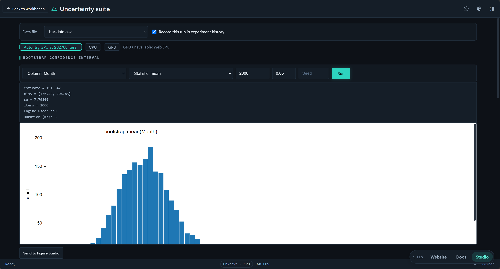

# Ergalics Studio 产品介绍

Ergalics Studio 是一款完全运行于浏览器中的专业科学计算工作站：交互式数据探索、GPU 计算调度、沙箱化插件系统与四种面向不同用户的工作模式整合在同一个网页应用里，无需安装任何本地软件，打开网页即可使用。数据保存在浏览器本地（IndexedDB / OPFS），不出本机；项目以 MIT 协议开源，源码、测试与持续集成全部公开。本文面向评审给出总述——项目概览、技术创新、功能全景、场景落地、开源治理与长期发展；79 条细粒度应用场景见配套的《应用场景库》（第 11 篇 · 独立专题），工程细节见本目录其余技术文档。

## 一、项目概览

- **浏览器内零安装的全栈科学计算工作台。** 从拖入 CSV 看图、搭数据流管线、拼积木到写 Python / R / JavaScript，全链路在网页内完成，支持离线使用。
- **本地优先，数据不出本机。** 项目与数据存于浏览器 IndexedDB / OPFS，可导出 .clproj 文件离线流转，不存在云端副本；项目同时是 Git 仓库，版本历史留在本机。
- **MIT 开源。** 全部源码、173 个测试文件与 5 条 CI 工作流公开可查，发版经 Zenodo 归档并铸造 DOI。

| 领域 | 现状 |
| --- | --- |
| 内置插件 | 107 个（97 个随启动自动加载，10 个趣味工具按需加载），按 16 个学科分组 |
| 科研工具 | 26 个，按测量与评估、建模与推断、数据与谱系、信号与记录、报告与复现、工具箱六组组织 |
| 流程区块 | 38 个，覆盖数据源、变换、过滤、数学、统计、单位、可视化与绘图八类 |
| 工作模式 | 标准 / 流程 / 积木 / 代码四模式；三种脚本模式共享同一中间表示（IR） |
| GPU 内核 | 14 个可复用 WGSL 计算内核，每个都配数学一致的 CPU 实现 |
| 竞赛级求解器 | 2 个：十万阶稀疏厄密特征值求解器、1D 管网–3D 场双向耦合求解器 |
| 测试与 CI | 2815 个单元测试、14 套端到端套件、5 条 CI 工作流 |

*电磁谐振特征值求解器：三内核求十万阶稀疏厄密特征对并做真实残差认证，图为微波腔体 3D 模式场。*

*1D-3D 双向耦合求解器：1D 管网与 3D 场双向耦合的瞬态仿真，图为耦合场体素渲染。*

## 二、技术创新

- **四模式同源 IR。** 积木、流程、代码三种模式经由同一份中间表示双向互转，配有专门的往返互转单元测试，端到端套件 verify-lang-modes 校验 Flow ⇄ Block ⇄ Code 无损循环；代码模式的缓冲区内容可解析回 IR，Python / R / JavaScript 三种语言之间可自由往返互译。同一条分析逻辑可以积木、流程图与脚本三种形态存在并随时切换。
- **浏览器内全栈运行时。** Python 由 Pyodide Worker 中的真实 CPython 执行（`studio` 作为可导入模块注入），R 由 vendored webR 0.6.0 运行时执行（资源缺失时回退 IR 引擎），持久化基于 IndexedDB 与 OPFS；Python / R 运行时 vendor 到本地自托管，不依赖公网 CDN，可离线使用。
- **真实 GPU 计算与优雅降级。** 14 个真实 WGSL 计算内核（含 D2Q9 流体、全对 N-Body、波动方程、FFT、K-means、SpMV）在 WebGPU 可用时由 GPU 执行，每个内核都配数学一致的 CPU 实现，单元测试对两条路径做数值一致性校验；数据规模低于阈值或设备缺失时自动回退 CPU，引擎选择写入运行记录，可追溯。
- **两个竞赛级求解器。** 电磁谐振特征值求解器面向十万阶非正定厄密稀疏矩阵，提供厚重启 Lanczos、块 LOBPCG 与 Jacobi-Davidson 三种内核，特征对经真实残差认证；1D–3D 双向耦合求解器以多速率时间步协调与粗-细时间子循环驱动 1D 管网–3D 场瞬态仿真，正反向边界耦合配守恒性审计。
- **沙箱 + 签名双防线。** 第三方包默认以隔离模式运行在 Web Worker 沙箱，经类型化 RPC 与宿主通信，画布渲染经 OffscreenCanvas 转移完成；`.cspkg` 包加载时做清单校验（必填字段、id 格式、入口路径穿越防护等），支持 Ed25519 签名与信任注册表（纯 TypeScript 自实现，不依赖 WebCrypto）。沙箱约束"能做什么"，签名回答"是谁发布的"，两道防线互相独立。

## 三、功能全景

107 个内置插件按学科分 16 组（97 个随启动加载，10 个趣味工具按需加载）：

| 学科 | 数量 | 代表插件 |
| --- | --- | --- |
| 图表可视化 charts | 16 | 散点、热力图、三维曲面 |
| 数学统计 stats | 8 | 直方图、小提琴图、中心极限定理演示台 |
| 数学方法 math | 3 | 傅里叶级数逼近、复变函数域着色、ODE 向量场 |
| 物理模拟 physics | 15 | 电磁谐振特征值求解器、1D-3D 双向耦合求解器、格子 Boltzmann 流体 |
| 化学 chem | 5 | 晶胞 3D 预览、反应动力学 3D、酸碱滴定曲线 |
| 生物学 bio | 8 | 序列比对、群体遗传学、药代动力学室分析 |
| 地理 geo | 13 | GeoJSON 地图、DEM 地形分析、放射性碳定年实验室 |
| 环境 env | 8 | 空气质量 AQI、碳循环推演、高斯烟羽扩散 |
| 天文 astro | 3 | 天文 CCD 管线、凌星光变拟合、赫罗图 |
| 材料学 materials | 3 | XRD 图谱分析、DSC/TGA 热分析、应力-应变分析 |
| 工程仿真 engineering | 4 | 平面桁架 FEM、直流电路节点分析、控制系统实验室 |
| 经济与金融 econ | 2 | Black-Scholes 期权定价、空间囚徒困境演化博弈 |
| 心理与行为 psych | 2 | 简单反应时实验室、信号检测论 ROC / d′ 分析 |
| 数据与智能 data | 2 | AI 训练器、图像处理 |
| 特效渲染 fx | 5 | 黑洞 3D 光线追踪、水波 3D 流体、体积云天空渲染 |
| 趣味工具 fun | 10 | 科赫雪花、巴恩斯利蕨、生命游戏 |

科研主线由 26 个面向任务的工具页承担，按六组组织（详见 05 篇）：

| 分组 | 数量 | 代表工具 |
| --- | --- | --- |
| 测量与评估 | 2 | 不确定性套件（Bootstrap / 蒙特卡洛 / MCMC）、数据画像 |
| 建模与推断 | 4 | 模型工作台、Inference Forge（HMC / NUTS）、模型推理（ONNX）、参数扫描 |
| 数据与谱系 | 6 | SQL 工作台（DuckDB-WASM）、数据血缘、Figure Studio、快速分析、清洗向导、工作区文件浏览 |
| 信号与记录 | 3 | 信号实验室（FFT / Welch PSD / ACF-PACF）、Notebook、运行历史 |
| 报告与复现 | 5 | 报告构建、复现锁 repro.lock、补充材料打包、课程模式、作品画廊 |
| 工具箱 | 6 | 单位换算、计算器、格式转换、有效数字、摩尔质量、快速统计 |

流程模式由 38 个内置区块（数据源 / 变换 / 过滤 / 数学 / 统计 / 单位 / 可视化 / 绘图八类）构成"词汇表"：编译器做结构校验、端口匹配与环检测，执行器按节点增量缓存，统计类区块含 t 检验族、方差分析、Bootstrap 与 MCMC 采样等十四种。

## 四、场景落地

场景验证采取"每条场景对应一个真实插件或科研工具"的方式：全部仿真类插件严格数据驱动——初始为空、绝不伪造默认场景，每个核心插件都附带一键可载的示例数据。79 条细粒度场景按"从硬核科研到基础教学"整理于《应用场景库》（第 11 篇），每条附实截图与说明，可与 03《插件系统》、05《科研工具集》对照检索。下表跨硬核到教学取样 13 条，给出所用插件 / 工具与可核查产出：

| 场景 | 所用插件 / 工具 | 可核查产出 |
| --- | --- | --- |
| 微波腔体模式求解 | 电磁谐振特征值求解器 | 特征对 + 真实残差认证 |
| 管网–3D 场耦合瞬态 | 1D-3D 双向耦合求解器 | 场体素与时间序列、守恒审计 |
| NUTS 贝叶斯推断 | Inference Forge | 后验摘要（HDI / R-hat / ESS）、WAIC、PSIS-LOO |
| Welch PSD 谐波识别 | 信号实验室 | PSD 功率谱，滤波列存回血缘 |
| Bootstrap 置信区间 | 不确定性套件 | 置信区间 + HDI / R-hat / ESS 诊断 |
| 出版级多面板组图 | Figure Studio | IEEE / Elsevier 模板组图，SVG / PDF / 600dpi 导出 |
| 结果复现与漂移检查 | 复现锁 repro.lock | 数据 / 参数 / 种子 / 代码 / 环境五类漂移判定，一键重跑 |
| SEIR 疫情曲线 | 传染病分室模型 | R₀、群体免疫阈值、峰值时刻、总感染率 |
| XRD 物相分析 | XRD 衍射图谱分析 | 峰检出、d 间距换算、晶格常数精修 |
| 碳定年校准 | 放射性碳定年实验室 | 校准曲线与年龄区间 |
| MNIST CNN 训练 | AI 训练器 | 实时损失曲线、预测网格 |
| 凌星光变拟合 | 凌星系外行星光变拟合 | BLS 周期、1σ 参数误差、相位折叠图 |
| 课程模式闭环 | 课程模式 | 作业布置、repro.lock 提交、评分批改与整班导出 |

*Figure Studio：IEEE 单栏模板多面板组图，SVG / PDF / 600dpi 导出。*

*Inference Forge：NUTS 采样后验摘要与 WAIC、PSIS-LOO 模型比较。*

*不确定性套件：Bootstrap 置信区间与 HDI、R-hat、ESS 收敛诊断。*

*信号实验室：Welch PSD 主峰与谐波识别。*

*凌星光变拟合：BLS 找周期与梯形模型相位折叠。*

*AI 训练器：浏览器内训练 CNN，MNIST 预测网格。*

## 五、开源治理与质量

- **协议与合规。** MIT 协议；security 工作流做依赖安全扫描并产出 SBOM；CITATION.cff 由脚本与 `package.json` 比对作者 / 许可，漂移即以非零码退出使 CI 变红。
- **单元测试网。** 173 个测试文件、2815 个单元测试（2813 通过，2 个在无 GPU 环境跳过）；`npm run verify` 串联 `tsc --noEmit` 严格类型检查与全部单测，是贡献指引要求保持绿色的组合检查。
- **端到端。** 14 套 Playwright 套件（1 冒烟 + 13 个 verify 脚本）驱动真实无头浏览器对生产预览验证，断言真实像素与零控制台错误。
- **5 条 CI 工作流。** ci（引用元数据检查、类型、ESLint、单测、构建、性能预算）、bench（性能基线）、security（依赖安全 + SBOM）、release（发版归档，Zenodo 铸造 DOI）、deploy（构建部署与站点完整性校验）。
- **性能基线按环境分文件。** 性能与体积用基线对比而非固定阈值，基线按运行环境分文件保存，避免共享 Runner 上的噪声被误判为性能回归。
- **文档体系。** 01–08 八篇系列文档；09、10 两篇求解器独立专题（含容器化部署手册）；《应用场景库》速查附录；中英双语 README；全部文档提供合集 PDF。CONTRIBUTING、SECURITY、CODE_OF_CONDUCT、CHANGELOG 齐备。
- **第三方包规范。** `.cspkg` 清单规范与 Ed25519 签名、市场目录内建（按科学 / 趣味 / 工具三类组织），第三方与内置插件走同一条加载路径，生态在受控前提下生长。

## 六、长期发展

- **插件契约即扩展路径。** 第三方插件与内置插件走同一条加载、渲染、参数与数据访问路径，能力增长不依赖修改宿主，契约稳定即可持续接纳新学科。
- **GPU / CPU 双路径覆盖硬件寿命。** 每个计算内核都有数学一致的 CPU 实现，无 WebGPU 的老设备全功能可用，硬件差异不淘汰用户。
- **结果长期可重放。** 复现锁 repro.lock 锁定数据指纹、参数哈希、种子、代码快照与环境快照五类漂移判定，任何一次分析在多年后仍可判定漂移并一键重跑。
- **数据开放，不设锁定。** 本地优先、无账号；CSV / JSON / HDF5 / NetCDF / FITS / Zarr / Parquet 等开放格式自由进出，项目可导出为 .clproj 离线流转。
- **求解器可持续维护。** 两个竞赛级求解器各配独立专题文档（09、10 篇）与容器化部署手册，验收标准与部署流程成文可循。

## 七、运行与获取

- 在线演示：GitHub Pages（见仓库 README 徽章链接），打开即用。
- 本地开发：`npm install` 后 `npm run dev` 启动；`npm run build:web` 完成纯 Web 构建（原生核心以 Rust 源码交付，浏览器构建产物为占位桩，运行时计算完全由 WebGPU / CPU 承担）；`npm run build` 为完整构建。
- 质量检查：`npm test` 跑单元测试，`npm run verify` 先做 `tsc --noEmit` 严格类型检查再跑单测，`npm run test:e2e` 串联端到端套件。
- 开源协议：MIT，欢迎通过 Issue 与 Pull Request 参与贡献。
