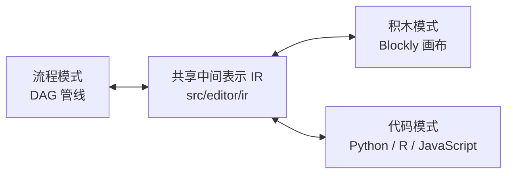
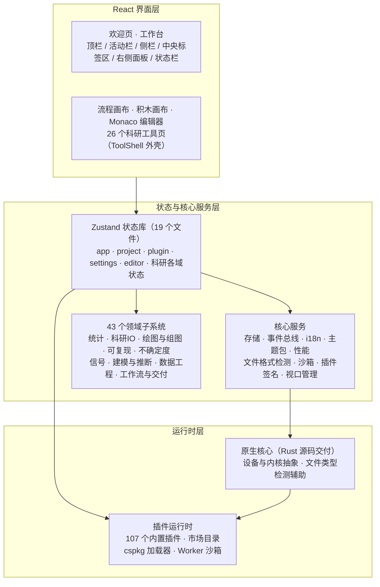
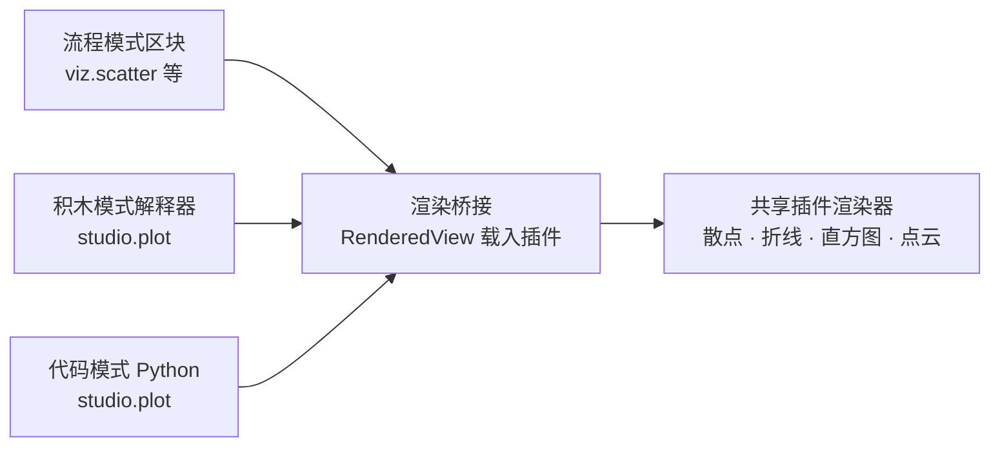
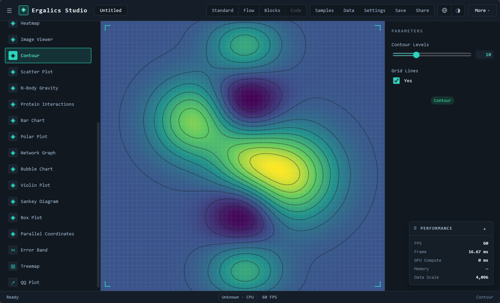
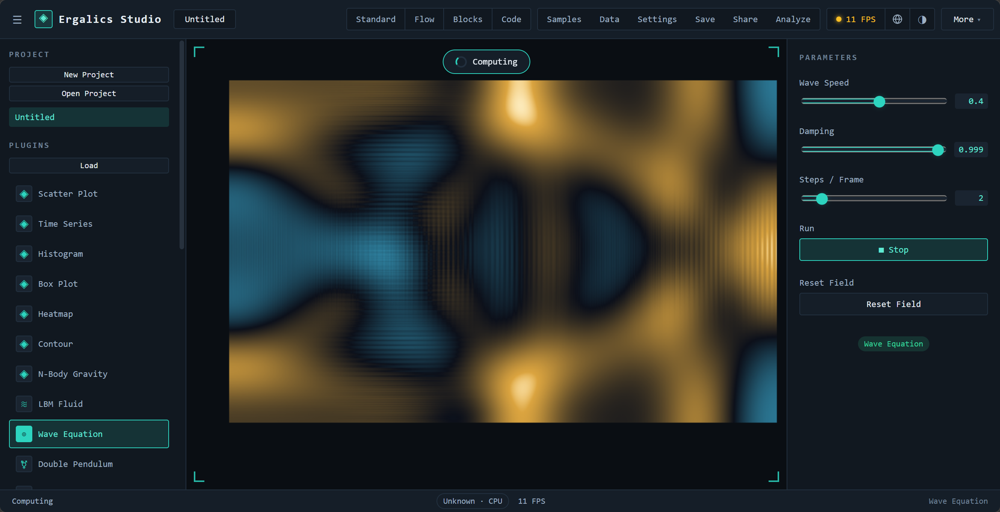
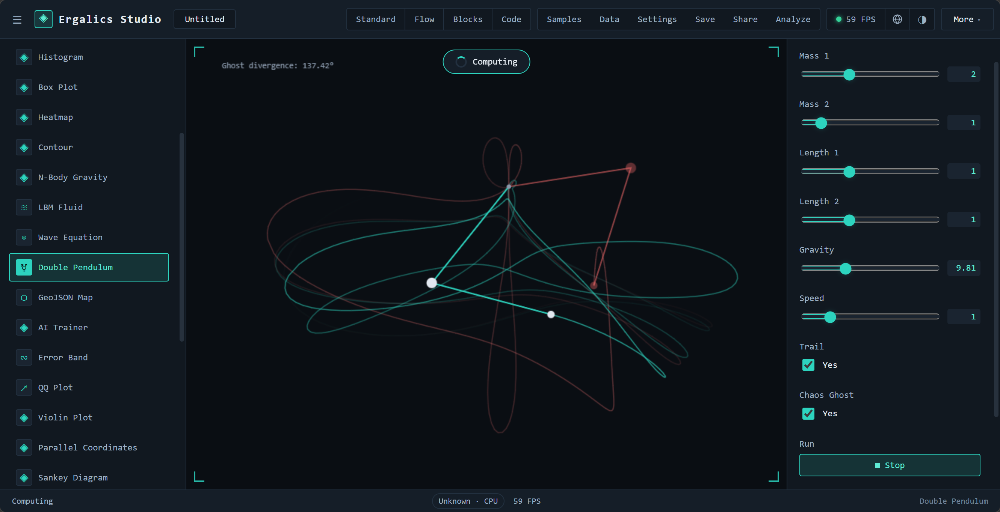
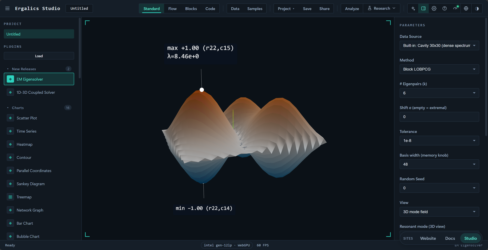

# Ergalics Studio 产品介绍

Ergalics Studio 是一款完全运行于浏览器中的专业科学计算工作站。它把交互式数据探索、GPU 计算调度、沙箱化插件系统与四种面向不同用户的工作模式整合进同一个网页应用：无需安装任何本地软件，打开网页即可使用；数据保存在浏览器本地（IndexedDB），不出本机；项目可以保存为 .clproj 文件或分享链接，随取随用。

它带来的，是一条从"零代码"到"真代码"的完整科学计算路径：拖入一个 CSV 文件立即看到图表，用 38 个内置区块搭出可视化数据流管线，用类 Scratch 积木写出第一段程序，最终在 Monaco 编辑器里编写由真实 CPython 运行时（Pyodide）执行的 Python 代码。四种模式共享同一份数据语义与渲染后端，切换模式时逻辑原样保留。

它与工作台并列的还有一条科研主线：**26 个科研工具**按测量与不确定性、建模与推断、数据与图谱、信号与扫描、交付与复现、通用小工具六组组织，覆盖数据体检、清洗、建模、推断、参数扫描、信号分析、图表排版、报告、可复现锁、补充材料打包与工作区文件浏览，把"跑完一次分析"变成"交付一份可被别人原样重跑的研究成果"（详见 05 篇）。

它适合谁：想快速看图的研究人员、刚开始学习数据分析的学生、讲授编程与计算思维的老师，以及需要一个"零安装、可离线、可扩展"科学计算环境的任何人。本文从产品视角展开介绍项目背景、技术架构概述、功能全景、应用场景与创新点；更细的工程实现见本目录其余技术文档。

## 一、项目背景与设计目标

### 1.1 科学计算工具链的三重门槛

安装与环境门槛高。传统桌面软件（如 MATLAB、Origin）体积庞大、授权昂贵，一台新电脑从安装到能用往往要以小时计；Python 生态虽然免费开放，但要让初学者独立配好解释器、虚拟环境、数值库与绘图库，仍然是一件容易劝退的事。环境问题消耗的是本应投入在数据与问题本身上的注意力。

教学路径存在断层。从积木式编程过渡到真实代码，中间缺少一款能把"拖拽数据、搭建流程、编写代码"统一在同一界面里的工具。学生在一个工具里学会拖积木，换到另一个工具里面对黑漆漆的终端，两次学习之间没有衔接，已建立的直觉难以迁移。

交付与复现的门槛被低估。即便分析跑通了，"这次结论是怎么算出来的"往往没有留下可核查的痕迹：环境版本、随机种子、输入数据的哈希、代码快照散落在不同地方。等到投稿或复核时，重跑一遍常常得不到同一个数字。

前两条门槛 Ergalics Studio 用"把整个工作台搬进浏览器标签页"来回答；第三条门槛用一条从运行记录到可复现锁、再到补充材料打包的完整交付链来回答——这也是它与"在线画图工具"最根本的区别。

### 1.2 六条设计目标

1. **零安装，打开即用。** 全部能力随网页交付，标准模式下把数据文件拖进窗口就能看到可视化结果。
2. **数据不出本机。** 项目与数据存储在浏览器 IndexedDB 中，可导出为 .clproj 文件离线流转，不存在云端副本；项目同时是 Git 仓库，版本历史也留在本机。
3. **一条学习曲线走到底。** 四种模式面向同一份项目数据，从看到图、到搭流程、到拼积木、到写代码，能力渐进而不换工具。
4. **计算必须是真计算。** GPU 内核是真实的 WGSL 计算着色器，Python 是真正的 CPython；每一个内核都有对应的单元测试与 GPU/CPU 数值一致性校验。
5. **结论必须可被重放。** 每一次执行都留下运行记录，环境与数据指纹可锁定为 `repro.lock`，报告与补充材料可一键打包成自包含文件与 ZIP。
6. **开放可扩展。** 插件契约清晰、市场目录内建、第三方包默认以隔离模式运行在 Worker 沙箱中、`.cspkg` 包支持 Ed25519 签名与信任注册表，配合完整的开源代码与持续集成，生态可以安全地生长。

### 1.3 四类用户，四种模式

| 模式 | 面向人群 | 核心体验 |
| --- | --- | --- |
| 标准（Standard） | 只想快速看图的人 | 拖入数据文件，自动识别格式并路由到匹配插件，即刻看到可视化 |
| 流程（Flow） | 数据分析初学者 | 用 38 个内置区块搭出可视化数据流管线，拓扑排序执行，逐节点查看输出 |
| 积木（Block） | 编程启蒙与教学 | 类 Scratch 积木编辑器，唯一入口是绿色"运行时"帽子区块，40 种积木完全可脚本化 |
| 代码（Code） | 真实脚本用户 | Monaco 编辑器，Python 走 Pyodide Worker 中的真实 CPython，R 由 vendored webR 0.6.0 运行时执行（资源缺失时回退 IR 引擎），JavaScript 由进程内 IR 引擎执行，带 REPL 控制台与变量面板 |

<!-- pagebreak -->

**标准模式**是产品的"前门"。工作台采用模块化外壳：顶栏承载项目下拉、四模式切换与数据入口；左侧活动栏在文件、Git 与插件三个视图间切换，侧栏可调宽、可收起；中央区以标签页容纳插件画布、文件预览、各类编辑器与内嵌科研工具；右侧是与所选插件实时绑定的参数面板；底部状态栏汇总运行状态。把文件拖进窗口，宿主会通过文件格式检测（按魔数识别，辅以扩展名，可选 WASM 辅助）自动路由到匹配的插件，例如拖入 .xyz 文件直接得到点云渲染；多个插件同时匹配时弹出选择框由用户决定。

*标准模式主界面：顶栏（项目与模式切换）、左侧活动栏与多视图侧栏、中央标签区（插件画布 / 文件预览 / 编辑器 / 内嵌工具）、右侧参数面板与底部状态栏；文件拖入即按格式魔数自动路由到匹配插件。*

<!-- pagebreak -->

**流程模式**把分析过程显式化为一张有向无环图。用户从区块目录拖出数据源、变换、过滤、数学、统计、单位、可视化与绘图区块，连线成管线；编译器先做结构校验（端口匹配、必填参数、类型检查）与环检测、拓扑排序，执行器再按序执行并对每个节点做增量缓存，改动一个参数只重算受影响的下游节点。每个区块的输出都可以就地预览：可视化区块弹出插件渲染，统计区块以只读数据表或标量形式呈现。

*流程模式：一条可执行的 DAG 数据流管线，数据源 / 变换 / 统计 / 可视化区块连线而成，改动参数只重算受影响的下游节点。*

<!-- pagebreak -->

**积木模式**面向编程启蒙。类 Scratch 的画布上，绿色"运行时"帽子区块是脚本的唯一入口，帽子下方未连接的孤立区块永不运行，从根本上杜绝误执行破损代码；数据加载、变量、循环、数学运算与绘图积木拼在其下。点击运行后，宿主把积木图编译为共享中间表示（IR），由内置解释器逐节点执行。积木名称、提示与下拉选项均已本地化，5 个内置示例程序开箱即玩。

*积木模式：类 Scratch 画布，绿色"运行时"帽子区块是脚本唯一入口，积木图编译为共享 IR 由内置解释器逐节点执行。*

<!-- pagebreak -->

**代码模式**面向真实脚本用户。Monaco 编辑器之外，侧栏提供控制台与变量面板；Python 代码运行在 Pyodide Worker 中，是货真价实的 CPython，`studio` 作为正经可导入模块注入；R 优先由 vendored webR 0.6.0 运行时执行（资源缺失时回退内置 IR 引擎），JavaScript 走进程内 IR 引擎，与积木模式共用同一个解释器。仓库在 `examples/code` 目录提供 9 个可直接运行的示例程序，从蒙特卡洛求圆周率到信号分析一应俱全。

*代码模式：内置 Monaco 编辑器与侧栏控制台 / 变量面板，Python 运行在 Pyodide Worker（真 CPython）中，`studio` 作为可导入模块注入。*

三个脚本模式共享同一份 IR：流程里搭好的管线可以变成积木，积木可以生成 Python 代码，代码模式下编辑的 studio 调用也能解析回积木图；Python、R、JavaScript 三种语言之间可自由往返互译。一次编辑，多种表达，由专门的往返互转单元测试兜底。

### 1.4 项目现状

项目处于积极开发中，核心闭环已端到端可用并有测试覆盖。当前基线（版本 1.9.0，MIT 协议）：

| 领域 | 现状 |
| --- | --- |
| 107 个内置插件 | 97 个核心/科学插件随启动自动加载，10 个趣味工具声明 `autoload: false` 按需加载；侧栏按 charts / stats / math / physics / chem / bio / geo / env / astro / materials / engineering / econ / psych / data / fx / fun 16 个学科分组 |
| 四种工作模式 | 全部可用；积木、流程、代码三种模式经由共享 IR 双向互转，Python / R / JavaScript 三语言自由往返 |
| 26 个科研工具 | 按测量与不确定性、建模与推断、数据与图谱、信号与扫描、交付与复现、通用小工具六组组织，统一挂在 `/studio/:toolId` 路由下，并可作为标签页内嵌进工作台 |
| 38 个流程区块 | 覆盖数据源、变换、过滤、数学、统计、单位、可视化与绘图八类 |
| 14 个可复用 WGSL 内核 | 粒子积分、全对 N-Body 引力、直方图、热力图、点云、D2Q9 流体的碰撞/迁移/涡量、二维波动方程、分块矩阵乘、基 2 FFT、K-means、键值分箱、稀疏矩阵-向量乘（SpMV）；每个内核都配数学一致的 CPU 实现 |
| 43 个领域子系统目录 | 全部已落地，覆盖统计、科研二进制 I/O、出版级绘图与组图、可复现性、不确定度、信号处理、建模与推断、数据质量与清洗、SQL、血缘、报告、补充材料、课程与作品长廊、化学与地理计算、工作区 VFS 与 Git 适配器等能力（详见 07 篇） |
| 质量保障 | 173 个测试文件、2815 个单元测试（2813 通过，2 个在无 GPU 的环境跳过）；14 套 Playwright 端到端套件（1 冒烟 + 13 个 verify 脚本）驱动真实浏览器（无头 Edge）验证；5 条 GitHub Actions 工作流覆盖单元测试、性能基准、安全扫描、发版归档与部署（详见 08 篇） |

## 二、技术架构概述

### 2.1 总体分层

整体为"React 界面层 + 状态与核心服务层 + 插件运行时与原生核心 + 浏览器底座"的多层结构。所有层级运行在同一浏览器页面内，通过明确的契约通信，低层从不反向导入高层。

各层职责如下：

| 层 | 位置 | 职责 |
| --- | --- | --- |
| React 界面层 | `src/pages` 与 `src/components` | 欢迎页、工作台模块化外壳（顶栏 / 活动栏 / 多视图侧栏 / 中央标签区 / 右侧面板 / 状态栏）、流程画布、积木画布、Monaco 代码编辑器与 26 个科研工具页。界面组件只与状态库和插件契约打交道，不含业务算法 |
| 状态层 | `src/stores`（19 个文件） | 分别管理应用壳、项目、插件、设置、编辑器、AI 面板、分析、区块、分块、实验、图表、血缘、笔记本、研究、模板引导与流程同步等状态，互相之间通过事件总线协作而非直接引用 |
| 核心服务层 | `src/core` | 存储（IndexedDB 与 OPFS）、工作区 VFS、Git 适配器（分支、变更、一键暂存提交）、事件总线、国际化（中英双语）、主题包、性能上报、文件格式检测、视口管理、沙箱与 cspkg 加载、插件签名等横切能力，以及 43 个领域子系统 |
| 插件运行时 | `src/plugins` | 内置插件的注册表与生命周期、市场目录、cspkg 包加载器与 Worker 沙箱 |
| 原生核心 | `native/ergalics-core`（Rust） | 以源码交付的设备管理、缓冲区与计算内核抽象参考实现；浏览器内构建产物为占位桩，运行时计算完全由浏览器原生 WebGPU（可用时）或 CPU 路径承担 |
| 浏览器底座 | — | WebGPU、Web Workers、IndexedDB / OPFS、OffscreenCanvas 与 Three.js，是所有能力最终落地的平台 |

### 2.2 贯穿架构的三条设计主线

**宿主与插件之间只有一个契约。** 每个插件实现统一的 Plugin 接口（初始化、激活、渲染、参数读写、数据加载、3D 场景渲染等），并从宿主获得一个 PluginApi 句柄用于本地化、状态上报、性能上报、通知与文件访问。第三方包的入口代码默认以隔离模式（isolated）运行在 Web Worker 沙箱中，仅通过类型化 RPC 协议与宿主通信，画布渲染经 OffscreenCanvas 转移完成；声明 trusted 的信任包经验证后可运行于宿主 DOM。`.cspkg` 包在加载时进行清单校验（必填字段、id 格式、入口路径穿越防护、沙箱枚举），并可选地经 Ed25519 签名验证来源。沙箱回答"它运行时能做什么"，签名回答"这个包是谁发布的"——两者互相独立，合法签名不会削弱沙箱隔离。

**一条渲染管线服务全部模式。** 无论是流程模式的可视化区块、积木模式解释器调用的 `studio.plot`，还是代码模式 Python 里的 `studio.plot` 调用，最终都汇入同一个渲染桥接，落到同一个散点图、直方图插件上。2D 插件共享同一个 canvas 视口；3D 插件按需懒创建宿主管理的 Three.js 场景，并在 2D 插件激活时自动隐藏，保证两种视口互不渗透。

**计算引擎按可用性与数据规模自动分派。** 14 个 WGSL 计算内核在 WebGPU 可用时由 GPU 执行，每个内核都配有数学一致的 CPU 实现；WebGPU 缺失或数据规模低于阈值（如矩阵乘 16384 个输出元素、FFT 1024 个复数样本）时自动回退 CPU，避免上传回读开销吃掉收益，行为一致。引擎选择结果会写入运行记录，使"这一次是谁在算"可追溯；单元测试对 GPU 与 CPU 的计算结果做数值一致性校验。

### 2.3 一条渲染管线服务全部模式

三种编辑模式产生的绘图请求汇入同一个渲染桥接，由共享的插件渲染器出图，因此"换一种表达方式"看到的是同一张图。

## 三、功能全景

### 3.1 内置插件生态

97 个核心/科学插件随启动自动加载，侧栏按学科分为 16 组（映射表 `src/plugins/categories.ts`）；另有 10 个趣味工具声明 `autoload: false` 按需加载，共 107 个：

| 分组 | 数量 | 插件 | 说明 |
| --- | --- | --- | --- |
| 图表可视化 charts | 16 | 散点、时间序列、热力图、等值线、柱状、气泡、雷达、网络、桑基、矩形树图、平行坐标、三维曲面、三维体素、点云、三维点云、图像查看器 | 覆盖最常见的工程与科学出图需求；2D 插件共享同一 canvas 视口，三维插件走 Three.js 场景 |
| 数学统计 stats | 8 | 直方图、箱线图、小提琴图、QQ 图、误差带、中心极限定理演示台、马尔可夫链与稳态分析、Zipf 定律词频分析 | 面向统计教学与多变量分布探索 |
| 数学方法 math | 3 | 傅里叶级数逼近实验室、复变函数域着色、ODE 向量场与流线 | 数值方法内核带解析解或理论界对拍 |
| 物理模拟 physics | 15 | 粒子、N-Body、流体模拟（LBM）、波动方程、双摆、电磁场、光学实验、电磁谐振特征值求解器、1D-3D 双向耦合求解器、一维量子力学求解器、二维伊辛模型、热机循环 p-V 分析台、热传导 / 扩散方程实验室、衍射实验室、轨迹运动学与能量分解实验室 | 数据驱动的仿真引擎与交互实验，WGSL 计算内核加速，带 CPU 回退 |
| 化学 chem | 5 | 晶胞 · 3D 预览、反应 · 自由反应动力学 3D、酸碱滴定曲线实验室、反应级数判定与 Arrhenius 分析、Gray-Scott 反应扩散图灵斑图 | 从晶胞构型（CIF / POSCAR / XYZ）到反应分子动力学的浏览器内化学建模与 3D 可视化 |
| 生物学 bio | 8 | 蛋白质交互网络、酶动力学、传染病分室模型、序列比对与分析、群体遗传学、药代动力学室分析、孟德尔 F2 分离比 χ² 检验、Hodgkin–Huxley 神经元 | 从分子网络到群体遗传的数据驱动生物学建模 |
| 地理 geo | 13 | GeoJSON 地图、太阳高度与昼夜长短、气候直方图、人口金字塔、空间插值、距离与面积量算、投影变形（Tissot 圆）、DEM 地形分析、GPX 轨迹分析、交互地球仪（3D）、放射性碳定年实验室、土壤水分特征曲线拟合、SCS 降雨径流模型 | 离线矢量地图、投影畸变分析与 3D 地理渲染 |
| 环境 env | 8 | 空气质量（AQI）、水质评价、温室效应、碳循环、生物多样性指数、污染物扩散、三维全球环境、捕食者-猎物（Lotka–Volterra） | 数据驱动的环境科学建模与采样模拟 |
| 天文 astro | 3 | 天文 CCD 管线、凌星系外行星光变拟合、赫罗图 | 科研级 CCD 数据管线与星表、光变分析 |
| 材料学 materials | 3 | XRD 衍射图谱分析、应力-应变分析、热分析（DSC/TGA） | 科研级材料表征数据内核 |
| 工程仿真 engineering | 4 | 结构力学（铰接桁架承重）、直流电路节点分析、平面桁架有限元分析、控制系统实验室 | 桁架承重与垮塌、MNA 节点分析、桁架有限元、PID 闭环分析，指标与解析解对照 |
| 经济与金融 econ | 2 | Black-Scholes 期权定价实验室、空间囚徒困境演化博弈 | 解析定价与蒙特卡洛交叉验证、空间演化博弈 |
| 心理与行为 psych | 2 | 信号检测论 ROC / d′ 分析、简单反应时实验室 | 心理物理学测量与统计推断内核 |
| 数据与智能 data | 2 | AI 训练器、图像处理 | 四类模型浏览器内训练；自实现图像处理数值内核 |
| 特效渲染 fx | 5 | 黑洞 · 3D 光线追踪、水波 · 3D 流体、体积云 · 天空渲染器、日光天空 · 大气散射、星空 · 夜天渲染器 | GPU 光线追踪 / 流体渲染专属学科组 |
| 趣味工具 fun | 10 | Mandelbrot、Spirograph、Lissajous、生命游戏、Harmonograph、调色板探索器、科赫雪花、巴恩斯利蕨、烟花、Truchet 瓦片 | 按需加载，保持首屏轻量 |

插件全部来自同一套契约：无论内置还是第三方，加载、渲染、参数与数据访问走的是同一条路径，市场目录（`src/plugins/marketplace.ts`）按科学、趣味、工具三类组织，支持按需加载。参数面板由宿主依清单自动生成本地化表单，支持范围滑杆、下拉、数字、复选框、文本、文件、按钮与开关八类控件。

科研级插件在清单中声明 research 元数据：研究就绪度四级徽章（research / quasi-research / demonstration / educational，插件详情页以四色徽章呈现）、物理单位、基准 id、reproducible 标记与适用范围说明；插件产出的关键指标经统一科学输出总线（`src/core/research/scienceOutput.ts`）汇入画布顶部的 ScienceOutputStrip 条带，同一套读数口径贯穿全部科研级插件。全部 32 个科研级插件与 8 个地理插件均支持"发送到 Figure Studio"一键生成多面板科研图组（含中英图注与公式标注），两个竞赛级求解器插件同样支持。

### 3.2 流程模式区块体系

38 个内置区块分八类，构成流程模式的"词汇表"：

| 类别 | 数量 | 区块 |
| --- | --- | --- |
| 数据源 source | 4 | 示例数据、随机数据、网格数据、文件导入 |
| 变换 transform | 5 | 选择列、重命名列、添加列、归一化、排序 |
| 过滤 filter | 3 | 范围过滤、数值过滤、Top-K 选取 |
| 数学 math | 6 | 加、减、乘、除、平方根、绝对值（支持与标量或另一列运算） |
| 统计 stats | 14 | 摘要统计、直方图分箱、单样本 / 独立双样本 / 配对 t 检验、单因素方差分析、Mann-Whitney U 检验、卡方独立性检验、相关分析、Cohen's d 效应量、多重比较校正、Bootstrap、蒙特卡洛传播、MCMC 采样 |
| 单位 units | 2 | 量纲换算、量纲一致性检查 |
| 可视化 viz | 4 | 散点、折线、直方图、二维点云（经渲染桥接走插件出图） |
| 绘图 plot | 4 | 折线、散点、直方图、柱状（出版级矢量引擎渲染，可直接导出 SVG / PDF） |

区块元数据（名称、描述）内建中英双语；编译器负责结构校验、端口匹配、类型检查与环检测，执行器以节点为粒度做增量缓存与失效重算，示例管线（`examples/projects` 下 8 个 `block-*.clproj` 项目文件，同目录另有 3 个插件演示项目）在构建期经 `import.meta.glob` 自动发现。

### 3.3 数据格式支持

| 类别 | 格式 | 说明 |
| --- | --- | --- |
| 表格与文本 | CSV、TSV、DAT、TXT、MD | 分隔文本与表格数据，项目数据文件可直接导入 |
| XY 谱线文本 | XY、XYE | 两列（2θ–强度，XYE 含误差列）x–y 文本数据，`#` 行为注释，XRD 衍射图谱分析等插件直接载入 |
| 网格与点数据 | JSON、XYZ | 数值网格、标量场与点云（JSON 矩阵 / XYZ 列） |
| 矩阵与数组 | MTX、NPY、NPZ | Matrix Market 稀疏矩阵与 NumPy 数组（电磁谐振特征值求解等） |
| 化学结构 | CIF、POSCAR、VASP | 晶胞结构：原子、周期性化学键与密度估算 |
| 地理与轨迹 | GeoJSON、GPX、ASC | 矢量地图、GPS 轨迹、ESRI ASCII Grid 高程 |
| 生物序列与遗传 | FASTA、FA、VCF | 序列比对与分析、群体遗传变异数据 |
| 图像 | PNG、JPEG、WEBP、GIF | 图像查看器加载位图 |
| 科研二进制 | HDF5（.h5/.hdf5/.hdf、MAT v7.3、h5ad）、NetCDF（.nc）、FITS（.fits/.fit）、Zarr（.zarr）、Parquet（.parquet） | 由纯 TypeScript 实现的科研 I/O 子系统解析，统一调度器按魔数分派，解码后以 CSV 落入项目 |
| 项目文件 | .clproj | 工程自有格式，lz-string 压缩，IndexedDB 存储并支持导出分享 |
| 插件包 | .cspkg | fflate 打包的 ZIP，加载时校验清单、可选验签，并落入沙箱 |
| 主题包 | .cstheme | 纯声明式 JSON 主题包，绝不携带可执行内容 |

格式检测优先按魔数识别，辅以扩展名匹配；识别结果驱动标准模式的插件自动路由。科研二进制文件在 drop 管线中解码为 CSV 后再进入项目，大文件先经 `src/core/chunked/` 的行窗口读取与内容指纹，再由 Worker 池并行解析，避免阻塞主线程。

### 3.4 科研能力全景

科研能力分布在两个层面——26 个面向任务的工具页，以及 43 个领域子系统。工具页解决"这一步要做什么"，子系统提供"这一步怎么算"：

| 分组 | 工具 |
| --- | --- |
| 测量与不确定性 measure | 不确定性套件（Bootstrap 置信区间 / 蒙特卡洛传播 / MCMC，CPU 或 WGSL GPU 引擎，R-hat、ESS 等收敛诊断）、数据画像（列剖析、相关矩阵、质量分与问题清单） |
| 建模与推断 model | 模型工作台（OLS / 逻辑 / 岭回归 / 多项式拟合与残差诊断）、Inference Forge（HMC / NUTS 贝叶斯推断与 WAIC、LOO、后验预测检验）、模型推理（浏览器内 WebGPU 运行 ONNX）、参数扫描（网格 / 列表 / 拉丁超立方设计点与响应面） |
| 数据与图谱 data | SQL 数据工作台（DuckDB-WASM）、数据血缘（文件→运行 DAG）、Figure Studio（多面板出版级图组）、快速分析（描述统计与 t / Mann–Whitney 检验）、数据清洗向导（可回退步骤）、工作区文件浏览（VFS 文件树、文本预览与下载） |
| 信号与扫描 signal | 信号实验室（FFT、Welch PSD、窗函数、Savitzky-Golay、ACF / PACF、季节分解）、Notebook（Markdown + Python 单元）、运行历史（全工具自动记录与 A/B 对比） |
| 交付与复现 deliver | 报告构建（叙事 + 图表 + 交互筛选 → 自包含 HTML）、复现锁（`repro.lock` 导入导出、漂移检查与一键复现）、补充材料打包（manifest + runs + 血缘 + 数据/代码的论文附件 ZIP）、课程模式（布置 / 收集 / 离线批改）、作品画廊（可复现作品图库） |
| 通用小工具 utils | 单位换算、计算器、格式转换、有效数字、摩尔质量、快速统计（六个工具均无需项目上下文，随开随用） |

配套内核包括单位系统（Quantity / convert / check）、大文件分块读取与 Figure 组图引擎（IEEE / Elsevier 期刊模板、投稿检查、双语图注起草、SVG / PDF / PNG-600dpi 导出与 3D 场图面板）。

项目以 Git 仓库为底座（`src/core/git`，isomorphic-git + LightningFS）：侧栏 Git 面板提供分支切换、变更审阅与一键暂存提交（Conventional-Commit 风格消息），项目快照随 `.clproj` 镜像同步，分析过程的每一步改动都可追溯。此外，运行日志导出（`src/core/logger.ts`）把会话内的事件序列落为可下载文件，便于问题回溯与教学演示复盘。

## 四、应用场景

### 4.1 科学与工程数据可视化

覆盖统计分析与工程绘图的常见图型：散点、折线、直方图、热力图、等值线、箱线图、小提琴图、误差带、平行坐标、桑基图、矩形树图、QQ 图、气泡图、雷达图、网络图等；数据格式上除 CSV、JSON、XYZ 外，还支持 HDF5、NetCDF、FITS、Zarr、Parquet 等科研领域常用的二进制格式导入，可服务地学、天文、生物等学科的数据探索需求。下图依次是等值线、空间插值与标准差椭圆三张代表性渲染。

*等值线：对二维标量场（JSON 网格）渲染色带 + 等值线，双高斯双峰可清晰呈现山谷与脊线，适合涡旋场、地形等数据。*

*空间插值：对离散站点数据做 IDW 逆距离加权网格化，输出插值色带与等值线，可调节幂次与搜索半径对比插值效果。*

*标准差椭圆：对点集计算平均中心、方向角与长短轴半径，一图概括分布中心、走向与离散程度，适合空间统计与分布形态分析。*

### 4.2 物理仿真与教学演示

内置多个数据驱动的仿真引擎，全部"初始为空、绝不伪造默认场景"，数据既可来自内置示例也可来自用户文件；其中电磁谐振特征值求解器与流体双向耦合求解器是两个竞赛级求解器插件（Pyodide Worker 内核，另有独立专题文档）：

| 插件 | 演示内容 |
| --- | --- |
| N-Body 引力 | 4096 体的三维全对引力直接求和，WGSL 内核加速 |
| 格子 Boltzmann 流体 | D2Q9 通道流绕障碍物，展示卡门涡街与机翼绕流 |
| 波动方程 | 高斯脉冲、双源干涉、双缝衍射场景，leapfrog 内核积分 |
| 双摆 | RK4 积分配合初值仅差 0.001 弧度的"混沌幽灵摆"，直观展示混沌 |
| 电磁场 | 可拖动电荷在库仑力与洛伦兹力共同作用下的回旋运动 |
| 光学实验 | 薄透镜成像、三棱镜折射与色散，元件可在画布上直接拖动 |
| 结构力学 | 铰接桁架实时承重，杆件按轴力着色，超载断裂直至垮塌 |
| 电磁谐振特征值求解器 | Lanczos / LOBPCG / Jacobi-Davidson 求稀疏厄密腔体模式，3D 模式场随共振模式切换实时重算 |
| 流体双向耦合求解器 | 1D 管网-3D 场双向耦合，多速率时间步协调、粗-细子循环与毫秒级阀门控制 |

*波动方程：二维有限差分模拟高斯脉冲 / 双源干涉 / 双缝衍射，leapfrog 内核逐步积分，图为双缝衍射干涉。*

*双摆：RK4 积分，主摆与初始角仅差 0.001 rad 的"幽灵摆"并行演化，轨迹快速发散，直观展示混沌对初值的敏感依赖。*

*电磁谐振特征值求解器：Lanczos / LOBPCG / Jacobi-Davidson 求稀疏厄密特征对并做真实残差认证，图中为微波腔体 3D 模式场。*

*流体双向耦合：1D 管网-3D 场双向耦合求解器以多速率时间步协调与粗-细子循环驱动，耦合场体素与监测点时序同屏呈现，正反向边界耦合保证守恒性。*

### 4.3 编程与计算思维教学

四种模式构成一条从"零代码"到"真代码"的渐进路径：初学者先在标准模式拖数据看图，再到流程模式理解数据流与统计概念（t 检验、方差分析、相关分析等 14 个统计区块），继而进入积木模式写出第一段带变量与循环的"程序"，最后在代码模式直接写 Python。三种脚本模式共享同一份 IR，切换模式时逻辑原样保留；仓库附带的 8 个流程示例项目、5 个积木示例与 9 个 Python 示例，构成可直接布置的练习素材库。课程模式进一步把这个闭环落在工具里：教师发布绑定学科模板的作业，学生提交带 `repro.lock` 的运行结果，教师查看学生 × 作业矩阵并批改。

### 4.4 浏览器内机器学习入门

AI 训练插件基于 TensorFlow.js，支持线性回归、非线性神经网络、逻辑回归与卷积神经网络四类模型，画布上方实时绘制损失曲线，下方按模型切换散点加拟合线、二维决策边界或 MNIST 数字识别网格。训练样本内置（线性、三次加正弦、双高斯分类、200 张 MNIST 子集），TF.js 依赖在首次点击训练时才懒加载，避免拖慢启动。

*AI 训练：TF.js 四类模型（线性回归 / 神经网络 / 逻辑回归 / MNIST 卷积网络），上方实时损失曲线、下方按模型切换拟合线 / 决策边界 / MNIST 预测网格。*

### 4.5 化学与生命科学套件

化学与生物插件把"从分子到群体"的建模放进浏览器：晶胞插件解析 CIF / POSCAR / VASP 构型，以球棍模型展示原子与周期性化学键，并结合有效组成与密度估算；反应动力学插件内置 NumPy / Langevin 引擎，在设定温度与催化剂条件下积分真实分子轨迹，酯化反应中键越过 Arrhenius 势垒断裂、自由基重组而成键。生物侧覆盖酶动力学（Michaelis-Menten 四情形拟合与 kcat 反解）、传染病分室模型（SIR / SEIR 的 RK4 积分）、序列比对（Needleman-Wunsch / Smith-Waterman 与 BLOSUM62）与群体遗传学（HWE 检验与 Wright-Fisher 遗传漂变）。

*自由反应动力学 3D：酯化反应（乙醇 + 乙酸）中分子轨迹由真实物理积分，键越过 Arrhenius 势垒断裂、自由基重组而成键，原子运动来自真实物理而非脚本动画。*

*酶动力学：无抑制 / 竞争性 / 非竞争性 / 反竞争性四情形对照，Levenberg-Marquardt 从含噪初速度数据反解 Vmax、Km，输出 kcat 与催化效率。*

### 4.6 地理可视化与算法艺术

离线 GeoJSON 分级设色地图支持 Albers（中国）、Web 墨卡托与等距圆柱投影，内置中国省份示例；DEM 地形分析解析 ESRI ASCII Grid 高程并渲染 3D 地形曲面；交互地球仪（3D）把 Natural Earth 海岸线贴于球面，叠加球面 Tissot 变形圆；Mandelbrot 与 Julia 集、科赫雪花、巴恩斯利蕨、Spirograph 等 10 个趣味工具适合课堂演示与兴趣探索。

*GeoJSON 地图：离线分级设色地图，支持 Albers（中国）/ Web 墨卡托 / 等距圆柱三种投影，内置中国省份示例。*

*交互地球仪（3D）：可拖拽旋转、滚轮缩放的真三维地球仪，Natural Earth 110m 海岸线贴于球面，叠加球面 Tissot 变形圆并支持自动自转。*

*DEM 地形分析：解析 ESRI ASCII Grid 高程数据，三维曲面按高程设色、垂直夸张系数可调，并可叠加等高线。*

### 4.7 研究交付与协作

面向"要把结果交出去"的场景：数据清洗向导把脏数据变成可用表格；运行历史台账汇总每一次运行的参数与指标；数据血缘图说明某个产物是由哪些文件、哪些步骤生成的；Figure Studio 按期刊模板拼出多面板组图；报告构建器把叙述、图与表打包成单一自包含 HTML；可复现锁锁定环境与数据指纹；补充材料打包把数据、代码与许可压成一个 ZIP。一条链路走完，结论不再只是截图。

## 五、创新点

**四模式同源架构。** 市面上的工具要么只做拖拽可视化，要么只做代码编辑。Ergalics Studio 用一份共享 IR 打通积木、流程与代码三种范式，并配备三模式往返互转的专门单元测试；代码模式的缓冲区内容还能解析回 IR，使"换一种表达方式理解同一逻辑"成为一键操作，Python、R、JavaScript 三种语言之间亦可自由往返互译。对教学而言，这意味着同一条管线可以用多种难度梯度反复讲解。

**零安装的全栈科学计算环境。** CPython（Pyodide Worker）、R（vendored webR 0.6.0）、WGSL 计算管线与 IndexedDB / OPFS 持久化全部运行在浏览器内，数据不出本机，同时保持接近桌面软件的体验。这不仅是部署便利，更改变了"教学机房的软件审批、学生自带电脑的环境差异"这类现实约束的性质。

**真实 GPU 计算加优雅降级。** 计算管线不是演示性质的：14 个真实 WGSL 内核（含 D2Q9 流体、全对 N-Body、波动方程、FFT、K-means、SpMV）在 WebGPU 上执行，每个内核都配数学一致的 CPU 实现，单元测试对两条路径的结果做数值一致性校验；数据规模低于阈值或 WebGPU 缺失时自动回退 CPU，行为一致，且引擎选择被记入运行记录。

**严格数据驱动的仿真插件。** 所有仿真插件初始为空，重置只重放已加载数据，杜绝"伪造默认场景"。这一约束保证了演示与真实数据的统一性，也倒逼插件把物理参数做成可调项，而不是把结论画死在界面里。

**沙箱与签名两条正交防线。** 第三方包默认以隔离模式运行于 Web Worker，通过类型化 RPC 访问宿主，画布渲染经 OffscreenCanvas 转移完成；声明 trusted 的信任包经验证后运行于宿主 DOM。`.cspkg` 包在加载时进行清单校验（必填字段、id 格式、入口路径穿越防护、沙箱枚举），并支持 Ed25519 签名与信任注册表（纯 TypeScript 自实现，不依赖 WebCrypto）。沙箱约束"能做什么"，签名回答"是谁发布的"——一把钥匙丢了不会连带废掉另一把锁。

**从"能算"到"能交付"。** 运行记录、数据血缘、可复现锁、报告构建与补充材料打包构成一条完整的交付链：一次分析不光产出图表，还产出可核查的溯源信息与可原样重跑的材料包。这是把"科学计算"与"数据可视化"区分开的关键能力。

**工程化质量。** 173 个测试文件、2815 个单元测试（2813 通过 + 2 个无 GPU 环境跳过）构成回归网，14 套端到端套件（1 冒烟 + 13 个 verify 脚本）在真实浏览器中校验像素与零控制台错误，5 条 CI 工作流分别把守单元测试与类型、性能基线、依赖安全与 SBOM、发版归档（Zenodo DOI）与文档站部署；性能与体积用基线对比而非拍定阈值，且基线按运行环境分文件，避免共享 Runner 上的噪声被当成性能回归。

## 六、运行与获取

- 在线演示：GitHub Pages（见仓库 README 徽章链接），打开即用。
- 本地开发：`npm install` 后 `npm run dev` 启动；`npm run build:web` 完成纯 Web 构建（原生核心以 Rust 源码交付，浏览器构建产物为占位桩，运行时计算完全由 WebGPU / CPU 承担）；`npm run build` 为完整构建。
- 质量检查：`npm test` 跑单元测试，`npm run verify` 先做 `tsc --noEmit` 严格类型检查再跑单测，`npm run test:e2e` 串联端到端套件。
- 开源协议：MIT，欢迎通过 Issue 与 Pull Request 参与贡献。
