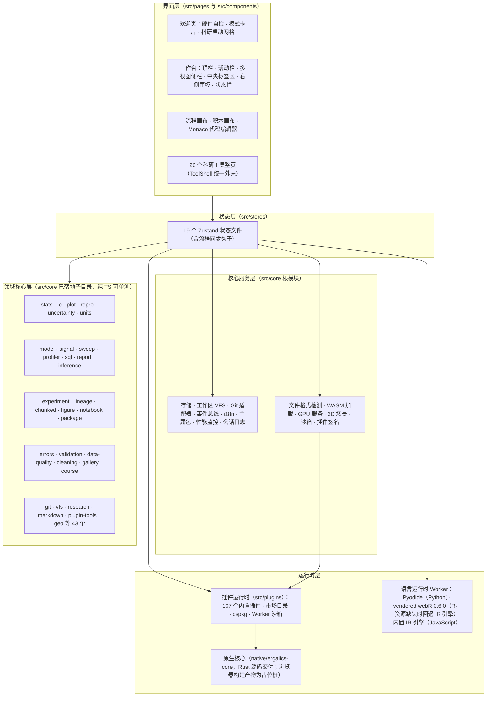
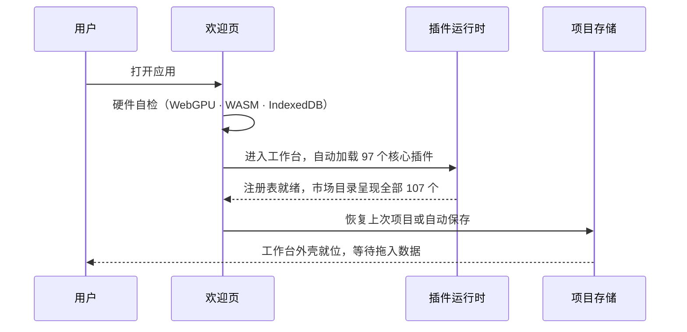
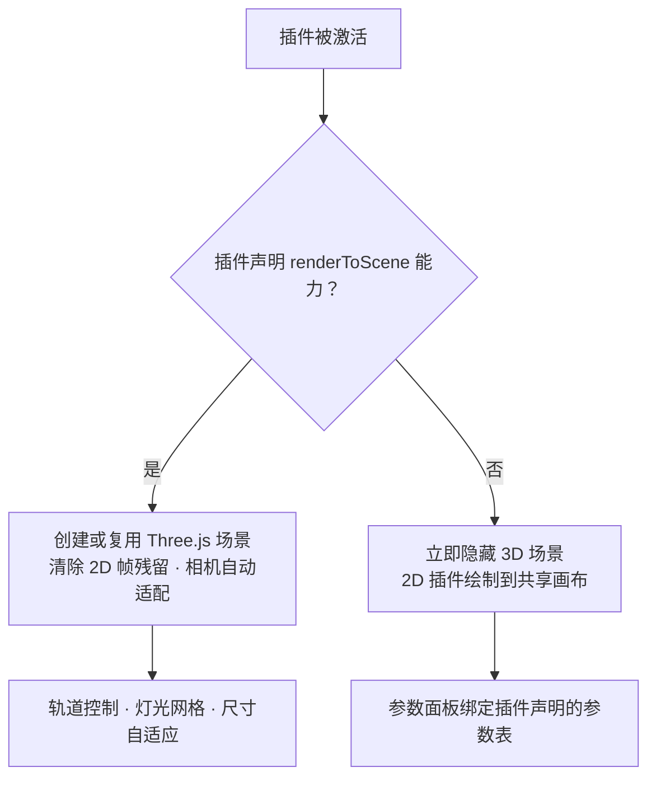

# 02 System Architecture

This document describes Ergalics Studio's layers, routing, startup sequence, state management, rendering pipeline, directory conventions, and dependency rules from an engineering perspective. Directory conventions: frontend code lives under `src/`, the Rust native core under `native/ergalics-core/`, example data and projects under `examples/`, unit tests under `tests/`, and the official website and documentation site under `website/` and `docs/`, respectively.

## I. Overall layering {#一、总体分层}

The entire application is a single-page application (built with Vite 6, React 18 and TypeScript 5.7 strict mode), divided into four layers from top to bottom; lower layers never import higher ones in reverse. The core principle is: **keep the domain core pure TypeScript and unit-testable, keep the UI layer thin, and allow third-party code only in the sandbox**.

**Layering constraints**

| Layer | Allowed dependencies | Forbidden dependencies |
| --- | --- | --- |
| UI | Core services, stores, domain core | Direct manipulation of runtime details (always go through services) |
| Domain core | Pure TS standard library, internal modules | DOM, React, browser-specific APIs |
| Core services | Domain core, browser APIs | React components |
| Runtime | Browser APIs, WASM | Reverse dependency on the domain core |

Responsibilities and technology choices:

| Layer | Responsibilities | Main technologies |
| --- | --- | --- |
| UI | Routing, modular workbench shell (multi-view sidebar + central tabs + editors dispatched by file), three editors, full research-tool pages, dialogs and onboarding | React 18, react-router-dom 7 (HashRouter) |
| State | 19 domain state files and cross-interface events | Zustand 5 |
| Core services | Cross-cutting services (storage, i18n, themes, performance, sandboxing, signing, etc.) | Pure TypeScript, IndexedDB, Web Workers, pure-TS cryptography independent of WebCrypto |
| Domain core | Scientific computing, research workflows, and reliability kernels, all pure TS and unit-testable in Node | Pure TypeScript |
| Runtime | Plugin registration and lifecycle, sandbox execution, language runtimes, native acceleration | fflate (ZIP), lz-string (compression), Rust and wasm-bindgen 0.2 |

The native core is delivered as Rust source; the browser build artifact is a build-time-generated placeholder stub (`scripts/make-wasm-stub.mjs`). Runtime computation does not rely on it: actual computation uses browser-native WebGPU when available or the CPU implementation accompanying each kernel. Host capabilities such as magic-number detection likewise have pure-TS primary paths, with WASM only as optional assistance.

## II. Routing and page organization {#二、路由与页面组织}

The app uses HashRouter for static deployment compatibility. All routes are lazy-loaded and use `location.pathname` as a key to replay the `.route-stage` entrance animation. Routes:

| Path | Page | Description |
| --- | --- | --- |
| `/` | Welcome | Hardware self-check (WebGPU · WASM · IndexedDB), four mode cards, research-tool launch grid, recent projects |
| `/workbench` | Workbench | Container for Standard / Flow / Block / Code; central tabs hold plugin canvases, file previews, file-dispatched editors (`.py`/`.js`/`.r` → Monaco, `*.flow.json` → Flow graph, `*.block.json` → blocks), and embedded research tools |
| `/studio/:toolId` | Research tool page | Driven by the `RESEARCH_TOOLS` registry, with a unified ToolShell |
| Legacy hash paths (e.g. `/#/signal`) | Redirect | Client-side redirect to `/studio/:toolId` |
| `/settings` | Settings | Global settings, theme marketplace, PWA panel, storage management |
| `/plugin/:pluginId` | Plugin view | Single-plugin detail |
| `/share/:payload` | Share | Render share payload |
| `*` | Redirect | Return to welcome page |

### 2.1 Research tool registry (RESEARCH_TOOLS) {#_2-1-科研工具注册表-research-tools}

`src/pages/research/toolRegistry.ts` is the single source of truth for the research interface: each tool declares its `id`, `path`, `legacyPath`, icon, i18n title and description keys, group, whether it appears in the launch grid, whether it requires project context, and its lazy-loaded component once. The `/studio` route, top-bar launcher, and welcome-page launch grid all consume this registry.

There are currently **26 research tools** in six groups:

| Group | Tools |
| --- | --- |
| Measurement and uncertainty measure | uncertainty (uncertainty), profiler (data profiling) |
| Modeling and inference model | model-lab (regression modeling), inference (Inference Forge), model-inference (ONNX inference), sweeps (parameter sweeps) |
| Data and graphs data | sql (SQL workbench), lineage (data lineage), figures (Figure Studio), analysis (quick analysis), cleaning (data cleaning), files (workspace file browser) |
| Signals and sweeps signal | signal (signal lab), notebook (notebook), runs (run history) |
| Delivery and reproduction deliver | report (report building), reprolock (reproducibility lock), supplement (supplementary material), course (course mode), gallery (project gallery) |
| General utilities utils | unit-convert (unit conversion), calc (calculator), format-convert (format conversion), sigfig (significant figures), molar-mass (molar mass), quick-stats (quick statistics) |

Quick analysis `analysis` has `inGrid` set to `false`: it retains a dedicated top-bar button without occupying a launch-grid slot. The general utilities group does not require project context and can be used directly. New research tools must be registered in this table with `legacyPath` configured; scattered routes are prohibited.

## III. Startup sequence {#三、启动时序}

Startup follows the fixed order “self-check, load, restore.” Missing environmental capabilities at any step are reported accurately rather than silently degraded:

Application assembly also runs `initProjectStore` / `initExperimentStore` / `initLineageStore`, making projects, experiment records, and lineage graphs ready before entering any page. `main.tsx` separately warms the plugin-signing module (including the public-key trust registry) and OPFS migration logic.

The welcome-page self-check also determines subsequent operating tiers: when WebGPU is available compute kernels use GPU acceleration; otherwise plugins perform the same computations with mathematically consistent CPU implementations. The native core is delivered as Rust source, and its build artifact is a placeholder stub that does not participate in runtime computation (see article 06).

## IV. State management {#四、状态管理}

There are **19 files** under `src/stores/` holding all application state. Cross-cutting UI communication uses a small typed event bus (`src/core/events.ts`), for events such as plugin parameter changes and the host file chooser. Stores cooperate through the event bus rather than directly referencing one another, avoiding circular dependencies.

| Store | Responsibility |
| --- | --- |
| appStore | Host status, banners and notifications, performance metrics, panel switches |
| projectStore | Current project, recent list, save and autosave, sharing, parameter persistence |
| pluginStore | Plugin registry, load and activation lifecycle, file dispatch, host containers, retry after built-in plugin load failure |
| settingsStore | GPU mode, autosave interval, language, PWA, theme packs and other preferences; language uses the i18n module as its sole authority with bidirectional subscription |
| blockStore | Flow graph state, run orchestration, node output cache, run cancellation |
| editorStore | Block and Code sessions (IR, code text, variables, console, language), sanitized field by field on load |
| analysisStore | Column selection, plot type, and analysis results for quick analysis |
| researchStore | Shared research-tool context (current file, recently used tools) |
| experimentStore | Read/write and filtering for experiment runs (IndexedDB runs store) |
| lineageStore | Reconstruction and query of data lineage graphs |
| chunkStore | Chunked-loading task queue and progress |
| figureStore | Figure Studio panel layout, captions, and submission-check state |
| notebookStore | Notebook cells, execution state, and output |
| aiPanelStore | AI assistant panel sessions, mode (offline/online), and authorization state |
| commandPaletteStore | Command palette (Ctrl+K) visibility and action registration |
| shortcutsStore | Keyboard shortcuts help dialog (ShortcutsDialog) visibility and entry registration |
| tourStore / templateTourStore | Onboarding and template-tour progress |
| useFlowSync | Bidirectional Flow graph ↔ shared IR synchronization hook, including hydration-signature guard |

Project lifecycle: create, open, save, autosave, and share. The project format is `.clproj`, compressed with lz-string and stored in IndexedDB; block programs, code sessions, and notebook cells are all persisted in the project file and fully restored when reopened. Projects are also backed by Git repositories (`src/core/git`, isomorphic-git + LightningFS); the sidebar GitPanel provides branch switching, change review, and one-click staging and commit. Flow graphs and block programs are additionally persisted as `.flow.json` / `.block.json` **workspace files** (through `src/core/vfs/`), directly editable by the file explorer's per-file editors; the old `blockGraph` project field remains readable for compatibility. Share links are identified by random UUIDs, and payload size and structure are both validated during resolution to reject malformed data. For large files, `src/core/opfs.ts` provides chunked OPFS storage and `opfs-migration.ts` smoothly migrates existing IndexedDB data.

## V. Rendering pipeline {#五、渲染管线}

The central viewport has three drawing surfaces, whose visibility is centrally managed by the host:

1. **Shared 2D canvas**: All 2D plugins (scatter, line, histogram, heatmap, contour, box, violin, Sankey, etc.) draw on the same canvas, accessed through snapshots provided by the unified 2D viewport abstraction (`viewport2d`).
2. **DOM container**: For plugins needing DOM elements; also where sandboxed plugin canvases are mounted after OffscreenCanvas transfer.
3. **Host-managed Three.js 3D scene**: Created on demand only when a plugin declaring `renderToScene` is activated, with orbit controls, light grid, and responsive sizing.

Visibility decision flow:

This guarantees a 3D coordinate system never bleeds into a 2D view, or vice versa; end-to-end tests include dedicated assertions for mutual exclusion of the two viewports. For 3D data there are also `src/core/mesh3d.ts` (pure-function 3D mesh data pipeline) and `src/core/pointcloud-gpu.ts` (GPU budget and downsampling strategy for million-point clouds).

## VI. Directory structure {#六、目录结构}

Top-level directories under `src/` are blocks, components, core, editor, hooks, i18n, native, pages, plugins, stores, styles, theme, and types. Main locations:

| Location | Contents |
| --- | --- |
| src/core (38 root modules) | storage, events, settings, perf, logger, gpu, compute, gpu-kernels, wgsl, wasm, fileFormat, parse-tasks, parse-worker, worker-pool, scene3d, viewport2d, mesh3d, pointcloud-gpu, sandbox, plugin-worker, pluginCache, cspkg, plugin-signing, crypto-primitives, dataFiles, exampleAssets, examples, download, opfs, opfs-migration, pwa, recentTools, site-links, citation, workspace-artifacts, boot, cpu-info, labHandoff (i18n dictionaries are separately in src/i18n) |
| src/core (43 subdirectories) | stats, io, plot, repro, uncertainty, units, model, signal, sweep, profiler, sql, report, inference, experiment, lineage, chunked, cleaning, figure, notebook, package, gallery, course, templates, theme-pack, submit, bench, validation, errors, data-quality, ai, r, pyodide, chem, monaco, geo, git, markdown, plugin-tools, research, vfs, astro, raytrace, sanitize |
| src/blocks | Flow block system: types, registry, compiler, executor, ops and DataTable operations, block catalog (38 blocks), localization (l10n), render bridge (render.ts) |
| src/editor | Block and Code modes: ir (types, validate, hash, serialize), Flow and Block conversions, block (Blockly engine, definitions, toolbox, theme, samples), code (parsing and samples), codegen (Python, R, JS generators), runtime (interpreter and Studio API) |
| src/components | Workbench shell components (TopBar / ActivityBar / Sidebar / CentralArea / RightPanel / StatusBar / GitPanel), file-dispatched editors (editor/fileEditors), Flow canvas components, Block and Code editor panels, ScienceOutputStrip, feedback and error boundaries, icon set |
| src/pages | welcome, workbench, studio, research (toolRegistry), labs (13 research-tool page components), figures, gallery, notebook, signal, sql, report, sweeps, utils, settings, share, plugin, plugin-dialog |
| src/plugins | Built-in plugins (builtin, 107: 97 autoloaded at startup + 10 fun tools), marketplace catalog (marketplace.ts), sample packages (marketplace-demo-packages.ts), category table (categories.ts) |
| src/stores | Zustand stores (19 files) |
| src/hooks / src/i18n / src/styles / src/theme | Cross-component hooks (CPU information, mode synchronization, panel width), Chinese/English dictionaries and types, global stylesheets, theme foundation |
| src/types | Contract types for plugins, projects, blocks, editors, and DataTable |
| src/native | Build-generated WASM bindings (not committed) |
| native/ergalics-core | Rust native core (lib, device, buffer, compute, utils), delivered as source |
| examples | Sample data (data), sample projects (projects, 11 .clproj files: 8 Flow examples + 3 plugin demos), Code-mode samples (code, 9 Python programs) |
| scripts | About 50 engineering scripts: WASM build and stub generation, example data generation, signing CLI, SBOM / CITATION generation, deployment merging, and 1 smoke + 13 verify end-to-end scripts |
| tests | Vitest unit tests (173 test files, 2,815 cases, 2 skipped without a GPU) |
| docs | VitePress documentation site and this technical documentation directory (technical) |
| website | Official website (project gallery · theme marketplace · plugin marketplace), deployed to the Pages root path |

## VII. Dependency rules and chunking strategy {#七、依赖规则与分包策略}

- The UI layer depends on the state layer, the state layer depends on core services and domain core, and core services never import the UI layer.
- The domain core must not access DOM or React; tests run in Node (Vitest). New capabilities should first be implemented as pure-TS modules in `src/core/`, then assembled in the UI layer; domain logic must not be implemented in components.
- Run operations (Flow / Block / Code / notebook / sweeps / uncertainty / modeling / inference) must enter experiment records and lineage through the event bus and must not bypass it.
- The plugin contract (`src/types/plugin.ts`) is the sole shared vocabulary between host and third-party code; the render bridge (`src/blocks/render.ts`) is the block system's only side-effectful module, sending visualization output to plugin renderers so compiler and executor remain testable.
- All heavy dependencies are lazy-loaded chunks: Blockly (about 828 KB) is fetched on first entering Block mode; TensorFlow.js on the first training click; Pyodide on the first Python run; vendored webR 0.6.0 (`public/webr/`) on the first R run, falling back to the built-in IR engine if assets are missing; Monaco and DuckDB-WASM likewise. Initial Standard and Flow screens are unaffected. WASM and Blockly media are vendored to `public/` on the same origin by custom Vite plugins, without an external CDN.
- The app version is injected from package.json through `define.__APP_VERSION__`; hard-coding it is prohibited.
- Error boundaries are isolated by area (top bar and status bar wrapped separately), with bounded retries by incrementing the reset key to avoid error loops.

## VIII. Observability {#八、可观测性}

| Facility | Capability |
| --- | --- |
| Performance monitoring (perf) | Aggregates frame time and GPU time; alerts users through notifications when thresholds are exceeded instead of silently stalling |
| Run logs (logger plus download) | Session event sequences can be exported to a file for issue reporting and regression diagnosis |
| Status bar | Persistently shows GPU availability, current engine, and performance metrics so users know “what is computing now” |
| Benchmark suite (`src/core/bench/`) | Four categories: import, GPU kernels, render frame rate, and memory; uses `scripts/bench-*.mjs` and `budget-baseline.json` for CI performance-regression gates (see article 08) |
| Reliability kernel (`src/core/errors/`) | Structured error taxonomy, `Result` type, backoff retries, deduplicated error registry, and global `error` / `unhandledrejection` capture turn “silent failures” into reportable events |
