# 03 插件系统

Ergalics Studio 把"一切可视化皆插件"作为第一性设计。宿主与插件之间只有一个契约，第三方扩展与内置插件走同一套接口与生命周期。当前共有 **107 个内置插件**：97 个在启动时自动加载，10 个趣味工具插件声明 `autoload: false` 按需手动加载。侧栏按**学科**把注册表分成 16 个分组（映射表 `src/plugins/categories.ts` 是唯一事实来源），本章第二节给出全部 107 个插件的完整清单。

## 一、宿主与插件的契约

每个插件实现统一的 `Plugin` 接口（`src/types/plugin.ts`）。`manifest`、`init`、`getParams` 为必选，其余方法均可选——宿主以可选调用探测，这正是第三方包可以只实现 `render` 就跑起来的原因：

| 方法 | 作用 |
| --- | --- |
| init / destroy | 初始化与销毁，宿主负责 GPU 安全的资源回收 |
| activate / deactivate | 激活与去激活，驱动 2D/3D 视口切换与残留帧清理 |
| render / updateParams | 绘制与参数更新（右侧面板响应式表单） |
| getParams / compute | 参数定义读取与计算（`compute` 带进度回调） |
| loadData / getSupportedFormats | 接收宿主分发的数据；声明支持的文件格式 |
| renderToScene | 3D 能力声明，激活时获得宿主 Three.js 场景句柄 |
| onProjectSave / onProjectLoad | 项目保存与加载后的生命周期钩子 |

### 1.1 3D 插件标准接法：renderToScene 与 Scene3DHandle

3D 插件不自行创建渲染器，而是实现 `renderToScene(scene)` 获取宿主统一管理的 `Scene3DHandle`：成员即真实的 Three.js 对象（`scene` 根节点、预置机位的 `camera`、`controls` 轨道控制器、`renderer`），插件向其中添加网格与灯光并通过 `render()` 驱动渲染循环；`setVisible/isVisible` 保证非 3D 插件激活时三维坐标系不会渗入二维视口；`snapshot({ transparent: true })` 导出去除背景与参考物件的透明 PNG；`dispose()` 释放 GPU 资源并停止渲染循环。WebGL 不可用时自动回退 2D 提示。

### 1.2 PluginApi：宿主提供的能力面

| 能力组 | 内容 |
| --- | --- |
| 本地化 | `locale`、`t()` 与语言切换订阅，参数面板随语言重建 |
| 状态上报 | `setStatus` 向状态栏上报 ready/computing/paused/loading/saving/error |
| 性能上报 | `reportGpuTime` 与 `reportDataScale` 进入性能监控与告警 |
| 通知 | `notify` 按严重级别的横幅与提示 |
| 日志 | `log` 输出到 `plugin:<id>` 作用域，随运行历史导出 |
| 取消与激活态 | `onCancel` 订阅状态栏取消；`isActive` 防止后台插件绘制共享画布 |
| 文件访问 | `openFile / readText / readBinary`（项目自有文件、内置示例与代码模式文件共享同一套逻辑） |
| 参数读写 | `getParam / setParam` 项目级持久化；`reload` 自恢复实例 |
| 临时缓存 | `cache` 插件作用域异步缓存，卸载即释放 |
| 文件保存 | `exportFile` 把文本/二进制保存到用户下载 |
| GPU 计算面 | `gpu`（createBuffer、write、read、compileKernel、run，详见 06 篇） |

### 1.3 参数面板与控件

插件在清单中声明参数表，宿主据此自动生成本地化的响应式参数面板，支持八类控件：

| 控件 | 用途示例 |
| --- | --- |
| 范围（滑杆） | 引力常数、阻尼系数 |
| 下拉 | 场景预设、投影方式、调色板 |
| 数字 | 分箱数、步长 |
| 复选框 | 轨迹线、网格显示 |
| 文本 | 列名、标签 |
| 文件 | 附加数据选择 |
| 按钮 | 重新播种、导出 |
| 开关 | 运行 / 暂停之外的布尔状态 |

参数可声明 `group` 与 `inline`，同一组控件并排自动换行布局。

### 1.4 生命周期与懒加载

插件运行时统一编排生命周期；模块本身是懒加载的——注册表中先登记 manifest，模块代码只在加载该插件时经动态 `import()` 实例化，未加载的插件不占运行时资源：


销毁时宿主回收插件持有的缓冲与事件监听；自动加载失败可重试：插件运行时把"初始化完成"作为状态机节点，失败后注册表不会进入就绪态，用户重试不会被误判为重复加载。

### 1.5 导出

导出能力分两层：**画布级**由中央区的统一"导出"菜单承担——把当前激活插件的 2D 画布或 3D 场景下载为 PNG（3D 场景额外提供透明背景选项），或保存为工作区 `figures/` 下的文件（经 `src/core/vfs/`）；**数据级**由各插件在参数面板以按钮动作自声明（`exportCsv` 动作），把所属表格数据导出为 RFC-4180 CSV（UTF-8 BOM，仿真类带行数上限与抽样）。

## 二、107 个内置插件（16 个学科分组）

侧栏分组由 `DISCIPLINE_BY_PLUGIN` 映射决定，未登记的第三方插件回落到"图表可视化"组。下表按侧栏显示顺序给出全部 107 个插件（数量：图表可视化 16 / 数学统计 8 / 数学方法 3 / 物理模拟 15 / 化学 5 / 生物学 8 / 地理 13 / 环境 8 / 天文 3 / 材料学 3 / 工程仿真 4 / 经济与金融 2 / 心理与行为 2 / 数据与智能 2 / 特效渲染 5 / 趣味工具 10）。其中 97 个自动加载，趣味工具组 10 个为 `autoload: false` 手动加载。

### 2.1 图表可视化（charts，16 个）

| 插件ID | 中文名 | 英文名 | 说明 |
| --- | --- | --- | --- |
| example.scatter | 散点图 | Scatter Plot | 渲染数值列（x y [值]）为二维散点，第三列可作为颜色通道 |
| example.timeseries | 时间序列绘图 | Time Series | 将 CSV 各列绘制为随时间变化的折线图 |
| example.heatmap | 热力图 | Heatmap | 将二维数值网格（JSON 矩阵）渲染为热力图 |
| example.contour | 等值线图 | Contour | 渲染二维标量场（JSON 网格）为色带 + 等值线，适合涡旋场、地形等数据 |
| example.surface-3d | 3D 表面图 | 3D Surface | 高度场网格 z=f(x,y) 的三维表面图，数据来自项目文件或示例数据，自适应视角 |
| example.voxel-3d | 3D 体素渲染 | 3D Voxel Field | 三维标量场等值面与半透明体素渲染，数据来自项目文件，单次实例化提交 |
| example.bar_chart | 柱状图 | Bar Chart | 渲染分类数据为柱状图，支持水平/垂直方向与配色选择 |
| example.bubble | 气泡图 | Bubble Chart | 渲染三维数值数据（x y 大小 [颜色]）为气泡图，第四列可作颜色通道 |
| example.polar | 雷达图 | Polar Plot | 渲染多系列雷达/极坐标图，每列一个维度，每行一个系列 |
| example.network | 网络图 | Network Graph | 从边列表数据渲染力导向网络图，支持节点大小、颜色与动画 |
| example.sankey | 桑基图 | Sankey Diagram | 从源→目标→值的边数据渲染桑基流图，带按比例缩放的流量带 |
| example.treemap | 矩形树图 | Treemap | 用嵌套矩形展示层级数据，矩形面积与数值成正比 |
| example.parallel | 平行坐标图 | Parallel Coordinates | 将多变量数据绘制为平行坐标轴，每行一条折线，可用类别列着色 |
| example.point-cloud | 点云查看器 | Point Cloud | 渲染 .xyz 点云文件，可调节点大小与颜色 |
| example.point-cloud-3d | 3D 点云 | Point Cloud 3D | 基于宿主 Three.js 场景的交互式 3D 点云渲染，支持高度着色与自适应视野 |
| example.image | 图像查看器 | Image Viewer | 加载并查看图片文件（PNG/JPEG/WebP/GIF） |

### 2.2 数学统计（stats，8 个）

| 插件ID | 中文名 | 英文名 | 说明 |
| --- | --- | --- | --- |
| example.histogram | 直方图 | Histogram | 对一维数值数据绘制分布直方图，可调节分箱数 |
| example.boxplot | 箱线图 | Box Plot | 对分组数值数据绘制箱线图（四分位箱体 + 须线 + 离群点） |
| example.violin | 小提琴图 | Violin Plot | 对分组数值数据绘制核密度小提琴图，支持带宽调节与箱线图叠加 |
| example.qqplot | QQ 图（正态检验） | QQ Plot | 样本分位数与标准正态分位数对比，偏离对角线表示非正态 |
| example.errorband | 误差带图 | Error Band | 折线 + 半透明误差带（置信区间）图，适合带不确定性的测量数据 |
| example.stats-clt | 中心极限定理演示台 | Central Limit Theorem Bench | 从均匀/指数/伯努利/双峰混合/截断重尾 Pareto 母体抽样求均值分布，叠加理论 N(μ, σ²/n) 正态曲线，给出偏度/峰度/Jarque-Bera 度量与内嵌验证基准 |
| example.stats-markov | 马尔可夫链与稳态分析 | Markov Chains & Stationary Analysis | 幂法求稳态分布（L1 残差 < 1e-12）、遍历性与周期检查、吸收链分析、轨迹模拟与阻尼 0.85 的 PageRank 模式 |
| example.stats-zipf | Zipf 定律词频分析 | Zipf's Law Word Frequencies | 真实语料的 Zipf 定律分析：分词、词频排序与 log(rank)–log(freq) 最小二乘拟合（s±σ、R²、逐秩残差），与理想指数 s=1 对照，内置《爱玛》公版语料 |

### 2.3 数学方法（math，3 个）

| 插件ID | 中文名 | 英文名 | 说明 |
| --- | --- | --- | --- |
| example.math-fourier | 傅里叶级数逼近实验室 | Fourier Series Lab | 间断点分段 Simpson 求积计算傅里叶系数，对比普通部分和与 Fejér 平均；Gibbs 过冲比例对照经典常数 2·Si(π)/π ≈ 1.17898 |
| example.math-domaincolor | 复变函数域着色 | Domain Coloring | f(z) 逐像素域着色（色相编码辐角、对数模长等值线带），内置递归下降复数表达式解析器，按辐角原理统计绕数 |
| example.math-odefield | ODE 向量场与流线 | ODE Vector Field & Streamlines | 二维自治系统相平面实验台：RK4 双向流线积分、牛顿法定位平衡点并按雅可比特征值分类 |

### 2.4 物理模拟（physics，15 个）

| 插件ID | 中文名 | 英文名 | 说明 |
| --- | --- | --- | --- |
| example.particles | 粒子模拟 | Particles | 交互式粒子模拟，演示计算进度与性能上报 |
| example.nbody | 引力 N 体模拟 | N-Body Gravity | 三维天体物理 N 体引力直接求和模拟，支持 GPU 全配对计算与 CPU 降级 |
| example.fluid | 流体模拟（LBM） | LBM Fluid | 二维格子 Boltzmann 通道流（D2Q9）绕流涡街演示，GPU 内核逐步计算 + CPU 降级 |
| example.wave | 波动方程 | Wave Equation | 二维波动方程有限差分模拟：高斯脉冲、双源干涉、双缝衍射三种场景，GPU 逐步计算 + CPU 降级 |
| example.pendulum | 双摆（混沌） | Double Pendulum | RK4 积分的经典双摆：主摆与初始角仅差 0.001 rad（≈0.057°）的"幽灵摆"并行演化，直观展示混沌对初值的敏感依赖 |
| example.electromag | 电磁场 | Electromagnetism | 在画布上拖动电荷并自由释放：电荷受库仑力与均匀磁场的洛伦兹力共同作用运动，磁场可单独设置（强度与方向） |
| example.optics | 光学实验 | Optics Lab | 几何光学光线追踪：凸透镜/凹透镜（薄透镜）、三棱镜（斯涅尔折射 + 色散）、光屏成像，所有元件可在画布上拖动 |
| example.em-eigensolver | 电磁谐振特征值求解器 | EM Eigensolver | 面向电磁谐振/微波器件仿真的十万阶非正定厄密稀疏矩阵特征值求解器：厚重启 Lanczos、块 LOBPCG、Jacobi-Davidson 三内核 + MINRES 位移逆变换 |
| example.fluid-cfd-coupler | 1D-3D 双向耦合求解器 | 1D-3D Coupled Solver | 1D 管网-3D 场双向耦合：多速率时间步协调、粗-细时间子循环、正反向边界耦合、毫秒级阀门控制、守恒性审计与精度-效率权衡曲线 |
| example.physics-schrodinger | 一维量子力学求解器 | 1-D Schrödinger Solver | 有限差分 + 自实现三对角 QL 本征求解器给出无限深阱/谐振子/有限阱/双势阱的能级与本征函数，Crank-Nicolson 幺正时间演化演示高斯波包 |
| example.physics-ising | 二维伊辛模型 | 2-D Ising Model | 周期方格子上运行 Metropolis 与 Wolff 单团簇算法，观测磁化率、比热与 Binder 累积量；χ(T) 峰位拟合给出 Onsager 临界温度 |
| example.physics-heatengine | 热机循环 p-V 分析台 | Heat Engine Cycles | 奥托/迪塞尔/卡诺/（回热）斯特林循环按准静态路径以梯形法积分 ∮p dV，逐支按 Q = ΔU + W 记账，热效率与闭式公式对拍 |
| example.physics-diffusion | 热传导 / 扩散方程实验室 | Diffusion Equation Lab | FTCS 显式格式（D·Δt/Δx²≤0.5 稳定性校验）与 Crank–Nicolson 隐式格式，支持 Dirichlet/Neumann 边界，实时输出与解析解的最大相对误差 |
| example.physics-diffraction | 衍射实验室 | Diffraction Lab | 数值计算菲涅尔-基尔霍夫衍射积分，单缝/双缝/N 缝光栅/圆孔近场与远场统一处理 |
| example.physics-trajectory | 轨迹运动学与能量分解实验室 | Trajectory Kinematics Lab | 分析轨迹数据（t, x[, y]）：三点 Lagrange 数值微分、可选 Savitzky-Golay 平滑、动能/势能分解与线性化最小二乘抛体拟合 |


*电磁场插件：在画布上拖动并释放电荷，电荷受库仑力与匀强磁场的洛伦兹力共同作用做回旋运动，磁场强度与方向可单独设置。*


*光学实验室：白光束经三棱镜折射发生色散，凸凹透镜与元件均可在画布上拖动，用于薄透镜成像与色散演示。*


*结构力学插件：铰接桁架实时承重，杆件按轴力着色，超载时依次断裂直至整体垮塌，直观展示材料极限与失效传播。*

### 2.5 化学（chem，5 个）

| 插件ID | 中文名 | 英文名 | 说明 |
| --- | --- | --- | --- |
| example.chem-crystal | 晶胞 · 3D 预览 | Crystal · 3D Unit Cell | 加载 CIF / POSCAR / XYZ 主流晶胞格式，3D 查看原子、周期性化学键、有效组成与密度估算 |
| example.chem-reaction | 反应 · 自由反应动力学 3D | Reaction · MD 3D | 内置 NumPy/Langevin 引擎在所选温度与催化剂条件下积分真实轨迹——键越过 Arrhenius 势垒而断裂、自由基重组而成键 |
| example.chem-titration | 酸碱滴定曲线实验室 | Titration Curve Lab | 全离子平衡（电荷 + 物料平衡 + Ka + Kw）方程组，带二分保护的 Newton–Raphson 逐体积求解 [H⁺]，标注等当点、缓冲区与指示剂变色区间，内嵌解析式对拍基准 |
| example.chem-reaction-order | 反应级数判定与 Arrhenius 分析 | Reaction Order & Arrhenius | 对 [A]–t 数据做零/一/二级线性化最小二乘并按 R² 判优，半衰期法交叉验证，Arrhenius 回归回收 Ea ± σ 与指前因子 A |
| example.chem-turing | Gray-Scott 反应扩散图灵斑图 | Gray–Scott Turing Patterns | FTCS 显式差分在 N×N 周期网格上演化反应-扩散方程，内置 Pearson (1993) 经典分区预设与质量守恒数值基准 |


*晶胞 · 3D 预览：加载 CIF 格式晶胞以球棍模型查看原子、周期性化学键与晶胞框，Rutile 示例含 8 个原子，并可结合有效组成与密度估算。*

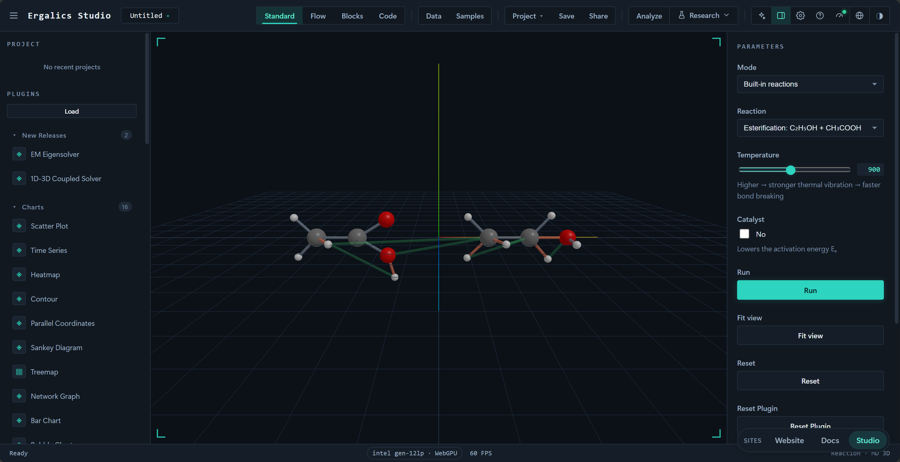

*自由反应动力学 3D：内置 NumPy / Langevin 引擎在设定温度与催化剂条件下积分真实轨迹——酯化反应（乙醇 + 乙酸）中键越过 Arrhenius 势垒断裂、自由基重组而成键，原子运动来自真实物理而非脚本动画。*

### 2.6 生物学（bio，8 个）

| 插件ID | 中文名 | 英文名 | 说明 |
| --- | --- | --- | --- |
| example.protein | 蛋白质交互网络 | Protein Interactions | 蛋白质-蛋白质交互网络与力导向布局计算，输出度分布与连通分量等生物学指标 |
| example.bio-enzyme | 酶动力学 | Enzyme Kinetics | Michaelis-Menten 酶动力学：竞争性/非竞争性/反竞争性抑制、Lineweaver-Burk 线性化，Levenberg-Marquardt 拟合反解 Vmax 与 Km，输出 kcat 与催化效率 |
| example.bio-epidemic | 传染病分室模型 | Epidemic Modeling | 确定性 SIR / SEIR 分室模型，经典 RK4 积分，输出 R₀、群体免疫阈值、感染峰值时刻与总感染率 |
| example.bio-seqalign | 序列比对与分析 | Sequence Alignment | BLOSUM62 / 核酸打分矩阵的双序列比对（全局 Needleman-Wunsch 或局部 Smith-Waterman，仿射空位罚分），以及碱基组成与 GC 滑动窗口分析，支持 FASTA 数据 |
| example.bio-popgen | 群体遗传学 | Population Genetics | 哈代-温伯格平衡（HWE）卡方检验，以及带可选自然选择（隐性/加性/显性）的、可复现的 Wright-Fisher 遗传漂变模拟 |
| example.bio-pk | 药代动力学室分析 | Pharmacokinetics | 一室/二室、静脉推注与口服一级吸收模型，RK4 数值解与解析解对拍，治疗窗（MEC/MSC）叠加 |
| example.bio-mendel | 孟德尔 F2 分离比 χ² 检验 | Mendel F2 χ² Tests | 对单杂合 3:1 与双杂合 9:3:3:1 分离比做卡方拟合优度检验，内置 1866 年论文七性状原始 F₂ 计数，自实现不完全伽马函数计算 p 值 |
| example.bio-neuron | Hodgkin–Huxley 神经元 | Hodgkin–Huxley Neuron | 采用 1952 年原始发表常数的四变量 RK4 积分，展示 V(t) 与 m/h/n 门控波形，支持电流脉冲与 Q10=3 温度标度 |


*酶动力学：以 v=f([S]) 饱和曲线对照无抑制 / 竞争性 / 非竞争性 / 反竞争性四种情形，并用 Levenberg-Marquardt 从含噪初速度数据反解 Vmax、Km，输出 kcat 与催化效率。*

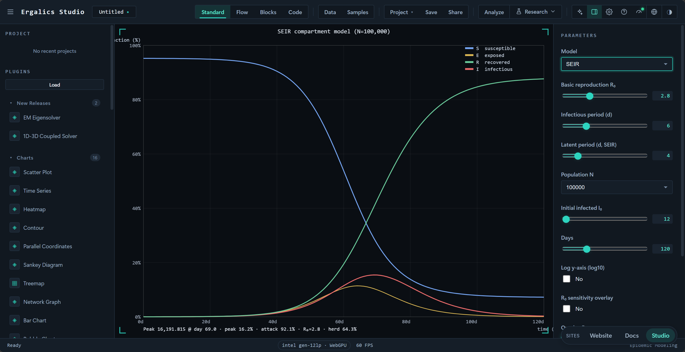

*传染病分室模型：确定性 SIR / SEIR 用经典 RK4 积分，图中 SEIR 显示 S/E/I/R 随时间演化，给出感染峰值时刻、总感染率（attack 92.1%）与群体免疫阈值。*

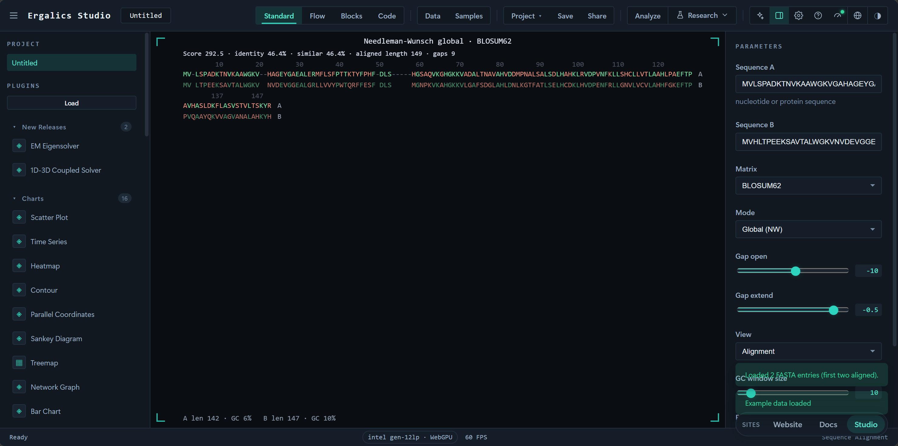

*序列比对：BLOSUM62 打分矩阵的双序列全局（NW）或局部（SW）比对与仿射空位罚分，图中给出两条蛋白序列的对齐、一致性 46.4%、9 个空位及 GC 分析。*

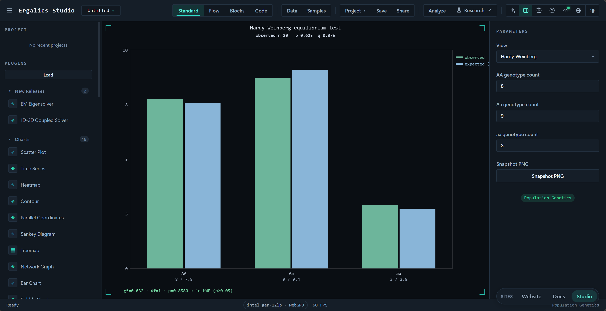

*群体遗传学 HWE 检验：输入三个基因型计数，χ² 检验观察值与 HWE 期望值之差（图中 χ²=0.832、p=0.86），p ≥ 0.05 判定处于平衡。*

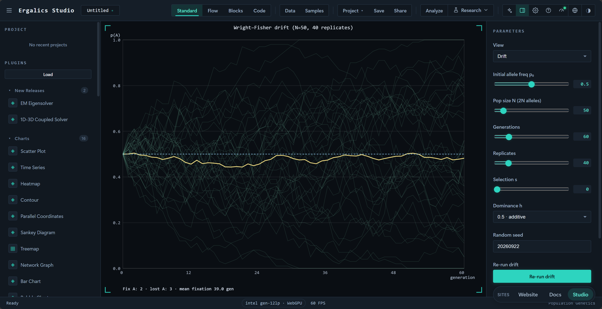

*群体遗传学遗传漂变：可复现的 Wright-Fisher 模拟，40 条轨迹展示等位基因频率的随机游走，记录固定 / 丢失次数与平均固定代数，支持可选隐性 / 加性 / 显性选择。*

### 2.7 地理（geo，13 个）

| 插件ID | 中文名 | 英文名 | 说明 |
| --- | --- | --- | --- |
| example.geomap | GeoJSON 地图 | GeoJSON Map | 离线渲染 GeoJSON 矢量数据：多边形/线/点，支持按数值属性分级设色（choropleth）与墨卡托/等距圆柱投影 |
| example.geo-solar | 太阳高度与昼夜长短 | Solar Elevation & Day Length | 给定纬度与日期计算太阳赤纬、正午太阳高度、昼长与日出日落地方时，绘制全年昼长与正午太阳高度曲线 |
| example.geo-climograph | 气候直方图 | Climatograph | 以"气温折线 + 降水柱状"双轴绘制月度气候图，自动汇总年均温、年降水、气温年较差与降水季节分配并判读气候类型 |
| example.geo-pop-pyramid | 人口金字塔 | Population Pyramid | 背靠背年龄性别金字塔（左男右女，年龄自下而上），计算 0-14 / 15-64 / 65+ 占比、总人口性别比并判读结构类型 |
| example.geo-interp | 空间插值 | Spatial Interpolation | 将离散站点观测值网格化：反距离加权（IDW，幂次可调）与普通克里金（经验变差函数自动拟合球状/指数模型），输出热力面、等值线与站点标注 |
| example.geo-measure | 距离与面积量算 | Distance & Area Measure | 画布点击加点：测距模式逐段给出大圆距离与累计里程；测面模式用球面多边形公式计算围合面积与周长 |
| example.geo-tissot | 投影变形（Tissot 圆） | Projection Distortion (Tissot) | 在等距圆柱、墨卡托、正弦、摩尔威德、高尔-彼得斯、方位等积与正射七种投影下绘制世界海岸线与 Tissot 变形圆 |
| example.geo-terrain | DEM 地形分析 | DEM Terrain Analysis | 解析 ESRI ASCII Grid（.asc）高程数据：高程设色、山体阴影、Horn 法坡度/坡向、等高线叠加与三维建模视图 |
| example.geo-gpx | GPX 轨迹分析 | GPX Track Analysis | 解析 GPX 轨迹点（含海拔/时间），统计总里程、累计爬升/下降（2 m 迟滞滤波）、用时与最高最低点，绘制海拔着色轨迹与海拔-距离剖面 |
| example.geo-globe | 交互地球仪（3D） | Interactive Globe (3D) | 可拖拽旋转、滚轮缩放的真三维地球仪：Natural Earth 110m 海岸线与经纬网贴在球面上，叠加球面 Tissot 变形圆，支持自动自转 |
| example.geo-carbondating | 放射性碳定年实验室 | Radiocarbon Dating Lab | Libby 常规年龄（5568 年半衰期，BP=1950）、对 IntCal20 大气校准曲线做似然剖面校准（1σ/2σ 区间）与多样品逆方差加权合并 |
| example.geo-soilwater | 土壤水分特征曲线拟合 | Soil Water Retention Fit | van Genuchten (1980) 模型的 Levenberg-Marquardt 非线性最小二乘（箱式约束 + 协方差标准误），输出比水容量 C(h)、有效饱和度与等效孔隙半径 |
| example.geo-hydrology | SCS 降雨径流模型 | SCS Runoff Event | SCS 曲线数法划分有效降雨后与 SCS 合成单位线（三角形或 NOHRSC 无因次曲表）卷积成直接径流过程线，体积守恒达机器精度 |

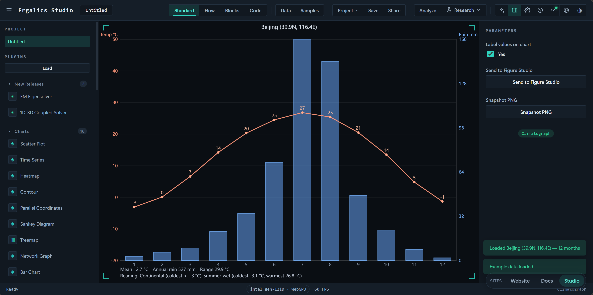

*气候直方图：以气温折线（左轴）+ 降水柱状（右轴）双轴绘制月度气候图，图上北京自动汇总年均温 12.7 ℃、年降水 527 mm、年较差 29.9 ℃并判读气候类型。*

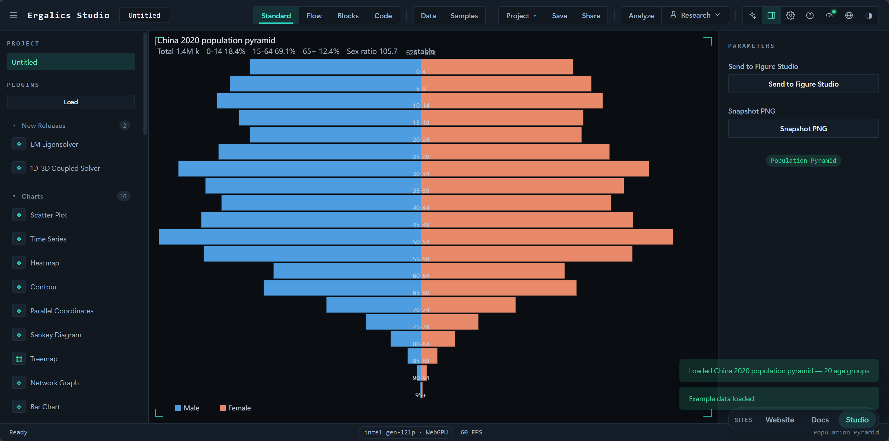

*人口金字塔：背靠背年龄性别分组（左男右女），自动计算 0-14 / 15-64 / 65+ 占比、性别比（105.7）并判读增长型 / 稳定型 / 缩减型结构。*


*空间插值：将离散站点观测值网格化——图中 IDW（p=2）对 31 站点生成热力面与等值线，附 LOOCV 交叉验证 RMSE / MAE 与 Moran's I 空间自相关检验。*

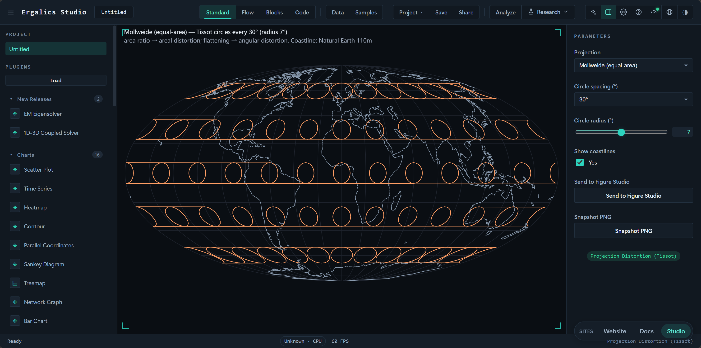

*投影变形（Tissot 圆）：在七种投影下绘制世界海岸线与 Tissot 变形圆，圆面积比表征面积变形、扁率表征角度（形状）变形；图中为保持等积性质的 Mollweide 投影。*

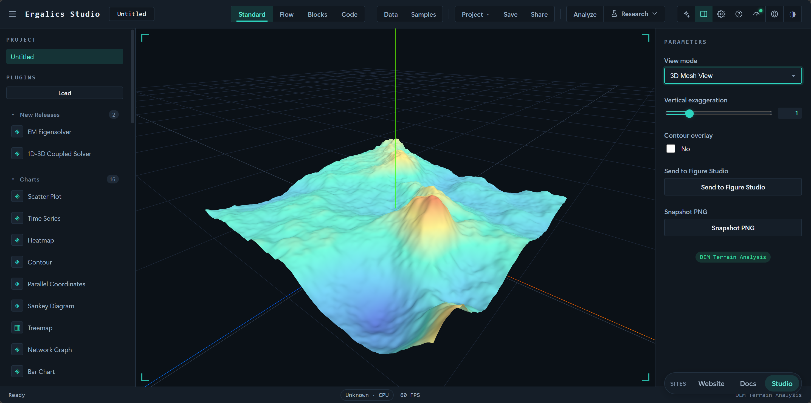

*DEM 地形分析（3D Mesh 视图）：解析 ESRI ASCII Grid 高程数据，三维曲面按高程设色、垂直夸张系数可调，并可叠加等高线。*


*DEM 地形分析（坡度视图）：按 Horn 法计算坡度（0-72°）并叠加等高线，另一模式给出山体阴影，用于提取地形坡度与坡向。*

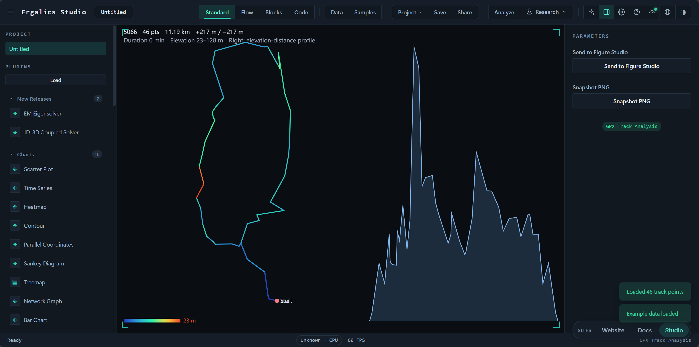

*GPX 轨迹分析：解析 GPX 轨迹点，左图按海拔着色显示路径（46 点、11.19 km、+217 m / −217 m），右图绘制海拔-距离剖面，并统计总里程与累计爬升 / 下降。*


*交互地球仪（3D）：可拖拽旋转、滚轮缩放的真三维地球仪，Natural Earth 110m 海岸线贴于球面，叠加球面 Tissot 变形圆并支持自动自转。*

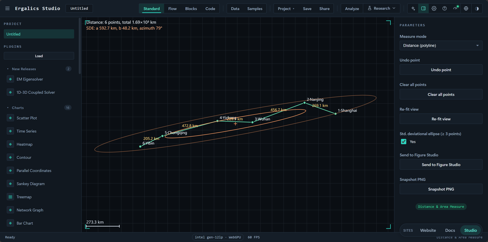

*距离与面积量算：画布点选加点后逐段给出大圆距离与累计里程，对 ≥3 点还可计算标准差椭圆（SDE a / b 半轴与方位角）与围合面积——图中为长江沿岸 6 城测距与标准差椭圆。*

### 2.8 环境（env，8 个）

| 插件ID | 中文名 | 英文名 | 说明 |
| --- | --- | --- | --- |
| example.env-aqi | 空气质量评价（AQI） | Air Quality (AQI) | 按 HJ 633-2012 分段线性插值计算各污染物 IAQI 与当日 AQI，输出级别、首要污染物与健康提示，可切换 US EPA 断点对照 |
| example.env-water | 水质评价（地表水分类） | Water Quality | 按 GB 3838-2002 将水样各项指标归类 Ⅰ–Ⅴ 类，单因子法取最差类别给出综合判定，绘制相对限值的雷达图 |
| example.env-greenhouse | 温室效应模拟 | Greenhouse Effect | 零维辐射收支教学模型：CO₂/反照率/云量滑块以 Myhre 辐射强迫公式估算平衡温升 |
| example.env-carbon | 碳循环推演 | Carbon Cycle | 四碳库箱式模型（大气/植被/土壤/海洋，GtC），donor-controlled 年通量，人为排放滑块与预设情景驱动时间步进 |
| example.env-biodiversity | 生物多样性指数 | Biodiversity Indices | 由物种-样方丰度矩阵计算各样地的丰富度 S、Shannon H′、Gini-Simpson 与 Pielou 均匀度 J，标注优势种 |
| example.env-plume | 污染物扩散模拟（高斯烟羽） | Pollutant Dispersion | 按 Pasquill–Gifford 扩散参数与地面反射项计算连续点源下风向地面浓度场，以热力云图呈现羽流形态 |
| example.env-earth3d | 3D 全球环境 | 3-D Global Environment | 三维地球环境要素示意：全球 CO₂ 浓度色带（含季节呼吸循环）、地表反照率图层与主要洋流方向箭头，月份滑块浏览季节变化 |
| example.env-predator-prey | 捕食者-猎物（Lotka–Volterra） | Predator–Prey (Lotka–Volterra) | RK4 积分、相图与时间序列，以守恒量漂移校验数值精度，对数空间线性回归估计 α/β/γ/δ |

### 2.9 天文（astro，3 个）

| 插件ID | 中文名 | 英文名 | 说明 |
| --- | --- | --- | --- |
| astro.pipeline | 天文 CCD 管线 | Astronomy CCD Pipeline | 科研级 CCD 图像处理：FITS 读写，偏置/暗场/平场校准与宇宙线剔除，σ 裁剪背景统计，局部极大值恒星检测与孔径测光，内置确定性 Moffat 星象仿真器 |
| example.astro-transit | 凌星系外行星光变拟合 | Exoplanet Transit Fitting | 简化 BLS 周期检测 + Levenberg-Marquardt 梯形模型拟合（P、T0、深度、T14、T23、基线），输出 1σ 参数误差、相位折叠图与半径比 √δ |
| example.astro-hrdiagram | 赫罗图（HR 图） | Hertzsprung–Russell Diagram | 色-星等散点（B−V 对 V，或按 Hipparcos 视差换算绝对星等 M_V），叠加经验主序参考线与太阳锚点，可对主序段做线性拟合 |

### 2.10 材料学（materials，3 个）

| 插件ID | 中文名 | 英文名 | 说明 |
| --- | --- | --- | --- |
| example.mats-xrd | XRD 衍射图谱分析 | XRD Pattern Analysis | 粉末衍射谱（2θ–强度）的基于突出度的峰检出、布拉格定律换算 d 间距、立方晶系最小二乘晶格常数精修，并与常见物相参考卡比对 |
| example.mats-mech | 应力-应变分析 | Stress-Strain Analysis | 工程应力-应变曲线完整拉伸指标：杨氏模量、0.2% 偏置屈服强度、抗拉强度、伸长率、Hollomon 硬化指数、弹性比能与断裂韧性 |
| example.mats-thermal | 热分析（DSC/TGA） | Thermal Analysis (DSC/TGA) | 基线校正后的峰检出与外推起始/峰值温度；DSC 积分相变焓变，TGA 分解失重台阶并输出起始温度与残重 |

### 2.11 工程仿真（engineering，4 个）

| 插件ID | 中文名 | 英文名 | 说明 |
| --- | --- | --- | --- |
| example.structure | 结构力学 | Structural Mechanics | 桁架承重演示：点击「运行」观察结构在自重与重物作用下杆件轴力增长、材料超限断裂，直至整体垮塌 |
| example.eng-circuit | 直流电路节点分析 | DC Circuit Node Analysis | 改进节点分析法（MNA）+ 部分主元高斯消元求 JSON 网表电路的节点电压，绘制节点-支路拓扑图并给出 Tellegen 功率平衡诊断 |
| example.eng-truss | 平面桁架有限元分析 | Plane Truss FEA | 每节点 2 自由度杆单元刚度矩阵组装、划行法约束处理与部分主元高斯消元，输出位移、轴力（拉正压负）、应力与支座反力并叠加变形图 |
| example.eng-control | 控制系统实验室 | Control Systems Lab | 一阶/二阶系统 + PID 闭环的 RK4 单位阶跃响应（超调、峰值时间、调节时间、稳态误差），s = jω 直接扫频绘制 Bode 图并计算 −3 dB 带宽 |

### 2.12 经济与金融（econ，2 个）

| 插件ID | 中文名 | 英文名 | 说明 |
| --- | --- | --- | --- |
| example.econ-blackscholes | Black-Scholes 期权定价实验室 | Black-Scholes Option Lab | Black-Scholes-Merton 解析定价与希腊字母（Delta/Gamma/Vega/Theta），固定种子蒙特卡洛几何布朗运动交叉验证，看涨-看跌平价残差认证与 MC 收敛带 |
| example.econ-evogame | 空间囚徒困境演化博弈 | Spatial Prisoner's Dilemma | Nowak-May 空间演化博弈：二维格子上 C/D 策略与 8 邻域+自身进行囚徒困境，下一代采纳邻域最高分策略，输出合作率时间序列与空间斑图定性判据 |

### 2.13 心理与行为（psych，2 个）

| 插件ID | 中文名 | 英文名 | 说明 |
| --- | --- | --- | --- |
| example.psych-sdt | 信号检测论 ROC / d′ 分析 | Signal Detection ROC / d′ | 由命中率/虚报率（或上传 trial 数据）计算 d′、β、判断标准 c 与 AUC，绘制解析 ROC 与信号/噪声分布重叠图，支持不等方差系数 |
| example.psych-rt | 简单反应时实验室 | Reaction Time Lab | 浏览器内简单反应时实验，输出 n/均值/中位数/SD/SEM/精确 95% t 置信区间、双条件 Welch t 检验、Cohen's d 与离群值筛查 |

### 2.14 数据与智能（data，2 个）

| 插件ID | 中文名 | 英文名 | 说明 |
| --- | --- | --- | --- |
| example.ai-training | AI 训练 | AI Trainer | 基于 TF.js 训练回归/分类模型，实时显示损失曲线与可视化 |
| example.data-imageproc | 图像处理 | Image Processing | 自实现图像处理数值内核：基-2 二维 FFT、空间/频域卷积、可分离高斯模糊、unsharp 锐化、Sobel 边缘、直方图均衡与 PSNR/MSE 指标 |

### 2.15 特效渲染（fx，5 个）

| 插件ID | 中文名 | 英文名 | 说明 |
| --- | --- | --- | --- |
| fx.blackhole | 黑洞 · 3D 光线追踪 | Black Hole · 3D Ray Tracer | 广义相对论实时光线追踪：逐像素 RK4 积分史瓦西零测地线，含多普勒集束吸积盘、引力红移与引力透镜星空 |
| fx.water | 水波 · 3D 流体 | Water · 3D Fluid Waves | 波动方程 FDTD 求解器（滴落、雨滴、双源干涉、吸收边界、池底焦散）+ 精确深水色散 ω²=g·k 的 Gerstner 海面 |
| fx.cloud | 体积云 · 天空渲染器 | Volumetric Clouds · Sky Renderer | 光线步进的体积云层：风场平流、Beer–Lambert 消光 + Henyey–Greenstein 散射、自遮蔽光程积分；日月位置由真实天文历表公式（Meeus）驱动 |
| fx.sky | 日光天空 · 大气散射 | Daylight Sky · Atmosphere | 解析式单次散射大气（Nishita 型）：Rayleigh + Mie 散射与浑浊度、物理晨昏蒙影、带临边昏暗的太阳盘面与按月相明暗的月亮 |
| fx.stars | 星空 · 夜天渲染器 | Starfield · Night Sky | 程序化星点 + 真实银道面银河带 + 恒星周日运动（GMST）：Bortle 光污染模型、月光冲淡、视宁度闪烁与泊松流星 |

### 2.16 趣味工具（fun，10 个，autoload: false 手动加载）

本组插件全部声明 `autoload: false`：应用启动时不加载，用户从插件面板或市场标签页手动加载后才实例化模块。

| 插件ID | 中文名 | 英文名 | 说明 |
| --- | --- | --- | --- |
| fun.mandelbrot | 分形浏览器 | Fractal Explorer | 曼德博集与茱莉亚集浏览器，支持多种配色方案与缩放 |
| fun.spirograph | 万花尺 | Spirograph | 生成内旋轮线（万花尺）曲线艺术 |
| fun.lissajous | 利萨茹曲线 | Lissajous | 动画利萨茹参数曲线，可调频率与相位 |
| fun.life | 生命游戏 | Conway's Game of Life | 经典细胞自动机，支持播放/暂停/重新播种 |
| fun.harmonograph | 谐振记录仪 | Harmonograph | 由衰减正弦叠加生成的谐振曲线艺术 |
| fun.palette | 配色探索器 | Palette Explorer | 两色渐变预览，并生成可查看的色板样例 |
| fun.koch | 科赫雪花 | Koch Snowflake | 用递归折线构造的科赫雪花分形，支持迭代深度调节 |
| fun.barnsley | 巴恩斯利蕨 | Barnsley Fern | 用迭代函数系统（IFS）的四个仿射变换绘出蕨类植物 |
| fun.fireworks | 烟花 | Fireworks | 带重力与拖尾的粒子烟花，支持自动连发与手动引爆 |
| fun.truchet | 特鲁谢瓷砖 | Truchet Tiles | 用随机朝向的圆弧瓷砖拼出流动图案，支持密度与配色调节 |

合计：16 + 8 + 3 + 15 + 5 + 8 + 13 + 8 + 3 + 3 + 4 + 2 + 2 + 2 + 5 + 10 = **107**（97 自动 + 10 手动）。

所有仿真类插件严格数据驱动：初始为空，绝不伪造默认场景；画布给出明确的空态提示，运行按钮带数据守卫，空数据启动会收到提示而非静默空跑；"重置"只重放已加载的数据，回归作者基准构型。每个核心插件都附带示例数据集（见 `examples/data/`），在"示例数据"对话框中一键加载即可看到真实可视化。

## 三、科研级元数据、科学输出与 Figure Studio 联动

### 3.1 manifest.research 四级研究就绪度

插件清单可声明 `research` 元数据（`PluginResearchMeta`），在插件市场与详情界面渲染为分级徽章；不声明即不评级（第三方包默认无徽章）。四个层级为：

| 层级 | 含义 |
| --- | --- |
| research | 文献算法 + 参考解对拍 + 真实残差认证 + 基准/测试 |
| quasi-research | 真实数据输入与正确内核，可能尚缺部分科学输出/诊断/复现钩子 |
| demonstration | 可加载数据，但输出以可视为主、无数值结论 |
| educational | 参数滑杆驱动、内置/近似数据或零维模型，仅作教学演示 |

字段包括：`tier`（上述四级之一）、`units`（关键量的物理单位，如 `{ length: 'm', time: 's' }`）、`benchmarks`（可在插件内运行的验证基准场景 id）、`reproducible`（同一种子与输入下结果确定）、`notes`（随徽章展示的适用范围说明）。`.cspkg` 清单校验会拒绝未知层级；声明 research 级的包必须携带非空 `benchmarks`（同时覆盖 `reproducible: true` 的声明）。

### 3.2 统一科学输出总线

`src/core/research/scienceOutput.ts` 是纯 TypeScript 的结构化科学输出总线：插件在"计算然后绘制"之外，把拟合质量、残差、置信区间、收敛/守恒诊断等数值结论以 `ScienceMetric`（key/label/value/unit/severity/hint）发布（`setScienceOutputs`），`ScienceOutputStrip` 订阅后渲染在视口旁的专属条带内。指标按插件 id 存放，切换插件自动换显对应结论；插件无有效结果时清空发布，保证过期结论不残留。数值格式化采用自适应精度（4 位有效数字，极值转指数），NaN/Infinity 显示为"—"而非静默。

### 3.3 发送到 Figure Studio

科研级套件插件（化学、物理、工程、生物与环境、地学、数学、统计、经济与心理、天文与数据九个套件共 32 个）与 8 个地理插件均提供"发送到 Figure Studio"按钮动作：把当前分析组装为多面板科研图组（含中英双语标题与图注、公式标注）一键送入图表工作台；两个求解器插件（电磁谐振特征值求解器、1D-3D 双向耦合求解器）亦支持。集中桥接在 `src/core/figure/sheet.ts` 的 `pushPanelsToFigure`：创建图组表 → 逐面板加入（336×252 标准面板、三列行优先、a/b/c 面板标签）→ 附加双语 caption → 通知用户；无数据或无打开项目时给出明确提示而不是静默失败。

## 四、市场目录与两级加载

市场目录（`src/plugins/marketplace.ts`）把每个内置插件以精选标签、流行度与分类筛选（科学、趣味、工具）的形式呈现，社区"敬请期待"条目以占位符列出；`marketplace-demo-packages.ts` 提供可真正安装的签名示例包，使"签名 → 信任 → 沙箱安装"全流程可在界面中演练。加载策略分两级：

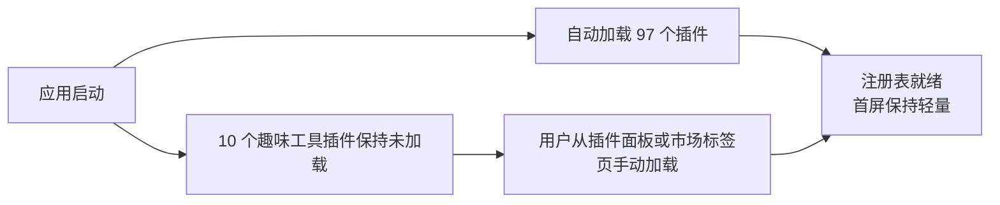

内置注册表的每条记录声明 manifest、`autoload` 标志与动态 `import()` 加载器：模块代码只在加载该插件时才拉取，未加载的插件只占一条 manifest 记录。

## 五、第三方包（.cspkg）、沙箱与签名

`.cspkg` 包是包含 `manifest.json`、入口模块与资源的 ZIP 压缩包（fflate 打包）。加载前先做清单校验（`src/core/cspkg.ts`）：必填字段、插件 id 格式、入口路径必须是包内相对路径（拒绝 `..`、绝对路径与盘符）与沙箱枚举；归档键名会归一化，路径穿越键与绝对路径键被丢弃，压缩包超大在解压前即被拒绝（防 zip 炸弹）。清单声明 `sandbox` 字段：

```jsonc
{
  "id": "com.example.analyzer",
  "name": "Analyzer",
  "version": "1.2.0",
  "author": "Example Corp",
  "description": "…",
  "entry": "dist/index.js",
  "sandbox": "isolated",        // "isolated"（默认）| "trusted"
  "formats": [{ "extension": ".dat" }]
}
```

- **isolated（默认）**：入口代码运行在 Web Worker 内，拥有独立全局作用域，无法访问宿主页面的全局变量、DOM 与状态库；画布渲染通过转移的 OffscreenCanvas 完成，宿主与 Worker 之间只走类型化 RPC 协议（`src/core/sandbox.ts` 与 `src/core/plugin-worker.ts`）。
- **trusted**：在宿主上下文中执行，拥有完整 DOM 访问权，仅建议用于自研包。

第三方插件加载与通信流程：

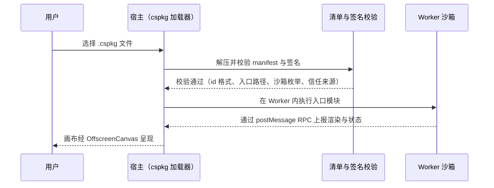

### 5.1 包签名与信任注册表

签名能力回答"**这个包是谁发布的**"，与沙箱回答的"**它运行时能做什么**"互相独立——合法签名不会削弱沙箱隔离。

| 环节 | 实现 |
| --- | --- |
| 算法 | Ed25519（RFC 8032）与 SHA-256（FIPS 180-4），纯 TypeScript 在 BigInt 上自实现，不依赖 WebCrypto（各浏览器与 Node 对 Ed25519 支持不齐） |
| 签名载荷 | 规范化后的包载荷：manifest 递归排序键、去空白、丢弃 undefined 的稳定 JSON 加入口字节；签名 CLI 与浏览器校验端字节级一致 |
| 指纹 | `ed25519:<hex32>`——公钥 SHA-256 的前 16 字节 |
| 信任模型 | `verifyPackageSignature` 返回结构化结果，结论含 `unsigned` / `untrusted-key` / 通过三类；未签名包默认拒绝，未知密钥的合法签名提示用户核对指纹后显式信任 |
| 信任注册表 | 内置官方公钥常量 `OFFICIAL_TRUSTED_KEYS`，用户新增的受信密钥经 `storage.ts` 持久化，IndexedDB 不可用时优雅降级 |
| 工具链 | `node scripts/sign-cspkg.mjs --genkey <keyfile>` 生成密钥对；`<package-dir> --key <keyfile>` 签名产出 .cspkg；`--verify <file.cspkg> [--trust <keyfile>]` 复验 |

已知限制（如实记录）：Worker 与页面共享同源的 IndexedDB；当 Worker 不可用时的遗留回退方案（`new Function` 加遮蔽全局变量）只是尽力而为的近似，并非安全边界，回退启用时界面会明确告警。

## 六、文件路由与示例数据

用户把任意文件拖入中央区或插件列表时，宿主按魔数与扩展名（可选 WASM 辅助检测）识别格式并路由到匹配插件：

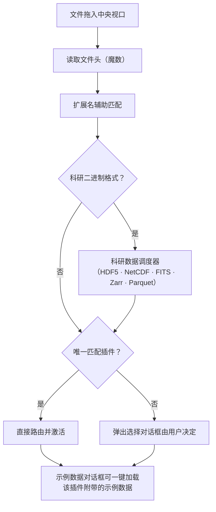

导入对话框本身也按文件格式过滤，未识别的文件不会进入解析器。大文件在进入解析前会先经 `src/core/chunked/` 的行窗口读取与内容指纹，配合 `parse-worker.ts` 与 `worker-pool.ts` 把解析放到 Worker 池中执行，避免阻塞主线程。

示例数据经 `examples` 模块统一注册（`src/core/examples.ts` 的 `BUILTIN_EXAMPLES`，每条记录把示例文件映射到插件 id）并在顶部栏"示例数据"对话框中按插件展示；`examples/data/` 含 138 个数据文件，`examples/projects/` 含 11 个 `.clproj` 示例项目，`examples/code/` 含 9 个 Python 示例程序。内容指纹（`citation.ts` 与存储层共用）让同一份数据的重复导入可被识别与复用。
