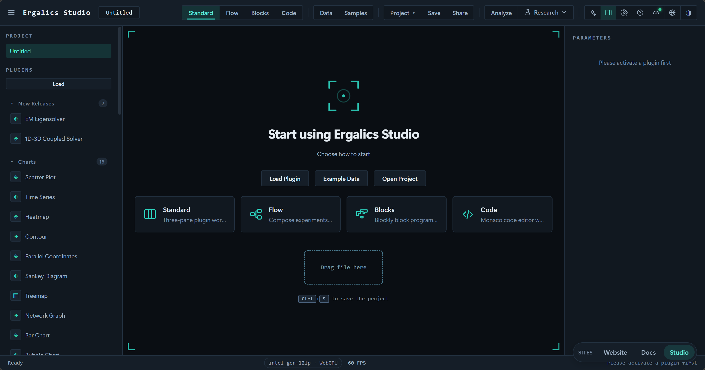
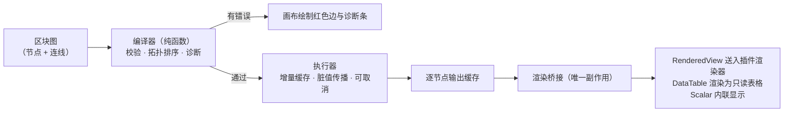
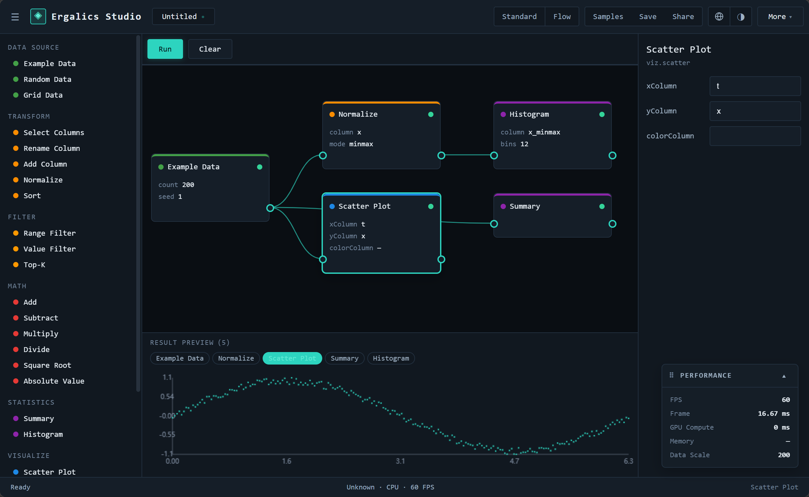
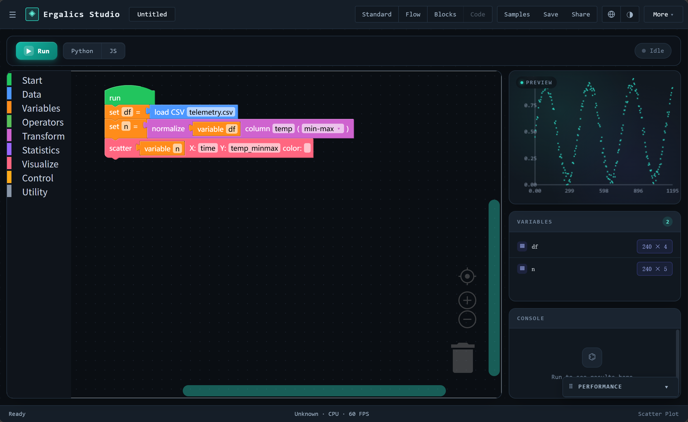
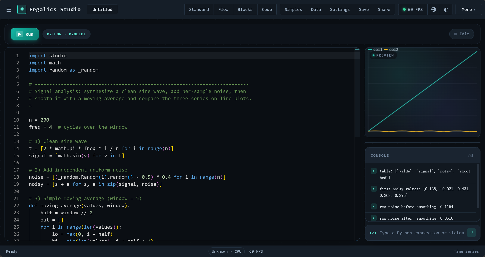
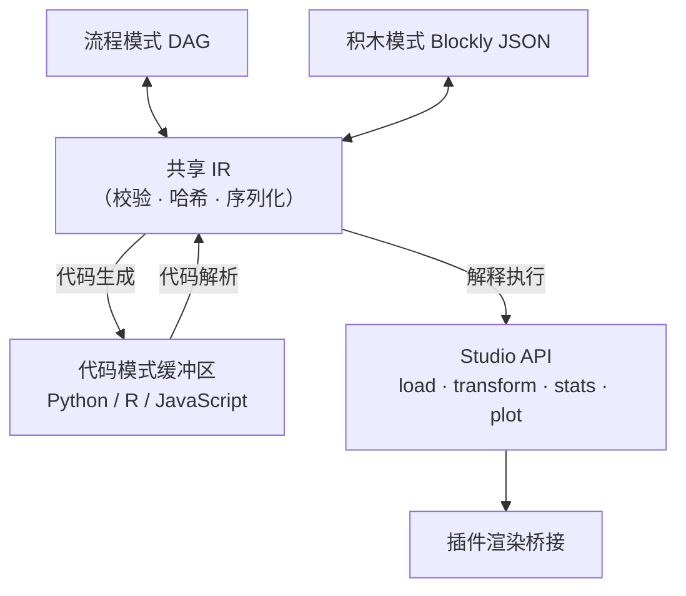

# 04 Four Working Modes

The Ergalics Studio workbench provides four modes, switched by the `[标准 | 流程 | 积木 | 代码]` segmented control in the top bar. All four share the same data semantics (DataTable) and plugin renderers; the latter three also share an intermediate representation (IR). Project data, plugin state, and the parameter panel are preserved when switching modes, with no loss of context.

Outside the workbench there is a second main track: the **research toolset** (entered through the top-bar “分析” button and “科研” launcher, or the welcome-page launch grid). It consists of 26 task-oriented tools that share the same project and kernels with the workbench but do not use mode switching. By default they open embedded in the workbench's central area in a unified ToolShell, and are also available as standalone `/studio/:toolId` pages; the responsibilities of the six groups are described in article 05.

| Mode | Audience | Core experience |
| --- | --- | --- |
| Standard | People who already know which plugin to use | Drag in a data file, automatically identify its format and route it to a matching plugin, and see a visualization immediately |
| Flow | Pipeline builders | Build a visual dataflow pipeline with 38 built-in blocks, execute in topological order, and inspect each node's output |
| Block | Learners and people wanting an imperative experience | Scratch-like block editor whose sole entry point is the green “运行时” hat block |
| Code | Real scripting users | Monaco editor; Python runs on real CPython in Pyodide, R uses the vendored webR 0.6.0 runtime (falling back to the IR engine when assets are missing), and JavaScript runs in the in-process IR engine |

## I. Standard mode {#一、标准模式}

The default entry experience. The workbench is a modular shell: top bar (brand and project dropdown, four-mode switch, data and research entry points); a left activity bar switching among Files, Git, and Plugins (the sidebar is resizable and collapsible); a central tab area (active plugin canvas, file previews, editors dispatched by file type, and embedded research tools coexist as tabs; the first launch shows a drop zone); a right parameter panel (turns the active plugin's declared parameters into a reactive form); and a persistent status bar showing GPU availability and performance metrics. The host routes dropped files by magic number and extension, presenting a chooser when multiple plugins match.

Top-bar actions are grouped semantically and separated by dividers: the project-name dropdown (recent-project switching in the upper section; New / Open / Open Folder / Rename / Save As / Delete / Export Logs in the lower section), the `[标准 | 流程 | 积木 | 代码]` mode switch (with an IR synchronization status dot), the `[数据 | 示例]` data group (the data button has a project-file-count badge), the `[保存 | 分享]` project group, the `[分析 | 科研▾]` research group (the research launcher lists 25 launch-grid tools grouped by discipline, with search filtering and recent use; see article 05), and the right-side global icon group (command palette, shortcuts, AI assistant, guide, performance, language, theme; folded into the ⋯ overflow menu on narrow screens).

This mode suits “I already know which plugin can answer my question and just want to point it at the file.”

*Standard mode: a modular-shell workbench whose central tab area hosts plugin canvases, file previews, and editors; the right parameter panel updates reactively. It is the default exploration entry point.*

## II. Flow mode {#二、流程模式-flow}

A visual dataflow pipeline editor: palette on the left, canvas (nodes and edges) in the middle, parameter editor on the right, and result preview at the bottom. The whole graph persists as a workspace `.flow.json` file (`{ version, kind: 'ergalics-flow', graph }`, written through `src/core/vfs/`) and is opened by the file explorer's Flow editor. The old `blockGraph` project field remains readable for compatibility, and the same `.clproj` autosave and sharing pipeline is used.

### 2.1 Block catalog (38 built-in blocks) {#_2-1-区块目录-38-个内置区块}

| Category | Count | Blocks |
| --- | --- | --- |
| Data source source | 4 | Example data, random data generation, grid generation, file loading |
| Transform transform | 5 | Select columns, rename column, add column, normalize, sort |
| Filter filter | 3 | Numeric range filter, conditional value filter, Top-K selection |
| Math math | 6 | Add, subtract, multiply, divide (column-to-column or column-to-scalar), square root, absolute value |
| Statistics stats | 14 | Summary statistics, histogram binning, one-sample / independent two-sample / paired t-tests, one-way ANOVA, Mann-Whitney U test, chi-square test of independence, correlation, Cohen's d effect size, multiple-comparison correction, Bootstrap, Monte Carlo propagation, MCMC sampling |
| Units units | 2 | Dimensional conversion (units.convert), dimensional consistency check (units.check) |
| Visualization viz | 4 | Scatter, line, histogram, 2D point cloud (plots through plugins via the render bridge) |
| Plotting plot | 4 | Line, scatter, histogram, bar (rendered by the publication-grade plotting engine) |

The division between `viz.*` and `plot.*` is deliberate: `viz.*` passes a `RenderedView` to the **plugin renderer**, using the same plugin seen in Standard mode; `plot.*` uses the **pure-TS vector engine** in `src/core/plot/` to produce publication-grade plots directly exportable as SVG / PDF. Math and statistics blocks call the pure functions in `src/core/stats` and `src/core/units` directly (see article 07). Block metadata (name, description) includes Chinese and English, resolved centrally by `src/blocks/l10n.ts`; adding a language is a data-only change.

Control-flow blocks (if/else, repeat, parallel) are deliberately deferred—the `region` seam on `BlockInstance` is in place so they can be incorporated later as extensions rather than a refactor.

### 2.2 Compiler and executor {#_2-2-编译器与执行器}

The compiler is a pure function: structural validation (port matching, required inputs, type compatibility), cycle detection, and Kahn-style topological sorting. Errors are returned as structured `diagnostics`, which the canvas uses to draw red edges and inline diagnostic strips, without throwing exceptions throughout the process.

The executor uses node-level incremental caching and dirty-value propagation for invalidation: changing a single block's parameters re-executes only that block and its downstream nodes. Runs support cancellation and concurrent deduplication—repeated run triggers do not cause parallel execution, and cancellation actually terminates an in-progress compute node.

### 2.3 Result preview {#_2-3-结果预览}

The bottom preview adapts to the selected node's output type: `RenderedView` uses the existing plugin renderer (scatter, histogram, etc.); the `svg-plot` vector view emitted by a `plot.*` block renders a standalone SVG in place and can be exported directly as SVG / PDF; `DataTable` output (such as the binning results of `stats.summary` and `stats.histogram`) renders as a read-only table, making non-visual outputs visible too; `Scalar` displays inline. When a pipeline has multiple outputs, a chip switcher selects the node to inspect.

*Flow mode: connect data source / transform / statistics / visualization blocks into a DAG pipeline, then execute incrementally after compilation and preview in place.*

### 2.4 Sample pipelines {#_2-4-示例管线}

Eight Flow sample projects are stored as real `.clproj` files in `examples/projects` (the same directory also contains three plugin demonstration projects; see article 01). They are discovered at build time via `import.meta.glob`; adding a sample only requires adding the file and registering it in the metadata table:

| Sample | Topic |
| --- | --- |
| block-01-signal-analysis | Signal analysis |
| block-02-random-distribution | Random distribution |
| block-03-grid-scatter | Grid scatter |
| block-04-range-filter | Range filter |
| block-05-dual-pipeline | Dual-pipeline comparison |
| block-06-topk-pipeline | Top-K selection |
| block-07-binning-stats | Binning statistics |
| block-08-normalize-grid | Normalized grid |
| crystal-lattice-demo | Crystal lattice demo |
| particles-demo | Particles demo |
| point-cloud-demo | Point-cloud demo |

All eight Flow examples execute through the shared IR interpreter and are individually verified by the `examples-roundtrip` unit test.

## III. Block mode (Blockly) {#三、积木模式-blockly}

A Scratch-like block editor for learners and users wanting an imperative experience. The green “运行时” hat block is the only execution entry point; orphan blocks not connected beneath the hat never run, fundamentally preventing “accidental execution of broken code.” Forty built-in blocks are organized into ten categories:

| Category | Blocks |
| --- | --- |
| Start | Run-time hat block (sole entry) |
| Data | Load CSV, load XYZ, random, range, list, list indexing |
| Variables | Assignment and retrieval |
| Operators | Number / text / boolean / null literals, arithmetic, comparison, logic, unary |
| Transform | Normalize, sort, select columns, filter, add column |
| Statistics | Summary, histogram |
| Plot | Scatter, line, histogram, point cloud |
| Control flow | If, repeat, while loop, for each, break, continue |
| Functions | Define, return, call |
| Utilities | Print, raw text |

*Block mode: a Scratch-like canvas starts a script with a hat block; the assembled blocks compile to shared IR for execution.*

Technical points:

- Blockly 13 drives the canvas and is a lazily loaded chunk (about 828 KB), so it does not affect the initial screen of Standard and Flow modes; media assets are vendored on the same origin and do not depend on a CDN.
- Block names, hints, dropdown options, and toolbox categories are localized through Blockly's `BKY_*` key system. A language change rebuilds the workspace with relabeled blocks, verified by a dedicated unit test (`tests/editor/block-i18n.test.ts`).
- The Run button provides three cards: live result preview, variable panel, and console panel.
- Five built-in sample programs (galaxy scatter plot, temperature line plot, random histogram, normalized scatter, looped greeting) live in `src/editor/block/samples.ts` and load through the top-bar “示例” dialog.
- After a block graph compiles to shared IR, the built-in interpreter executes it and calls the same Studio API as Code mode.

## IV. Code mode (Monaco · Python / R / JavaScript) {#四、代码模式-monaco-·-python-r-javascript}

A real script editor. The toolbar provides a **Python / R / JS** segmented language switch and an engine badge explicitly showing what will execute the current buffer.

| Language | Execution engine | Description |
| --- | --- | --- |
| Python | Full CPython in a Pyodide Web Worker | Free-form syntax (comprehensions, f-strings, importable packages); `studio` is injected as a proper importable module; supports REPL single-expression evaluation |
| R | Vendored webR 0.6.0 runtime (`public/webr/`, falling back to the IR engine when assets are missing) | Prefer execution by a real R interpreter; fall back to the shared IR engine when webR assets are missing or the `studio.*` bridge degrades; `<-` assignment |
| JavaScript | In-process IR engine | The buffer is parsed to shared IR and executed by the same interpreter as Block mode; `const/let/var` declarations |

Shared capabilities:

| Capability | Behavior |
| --- | --- |
| Consistent studio interface across languages | `load / random / range / exampleData / grid / normalize / sort / select / addColumn / addConstantColumn / filter / filterRange / topK / renameColumn / summary / histogram / plot / print / notify / getParam / setParam`. `studio.plot(...)` reaches exactly the same plugins as Flow-mode `viz.*` blocks via the render bridge. |
| One-click language translation | Switching language tabs opens a “语言切换预览” floating dialog with an editable reference translation in an embedded Monaco editor. Edit the translation and click “应用” to use the new language, click “放弃并清空” to start blank, or “取消” to stay in the original language. After discard-and-clear, an “撤销清空” notice allows one-click restoration of the previous code. A clearing guard prevents a nonempty buffer from being silently cleared when translation is empty; only an explicit “放弃并清空” clears it through a one-time allow flag. |
| Interrupt | Stopping execution terminates and restarts the Worker so runaway loops cannot freeze the page; the Worker's bootstrap URL and bootstrap Promise are memoized, avoiding repeated initialization on restart. |
| Shortcut | `Ctrl/⌘ + Enter` runs the buffer (and stops an in-progress Python task); keyboard input is debounced for 150 ms before syncing to IR, keeping Block and Flow up to date while typing. |
| Explicit DSL boundary | Statements that R / JS parsers cannot model are kept as raw-code nodes, skipped at runtime, and reported once as a count in the console; full syntax is always available in the Python tab. |

| Method | Description |
| --- | --- |
| load | Load a project data file as a table |
| random / range / exampleData / grid | Generate random numbers, integer sequences, built-in examples, and grid data |
| normalize / sort / select / addColumn / addConstantColumn / filter / filterRange / topK / renameColumn | Table transforms |
| summary / histogram | Summary statistics and binning |
| plot | Plotting (through the render bridge to the plugin renderer) |
| print / notify | Console output and notifications |
| getParam / setParam | Read/write project parameters |

Nine sample programs are stored as real files in `examples/code` (EDA pipeline, Monte Carlo circle estimation, signal analysis, telemetry exploration, galaxy scatter, random histogram, range loop, add-column plotting, normalize and filter) and loaded through the “示例” dialog.

*Code mode: Monaco editor + console / variable panels; Python runs in a Pyodide Worker with the `studio` module injected.*

## V. Conversion among three modes (shared IR) {#五、三模式互转-共享-ir}

IR (`src/editor/ir`, including validation, hashing, and serialization) is the single source of truth for Block, Flow, and Code modes; each mode has pure-function round-trip conversions to and from IR:

| Conversion | Module |
| --- | --- |
| IR ↔ Flow DAG | `src/editor/flow/convert.ts` (irToFlow, flowToIR, Kahn topological sort, parameters aligned 1:1 with the block catalog) |
| Blockly JSON ↔ IR | `src/editor/block/convert.ts` |
| Parse code buffer back to IR | `src/editor/code/parse.ts` (unparseable lines retained as raw-code nodes) |
| Generate code from IR | `src/editor/codegen` (Python, R, JS generators) |
| Interpret IR directly | `src/editor/runtime/interpreter.ts` (calls the same Studio API as Flow blocks) |

Build a pipeline in Flow mode, switch to Block to see the same logic as blocks, and jump to Code to see generated Python; the reverse also works. Flow edits are **merged** into IR rather than flattening it (`mergeFlowIR`): print / loop / if / function statements remain in place and only DAG nodes are replaced. The graph-signature guard in `src/stores/useFlowSync.ts` ignores debounced echoes produced by hydration so repeated mode switches do not lose nodes.

Code generators handle target-language dialect differences: the Python generator outputs real Python syntax, the R generator handles R conventions (loop syntax, truth literals, integer division, logical operators, etc.), and the JS generator outputs directly evaluable scripts.

Round-trip consistency is pinned by unit tests including `sync-threeway`, `flow-convert`, `editorStore`, `examples-roundtrip`, and `roundtrip-all-langs` (free round trips among Python / R / JavaScript), and verified by the `verify-lang-modes` end-to-end suite using a real browser for R/JS editing, R→JS translation, a lossless Flow ⇄ Block ⇄ Code cycle, and real pipeline execution.
