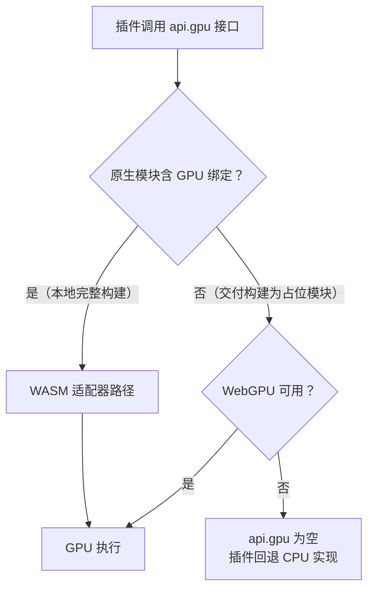

# 06 GPU 计算与原生核心

Ergalics Studio 的计算加速由两层构成：随仓库**源码交付**的 Rust 原生核心（`native/ergalics-core`），以及宿主侧的计算服务（`src/core/gpu.ts`、`src/core/compute.ts`、`src/core/wgsl.ts`）。需要明确交付口径：随发行版的 Web 构建**不携带 Rust 编译产物**——CI 与默认 Web 构建由存根生成脚本（`scripts/make-wasm-stub.mjs`）产出一个功能占位模块；运行时的实际计算全部走**浏览器原生 WebGPU**，WebGPU 缺失时逐级降级到与 GPU 内核数学一致的纯 CPU 路径。

## 一、Rust 原生核心（源码交付）

`native/ergalics-core`（crate 版本 0.1.0，edition 2021，`crate-type = ["cdylib", "rlib"]`）编译目标为 `wasm32-unknown-unknown`，经 wasm-bindgen 0.2 绑定到 `src/native`。WebGPU 绑定依赖 web-sys 的实验性 GPU API 面（GpuAdapter、GpuDevice、GpuBuffer、GpuComputePipeline、GpuBindGroup 等约四十项 feature 显式开启）。依赖为 wasm-bindgen、wasm-bindgen-futures、js-sys、web-sys、console_error_panic_hook、serde 与 serde_json；release profile 开启 `lto`、`codegen-units = 1` 与 `opt-level = 3`。Rust 源码按职责分为五个模块：

| 源文件 | 职责 |
| --- | --- |
| lib.rs | 对外导出、版本查询（core_version）与初始化 |
| device.rs | GpuDeviceManager 与 GpuInfo：适配器与设备获取，`webgpu_available` 探测，带 CPU 回退选项 |
| buffer.rs | GpuBuffer：以显式 usage 掩码创建存储 / 只读 / 均匀缓冲，write 上传、read 经专用回读缓冲读回 |
| compute.rs | KernelDescriptor 与 BindingDescriptor、ComputeKernel 编译、绑定组物化与 dispatching，ComputeQueue 封装 |
| utils.rs | detect_file_kind 等辅助（基于魔数的文件类型检测）与日志 |

该 crate 以源码形式随仓库交付并可本地编译；它不参与生产环境的计算路径——随发行版构建生成的是占位模块（见第五节），实际计算由浏览器原生 WebGPU 承担。

## 二、宿主侧计算服务

`src/core/gpu.ts` 持有适配器与设备生命周期：`initGpu(mode)`（支持 `auto` 与 `cpu-fallback` 两种模式，带并发合并与 epoch 守卫，避免用户显式释放设备后被在途初始化覆盖）、`getGpuBackend` / `resetGpu` / `subscribeGpu`。后端状态 `GpuBackend` 包含可用性、适配器信息（vendor / architecture 等，经 `adapter.info` 读取）、设备引用、CPU 回退标志与显存不足（`oom`，由设备未捕获错误置位）跟踪。

其上的 `src/core/compute.ts` 是面向插件的计算面（即 `PluginApi.gpu`）：`createBuffer`、`write`、`read`、`compileKernel`、`compilationInfo` 与一次性 `run`。`getGpuCompute()` 依据设备可用性返回计算服务或 `null`——为 `null` 时插件回退 CPU 实现。执行路径经 `backend` 字段区分：原生 WebGPU 直连路径（`NativeCompute`，`backend = 'webgpu'`）直接以 `GPUDevice` 创建缓冲、编译 WGSL 管线并 dispatch，只读缓冲按 usage 分流 `mapAsync` 直映射或 `COPY_SRC → MAP_READ` 回读拷贝；当本地构建编译出真实原生模块时，`WasmCompute`（`backend = 'wasm'`）适配器以同一接口转发到 `src/native` 绑定。两条路径暴露完全相同的原语：

> 当 WebGPU 不可用时，`api.gpu` 为 `undefined`，插件回退到 CPU 实现——行为一致，不要求 GPU 存在。

这一设计保证开发与生产环境的加速计算均可用：浏览器原生 WebGPU 直连是交付构建的实际计算路径，而每个内置插件的 CPU 回退跑的是与 GPU 内核数学一致的实现。

## 三、可复用 WGSL 内核

`src/core/wgsl.ts` 收纳可复用的 WGSL 计算内核，并配套与内核数学一致的宿主侧打包 / 解包辅助函数供 CPU 回退使用（如 `packParticles` / `unpackParticles` / `advanceParticleCPU`、`packBodies` / `unpackBodies` / `advanceNBodyCPU` 与 `nbodyTotalEnergy`、`histogramCPU` 等）。当前共 **14 个内核**：

| 内核 | 数学内容 | 主要使用方 |
| --- | --- | --- |
| particleKernelWGSL | 交错式 [x, y, vx, vy] 单缓冲积分 | 粒子插件 |
| nbodyKernelWGSL | 三维全对引力 O(N²) 直接求和 | N-Body 引力插件 |
| histogramKernelWGSL | 分箱计数 + 对数刻度 | 直方图插件与统计区块 |
| heatmapKernelWGSL | 网格标量到颜色映射（viridis 停靠点） | 热力图插件 |
| pointCloudKernelWGSL | 点云投影与密度输出 | 点云插件、百万级点云增强 |
| fluidCollideKernelWGSL | D2Q9 格子 Boltzmann 碰撞 | 流体插件 |
| fluidStreamKernelWGSL | D2Q9 迁移 | 流体插件 |
| fluidCurlKernelWGSL | 涡量计算（涡街可视化） | 流体插件 |
| waveKernelWGSL | 二维波动方程 leapfrog 时间推进 | 波动方程插件 |
| matmulKernelWGSL | 分块矩阵乘法（TILE = 16） | 领域内核线性代数加速 |
| fftKernelWGSL | 按级迭代的基 2 FFT（最大 N = 4096） | 信号实验室 |
| kmeansKernelWGSL | K-means 指派与质心累加 | 数据画像与聚类 |
| binningKernelWGSL | 键值分箱聚合（sum / mean / count） | 分箱统计与扫描 |
| spmvKernelWGSL | 稀疏矩阵-向量乘（CSR 行式逐步） | 宿主侧稀疏线性代数内核库（暂无内置插件直接调用；em-eigensolver 改在 Pyodide 上以 NumPy 求解） |

两种典型的内核调用路径：

1. **单缓冲路径**（粒子演示）：上传交错式数据加均匀参数，dispatch WGSL 积分器，读回结果并上报真实 GPU 时间。
2. **乒乓缓冲路径**（N-Body、流体、波动方程演示）：成对缓冲交替读写，每个积分步完全留在设备上，无逐步回读开销。

以 N-Body 为例的逐步流程：

*N-Body 引力在 GPU 上的全对求和：数天体绕中心质量的三维引力轨迹，WGSL 内核计算并一次性读回交给 Three.js 渲染。*

*格子 Boltzmann 流体：WGSL 编译期推导 D2Q9 碰撞 / 流 / 涡量三内核并逐步计算，绕翼流场与卡门涡街清晰可见，小规模自动回退 CPU。*

### 3.1 引擎选择与数据规模阈值

GPU 的收益来自算力，但上传与回读有固定开销，小规模数据在 GPU 上反而更慢。`src/core/gpu-kernels.ts` 因此提供统一分派层与一组数据规模阈值，`auto` 模式下低于阈值自动走 CPU：

| 内核 | 阈值单位 | 阈值 |
| --- | --- | --- |
| matmul | 输出元素数（m × n） | 16384（128 × 128） |
| fft | 复数样本数 | 1024 |
| kmeans | 点数 | 2048 |
| binning | 行数 | 10000 |
| spmv | 非零元素数（nnz） | 65536 |

内核描述符的绑定布局直接取自 `wgsl.ts` 的 `*_BINDINGS` 常量，宿主描述符与着色器文本不会漂移。阈值判断还会叠加实时设备可用性（`getGpuBackend()`）。`src/core/pointcloud-gpu.ts` 在此之上提供百万级点云的预算控制、确定性降采样与 WebGPU 高度着色内核，`src/core/mesh3d.ts` 提供三维网格数据管线的纯函数实现（面/体插件共享）。

### 3.2 不确定度 WGSL 引擎

不确定度内核（`src/core/uncertainty`）自带两条 WGSL 加速路径，均复用本节的计算面：

- `gpu-engine.ts`：WebGPU 上的百分位 Bootstrap 重采样。固定统计量族（均值 / 中位数 / 方差 / 标准差 / 相关 / OLS 斜率）走 GPU 内核，自定义 JS 统计量始终走 CPU；重采样以不超过 `blockSize`（默认 65 536）的块推进，块间上报进度并响应 `AbortSignal`；随机源为 WGSL 版 PCG32（`pcg.ts` 的 `PCG32_WGSL`），与 CPU 路径共享同一种子序列定义。
- `gpu-mcmc.ts`：多链随机游走 Metropolis–Hastings。调用方提供 WGSL 对数密度主体（固定维度烘焙进内核），编译后每个线程承载一条链，链状态驻留缓冲跨 dispatch 保留，百万步运行不阻塞设备与界面；CPU 路径为 mulberry32 驱动的独立链并行批处理。

引擎选择（`auto` / `gpu` / `cpu`）遵循 3.1 节的设备可用性规则并把选择结果写入运行记录；GPU 不可用时自动回落 CPU，两条路径在同一种子下结果在数值容差内一致，收敛诊断（split-R-hat、ESS）对两条路径一致可用。

## 四、端到端数值验证

GPU 路径不是摆设：`verify-webgpu` 端到端套件在无头 Edge（SwiftShader 软件适配器）中驱动真实 WebGPU 通路，分两阶段验证。阶段 A 经 `tests/e2e/webgpu.html` 申请真实 WebGPU 设备，用 `src/core/wgsl.ts` 的真实 WGSL 内核驱动原生核心模块接口（缓冲创建、内核编译、dispatch、mapAsync 回读），对严格场景与边界场景分别比较 GPU 结果与 CPU 积分器（容差 5e-3 与 0.02）；阶段 B 在工作台加载粒子插件与星系样例，点击"GPU 计算"按钮，断言成功提示上报了真实引擎与实测 GPU 时间。单元测试层覆盖每个 WGSL 模板的生成、参数打包、输出尺寸与 CPU 回退的一致性，以及 GPU 与 CPU 两条路径的数值一致性比对（内核级与领域级两层）。

## 五、构建与降级说明

构建命令链为：`npm run build` 依次执行 `build:wasm`（本地 Rust 工具链编译进 `src/native`）→ `tsc --noEmit` → Vite 生产构建 → 文档构建；只构建前端可用 `npm run build:web`，它以 `make-wasm-stub.mjs` 开头——当真实构建产物缺失时，该脚本生成一个功能占位模块（`core_version` 返回 `'wasm-stub'`，`detect_file_kind` 回退扩展名检测，不携带任何 GPU 绑定），使动态导入的分块在打包期存在。CI 环境一律不安装 Rust 工具链（deploy 工作流除外），因此**交付构建运行的是占位模块**。

运行时降级由 `src/core/wasm.ts` 的加载器兜底：动态导入失败时重试 3 次（间隔 1 秒），最终把模块标记为不可用。三级路径总结：

| 档位 | 条件 | 计算路径 |
| --- | --- | --- |
| 本地完整构建（可选） | 本地执行 `build:wasm` 编译出真实模块 | WASM 绑定路径 |
| 交付构建的实际路径 | 构建仅含占位模块、WebGPU 可用 | 浏览器原生 WebGPU |
| 兜底路径 | WebGPU 不可用 | 与内核数学一致的 CPU 实现 |

无论处于哪一档，欢迎页硬件自检都会如实报告 WebGPU、WASM 与 IndexedDB 的可用性；插件在无 GPU 环境下以 CPU 完成同样的数学，行为一致。

### 5.1 3D 场景宿主与 WebGL 缺席

三维渲染由宿主统一管理：`src/core/scene3d.ts` 的 `createScene3D(container)` 惰性创建并按会话缓存一个 Three.js 场景容器，宿主持有渲染循环、OrbitControls、缩放与 GPU 资源释放；插件实现 `renderToScene(scene)`（`Scene3DHandle`）把自己的网格与灯光挂进场景，声明了 `renderToScene` 的插件才会在激活时物化 WebGL 场景，2D 插件不为此付出 WebGL 上下文成本。WebGL 不可用或 3D 容器缺席时，相关插件给出明确的 2D 提示并以 2D 画布继续工作，AI 训练插件的 TF.js 后端同样在 WebGL 缺席时回退 CPU——功能降级始终显式、可观测。
