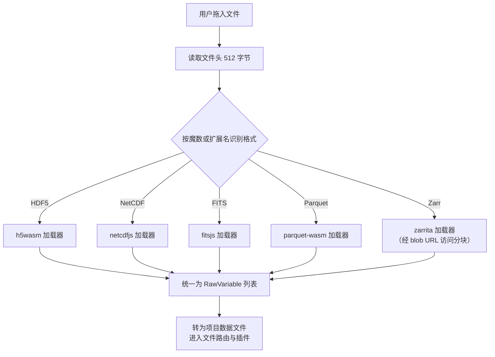
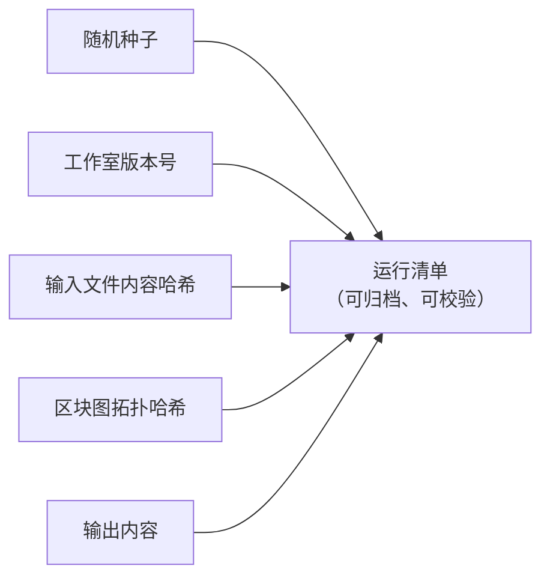
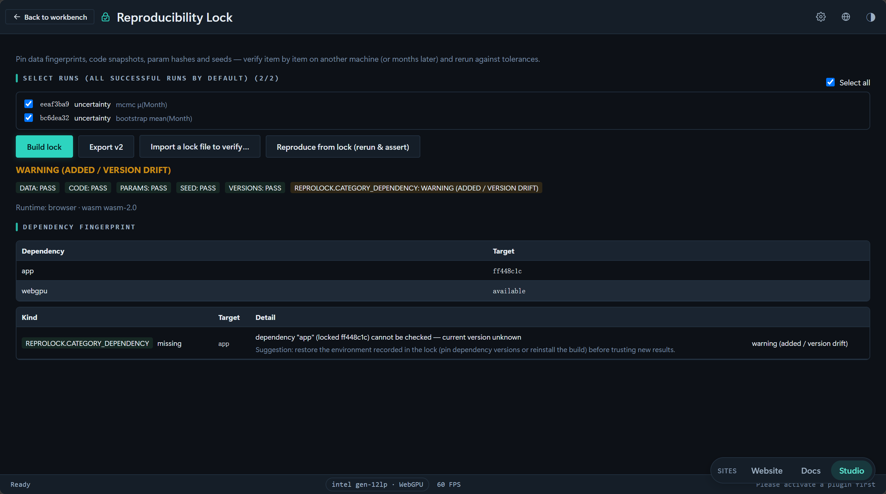
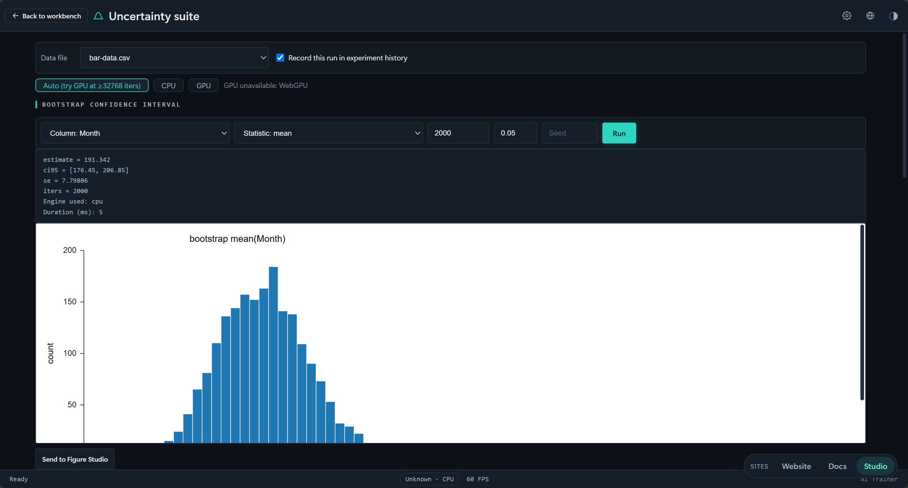
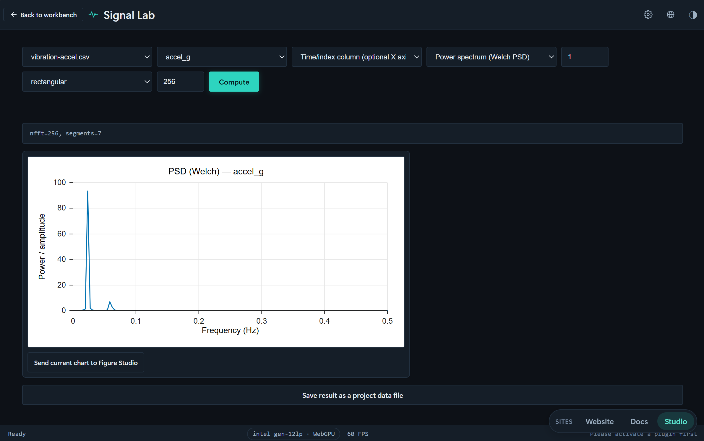
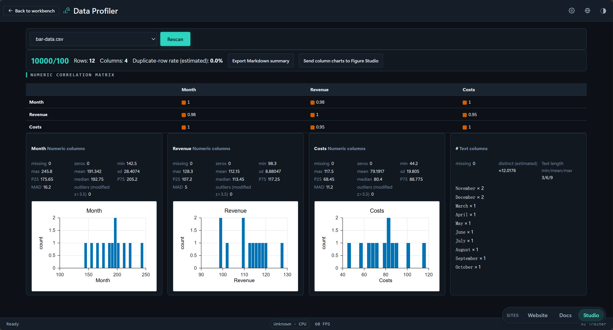
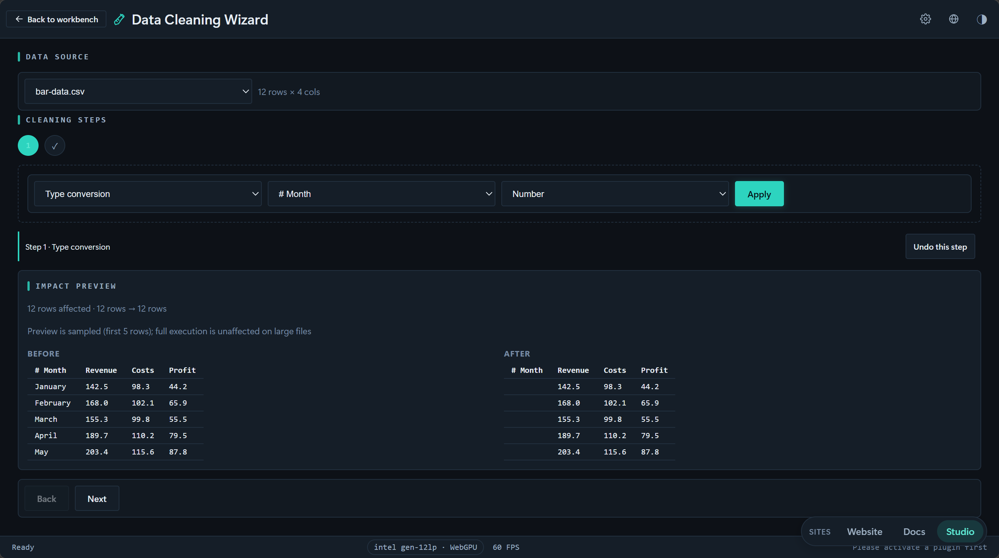
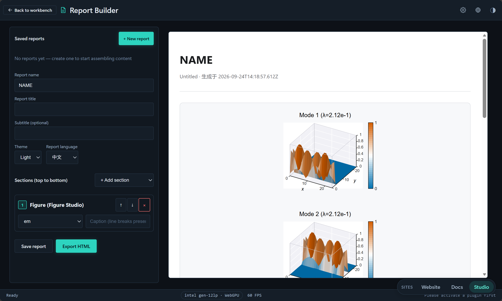
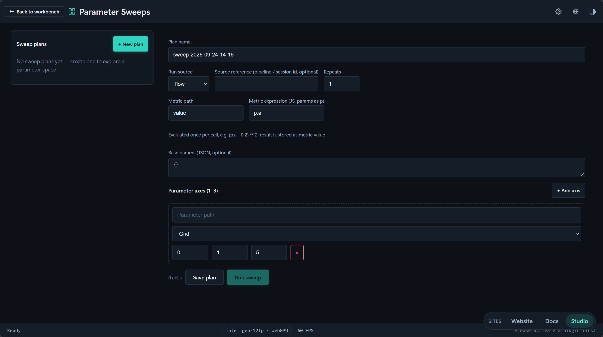
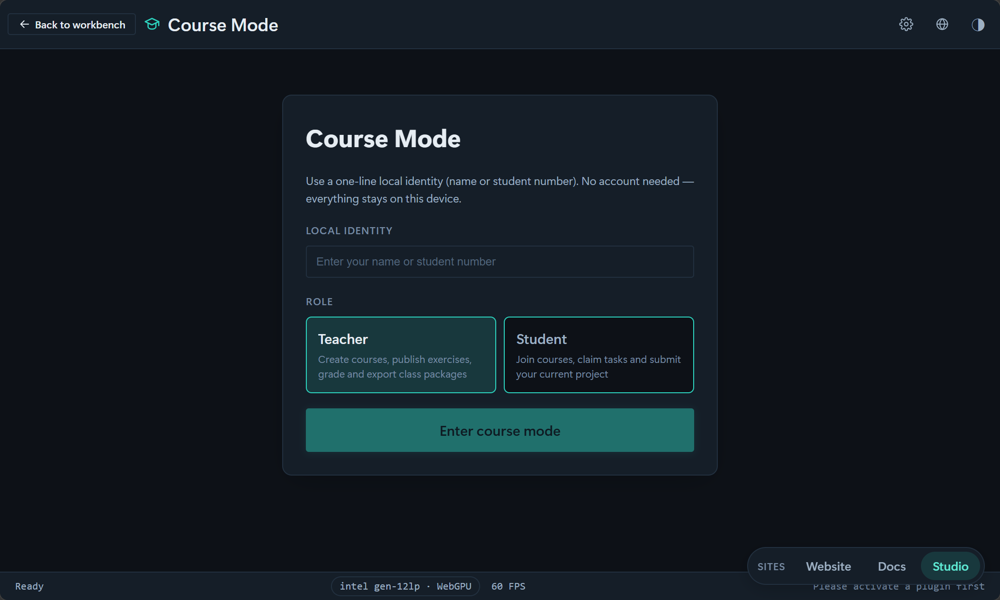

# 07 Scientific Computing Subsystems

`src/core` is the product's scientific foundation: **54 domain-subsystem subdirectories + 42 root-level modules**, all implemented in pure TypeScript with little DOM use and directly testable with Vitest in Node. They are consumed by the block system, Studio API, research-tool pages, and delivery pipeline, forming the capability layer that moves the product from “can plot” to “usable for real research.”

## I. Kernel overview {#一、内核总览}

### 1.1 Subsystem directories (54, grouped by domain) {#_1-1-子系统目录-54-个-按领域分组}

| Domain | Subsystem | One-line facts |
| --- | --- | --- |
| Statistics, inference and units | stats | Descriptive statistics, hypothesis tests, effect sizes, multiple-comparison correction, power analysis and bilingual result narratives (8 module files) |
| Statistics, inference and units | model | OLS / logistic / ridge / polynomial regression and residual diagnostics (Householder QR, IRLS, K-fold cross-validation) |
| Statistics, inference and units | inference | HMC / NUTS Bayesian sampling, model catalog, WAIC / PSIS-LOO comparison, posterior diagnostics and ONNX inference |
| Statistics, inference and units | uncertainty | Bootstrap / Monte Carlo / MCMC and WGSL GPU engines (gpu-engine, gpu-mcmc), PCG32, R-hat / ESS diagnostics |
| Statistics, inference and units | signal | Radix-2 FFT, windows, Savitzky-Golay filtering, ACF / PACF, additive time-series decomposition |
| Statistics, inference and units | units | Typed `Quantity`: SI prefixes, dimensional algebra and conversion checks |
| Statistics, inference and units | numerics | Shared numerical linear algebra (matrix helpers and solvers) with structured numeric errors (linalg.ts, errors.ts) |
| Data I/O and quality | io | Unified HDF5 / NetCDF / FITS / Parquet / Zarr loading (scientific.ts routes by magic number to RawVariable) |
| Data I/O and quality | chunked | Row-window reading of large delimited files (csv / tsv / dat / xyz / txt) |
| Data I/O and quality | data-quality | Column / table expectation contracts and lazy quality reports, schema suggestions from profiling, row quarantine |
| Data I/O and quality | cleaning | Five serializable cleaning-wizard step types with forward / backward / undo engine |
| Data I/O and quality | sanitize | Allowlist sanitizer for externally produced SVG (sanitizeSvg.ts) |
| Data I/O and quality | validation | Composable validators `(value, path) => issues[]`; schemas are ordinary data |
| Data I/O and quality | sql | DuckDB-WASM SQL workbench engine (lazy loading, timeouts and AbortSignal cancellation) |
| Data I/O and quality | dataeng | Reusable ETL steps, schema inspection, deterministic synthetic-data generation and `DataTable`-level long/wide reshaping (etl.ts, schema.ts, synth.ts, reshape.ts) |
| Plotting and delivery | plot | Pure-TS vector plotting: DataTable → publication-grade SVG, exportable as SVG / PDF |
| Plotting and delivery | figure | Multi-panel figures on journal-template grids (compose one SVG, export including PNG-600dpi) |
| Plotting and delivery | report | ReportSpec → one self-contained interactive HTML report (inline CSS / SVG / JSON) |
| Plotting and delivery | markdown | Markdown DOM enhancement: Mermaid diagrams and KaTeX formula rendering |
| Plotting and delivery | gallery | Built-in project gallery catalog and local “My Shares” storage (filter / share / store) |
| Plotting and delivery | submit | Pre-submission checklist and Chinese/English caption drafting |
| Plotting and delivery | package | Paper supplement ZIP packaging (manifest + data + code sessions, fflate compression) |
| Plotting and delivery | pdf | Pure-TypeScript PDF output: font subsetting (font.ts) and SVG → PDF conversion (svg.ts) |
| Reproducibility and experiments | repro | Seeded random numbers, stable hashes, run manifests, DAG→Python export, repro.lock, environment snapshots |
| Reproducibility and experiments | experiment | Run-record model and A/B parameter comparison (IndexedDB `runs` store, not written into .clproj) |
| Reproducibility and experiments | lineage | File → run DAG lineage graph and Sugiyama-style layered layout |
| Reproducibility and experiments | sweep | Expand SweepPlan into deterministic design points (full grid / list / Latin hypercube) and run sweeps |
| Language runtimes and editor | pyodide | CPython runtime in a Web Worker (pyodide-worker, studio.py for injection, client runtime bridge) |
| Language runtimes and editor | r | R runtime factory: prefer full webR, fall back to built-in IR engine if missing and record the reason |
| Language runtimes and editor | monaco | Monaco editor host assembly (lazy-loaded) and `studio.*` completion data |
| Language runtimes and editor | notebook | Notebook cell / output models and safe small Markdown renderer |
| Domain compute kernels | chem | Element data, molecular structure and thermodynamics (bond energy / formation enthalpy, ΔG°(T), Arrhenius rates) |
| Domain compute kernels | geo | Spherical geometry and terrain meshes (spherical.ts, terrainMesh.ts) |
| Domain compute kernels | astro | Pure-TypeScript FITS (Flexible Image Transport System) reading and writing |
| Domain compute kernels | raytrace | GLSL ray-tracing shaders and shared astronomical calculations (sky-base, astro, glsl) |
| Domain compute kernels | ai | Offline intent engine (intents.ts rules synthesize `studio.*` code) and online-mode authorization policy (provider.ts) |
| Domain compute kernels | profiler | Single-pass streaming column profiling: Welford mean and variance, HLL cardinality, quality score and issues |
| Domain compute kernels | fem | Finite-element kernels: Delaunay meshing, P1 assembly and conjugate-gradient solves for Poisson, heat and elasticity (index.ts) |
| Domain compute kernels | audio | WAV encoding / decoding used by the acoustics and synthesizer labs (wav.ts) |
| Platform and infrastructure | git | Dual adapters for isomorphic-git + LightningFS and simple-git, automatic commits and reference-name normalization |
| Platform and infrastructure | vfs | Workspace file system (LightningFS / memory backends, paths, project skeleton) |
| Platform and infrastructure | research | ScienceOutputStrip unified scientific output bus (scienceOutput.ts, pure TS) |
| Platform and infrastructure | errors | AppError taxonomy, `Result<T, E>`, retries, assertion guards and global capture |
| Platform and infrastructure | course | Course-mode domain model, export and offline grading (IndexedDB `courses` store) |
| Platform and infrastructure | templates | Discipline template catalog, deterministic sample data and plugin scaffolding |
| Platform and infrastructure | theme-pack | `.cstheme` schema validation, registry, application and theme marketplace |
| Platform and infrastructure | plugin-tools | Built-in plugin panel enhancements (tables, localization) |
| Platform and infrastructure | bench | Import / compute / render / memory benchmark suites and structured results |
| Platform and infrastructure | platform | Desktop bridge: Python client and IPC Git adapter, with bootstrap helpers for the desktop shell (platform/) |
| Platform and infrastructure | search | Workspace full-text search with match offsets and per-file grouping (workspaceSearch.ts) |
| Platform and infrastructure | terminal | Terminal session commands and run-file execution (host-commands.ts, run-file.ts) |
| Platform and infrastructure | workspace | Workspace file classification, open-with routing, project file listing and session restore |
| Platform and infrastructure | publish | Writing and publication suite: LaTeX, BibTeX, citation state, collaboration and preprint export (publish/) |
| Platform and infrastructure | ambience | Ambient audio engine and vitality model (audio.ts, engine.ts, model.ts, vitality.ts) |

### 1.2 Root-level modules (42) {#_1-2-根级模块-42-个}

| Group | Modules |
| --- | --- |
| Compute and rendering | gpu.ts (WebGPU device service), compute.ts (PluginApi.gpu compute surface), wgsl.ts (14 reusable WGSL kernels), gpu-kernels.ts (engine dispatch and size thresholds), wasm.ts (native module loader, retries 3 times), pointcloud-gpu.ts (million-point budget and downsampling), mesh3d.ts (3D mesh pipeline), scene3d.ts (host Three.js scene container), three-utils.ts (shared GPU-safe disposal and camera framing), viewport2d.ts (2D viewport pan and zoom), perf.ts (FPS / frame time / GPU memory / JS heap monitoring) |
| Plugin runtime and security | sandbox.ts (plugin sandbox), plugin-worker.ts (plugin runtime in Worker), plugin-signing.ts (signatures and trust registry), crypto-primitives.ts (bundled signing primitives), cspkg.ts (third-party plugin packages), pluginCache.ts (plugin cache) |
| Data parsing and storage | fileFormat.ts (format detection), parse-tasks.ts (parse task definitions and shared runner), parse-worker.ts (parsing entry in Worker), worker-pool.ts (Worker pool), storage.ts (persistence), dataFiles.ts (data-file registration), opfs.ts (chunked OPFS storage), opfs-migration.ts (IndexedDB migration), exampleAssets.ts and examples.ts (built-in example assets and sample discovery), labHandoff.ts (one-time handoff between tools) |
| Workflows and application | boot.ts (startup gate), events.ts (typed publish/subscribe event bus), settings.ts (app settings), recentTools.ts (recent research tools), workspace-artifacts.ts (save experiment artifacts in project workspace), cpu-info.ts (CPU capability detection), logger.ts (session logging), download.ts (download helper), site-links.ts (navigation among three sites), pwa.ts (offline cache and Service Worker), citation.ts (citation and archival metadata), debut.ts (30-second first-figure project builder), lazyRetry.ts (chunk-load retry wrapper for React.lazy), orientation.ts (forced-landscape mobile strategy) |

The following sections expand on core subsystems in statistics, I/O, plotting, reproducibility, modeling, inference and delivery.

## II. Statistics kernel (src/core/stats) {#二、统计内核-src-core-stats}

The statistics kernel consumes ordinary numeric arrays, DataTable or Dataset and returns structured results; all implementations are pure functions. Public exports by module:

| Module | Capability |
| --- | --- |
| descriptive | Mean, variance, standard deviation, median, quantiles, summary statistics, confidence interval for the mean (t-distribution critical value obtained with studentTInv) |
| special | Special functions: incomplete gamma and beta functions, cumulative normal and t distributions and their inverses (reused by tests and power calculations) |
| tests | One-sample, two-sample (Welch-corrected degrees of freedom) and paired t-tests, one-way ANOVA, Mann-Whitney U, chi-square independence test; structured results include statistic, p-value and degrees of freedom |
| posthoc | Tukey HSD (Tukey–Kramer intervals for unequal group sizes) and Dunnett comparisons against a control; Studentized-range and Dunnett joint probabilities are evaluated by numerical integration rather than table look-ups |
| nonparametric | Kruskal–Wallis H (tie correction and ε² effect size) with Dunn pairwise post-hoc comparisons (Bonferroni / BH) |
| survival | Kaplan–Meier estimator (Greenwood SE, log–log 95% CI, median survival, risk-table fields) and the two-sample log-rank test (χ², p-value, hazard ratio with CI) |
| psychometrics | Cronbach's α (with α-if-item-deleted, item–total and mean inter-item correlations), KMO sampling adequacy (overall and per item) and Bartlett's test of sphericity |
| effect | Cohen's d effect size, Pearson and Spearman correlations |
| correction | Bonferroni and Benjamini-Hochberg multiple-comparison corrections; p-values are cleaned first (non-finite values removed) |
| power | Power analysis for two-sample t-tests |
| narrative | Converts structured results from five major test families (t-tests, ANOVA, chi-square, correlation, linear regression) into publication-grade Chinese and English sentences; formats p-values by journal convention (`p < .001` as an inequality, others to three decimals without a leading zero), using neutral wording for nonsignificant results |

Boundary inputs explicitly throw errors rather than silently returning wrong numbers: division by zero in Welch degrees of freedom, too few ANOVA groups, and unequal paired-test lengths produce structured errors. Statistics reach users through 23 `stats.*` Flow blocks, the **Data Analysis lab** (Tukey/Dunnett, Kruskal–Wallis + Dunn, Kaplan–Meier + log-rank, Cronbach's α / KMO / Bartlett, long/wide reshaping), calls such as `summary` in the Block and Code Studio API, and report-builder and Figure Studio caption drafts—all point to the same implementation.

## III. Scientific binary I/O (src/core/io) {#三、科研二进制-i-o-src-core-io}

Scientific data often uses domain binary formats. `scientific.ts` provides one entry: given a dropped or opened File, read its header and identify the format by magic number (or extension), route to the corresponding loader, and convert each variable, dataset or HDU into a unified `RawVariable` list. The caller converts these into project data files.

| Format | Typical domain | Library | Module |
| --- | --- | --- | --- |
| HDF5 | General scientific hierarchical data | h5wasm | hdf5.ts |
| NetCDF | Earth science, meteorology | netcdfjs | netcdf.ts |
| FITS | Astronomical images and tables | fitsjs | fits.ts |
| Parquet | Columnar tables | parquet-wasm (merges all record batches through apache-arrow) | parquet.ts |
| Zarr | Chunked N-dimensional arrays (local directory or remote store) | zarrita | zarr.ts |

Helpers (`types.ts`) include safe integer-to-Float64 conversion (int64 and uint64 datasets no longer throw), name sanitization, DataTable-to-CSV and dataset construction. Large-file imports first use `chunked/` row-window reading and content fingerprints, then parse in parallel in a Worker pool through `parse-worker.ts` and `worker-pool.ts`.

## IV. Publication-grade plot engine (src/core/plot) {#四、出版级绘图引擎-src-core-plot}

Unlike plugin canvas rendering, the plot subsystem is a pure-TS vector engine intended to turn DataTable into publication-grade SVG and export it:

| Module | Capability |
| --- | --- |
| types | PlotSpec, PlotSeries, scale types and SVG payload definitions |
| scale | Linear, logarithmic and temporal scales, niceTicks tick values and tick formatting; explicit handling of degenerate domains (single point, zero span) |
| charts | Convert DataTable to line, scatter, histogram and bar charts |
| svg | renderSVG vector rendering, with attributes and text escaped separately |
| export | Export SVG and PDF (jsPDF + svg2pdf.js), download text |

Because the entire chain (data, scales, rendering, export) consists of pure functions, the engine has dedicated unit tests (`tests/plot`) and naturally complements the reproducibility kernel's DAG-to-Python export strategy. The four Flow `plot.*` blocks use this engine, complementing the four `viz.*` blocks that use plugin renderers.

## V. Reproducibility kernel (src/core/repro) {#五、可复现性内核-src-core-repro}

Reproducible scientific computation requires “the same inputs and parameters produce the same outputs.” The repro kernel provides six capabilities:

| Module | Capability |
| --- | --- |
| random | Seeded pseudorandom numbers: mulberry32 produces identical sequences from the same seed; global setSeed and currentSeed support session-level settings |
| manifest | `createManifest` records seed, Studio version, hash of each input file, block graph (hashed after topological sorting), and output; manifestToText generates archival text |
| exporter | DAG to Python: export a Flow graph as a standalone rerunnable Python script, using topoSort dependency ordering and including a seed setting consistent with the manifest |
| lock | `repro.lock` export and validation: data fingerprints, parameter hashes, seeds and code snapshots, five drift categories and one-click reruns |
| snapshot | Environment snapshot (version, platform and kernel availability) in the lockfile, helping determine “whether drift occurred in data or environment” |
| index | Unified exports and stable hashing (FNV-1a hashString, eight hexadecimal digits, reused for input and graph fingerprints) |

Run manifest contents:

UI for manifests and rerun locks:

*The reproducibility lock archives a run manifest (seed, version, input hashes, block-graph topology hash, output, environment snapshot) as a verifiable `repro.lock`. The interface marks each work locked / drift detected / unlocked using five drift categories, allowing anyone to verify whether conclusions can be replayed unchanged.*

## VI. Uncertainty engine (src/core/uncertainty) {#六、不确定度引擎-src-core-uncertainty}

| Module | Capability |
| --- | --- |
| bootstrap | Bootstrap confidence intervals: reproducible resampling, supporting statistics such as mean / median / standard deviation |
| montecarlo | Monte Carlo propagation: propagate input distributions through samples to an output distribution |
| mcmc | Metropolis-Hastings sampling (CPU path) |
| pcg | PCG32 pseudorandom number generator (TS implementation and WGSL `PCG32_WGSL`), sharing a sequence definition with GPU kernels |
| gpu-engine | WGSL GPU-accelerated percentile Bootstrap resampling (≤ 65,536 dispatches per block, with progress and cancellation) |
| gpu-mcmc | Multi-chain random-walk MCMC on GPU (one chain per thread, chain state resident in buffers) |
| diagnostics | Convergence diagnostics: R-hat, effective sample size ESS, HDI intervals and MCSE |
| index | Automatic CPU / GPU engine selection and unified exports; selection is written to the run record |

Engine selection follows the thresholds and device-availability rules in article 06. When GPU is unavailable it falls back to CPU; with the same random sequence the two paths agree within numerical tolerance, with dedicated consistency unit tests.

The uncertainty capability in the research-tool interface:

*The uncertainty lab compares Bootstrap confidence intervals and Monte Carlo propagation for the same statistic; resampling seeds are reproducible and the GPU path automatically takes over when sample size reaches the threshold.*

## VII. Unit system (src/core/units) {#七、单位系统-src-core-units}

`quantity.ts` provides typed `Quantity` values: SI prefixes, dimensional algebra and conversion checks. It exposes them through the `units.convert` and `units.check` Flow blocks and the parameter panel's `QuantityInput` component, so physical parameters with units no longer appear as bare numbers in pipelines.

## VIII. Signal processing (src/core/signal) {#八、信号处理-src-core-signal}

| Module | Capability |
| --- | --- |
| fft | Radix-2 FFT and amplitude spectrum; mathematically consistent with GPU `fftKernelWGSL` |
| window | Window functions (Hann, Hamming, Blackman, etc.) |
| filter | Savitzky-Golay smoothing and moving-average filtering |
| correlation | Autocorrelation ACF and partial autocorrelation PACF |
| decompose | Classical additive time-series decomposition x = 趋势 + 季节 + 残差 (trend + seasonality + residual): trend uses a symmetric moving average (for an even period, a centered average of period plus one, as in X-11); seasonal components are phase-wise detrended means normalized to zero sum; residual summary provides mean / standard deviation and a Jarque-Bera-style skewness/kurtosis normality check |
| index | Unified exports; filtered columns can be saved as derived project files and enter the lineage graph |

Signal capabilities in the signal-lab interface:

*The signal lab analyzes an acceleration time series: the main Welch PSD peak and harmonics are clear; it supports radix-2 FFT amplitude spectra, windows, Savitzky-Golay filtering and time-domain processing, with output sent to Figure Studio or saved back to project files.*

## IX. Modeling and inference {#九、建模与推断}

**Regression modeling (src/core/model)**

| Module | Capability |
| --- | --- |
| linalg | Small dense linear algebra: transpose, multiplication, Householder QR and triangular solve (only what OLS / ridge / polynomial fitting require) |
| ols | Ordinary least squares (QR decomposition), with estimates, standard errors, p-values and confidence intervals in the coefficient table |
| logistic | Logistic regression (IRLS iteratively reweighted least squares) |
| ridge | Ridge regression, with K-fold cross-validation for parameter selection |
| poly | Polynomial fitting |
| nonlinear | Nonlinear least squares (Levenberg–Marquardt with a numerical Jacobian); built-in Michaelis–Menten, four-parameter dose–response, exponential decay, power, Gaussian peak and Arrhenius models, returning parameter SEs, 95% CIs, covariance, R²/AIC/BIC and residuals |
| diagnostics | 2×2 residual diagnostics (residuals–fitted, QQ, scale–location, residuals–leverage) |
| index | Unified fitting entry and result types |

Fitting is available directly in the **Model Lab** (`/studio/model-lab`): OLS, logistic regression, ridge, polynomial and nonlinear least squares share the same target/predictor pickers, coefficient table, diagnostic plots and experiment-history recording; nonlinear curves and residual plots can be sent to Figure Studio in one click.

**Bayesian inference · Inference Forge (src/core/inference)**

| Module | Capability |
| --- | --- |
| hmc | Hamiltonian Monte Carlo sampler with Dual Averaging step-size adaptation |
| nuts | No-U-Turn Sampler (U-turn criterion), without manually setting a step count |
| model / templates | Declarative likelihood templates (linear regression, logistic regression, etc.) with weak priors scaled to the data |
| model-catalog | Catalog of inferable models and parameter metadata |
| diag | Posterior diagnostics including R-hat, bulk / tail-ESS, HDI and MCSE |
| compare | WAIC and PSIS-LOO model comparison; PSIS uses raw truncation at 0.2 times the maximum weight (without full generalized Pareto refitting), and Pareto-k uses a Hill-type tail estimate, sufficient to flag k > 0.7 but not equivalent to full loo diagnostics |
| onnx-runner | In-browser ONNX model inference (WebGPU accelerated path) |
| types | Shared sampling, model and diagnostic types |

Inference capabilities enter pipelines as the three Flow blocks `stats.mcmc`, `stats.bootstrap`, and `stats.montecarlo`, and appear as full research-tool pages Inference Forge (`/studio/inference`) and model inference (`/studio/model-inference`).

Modeling and inference in the research-tool interface:

*Inference Forge runs NUTS sampling in the browser (WebAssembly): posterior summaries with 94% HDI / MCSE / R-hat / ESS, WAIC / PSIS-LOO model comparison, posterior predictive checks, and trace + density plots, backed by the model / inference kernels in this section.*

## X. Data engineering and reliability kernels {#十、数据工程与可靠性内核}

| Subsystem | Key capabilities |
| --- | --- |
| data-quality | Pandera-style column / table expectation contracts and lazy quality reports; type inference and profiling (quartiles, IQR outliers, missing and deduplication counts), schema suggestions from profiles, row-by-row quarantine with rejection reasons, DataTable adapter |
| cleaning | Cleaning wizard step model and engine: five serializable steps—type conversion, missing-value policy (delete / mean / median / zero / forward fill), outlier marking (IQR / z-score), deduplication, column renaming. Steps never rewrite input tables and support forward / backward / jump and “undo this step.” |
| profiler | Single-pass streaming column profiles: numeric columns use Welford exact mean and variance plus reservoir sampling for quantiles and MAD; modified z-score (\|0.6745(x−median)/MAD\| > 3.5) counts outliers. Text columns use HyperLogLog for cardinality and Space-Saving for Top-K. Table-level Pearson / Spearman joint sampling and duplicate-rate estimates combine into a deterministic 0–100 quality score and issue list cached by content fingerprint. |
| chunked | Row-window reading of large delimited files (csv / tsv / dat / xyz / txt), keeping one chunk rather than the whole file in the working set; other formats still use whole-file I/O |
| sql | DuckDB-WASM engine lazy-loaded on first use; project files registered in DuckDB's virtual file system and exposed as tables; queries support timeout and AbortSignal, terminating the Worker and discarding the singleton on abort/timeout, then rebuilding on the next call |
| sanitize | Externally produced SVG is allowlist-sanitized (sanitizeSvg.ts) before rendering, removing scripts and event attributes |
| validation | Composable validators `(value, path) => issues[]`: composition is ordinary function composition and schema is ordinary data; reusable, partially applicable and testable without React. Type validators skip null / undefined; combine with `required()` when required. |
| errors | Structured error taxonomy and cause chains, `Result<T, E>` explicit error-value channel, retries with backoff and jitter plus cancellation, assertion guards, deduplicated error registry and bounded diagnostic ring, and global `error` / `unhandledrejection` capture |

`Result` exists because boundary code should not throw by default: an invalid CSV row or missing file is an **expected** result callers must branch on. Representing it as a value makes branches exhaustive under `noImplicitReturns` and removes stack overhead from hot validation paths.

Data profiling and cleaning in the research-tool interface:

*The data profiler provides Welford mean and variance, quantiles, outlier counts and HyperLogLog cardinality estimates per column, combining them into a deterministic 0–100 quality score and issue list cached by content fingerprint.*

*The cleaning wizard is driven by this section's cleaning kernel: type conversion, missing-value policy, IQR / z outlier marking, deduplication and column renaming can all advance / go back / be undone, and never rewrite the input table.*

## XI. Research workflows and delivery {#十一、科研工作流与交付}

| Subsystem | Key capabilities |
| --- | --- |
| experiment | Run-record model and A/B parameter comparison: a durable snapshot of each execution (Flow / Block / Code / notebook / sweeps / uncertainty / modeling / inference), stored in IndexedDB `runs` and **not** written to `.clproj` to keep project files small; indexed by projectId and cleaned up with project deletion; content hashes reuse repro's FNV-1a |
| lineage | Data-lineage graph and layered layout: connect project files (sources) to runs (transformations) by file id in run records, using a Sugiyama-style layered DAG (longest-path layers, single-pass barycenter ordering, centered rows), without React / store / DOM dependencies |
| sweep | Parameter-sweep domain layer: `expandPlan` expands a SweepPlan into deterministic design points—full grid / list axes use a full Cartesian product, Latin hypercube axes use per-dimension stratified sampling, mixed lhs / grid plans are rejected (sample count has no unambiguous definition); pure TS, with all validation testable |
| figure | Publication-grade multi-panel figures: FigureSpec is a multi-panel PlotSpec container on journal-template grids (IEEE / Elsevier column widths, colorblind-friendly palette); `composeFigure` renders one standalone SVG (nested panel viewports and a/b/c labels), `exportFigure` handles SVG / PDF / PNG-600dpi downloads; composition only resizes and does **not** modify the original PlotSpec |
| submit | Pre-submission gate: `runSubmissionCheck` traverses a figure document (template, panels, captions, export settings) using the target journal profile (IEEE / Elsevier), returning passes and failures grouped by image / annotation / text / metadata. Each failure has an i18n message, fix key and DOM id of the problematic control so the UI can offer “locate issue”; `caption.ts` drafts bilingual “Figure 1. …” captions from chart type, column names and optional statistics |
| report | Interactive report builder: `buildReport` builds a ReportSpec (ordered sections: heading, Markdown, Figure Studio figure, table, run summary, filter) into **one self-contained HTML file**—inline CSS, SVG and JSON data plus a zero-dependency native-JS controller (linked filters, sortable tables); user strings are escaped first and embedded JSON uses `` payload escape |
| package | Supplement packaging: manifest.json (project metadata, run records, lineage graph, author and license forms) plus optional raw data and code sessions, zipped with fflate for upload with a paper |
| notebook | Notebook model: flat list of Markdown / code cells persisted in `project.state.notebook`; execution semantics are in notebookStore (the Pyodide runtime is stateful and page-scoped); the module itself holds only cell model, output model and a safe small Markdown renderer |
| course | Course-mode domain model: local-first teaching loop—teacher creates a course (identified by local identity string, no accounts), publishes assignments bound to discipline templates; students claim tasks, work in projects and submit repro.lock snapshots; teacher views a student × assignment matrix, records grades and comments, and exports the class with one directory per student; persisted in IndexedDB `courses` |
| gallery | Project gallery: curated built-in catalog (catalog.ts) and local “My Shares” storage (localStorage), storing metadata and sanitized snapshot HTML for shared work so details can reopen offline; v1 uploads nothing, and delisting only marks an item (retaining audit trail) and filters it from all lists |
| templates | Discipline template catalog: early feature-demonstration samples rewritten as discipline scenarios, each starting with a real research question and including deterministic data and a 3–6-step guide; template content is embedded as `{ zh, en }` pairs (not in the global i18n dictionary), with only surrounding UI using `tpl.` keys |

Delivery and collaboration interfaces:

*The report builder compiles ordered sections (heading, Markdown, Figure Studio figure, table, run summary, filter) into one self-contained HTML file—inline CSS / SVG / JSON and a zero-dependency native-JS controller, with linked filters and sortable tables.*

*Figure Studio combines multi-panel figures on journal-template grids (IEEE / Elsevier column widths, colorblind-friendly palette), with caption drafting and a pre-submission gate (submit kernel).*

*Parameter sweeps expand a SweepPlan into deterministic design points: full-grid / list axes use a Cartesian product, Latin hypercube axes use stratified sampling, and mixed plans are rejected to keep sample count unambiguous.*

*Course mode implements a teacher–student loop: the teacher publishes template-bound assignments, students submit run results (repro.lock snapshots), and the teacher grades a student × assignment matrix and exports the class as a package.*

## XII. Language runtimes and AI assistant {#十二、语言运行时与-ai-助手}

| Subsystem | Key capabilities |
| --- | --- |
| pyodide | Python runtime for Code mode: `pyodide-worker.ts` starts CPython in a Web Worker, `studio.py.ts` injects an importable module into `sys.modules`, and `runtime.ts` connects PyodideClient to the editor store and render bridge—streaming stdout/stderr, sending plot payloads through the same RenderedView → plugin path as Block mode, and converting Python variable snapshots into DataValue for the panel |
| r | R runtime factory `createRRuntime({ preferFull })`: prefer full webR; if the bundle is absent or startup fails, fall back to the built-in IR engine and record `fallbackReason` for accurate UI reporting. With `preferFull = false` use the built-in engine directly. The built-in path has no external dependencies and must always be available—the current release runs the full `studio.*` DSL by this path |
| monaco | Lazy Monaco host and language-service assembly, with `studio.*` completion data |
| ai | Two-mode assistant policy: offline (default) uses the pure-TS `intents.ts` rules engine to synthesize runnable `studio.*` Python code from natural-language requests (e.g. “correlate x and y and draw a scatter plot”) through five intent templates (correlation / regression / distribution / test / filter), without network access. Online mode requires **both** explicit authorization and a configured endpoint; if either is absent it refuses or degrades, preventing accidental prompt leakage. `validateStudioApi` ensures generated calls stay within the actual runtime module's API allowlist; the assistant never invents interfaces |
| theme-pack | `.cstheme` theme package: purely declarative data (CSS custom-property overrides, font preferences, density mode and optional chart palette), **never executable content**; `parseCsTheme` is the sole validation gate—strictly rejecting unknown keys at every layer and dangerous prototype keys such as `__proto__` / `constructor` / `prototype`, and requiring CSS variable names in `--kebab-case` |

## XIII. Supporting infrastructure {#十三、支撑设施}

- **Run-log export**: `logger.ts` aggregates session logs and, with `download.ts`, supports exporting a log file from the workbench for issue reporting and regression diagnosis.
- **Plugin cache and sample assets**: `pluginCache.ts`, `exampleAssets.ts`, and `examples.ts` support discovery and loading of built-in sample data and projects (189 sample files in `examples/data`, 11 .clproj projects in `examples/projects`, 9 Python examples in `examples/code`).
- **viewport2d and dataFiles**: the 2D viewport abstraction (snapshot access, safe on plugin unload) and project data-file registration (`setProjectFiles` and `resolveDataFile`) let project-owned files, built-in examples and Code-mode `_FILES` share loading logic.
- **Tool handoff and artifact persistence**: `labHandoff.ts` supports one-time data handoffs between tools; `workspace-artifacts.ts` saves experiment artifacts in the project workspace; `recentTools.ts` records recently used research tools.
- **OPFS and migration**: `opfs.ts` provides chunked storage for large files; `opfs-migration.ts` smoothly migrates existing IndexedDB data while project metadata stays in IndexedDB.
- **Events and startup**: `events.ts` supplies a typed publish/subscribe bus for plugin↔plugin and plugin↔host communication; `boot.ts` gates startup, `settings.ts` manages app settings, and `cpu-info.ts` detects CPU capabilities for benchmarks and profiling.
- **PWA and cross-site navigation**: `pwa.ts` handles offline caching and the Service Worker precache manifest (generated by `gen-sw-precache.mjs`); `site-links.ts` connects the workbench, official website and documentation site.
- **Citation and archival**: `citation.ts` generates software citation and archival metadata; `gen-citation-cff.mjs` and `check-citation.mjs` maintain CITATION.cff.
- **Performance benchmarks**: `runAllBenchmarks()` in `bench/` runs import / compute / render / memory key-path suites and returns structured results with environment information (Node version, platform, architecture, CPU model, date). `scripts/bench-run.mjs` runs them headlessly in Node, writes `bench-results.json`, and compares with `bench/baseline.json` (see article 08).

These 54 subsystems and 42 root-level modules together form the product's scientific foundation: statistics, modeling and inference ensure professional results; I/O and data engineering provide open and trustworthy inputs; plots and multi-panel figures ensure publication-quality output; and reproducibility and delivery pipelines allow others to replay conclusions unchanged and receive them with a paper.
