# Ergalics Studio

Ergalics Studio 是一款完全运行在浏览器中的科学计算工作站：无需安装，打开即用，数据保存在本机。四种工作模式共享同一份数据，从看图、搭流程到写代码连贯不换工具，并可交付可复现的研究成果。

> 本文是 Ergalics Studio 的完整技术总结，覆盖系统架构、插件体系、四种工作模式、科研工具集、GPU 计算引擎与测试质量保障，另附使用指南与文档索引。数字基线为 107 个内置插件、38 个流程区块、26 个科研工具、43 个领域子系统、173 个测试文件 / 2813 个单元测试、14 套端到端套件（1 冒烟 + 13 verify）、5 条 CI 工作流。

## 第一章 项目概览

### 1.1 项目背景与设计目标

#### 1.1.1 科学计算工具链的三重门槛

安装与环境门槛高。传统桌面软件（如 MATLAB、Origin）体积庞大、授权昂贵，一台新电脑从安装到能用往往要以小时计；Python 生态虽然免费开放，但要让初学者独立配好解释器、虚拟环境、数值库与绘图库，仍然是一件容易劝退的事。环境问题消耗的是本应投入在数据与问题本身上的注意力。

教学路径存在断层。从积木式编程过渡到真实代码，中间缺少一款能把"拖拽数据、搭建流程、编写代码"统一在同一界面里的工具。学生在一个工具里学会拖积木，换到另一个工具里面对黑漆漆的终端，两次学习之间没有衔接，已建立的直觉难以迁移。

交付与复现的门槛被低估。即便分析跑通了，"这次结论是怎么算出来的"往往没有留下可核查的痕迹：环境版本、随机种子、输入数据的哈希、代码快照散落在不同地方。等到投稿或复核时，重跑一遍常常得不到同一个数字。

前两条门槛 Ergalics Studio 用"把整个工作台搬进浏览器标签页"来回答；第三条门槛用一条从运行记录到可复现锁、再到补充材料打包的完整交付链来回答——这也是它与"在线画图工具"最根本的区别。

#### 1.1.2 六条设计目标

1. **零安装，打开即用。** 全部能力随网页交付，标准模式下把数据文件拖进窗口就能看到可视化结果。
2. **数据不出本机。** 项目与数据存储在浏览器 IndexedDB 中，可导出为 .clproj 文件离线流转，不存在云端副本；项目同时是 Git 仓库，版本历史也留在本机。
3. **一条学习曲线走到底。** 四种模式面向同一份项目数据，从看到图、到搭流程、到拼积木、到写代码，能力渐进而不换工具。
4. **计算必须是真计算。** GPU 内核是真实的 WGSL 计算着色器，Python 是真正的 CPython；每一个内核都有对应的单元测试与 GPU/CPU 数值一致性校验。
5. **结论必须可被重放。** 每一次执行都留下运行记录，环境与数据指纹可锁定为 `repro.lock`，报告与补充材料可一键打包成自包含文件与 ZIP。
6. **开放可扩展。** 插件契约清晰、市场目录内建、第三方包默认以隔离模式运行在 Worker 沙箱中、`.cspkg` 包支持 Ed25519 签名与信任注册表，配合完整的开源代码与持续集成，生态可以安全地生长。

#### 1.1.3 四类用户，四种模式

| 模式 | 面向人群 | 核心体验 |
| --- | --- | --- |
| 标准（Standard） | 只想快速看图的人 | 拖入数据文件，自动识别格式并路由到匹配插件，即刻看到可视化 |
| 流程（Flow） | 数据分析初学者 | 用 38 个内置区块搭出可视化数据流管线，拓扑排序执行，逐节点查看输出 |
| 积木（Block） | 编程启蒙与教学 | 类 Scratch 积木编辑器，唯一入口是绿色"运行时"帽子区块，40 种积木完全可脚本化 |
| 代码（Code） | 真实脚本用户 | Monaco 编辑器，Python 走 Pyodide Worker 中的真实 CPython，R 由 vendored webR 0.6.0 运行时执行（资源缺失时回退 IR 引擎），JavaScript 由进程内 IR 引擎执行，带 REPL 控制台与变量面板 |

<!-- pagebreak -->

**标准模式**是产品的"前门"。工作台采用模块化外壳：顶栏承载项目下拉、四模式切换与数据入口；左侧活动栏在文件、Git 与插件三个视图间切换，侧栏可调宽、可收起；中央区以标签页容纳插件画布、文件预览、各类编辑器与内嵌科研工具；右侧是与所选插件实时绑定的参数面板；底部状态栏汇总运行状态。把文件拖进窗口，宿主会通过文件格式检测（按魔数识别，辅以扩展名，可选 WASM 辅助）自动路由到匹配的插件，例如拖入 .xyz 文件直接得到点云渲染；多个插件同时匹配时弹出选择框由用户决定。


*标准模式主界面：顶栏（项目与模式切换）、左侧活动栏与多视图侧栏、中央标签区（插件画布 / 文件预览 / 编辑器 / 内嵌工具）、右侧参数面板与底部状态栏；文件拖入即按格式魔数自动路由到匹配插件。*

<!-- pagebreak -->

**流程模式**把分析过程显式化为一张有向无环图。用户从区块目录拖出数据源、变换、过滤、数学、统计、单位、可视化与绘图区块，连线成管线；编译器先做结构校验（端口匹配、必填参数、类型检查）与环检测、拓扑排序，执行器再按序执行并对每个节点做增量缓存，改动一个参数只重算受影响的下游节点。每个区块的输出都可以就地预览：可视化区块弹出插件渲染，统计区块以只读数据表或标量形式呈现。


*流程模式：一条可执行的 DAG 数据流管线，数据源 / 变换 / 统计 / 可视化区块连线而成，改动参数只重算受影响的下游节点。*

<!-- pagebreak -->

**积木模式**面向编程启蒙。类 Scratch 的画布上，绿色"运行时"帽子区块是脚本的唯一入口，帽子下方未连接的孤立区块永不运行，从根本上杜绝误执行破损代码；数据加载、变量、循环、数学运算与绘图积木拼在其下。点击运行后，宿主把积木图编译为共享中间表示（IR），由内置解释器逐节点执行。积木名称、提示与下拉选项均已本地化，5 个内置示例程序开箱即玩。


*积木模式：类 Scratch 画布，绿色"运行时"帽子区块是脚本唯一入口，积木图编译为共享 IR 由内置解释器逐节点执行。*

<!-- pagebreak -->

**代码模式**面向真实脚本用户。Monaco 编辑器之外，侧栏提供控制台与变量面板；Python 代码运行在 Pyodide Worker 中，是货真价实的 CPython，`studio` 作为正经可导入模块注入；R 优先由 vendored webR 0.6.0 运行时执行（资源缺失时回退内置 IR 引擎），JavaScript 走进程内 IR 引擎，与积木模式共用同一个解释器。仓库在 `examples/code` 目录提供 9 个可直接运行的示例程序，从蒙特卡洛求圆周率到信号分析一应俱全。


*代码模式：内置 Monaco 编辑器与侧栏控制台 / 变量面板，Python 运行在 Pyodide Worker（真 CPython）中，`studio` 作为可导入模块注入。*

三个脚本模式共享同一份 IR：流程里搭好的管线可以变成积木，积木可以生成 Python 代码，代码模式下编辑的 studio 调用也能解析回积木图；Python、R、JavaScript 三种语言之间可自由往返互译。一次编辑，多种表达，由专门的往返互转单元测试兜底。

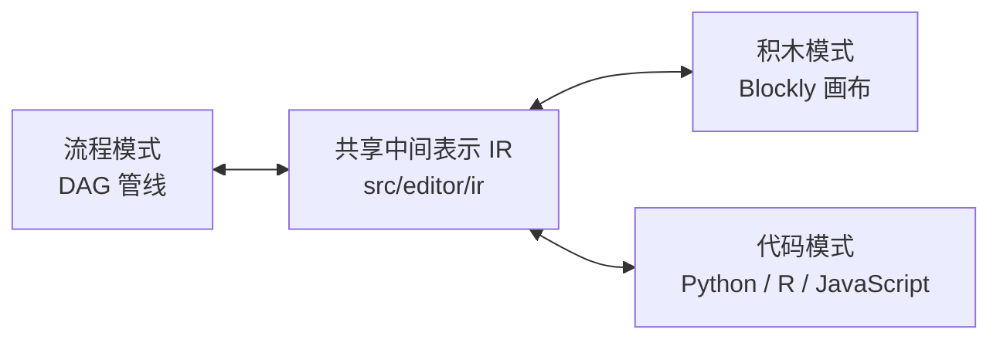

#### 1.1.4 项目现状

项目处于积极开发中，核心闭环已端到端可用并有测试覆盖。当前基线（版本 1.9.0，MIT 协议）：

| 领域 | 现状 |
| --- | --- |
| 107 个内置插件 | 97 个核心/科学插件随启动自动加载，10 个趣味工具声明 `autoload: false` 按需加载；侧栏按 charts / stats / math / physics / chem / bio / geo / env / astro / materials / engineering / econ / psych / data / fx / fun 16 个学科分组 |
| 四种工作模式 | 全部可用；积木、流程、代码三种模式经由共享 IR 双向互转，Python / R / JavaScript 三语言自由往返 |
| 26 个科研工具 | 按测量与不确定性、建模与推断、数据与图谱、信号与扫描、交付与复现、通用小工具六组组织，统一挂在 `/studio/:toolId` 路由下，并可作为标签页内嵌进工作台 |
| 38 个流程区块 | 覆盖数据源、变换、过滤、数学、统计、单位、可视化与绘图八类 |
| 14 个可复用 WGSL 内核 | 粒子积分、全对 N-Body 引力、直方图、热力图、点云、D2Q9 流体的碰撞/迁移/涡量、二维波动方程、分块矩阵乘、基 2 FFT、K-means、键值分箱、稀疏矩阵-向量乘（SpMV）；每个内核都配数学一致的 CPU 实现 |
| 43 个领域子系统目录 | 全部已落地，覆盖统计、科研二进制 I/O、出版级绘图与组图、可复现性、不确定度、信号处理、建模与推断、数据质量与清洗、SQL、血缘、报告、补充材料、课程与作品长廊、化学与地理计算、工作区 VFS 与 Git 适配器等能力（详见 07 篇） |
| 质量保障 | 173 个测试文件、2815 个单元测试（2813 通过，2 个在无 GPU 的环境跳过）；14 套 Playwright 端到端套件（1 冒烟 + 13 个 verify 脚本）驱动真实浏览器（无头 Edge）验证；5 条 GitHub Actions 工作流覆盖单元测试、性能基准、安全扫描、发版归档与部署（详见 08 篇） |

### 1.2 功能全景

#### 1.2.1 内置插件生态

97 个核心/科学插件随启动自动加载，侧栏按学科分为 16 组（映射表 `src/plugins/categories.ts`）；另有 10 个趣味工具声明 `autoload: false` 按需加载，共 107 个：

| 分组 | 数量 | 插件 | 说明 |
| --- | --- | --- | --- |
| 图表可视化 charts | 16 | 散点、时间序列、热力图、等值线、柱状、气泡、雷达、网络、桑基、矩形树图、平行坐标、三维曲面、三维体素、点云、三维点云、图像查看器 | 覆盖最常见的工程与科学出图需求；2D 插件共享同一 canvas 视口，三维插件走 Three.js 场景 |
| 数学统计 stats | 8 | 直方图、箱线图、小提琴图、QQ 图、误差带、中心极限定理演示台、马尔可夫链与稳态分析、Zipf 定律词频分析 | 面向统计教学与多变量分布探索 |
| 数学方法 math | 3 | 傅里叶级数逼近实验室、复变函数域着色、ODE 向量场与流线 | 数值方法内核带解析解或理论界对拍 |
| 物理模拟 physics | 15 | 粒子、N-Body、流体模拟（LBM）、波动方程、双摆、电磁场、光学实验、电磁谐振特征值求解器、1D-3D 双向耦合求解器、一维量子力学求解器、二维伊辛模型、热机循环 p-V 分析台、热传导 / 扩散方程实验室、衍射实验室、轨迹运动学与能量分解实验室 | 数据驱动的仿真引擎与交互实验，WGSL 计算内核加速，带 CPU 回退 |
| 化学 chem | 5 | 晶胞 · 3D 预览、反应 · 自由反应动力学 3D、酸碱滴定曲线实验室、反应级数判定与 Arrhenius 分析、Gray-Scott 反应扩散图灵斑图 | 从晶胞构型（CIF / POSCAR / XYZ）到反应分子动力学的浏览器内化学建模与 3D 可视化 |
| 生物学 bio | 8 | 蛋白质交互网络、酶动力学、传染病分室模型、序列比对与分析、群体遗传学、药代动力学室分析、孟德尔 F2 分离比 χ² 检验、Hodgkin–Huxley 神经元 | 从分子网络到群体遗传的数据驱动生物学建模 |
| 地理 geo | 13 | GeoJSON 地图、太阳高度与昼夜长短、气候直方图、人口金字塔、空间插值、距离与面积量算、投影变形（Tissot 圆）、DEM 地形分析、GPX 轨迹分析、交互地球仪（3D）、放射性碳定年实验室、土壤水分特征曲线拟合、SCS 降雨径流模型 | 离线矢量地图、投影畸变分析与 3D 地理渲染 |
| 环境 env | 8 | 空气质量（AQI）、水质评价、温室效应、碳循环、生物多样性指数、污染物扩散、三维全球环境、捕食者-猎物（Lotka–Volterra） | 数据驱动的环境科学建模与采样模拟 |
| 天文 astro | 3 | 天文 CCD 管线、凌星系外行星光变拟合、赫罗图 | 科研级 CCD 数据管线与星表、光变分析 |
| 材料学 materials | 3 | XRD 衍射图谱分析、应力-应变分析、热分析（DSC/TGA） | 科研级材料表征数据内核 |
| 工程仿真 engineering | 4 | 结构力学（铰接桁架承重）、直流电路节点分析、平面桁架有限元分析、控制系统实验室 | 桁架承重与垮塌、MNA 节点分析、桁架有限元、PID 闭环分析，指标与解析解对照 |
| 经济与金融 econ | 2 | Black-Scholes 期权定价实验室、空间囚徒困境演化博弈 | 解析定价与蒙特卡洛交叉验证、空间演化博弈 |
| 心理与行为 psych | 2 | 信号检测论 ROC / d′ 分析、简单反应时实验室 | 心理物理学测量与统计推断内核 |
| 数据与智能 data | 2 | AI 训练器、图像处理 | 四类模型浏览器内训练；自实现图像处理数值内核 |
| 特效渲染 fx | 5 | 黑洞 · 3D 光线追踪、水波 · 3D 流体、体积云 · 天空渲染器、日光天空 · 大气散射、星空 · 夜天渲染器 | GPU 光线追踪 / 流体渲染专属学科组 |
| 趣味工具 fun | 10 | Mandelbrot、Spirograph、Lissajous、生命游戏、Harmonograph、调色板探索器、科赫雪花、巴恩斯利蕨、烟花、Truchet 瓦片 | 按需加载，保持首屏轻量 |

插件全部来自同一套契约：无论内置还是第三方，加载、渲染、参数与数据访问走的是同一条路径，市场目录（`src/plugins/marketplace.ts`）按科学、趣味、工具三类组织，支持按需加载。参数面板由宿主依清单自动生成本地化表单，支持范围滑杆、下拉、数字、复选框、文本、文件、按钮与开关八类控件。

科研级插件在清单中声明 research 元数据：研究就绪度四级徽章（research / quasi-research / demonstration / educational，插件详情页以四色徽章呈现）、物理单位、基准 id、reproducible 标记与适用范围说明；插件产出的关键指标经统一科学输出总线（`src/core/research/scienceOutput.ts`）汇入画布顶部的 ScienceOutputStrip 条带，同一套读数口径贯穿全部科研级插件。全部 32 个科研级插件与 8 个地理插件均支持"发送到 Figure Studio"一键生成多面板科研图组（含中英图注与公式标注），两个竞赛级求解器插件同样支持。

#### 1.2.2 流程模式区块体系

38 个内置区块分八类，构成流程模式的"词汇表"：

| 类别 | 数量 | 区块 |
| --- | --- | --- |
| 数据源 source | 4 | 示例数据、随机数据、网格数据、文件导入 |
| 变换 transform | 5 | 选择列、重命名列、添加列、归一化、排序 |
| 过滤 filter | 3 | 范围过滤、数值过滤、Top-K 选取 |
| 数学 math | 6 | 加、减、乘、除、平方根、绝对值（支持与标量或另一列运算） |
| 统计 stats | 14 | 摘要统计、直方图分箱、单样本 / 独立双样本 / 配对 t 检验、单因素方差分析、Mann-Whitney U 检验、卡方独立性检验、相关分析、Cohen's d 效应量、多重比较校正、Bootstrap、蒙特卡洛传播、MCMC 采样 |
| 单位 units | 2 | 量纲换算、量纲一致性检查 |
| 可视化 viz | 4 | 散点、折线、直方图、二维点云（经渲染桥接走插件出图） |
| 绘图 plot | 4 | 折线、散点、直方图、柱状（出版级矢量引擎渲染，可直接导出 SVG / PDF） |

区块元数据（名称、描述）内建中英双语；编译器负责结构校验、端口匹配、类型检查与环检测，执行器以节点为粒度做增量缓存与失效重算，示例管线（`examples/projects` 下 8 个 `block-*.clproj` 项目文件，同目录另有 3 个插件演示项目）在构建期经 `import.meta.glob` 自动发现。

#### 1.2.3 数据格式支持

| 类别 | 格式 | 说明 |
| --- | --- | --- |
| 表格与文本 | CSV、TSV、DAT、TXT、MD | 分隔文本与表格数据，项目数据文件可直接导入 |
| XY 谱线文本 | XY、XYE | 两列（2θ–强度，XYE 含误差列）x–y 文本数据，`#` 行为注释，XRD 衍射图谱分析等插件直接载入 |
| 网格与点数据 | JSON、XYZ | 数值网格、标量场与点云（JSON 矩阵 / XYZ 列） |
| 矩阵与数组 | MTX、NPY、NPZ | Matrix Market 稀疏矩阵与 NumPy 数组（电磁谐振特征值求解等） |
| 化学结构 | CIF、POSCAR、VASP | 晶胞结构：原子、周期性化学键与密度估算 |
| 地理与轨迹 | GeoJSON、GPX、ASC | 矢量地图、GPS 轨迹、ESRI ASCII Grid 高程 |
| 生物序列与遗传 | FASTA、FA、VCF | 序列比对与分析、群体遗传变异数据 |
| 图像 | PNG、JPEG、WEBP、GIF | 图像查看器加载位图 |
| 科研二进制 | HDF5（.h5/.hdf5/.hdf、MAT v7.3、h5ad）、NetCDF（.nc）、FITS（.fits/.fit）、Zarr（.zarr）、Parquet（.parquet） | 由纯 TypeScript 实现的科研 I/O 子系统解析，统一调度器按魔数分派，解码后以 CSV 落入项目 |
| 项目文件 | .clproj | 工程自有格式，lz-string 压缩，IndexedDB 存储并支持导出分享 |
| 插件包 | .cspkg | fflate 打包的 ZIP，加载时校验清单、可选验签，并落入沙箱 |
| 主题包 | .cstheme | 纯声明式 JSON 主题包，绝不携带可执行内容 |

格式检测优先按魔数识别，辅以扩展名匹配；识别结果驱动标准模式的插件自动路由。科研二进制文件在 drop 管线中解码为 CSV 后再进入项目，大文件先经 `src/core/chunked/` 的行窗口读取与内容指纹，再由 Worker 池并行解析，避免阻塞主线程。

#### 1.2.4 科研能力全景

科研能力分布在两个层面——26 个面向任务的工具页，以及 43 个领域子系统。工具页解决"这一步要做什么"，子系统提供"这一步怎么算"：

| 分组 | 工具 |
| --- | --- |
| 测量与不确定性 measure | 不确定性套件（Bootstrap 置信区间 / 蒙特卡洛传播 / MCMC，CPU 或 WGSL GPU 引擎，R-hat、ESS 等收敛诊断）、数据画像（列剖析、相关矩阵、质量分与问题清单） |
| 建模与推断 model | 模型工作台（OLS / 逻辑 / 岭回归 / 多项式拟合与残差诊断）、Inference Forge（HMC / NUTS 贝叶斯推断与 WAIC、LOO、后验预测检验）、模型推理（浏览器内 WebGPU 运行 ONNX）、参数扫描（网格 / 列表 / 拉丁超立方设计点与响应面） |
| 数据与图谱 data | SQL 数据工作台（DuckDB-WASM）、数据血缘（文件→运行 DAG）、Figure Studio（多面板出版级图组）、快速分析（描述统计与 t / Mann–Whitney 检验）、数据清洗向导（可回退步骤）、工作区文件浏览（VFS 文件树、文本预览与下载） |
| 信号与扫描 signal | 信号实验室（FFT、Welch PSD、窗函数、Savitzky-Golay、ACF / PACF、季节分解）、Notebook（Markdown + Python 单元）、运行历史（全工具自动记录与 A/B 对比） |
| 交付与复现 deliver | 报告构建（叙事 + 图表 + 交互筛选 → 自包含 HTML）、复现锁（`repro.lock` 导入导出、漂移检查与一键复现）、补充材料打包（manifest + runs + 血缘 + 数据/代码的论文附件 ZIP）、课程模式（布置 / 收集 / 离线批改）、作品画廊（可复现作品图库） |
| 通用小工具 utils | 单位换算、计算器、格式转换、有效数字、摩尔质量、快速统计（六个工具均无需项目上下文，随开随用） |

配套内核包括单位系统（Quantity / convert / check）、大文件分块读取与 Figure 组图引擎（IEEE / Elsevier 期刊模板、投稿检查、双语图注起草、SVG / PDF / PNG-600dpi 导出与 3D 场图面板）。

项目以 Git 仓库为底座（`src/core/git`，isomorphic-git + LightningFS）：侧栏 Git 面板提供分支切换、变更审阅与一键暂存提交（Conventional-Commit 风格消息），项目快照随 `.clproj` 镜像同步，分析过程的每一步改动都可追溯。此外，运行日志导出（`src/core/logger.ts`）把会话内的事件序列落为可下载文件，便于问题回溯与教学演示复盘。

## 第二章 系统架构

### 2.1 总体分层

整个应用是单页应用（Vite 6 构建，React 18 加 TypeScript 5.7 严格模式），自上而下分为四层，低层从不反向导入高层。核心原则是：**领域核心保持纯 TypeScript 且可单测，UI 层保持薄，第三方代码仅可进入沙箱**。

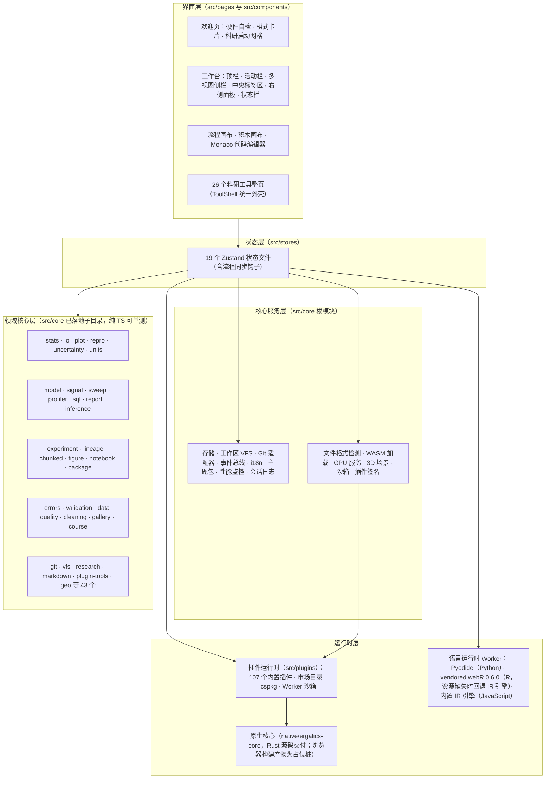

**分层约束**

| 层 | 允许依赖 | 禁止依赖 |
| --- | --- | --- |
| 界面层 | 核心服务、状态库、领域核心 | 直接操作运行时细节（一律经服务层） |
| 领域核心 | 纯 TS 标准库、内部模块 | DOM、React、浏览器专属 API |
| 核心服务 | 领域核心、浏览器 API | React 组件 |
| 运行时层 | 浏览器 API、WASM | 领域核心反向依赖 |

各层职责与技术选型：

| 层 | 职责 | 主要技术 |
| --- | --- | --- |
| 界面层 | 路由、工作台模块化外壳（多视图侧栏 + 中央标签区 + 按文件分派的编辑器）、三种编辑器、科研工具整页、对话框与引导 | React 18、react-router-dom 7（HashRouter） |
| 状态层 | 19 个领域状态文件与跨界面事件 | Zustand 5 |
| 核心服务层 | 横切服务（存储、i18n、主题、性能、沙箱、签名等） | 纯 TypeScript、IndexedDB、Web Workers、WebCrypto 之外的纯 TS 密码学实现 |
| 领域核心层 | 科学计算、科研工作流与可靠性内核，全部纯 TS 可 Node 单测 | 纯 TypeScript |
| 运行时层 | 插件注册与生命周期、沙箱执行、语言运行时、原生加速 | fflate（ZIP）、lz-string（压缩）、Rust 与 wasm-bindgen 0.2 |

原生核心以 Rust 源码交付，浏览器内构建产物是构建期生成的占位桩（`scripts/make-wasm-stub.mjs`）：运行时不依赖它承担计算，实际计算由浏览器原生 WebGPU（可用时）或各内核配套的 CPU 实现完成；魔数检测等宿主能力同样有纯 TS 主路径，WASM 仅作为可选辅助。

### 2.2 路由与页面组织

应用采用 HashRouter（静态部署兼容），全部路由懒加载并以 `location.pathname` 为 key 重放 `.route-stage` 入场动画。路由表：

| 路径 | 页面 | 说明 |
| --- | --- | --- |
| `/` | 欢迎页 | 硬件自检（WebGPU · WASM · IndexedDB）、四模式卡片、科研工具启动网格、最近项目 |
| `/workbench` | 工作台 | 标准 / 流程 / 积木 / 代码四模式容器；中央标签区容纳插件画布、文件预览、按文件分派的编辑器（`.py`/`.js`/`.r` → Monaco、`*.flow.json` → 流程图、`*.block.json` → 积木）与内嵌科研工具 |
| `/studio/:toolId` | 科研工具页 | 由 `RESEARCH_TOOLS` 注册表驱动，统一 ToolShell 外壳 |
| 旧哈希路径（如 `/#/signal`） | 重定向 | 客户端重定向到 `/studio/:toolId` |
| `/settings` | 设置 | 全局设置、主题市场、PWA 面板、存储管理 |
| `/plugin/:pluginId` | 插件视图 | 单插件详情 |
| `/share/:payload` | 分享 | 分享载荷渲染 |
| `*` | 重定向 | 回欢迎页 |

#### 2.2.1 科研工具注册表（RESEARCH_TOOLS）

`src/pages/research/toolRegistry.ts` 是科研界面的唯一事实来源：每个工具声明一次 `id`、`path`、`legacyPath`、图标、i18n 标题与描述键、分组、是否进入启动网格、是否要求项目上下文与懒加载组件，由 `/studio` 路由、顶栏启动器与欢迎页启动网格共同消费。

当前共 **26 个科研工具**，分六组：

| 分组 | 工具 |
| --- | --- |
| 测量与不确定性 measure | uncertainty（不确定性）、profiler（数据画像） |
| 建模与推断 model | model-lab（回归建模）、inference（Inference Forge）、model-inference（ONNX 推理）、sweeps（参数扫描） |
| 数据与图谱 data | sql（SQL 工作台）、lineage（数据血缘）、figures（Figure Studio）、analysis（快速分析）、cleaning（数据清洗）、files（工作区文件浏览） |
| 信号与扫描 signal | signal（信号实验室）、notebook（笔记本）、runs（运行历史） |
| 交付与复现 deliver | report（报告构建）、reprolock（复现锁）、supplement（补充材料）、course（课程模式）、gallery（作品长廊） |
| 通用小工具 utils | unit-convert（单位换算）、calc（计算器）、format-convert（格式转换）、sigfig（有效数字）、molar-mass（摩尔质量）、quick-stats（快速统计） |

其中快速分析 `analysis` 的 `inGrid` 为 `false`——它保留顶栏独立按钮入口，不占启动网格位；通用小工具组不要求项目上下文，可零门槛直接使用。新科研工具必须注册进该表并配置 `legacyPath`，禁止散落路由。

### 2.3 启动时序

应用启动遵循"先自检、再加载、后恢复"的固定顺序，任何一步的环境缺失都会如实报告而不是静默降级：

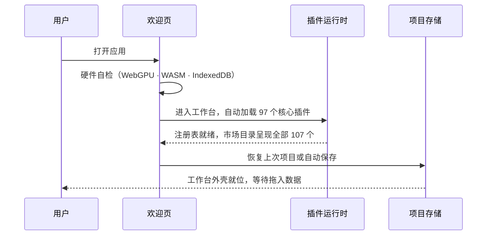

应用装配阶段还会执行 `initProjectStore` / `initExperimentStore` / `initLineageStore`，使项目、实验记录与血缘图在任何页面进入前就绪；`main.tsx` 另行预热插件签名模块（含公钥信任注册表）与 OPFS 迁移逻辑。

欢迎页的自检结果同时决定后续行为的"档位"：WebGPU 可用则各计算内核走 GPU 加速，不可用时插件以数学一致的 CPU 实现完成同样的计算；原生核心以 Rust 源码交付、构建产物为占位桩，不参与运行时计算（详见 06 篇）。

### 2.4 状态管理

`src/stores/` 下共 **19 个文件**，承载全部应用状态；跨界的 UI 通信走一个小型类型化事件总线（`src/core/events.ts`），例如插件参数变化、宿主文件选择对话框等事件。状态库之间通过事件总线协作而非直接引用，避免环状依赖。

| 状态库 | 职责 |
| --- | --- |
| appStore | 宿主状态、横幅与通知、性能指标、面板开关 |
| projectStore | 当前项目、最近列表、保存与自动保存、分享、参数持久化 |
| pluginStore | 插件注册表、加载与激活生命周期、文件分发、宿主容器、内置插件加载失败重试 |
| settingsStore | GPU 模式、自动保存间隔、语言、PWA、主题包等偏好；语言以 i18n 模块为唯一权威源并双向订阅 |
| blockStore | 流程模式图状态、运行编排、节点输出缓存、运行取消 |
| editorStore | 积木与代码模式的会话（IR、代码文本、变量、控制台、语言），载入时逐字段净化 |
| analysisStore | 快速分析页的列选择、图型与分析结果 |
| researchStore | 科研工具页的公共上下文（当前文件、最近使用工具） |
| experimentStore | 实验运行记录的读写与筛选（IndexedDB runs 存储） |
| lineageStore | 数据血缘图的重建与查询 |
| chunkStore | 分块加载任务队列与进度 |
| figureStore | Figure Studio 的面板布局、图注与投稿检查状态 |
| notebookStore | 笔记本单元、执行状态与输出 |
| aiPanelStore | AI 助手面板的会话、模式（离线/在线）与授权状态 |
| commandPaletteStore | 命令面板（Ctrl+K）的开关与动作注册 |
| shortcutsStore | 键盘快捷键帮助对话框（ShortcutsDialog）的开关与条目注册 |
| tourStore / templateTourStore | 引导流程与模板引导的进度 |
| useFlowSync | 流程图 ↔ 共享 IR 的双向同步钩子，含注水签名守卫 |

项目生命周期：创建、打开、保存、自动保存与分享。项目格式为 `.clproj`，内容经 lz-string 压缩后存入 IndexedDB；积木程序、代码会话与笔记本单元全部持久化进项目文件，重新打开时完整恢复。项目同时以 Git 仓库为底座（`src/core/git`，isomorphic-git + LightningFS），侧栏 GitPanel 提供分支切换、变更审阅与一键暂存提交。流程图与积木程序另以 `.flow.json` / `.block.json` **工作区文件**（经 `src/core/vfs/`）持久化，文件资源管理器的按文件编辑器可直接打开编辑，旧的 `blockGraph` 项目字段仍兼容读取。分享链接由随机 UUID 标识，载荷在解析端做大小与结构双重校验，拒绝畸形数据。大文件场景下 `src/core/opfs.ts` 提供 OPFS 分块存储，`opfs-migration.ts` 负责把既有 IndexedDB 数据平滑迁移。

### 2.5 渲染管线

中央视口拥有三个绘图表面，宿主集中管理其可见性：

1. **共享 2D canvas**：所有 2D 插件（散点、折线、直方图、热力图、等值线、箱线、小提琴、桑基等）画在同一个画布上，由统一的 2D 视口抽象（`viewport2d`）提供快照式访问。
2. **DOM 容器**：供需要 DOM 元素的插件使用，也是沙箱插件经 OffscreenCanvas 转移后挂载画布的位置。
3. **宿主管理的 Three.js 3D 场景**：只有声明了 `renderToScene` 能力的插件激活时才按需创建，并配套轨道控制、灯光网格与尺寸自适应。

可见性判定流程：

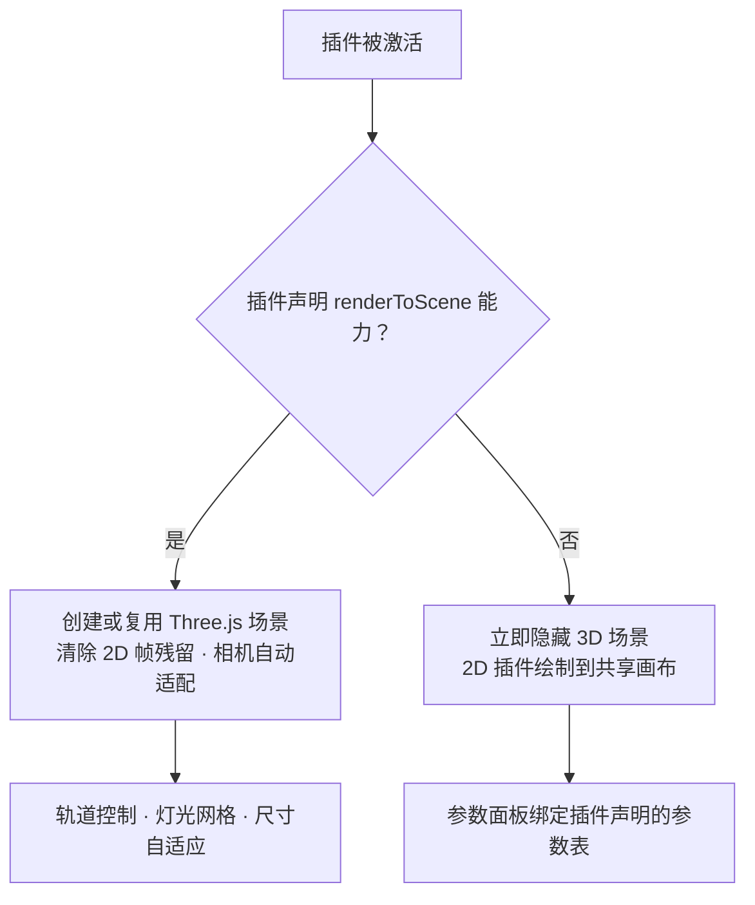

这保证 3D 坐标系永远不会渗透进 2D 视图，反之亦然；端到端测试对两种视口的互斥有专门断言。三维数据侧另有 `src/core/mesh3d.ts`（三维网格数据管线，纯函数）与 `src/core/pointcloud-gpu.ts`（百万级点云的 GPU 预算与降采样策略）。

### 2.6 目录结构

`src/` 顶层目录为 blocks、components、core、editor、hooks、i18n、native、pages、plugins、stores、styles、theme、types。主要位置如下：

| 位置 | 内容 |
| --- | --- |
| src/core（根模块，38 个） | storage、events、settings、perf、logger、gpu、compute、gpu-kernels、wgsl、wasm、fileFormat、parse-tasks、parse-worker、worker-pool、scene3d、viewport2d、mesh3d、pointcloud-gpu、sandbox、plugin-worker、pluginCache、cspkg、plugin-signing、crypto-primitives、dataFiles、exampleAssets、examples、download、opfs、opfs-migration、pwa、recentTools、site-links、citation、workspace-artifacts、boot、cpu-info、labHandoff（国际化词典另置于 src/i18n） |
| src/core（子目录，43 个） | stats、io、plot、repro、uncertainty、units、model、signal、sweep、profiler、sql、report、inference、experiment、lineage、chunked、cleaning、figure、notebook、package、gallery、course、templates、theme-pack、submit、bench、validation、errors、data-quality、ai、r、pyodide、chem、monaco、geo、git、markdown、plugin-tools、research、vfs、astro、raytrace、sanitize |
| src/blocks | 流程模式区块系统：类型、注册表、编译器、执行器、ops 与 DataTable 运算、区块目录（catalog，38 个区块）、本地化（l10n）、渲染桥接（render.ts） |
| src/editor | 积木与代码模式：ir（types、validate、hash、serialize）、flow 与 block 的互转、block（Blockly 引擎、积木定义、工具箱、主题、示例）、code（解析与示例）、codegen（Python、R、JS 三个生成器）、runtime（解释器与 Studio API） |
| src/components | 工作台外壳组件（TopBar / ActivityBar / Sidebar / CentralArea / RightPanel / StatusBar / GitPanel）、按文件分派的编辑器（editor/fileEditors）、流程模式画布组件、积木与代码模式的编辑器面板组件、ScienceOutputStrip 科学输出条带、反馈与错误边界、图标集 |
| src/pages | welcome、workbench、studio、research（toolRegistry）、labs（13 个科研工具页组件）、figures、gallery、notebook、signal、sql、report、sweeps、utils、settings、share、plugin、plugin-dialog |
| src/plugins | 内置插件（builtin，107 个：97 个随启动自动加载 + 10 个趣味工具）、市场目录（marketplace.ts）、示例包（marketplace-demo-packages.ts）、分类表（categories.ts） |
| src/stores | Zustand 状态库（19 个文件） |
| src/hooks / src/i18n / src/styles / src/theme | 跨组件复用钩子（CPU 信息、模式同步、面板宽度）、中英双语词典与类型、全局样式表、主题基座 |
| src/types | 插件、项目、区块、编辑器与 DataTable 契约类型 |
| src/native | 构建生成的 WASM 绑定（不入库） |
| native/ergalics-core | Rust 原生核心（lib、device、buffer、compute、utils），以源码交付 |
| examples | 示例数据（data）、示例项目（projects，11 个 .clproj：8 个流程示例 + 3 个插件演示）、代码模式示例（code，9 个 Python 程序） |
| scripts | 约 50 个工程脚本：WASM 构建与占位桩生成、示例数据生成、签名 CLI、SBOM / CITATION 生成、部署合并，以及 1 个冒烟 + 13 个 verify 端到端脚本 |
| tests | Vitest 单元测试（173 个测试文件、2815 个用例，其中 2 个在无 GPU 环境跳过） |
| docs | VitePress 文档站与本技术文档目录（technical） |
| website | 官方站点（作品长廊 · 主题市场 · 插件市场），部署到 Pages 根路径 |

### 2.7 依赖规则与分包策略

- 界面层依赖状态层，状态层依赖核心服务与领域核心，核心服务层绝不导入界面层。
- 领域核心禁止访问 DOM 与 React，测试在 Node 环境运行（Vitest）；新能力优先落在 `src/core/` 的纯 TS 模块，再在 UI 层装配，禁止在组件内实现领域逻辑。
- 运行类操作（流程 / 积木 / 代码 / 笔记本 / 扫描 / 不确定性 / 建模 / 推断）必须通过事件总线汇入实验记录与血缘，禁止绕过。
- 插件契约（`src/types/plugin.ts`）是宿主与第三方代码之间唯一的共享词汇表；渲染桥接（`src/blocks/render.ts`）是区块系统唯一带副作用的模块，负责把可视化输出送进插件渲染器，使编译器与执行器保持可测。
- 重依赖全部懒加载分包：Blockly（约 828 KB）在首次进入积木模式时才拉取，TensorFlow.js 在首次点击训练时才拉取，Pyodide 运行时在首次运行 Python 时才引导，vendored webR 0.6.0（`public/webr/`）在首次运行 R 时引导、资源缺失时回退内置 IR 引擎，Monaco 与 DuckDB-WASM 同理；标准与流程模式的首屏不受影响。WASM 与 Blockly 媒体资源经自定义 Vite 插件同源 vendoring 到 `public/`，不依赖外部 CDN。
- 应用版本号经 `define.__APP_VERSION__` 从 package.json 注入，禁止硬编码。
- 错误边界按区域隔离（顶栏、状态栏独立包裹），边界重置通过递增 key 实现有界重试，避免错误死循环。

### 2.8 可观测性

| 设施 | 能力 |
| --- | --- |
| 性能监控（perf） | 帧时间与 GPU 时间聚合，超阈值时经通知系统提示用户而非静默卡顿 |
| 运行日志（logger 加 download） | 会话事件序列可导出为文件，用于问题反馈与回归定位 |
| 状态栏 | 常驻显示 GPU 可用性、当前引擎与性能指标，用户随时知道"现在是谁在算" |
| 基准套件（`src/core/bench/`） | 导入、GPU 内核、渲染帧率与内存四类基准，配合 `scripts/bench-*.mjs` 与 `budget-baseline.json` 在 CI 中做性能回归门禁（详见 08 篇） |
| 可靠性内核（`src/core/errors/`） | 结构化错误分类法、`Result` 类型、退避重试、去重错误注册表与全局 `error` / `unhandledrejection` 捕获，把"静默失败"转成可上报的事件 |

## 第三章 插件系统

### 3.1 宿主与插件的契约

每个插件实现统一的 `Plugin` 接口（`src/types/plugin.ts`）。`manifest`、`init`、`getParams` 为必选，其余方法均可选——宿主以可选调用探测，这正是第三方包可以只实现 `render` 就跑起来的原因：

| 方法 | 作用 |
| --- | --- |
| init / destroy | 初始化与销毁，宿主负责 GPU 安全的资源回收 |
| activate / deactivate | 激活与去激活，驱动 2D/3D 视口切换与残留帧清理 |
| render / updateParams | 绘制与参数更新（右侧面板响应式表单） |
| getParams / compute | 参数定义读取与计算（`compute` 带进度回调） |
| loadData / getSupportedFormats | 接收宿主分发的数据；声明支持的文件格式 |
| renderToScene | 3D 能力声明，激活时获得宿主 Three.js 场景句柄 |
| onProjectSave / onProjectLoad | 项目保存与加载后的生命周期钩子 |

#### 3.1.1 3D 插件标准接法：renderToScene 与 Scene3DHandle

3D 插件不自行创建渲染器，而是实现 `renderToScene(scene)` 获取宿主统一管理的 `Scene3DHandle`：成员即真实的 Three.js 对象（`scene` 根节点、预置机位的 `camera`、`controls` 轨道控制器、`renderer`），插件向其中添加网格与灯光并通过 `render()` 驱动渲染循环；`setVisible/isVisible` 保证非 3D 插件激活时三维坐标系不会渗入二维视口；`snapshot({ transparent: true })` 导出去除背景与参考物件的透明 PNG；`dispose()` 释放 GPU 资源并停止渲染循环。WebGL 不可用时自动回退 2D 提示。

#### 3.1.2 PluginApi：宿主提供的能力面

| 能力组 | 内容 |
| --- | --- |
| 本地化 | `locale`、`t()` 与语言切换订阅，参数面板随语言重建 |
| 状态上报 | `setStatus` 向状态栏上报 ready/computing/paused/loading/saving/error |
| 性能上报 | `reportGpuTime` 与 `reportDataScale` 进入性能监控与告警 |
| 通知 | `notify` 按严重级别的横幅与提示 |
| 日志 | `log` 输出到 `plugin:<id>` 作用域，随运行历史导出 |
| 取消与激活态 | `onCancel` 订阅状态栏取消；`isActive` 防止后台插件绘制共享画布 |
| 文件访问 | `openFile / readText / readBinary`（项目自有文件、内置示例与代码模式文件共享同一套逻辑） |
| 参数读写 | `getParam / setParam` 项目级持久化；`reload` 自恢复实例 |
| 临时缓存 | `cache` 插件作用域异步缓存，卸载即释放 |
| 文件保存 | `exportFile` 把文本/二进制保存到用户下载 |
| GPU 计算面 | `gpu`（createBuffer、write、read、compileKernel、run，详见 06 篇） |

#### 3.1.3 参数面板与控件

插件在清单中声明参数表，宿主据此自动生成本地化的响应式参数面板，支持八类控件：

| 控件 | 用途示例 |
| --- | --- |
| 范围（滑杆） | 引力常数、阻尼系数 |
| 下拉 | 场景预设、投影方式、调色板 |
| 数字 | 分箱数、步长 |
| 复选框 | 轨迹线、网格显示 |
| 文本 | 列名、标签 |
| 文件 | 附加数据选择 |
| 按钮 | 重新播种、导出 |
| 开关 | 运行 / 暂停之外的布尔状态 |

参数可声明 `group` 与 `inline`，同一组控件并排自动换行布局。

#### 3.1.4 生命周期与懒加载

插件运行时统一编排生命周期；模块本身是懒加载的——注册表中先登记 manifest，模块代码只在加载该插件时经动态 `import()` 实例化，未加载的插件不占运行时资源：


销毁时宿主回收插件持有的缓冲与事件监听；自动加载失败可重试：插件运行时把"初始化完成"作为状态机节点，失败后注册表不会进入就绪态，用户重试不会被误判为重复加载。

#### 3.1.5 导出

导出能力分两层：**画布级**由中央区的统一"导出"菜单承担——把当前激活插件的 2D 画布或 3D 场景下载为 PNG（3D 场景额外提供透明背景选项），或保存为工作区 `figures/` 下的文件（经 `src/core/vfs/`）；**数据级**由各插件在参数面板以按钮动作自声明（`exportCsv` 动作），把所属表格数据导出为 RFC-4180 CSV（UTF-8 BOM，仿真类带行数上限与抽样）。

### 3.2 107 个内置插件（16 个学科分组）

侧栏分组由 `DISCIPLINE_BY_PLUGIN` 映射决定，未登记的第三方插件回落到"图表可视化"组。下表按侧栏显示顺序给出全部 107 个插件（数量：图表可视化 16 / 数学统计 8 / 数学方法 3 / 物理模拟 15 / 化学 5 / 生物学 8 / 地理 13 / 环境 8 / 天文 3 / 材料学 3 / 工程仿真 4 / 经济与金融 2 / 心理与行为 2 / 数据与智能 2 / 特效渲染 5 / 趣味工具 10）。其中 97 个自动加载，趣味工具组 10 个为 `autoload: false` 手动加载。

#### 3.2.1 图表可视化（charts，16 个）

| 插件ID | 中文名 | 英文名 | 说明 |
| --- | --- | --- | --- |
| example.scatter | 散点图 | Scatter Plot | 渲染数值列（x y [值]）为二维散点，第三列可作为颜色通道 |
| example.timeseries | 时间序列绘图 | Time Series | 将 CSV 各列绘制为随时间变化的折线图 |
| example.heatmap | 热力图 | Heatmap | 将二维数值网格（JSON 矩阵）渲染为热力图 |
| example.contour | 等值线图 | Contour | 渲染二维标量场（JSON 网格）为色带 + 等值线，适合涡旋场、地形等数据 |
| example.surface-3d | 3D 表面图 | 3D Surface | 高度场网格 z=f(x,y) 的三维表面图，数据来自项目文件或示例数据，自适应视角 |
| example.voxel-3d | 3D 体素渲染 | 3D Voxel Field | 三维标量场等值面与半透明体素渲染，数据来自项目文件，单次实例化提交 |
| example.bar_chart | 柱状图 | Bar Chart | 渲染分类数据为柱状图，支持水平/垂直方向与配色选择 |
| example.bubble | 气泡图 | Bubble Chart | 渲染三维数值数据（x y 大小 [颜色]）为气泡图，第四列可作颜色通道 |
| example.polar | 雷达图 | Polar Plot | 渲染多系列雷达/极坐标图，每列一个维度，每行一个系列 |
| example.network | 网络图 | Network Graph | 从边列表数据渲染力导向网络图，支持节点大小、颜色与动画 |
| example.sankey | 桑基图 | Sankey Diagram | 从源→目标→值的边数据渲染桑基流图，带按比例缩放的流量带 |
| example.treemap | 矩形树图 | Treemap | 用嵌套矩形展示层级数据，矩形面积与数值成正比 |
| example.parallel | 平行坐标图 | Parallel Coordinates | 将多变量数据绘制为平行坐标轴，每行一条折线，可用类别列着色 |
| example.point-cloud | 点云查看器 | Point Cloud | 渲染 .xyz 点云文件，可调节点大小与颜色 |
| example.point-cloud-3d | 3D 点云 | Point Cloud 3D | 基于宿主 Three.js 场景的交互式 3D 点云渲染，支持高度着色与自适应视野 |
| example.image | 图像查看器 | Image Viewer | 加载并查看图片文件（PNG/JPEG/WebP/GIF） |

#### 3.2.2 数学统计（stats，8 个）

| 插件ID | 中文名 | 英文名 | 说明 |
| --- | --- | --- | --- |
| example.histogram | 直方图 | Histogram | 对一维数值数据绘制分布直方图，可调节分箱数 |
| example.boxplot | 箱线图 | Box Plot | 对分组数值数据绘制箱线图（四分位箱体 + 须线 + 离群点） |
| example.violin | 小提琴图 | Violin Plot | 对分组数值数据绘制核密度小提琴图，支持带宽调节与箱线图叠加 |
| example.qqplot | QQ 图（正态检验） | QQ Plot | 样本分位数与标准正态分位数对比，偏离对角线表示非正态 |
| example.errorband | 误差带图 | Error Band | 折线 + 半透明误差带（置信区间）图，适合带不确定性的测量数据 |
| example.stats-clt | 中心极限定理演示台 | Central Limit Theorem Bench | 从均匀/指数/伯努利/双峰混合/截断重尾 Pareto 母体抽样求均值分布，叠加理论 N(μ, σ²/n) 正态曲线，给出偏度/峰度/Jarque-Bera 度量与内嵌验证基准 |
| example.stats-markov | 马尔可夫链与稳态分析 | Markov Chains & Stationary Analysis | 幂法求稳态分布（L1 残差 < 1e-12）、遍历性与周期检查、吸收链分析、轨迹模拟与阻尼 0.85 的 PageRank 模式 |
| example.stats-zipf | Zipf 定律词频分析 | Zipf's Law Word Frequencies | 真实语料的 Zipf 定律分析：分词、词频排序与 log(rank)–log(freq) 最小二乘拟合（s±σ、R²、逐秩残差），与理想指数 s=1 对照，内置《爱玛》公版语料 |

#### 3.2.3 数学方法（math，3 个）

| 插件ID | 中文名 | 英文名 | 说明 |
| --- | --- | --- | --- |
| example.math-fourier | 傅里叶级数逼近实验室 | Fourier Series Lab | 间断点分段 Simpson 求积计算傅里叶系数，对比普通部分和与 Fejér 平均；Gibbs 过冲比例对照经典常数 2·Si(π)/π ≈ 1.17898 |
| example.math-domaincolor | 复变函数域着色 | Domain Coloring | f(z) 逐像素域着色（色相编码辐角、对数模长等值线带），内置递归下降复数表达式解析器，按辐角原理统计绕数 |
| example.math-odefield | ODE 向量场与流线 | ODE Vector Field & Streamlines | 二维自治系统相平面实验台：RK4 双向流线积分、牛顿法定位平衡点并按雅可比特征值分类 |

#### 3.2.4 物理模拟（physics，15 个）

| 插件ID | 中文名 | 英文名 | 说明 |
| --- | --- | --- | --- |
| example.particles | 粒子模拟 | Particles | 交互式粒子模拟，演示计算进度与性能上报 |
| example.nbody | 引力 N 体模拟 | N-Body Gravity | 三维天体物理 N 体引力直接求和模拟，支持 GPU 全配对计算与 CPU 降级 |
| example.fluid | 流体模拟（LBM） | LBM Fluid | 二维格子 Boltzmann 通道流（D2Q9）绕流涡街演示，GPU 内核逐步计算 + CPU 降级 |
| example.wave | 波动方程 | Wave Equation | 二维波动方程有限差分模拟：高斯脉冲、双源干涉、双缝衍射三种场景，GPU 逐步计算 + CPU 降级 |
| example.pendulum | 双摆（混沌） | Double Pendulum | RK4 积分的经典双摆：主摆与初始角仅差 0.001 rad（≈0.057°）的"幽灵摆"并行演化，直观展示混沌对初值的敏感依赖 |
| example.electromag | 电磁场 | Electromagnetism | 在画布上拖动电荷并自由释放：电荷受库仑力与均匀磁场的洛伦兹力共同作用运动，磁场可单独设置（强度与方向） |
| example.optics | 光学实验 | Optics Lab | 几何光学光线追踪：凸透镜/凹透镜（薄透镜）、三棱镜（斯涅尔折射 + 色散）、光屏成像，所有元件可在画布上拖动 |
| example.em-eigensolver | 电磁谐振特征值求解器 | EM Eigensolver | 面向电磁谐振/微波器件仿真的十万阶非正定厄密稀疏矩阵特征值求解器：厚重启 Lanczos、块 LOBPCG、Jacobi-Davidson 三内核 + MINRES 位移逆变换 |
| example.fluid-cfd-coupler | 1D-3D 双向耦合求解器 | 1D-3D Coupled Solver | 1D 管网-3D 场双向耦合：多速率时间步协调、粗-细时间子循环、正反向边界耦合、毫秒级阀门控制、守恒性审计与精度-效率权衡曲线 |
| example.physics-schrodinger | 一维量子力学求解器 | 1-D Schrödinger Solver | 有限差分 + 自实现三对角 QL 本征求解器给出无限深阱/谐振子/有限阱/双势阱的能级与本征函数，Crank-Nicolson 幺正时间演化演示高斯波包 |
| example.physics-ising | 二维伊辛模型 | 2-D Ising Model | 周期方格子上运行 Metropolis 与 Wolff 单团簇算法，观测磁化率、比热与 Binder 累积量；χ(T) 峰位拟合给出 Onsager 临界温度 |
| example.physics-heatengine | 热机循环 p-V 分析台 | Heat Engine Cycles | 奥托/迪塞尔/卡诺/（回热）斯特林循环按准静态路径以梯形法积分 ∮p dV，逐支按 Q = ΔU + W 记账，热效率与闭式公式对拍 |
| example.physics-diffusion | 热传导 / 扩散方程实验室 | Diffusion Equation Lab | FTCS 显式格式（D·Δt/Δx²≤0.5 稳定性校验）与 Crank–Nicolson 隐式格式，支持 Dirichlet/Neumann 边界，实时输出与解析解的最大相对误差 |
| example.physics-diffraction | 衍射实验室 | Diffraction Lab | 数值计算菲涅尔-基尔霍夫衍射积分，单缝/双缝/N 缝光栅/圆孔近场与远场统一处理 |
| example.physics-trajectory | 轨迹运动学与能量分解实验室 | Trajectory Kinematics Lab | 分析轨迹数据（t, x[, y]）：三点 Lagrange 数值微分、可选 Savitzky-Golay 平滑、动能/势能分解与线性化最小二乘抛体拟合 |


*电磁场插件：在画布上拖动并释放电荷，电荷受库仑力与匀强磁场的洛伦兹力共同作用做回旋运动，磁场强度与方向可单独设置。*


*光学实验室：白光束经三棱镜折射发生色散，凸凹透镜与元件均可在画布上拖动，用于薄透镜成像与色散演示。*


*结构力学插件：铰接桁架实时承重，杆件按轴力着色，超载时依次断裂直至整体垮塌，直观展示材料极限与失效传播。*

#### 3.2.5 化学（chem，5 个）

| 插件ID | 中文名 | 英文名 | 说明 |
| --- | --- | --- | --- |
| example.chem-crystal | 晶胞 · 3D 预览 | Crystal · 3D Unit Cell | 加载 CIF / POSCAR / XYZ 主流晶胞格式，3D 查看原子、周期性化学键、有效组成与密度估算 |
| example.chem-reaction | 反应 · 自由反应动力学 3D | Reaction · MD 3D | 内置 NumPy/Langevin 引擎在所选温度与催化剂条件下积分真实轨迹——键越过 Arrhenius 势垒而断裂、自由基重组而成键 |
| example.chem-titration | 酸碱滴定曲线实验室 | Titration Curve Lab | 全离子平衡（电荷 + 物料平衡 + Ka + Kw）方程组，带二分保护的 Newton–Raphson 逐体积求解 [H⁺]，标注等当点、缓冲区与指示剂变色区间，内嵌解析式对拍基准 |
| example.chem-reaction-order | 反应级数判定与 Arrhenius 分析 | Reaction Order & Arrhenius | 对 [A]–t 数据做零/一/二级线性化最小二乘并按 R² 判优，半衰期法交叉验证，Arrhenius 回归回收 Ea ± σ 与指前因子 A |
| example.chem-turing | Gray-Scott 反应扩散图灵斑图 | Gray–Scott Turing Patterns | FTCS 显式差分在 N×N 周期网格上演化反应-扩散方程，内置 Pearson (1993) 经典分区预设与质量守恒数值基准 |


*晶胞 · 3D 预览：加载 CIF 格式晶胞以球棍模型查看原子、周期性化学键与晶胞框，Rutile 示例含 8 个原子，并可结合有效组成与密度估算。*


*自由反应动力学 3D：内置 NumPy / Langevin 引擎在设定温度与催化剂条件下积分真实轨迹——酯化反应（乙醇 + 乙酸）中键越过 Arrhenius 势垒断裂、自由基重组而成键，原子运动来自真实物理而非脚本动画。*

#### 3.2.6 生物学（bio，8 个）

| 插件ID | 中文名 | 英文名 | 说明 |
| --- | --- | --- | --- |
| example.protein | 蛋白质交互网络 | Protein Interactions | 蛋白质-蛋白质交互网络与力导向布局计算，输出度分布与连通分量等生物学指标 |
| example.bio-enzyme | 酶动力学 | Enzyme Kinetics | Michaelis-Menten 酶动力学：竞争性/非竞争性/反竞争性抑制、Lineweaver-Burk 线性化，Levenberg-Marquardt 拟合反解 Vmax 与 Km，输出 kcat 与催化效率 |
| example.bio-epidemic | 传染病分室模型 | Epidemic Modeling | 确定性 SIR / SEIR 分室模型，经典 RK4 积分，输出 R₀、群体免疫阈值、感染峰值时刻与总感染率 |
| example.bio-seqalign | 序列比对与分析 | Sequence Alignment | BLOSUM62 / 核酸打分矩阵的双序列比对（全局 Needleman-Wunsch 或局部 Smith-Waterman，仿射空位罚分），以及碱基组成与 GC 滑动窗口分析，支持 FASTA 数据 |
| example.bio-popgen | 群体遗传学 | Population Genetics | 哈代-温伯格平衡（HWE）卡方检验，以及带可选自然选择（隐性/加性/显性）的、可复现的 Wright-Fisher 遗传漂变模拟 |
| example.bio-pk | 药代动力学室分析 | Pharmacokinetics | 一室/二室、静脉推注与口服一级吸收模型，RK4 数值解与解析解对拍，治疗窗（MEC/MSC）叠加 |
| example.bio-mendel | 孟德尔 F2 分离比 χ² 检验 | Mendel F2 χ² Tests | 对单杂合 3:1 与双杂合 9:3:3:1 分离比做卡方拟合优度检验，内置 1866 年论文七性状原始 F₂ 计数，自实现不完全伽马函数计算 p 值 |
| example.bio-neuron | Hodgkin–Huxley 神经元 | Hodgkin–Huxley Neuron | 采用 1952 年原始发表常数的四变量 RK4 积分，展示 V(t) 与 m/h/n 门控波形，支持电流脉冲与 Q10=3 温度标度 |


*酶动力学：以 v=f([S]) 饱和曲线对照无抑制 / 竞争性 / 非竞争性 / 反竞争性四种情形，并用 Levenberg-Marquardt 从含噪初速度数据反解 Vmax、Km，输出 kcat 与催化效率。*


*传染病分室模型：确定性 SIR / SEIR 用经典 RK4 积分，图中 SEIR 显示 S/E/I/R 随时间演化，给出感染峰值时刻、总感染率（attack 92.1%）与群体免疫阈值。*


*序列比对：BLOSUM62 打分矩阵的双序列全局（NW）或局部（SW）比对与仿射空位罚分，图中给出两条蛋白序列的对齐、一致性 46.4%、9 个空位及 GC 分析。*


*群体遗传学 HWE 检验：输入三个基因型计数，χ² 检验观察值与 HWE 期望值之差（图中 χ²=0.832、p=0.86），p ≥ 0.05 判定处于平衡。*


*群体遗传学遗传漂变：可复现的 Wright-Fisher 模拟，40 条轨迹展示等位基因频率的随机游走，记录固定 / 丢失次数与平均固定代数，支持可选隐性 / 加性 / 显性选择。*

#### 3.2.7 地理（geo，13 个）

| 插件ID | 中文名 | 英文名 | 说明 |
| --- | --- | --- | --- |
| example.geomap | GeoJSON 地图 | GeoJSON Map | 离线渲染 GeoJSON 矢量数据：多边形/线/点，支持按数值属性分级设色（choropleth）与墨卡托/等距圆柱投影 |
| example.geo-solar | 太阳高度与昼夜长短 | Solar Elevation & Day Length | 给定纬度与日期计算太阳赤纬、正午太阳高度、昼长与日出日落地方时，绘制全年昼长与正午太阳高度曲线 |
| example.geo-climograph | 气候直方图 | Climatograph | 以"气温折线 + 降水柱状"双轴绘制月度气候图，自动汇总年均温、年降水、气温年较差与降水季节分配并判读气候类型 |
| example.geo-pop-pyramid | 人口金字塔 | Population Pyramid | 背靠背年龄性别金字塔（左男右女，年龄自下而上），计算 0-14 / 15-64 / 65+ 占比、总人口性别比并判读结构类型 |
| example.geo-interp | 空间插值 | Spatial Interpolation | 将离散站点观测值网格化：反距离加权（IDW，幂次可调）与普通克里金（经验变差函数自动拟合球状/指数模型），输出热力面、等值线与站点标注 |
| example.geo-measure | 距离与面积量算 | Distance & Area Measure | 画布点击加点：测距模式逐段给出大圆距离与累计里程；测面模式用球面多边形公式计算围合面积与周长 |
| example.geo-tissot | 投影变形（Tissot 圆） | Projection Distortion (Tissot) | 在等距圆柱、墨卡托、正弦、摩尔威德、高尔-彼得斯、方位等积与正射七种投影下绘制世界海岸线与 Tissot 变形圆 |
| example.geo-terrain | DEM 地形分析 | DEM Terrain Analysis | 解析 ESRI ASCII Grid（.asc）高程数据：高程设色、山体阴影、Horn 法坡度/坡向、等高线叠加与三维建模视图 |
| example.geo-gpx | GPX 轨迹分析 | GPX Track Analysis | 解析 GPX 轨迹点（含海拔/时间），统计总里程、累计爬升/下降（2 m 迟滞滤波）、用时与最高最低点，绘制海拔着色轨迹与海拔-距离剖面 |
| example.geo-globe | 交互地球仪（3D） | Interactive Globe (3D) | 可拖拽旋转、滚轮缩放的真三维地球仪：Natural Earth 110m 海岸线与经纬网贴在球面上，叠加球面 Tissot 变形圆，支持自动自转 |
| example.geo-carbondating | 放射性碳定年实验室 | Radiocarbon Dating Lab | Libby 常规年龄（5568 年半衰期，BP=1950）、对 IntCal20 大气校准曲线做似然剖面校准（1σ/2σ 区间）与多样品逆方差加权合并 |
| example.geo-soilwater | 土壤水分特征曲线拟合 | Soil Water Retention Fit | van Genuchten (1980) 模型的 Levenberg-Marquardt 非线性最小二乘（箱式约束 + 协方差标准误），输出比水容量 C(h)、有效饱和度与等效孔隙半径 |
| example.geo-hydrology | SCS 降雨径流模型 | SCS Runoff Event | SCS 曲线数法划分有效降雨后与 SCS 合成单位线（三角形或 NOHRSC 无因次曲表）卷积成直接径流过程线，体积守恒达机器精度 |


*气候直方图：以气温折线（左轴）+ 降水柱状（右轴）双轴绘制月度气候图，图上北京自动汇总年均温 12.7 ℃、年降水 527 mm、年较差 29.9 ℃并判读气候类型。*


*人口金字塔：背靠背年龄性别分组（左男右女），自动计算 0-14 / 15-64 / 65+ 占比、性别比（105.7）并判读增长型 / 稳定型 / 缩减型结构。*


*空间插值：将离散站点观测值网格化——图中 IDW（p=2）对 31 站点生成热力面与等值线，附 LOOCV 交叉验证 RMSE / MAE 与 Moran's I 空间自相关检验。*


*投影变形（Tissot 圆）：在七种投影下绘制世界海岸线与 Tissot 变形圆，圆面积比表征面积变形、扁率表征角度（形状）变形；图中为保持等积性质的 Mollweide 投影。*


*DEM 地形分析（3D Mesh 视图）：解析 ESRI ASCII Grid 高程数据，三维曲面按高程设色、垂直夸张系数可调，并可叠加等高线。*


*DEM 地形分析（坡度视图）：按 Horn 法计算坡度（0-72°）并叠加等高线，另一模式给出山体阴影，用于提取地形坡度与坡向。*


*GPX 轨迹分析：解析 GPX 轨迹点，左图按海拔着色显示路径（46 点、11.19 km、+217 m / −217 m），右图绘制海拔-距离剖面，并统计总里程与累计爬升 / 下降。*


*交互地球仪（3D）：可拖拽旋转、滚轮缩放的真三维地球仪，Natural Earth 110m 海岸线贴于球面，叠加球面 Tissot 变形圆并支持自动自转。*


*距离与面积量算：画布点选加点后逐段给出大圆距离与累计里程，对 ≥3 点还可计算标准差椭圆（SDE a / b 半轴与方位角）与围合面积——图中为长江沿岸 6 城测距与标准差椭圆。*

#### 3.2.8 环境（env，8 个）

| 插件ID | 中文名 | 英文名 | 说明 |
| --- | --- | --- | --- |
| example.env-aqi | 空气质量评价（AQI） | Air Quality (AQI) | 按 HJ 633-2012 分段线性插值计算各污染物 IAQI 与当日 AQI，输出级别、首要污染物与健康提示，可切换 US EPA 断点对照 |
| example.env-water | 水质评价（地表水分类） | Water Quality | 按 GB 3838-2002 将水样各项指标归类 Ⅰ–Ⅴ 类，单因子法取最差类别给出综合判定，绘制相对限值的雷达图 |
| example.env-greenhouse | 温室效应模拟 | Greenhouse Effect | 零维辐射收支教学模型：CO₂/反照率/云量滑块以 Myhre 辐射强迫公式估算平衡温升 |
| example.env-carbon | 碳循环推演 | Carbon Cycle | 四碳库箱式模型（大气/植被/土壤/海洋，GtC），donor-controlled 年通量，人为排放滑块与预设情景驱动时间步进 |
| example.env-biodiversity | 生物多样性指数 | Biodiversity Indices | 由物种-样方丰度矩阵计算各样地的丰富度 S、Shannon H′、Gini-Simpson 与 Pielou 均匀度 J，标注优势种 |
| example.env-plume | 污染物扩散模拟（高斯烟羽） | Pollutant Dispersion | 按 Pasquill–Gifford 扩散参数与地面反射项计算连续点源下风向地面浓度场，以热力云图呈现羽流形态 |
| example.env-earth3d | 3D 全球环境 | 3-D Global Environment | 三维地球环境要素示意：全球 CO₂ 浓度色带（含季节呼吸循环）、地表反照率图层与主要洋流方向箭头，月份滑块浏览季节变化 |
| example.env-predator-prey | 捕食者-猎物（Lotka–Volterra） | Predator–Prey (Lotka–Volterra) | RK4 积分、相图与时间序列，以守恒量漂移校验数值精度，对数空间线性回归估计 α/β/γ/δ |

#### 3.2.9 天文（astro，3 个）

| 插件ID | 中文名 | 英文名 | 说明 |
| --- | --- | --- | --- |
| astro.pipeline | 天文 CCD 管线 | Astronomy CCD Pipeline | 科研级 CCD 图像处理：FITS 读写，偏置/暗场/平场校准与宇宙线剔除，σ 裁剪背景统计，局部极大值恒星检测与孔径测光，内置确定性 Moffat 星象仿真器 |
| example.astro-transit | 凌星系外行星光变拟合 | Exoplanet Transit Fitting | 简化 BLS 周期检测 + Levenberg-Marquardt 梯形模型拟合（P、T0、深度、T14、T23、基线），输出 1σ 参数误差、相位折叠图与半径比 √δ |
| example.astro-hrdiagram | 赫罗图（HR 图） | Hertzsprung–Russell Diagram | 色-星等散点（B−V 对 V，或按 Hipparcos 视差换算绝对星等 M_V），叠加经验主序参考线与太阳锚点，可对主序段做线性拟合 |

#### 3.2.10 材料学（materials，3 个）

| 插件ID | 中文名 | 英文名 | 说明 |
| --- | --- | --- | --- |
| example.mats-xrd | XRD 衍射图谱分析 | XRD Pattern Analysis | 粉末衍射谱（2θ–强度）的基于突出度的峰检出、布拉格定律换算 d 间距、立方晶系最小二乘晶格常数精修，并与常见物相参考卡比对 |
| example.mats-mech | 应力-应变分析 | Stress-Strain Analysis | 工程应力-应变曲线完整拉伸指标：杨氏模量、0.2% 偏置屈服强度、抗拉强度、伸长率、Hollomon 硬化指数、弹性比能与断裂韧性 |
| example.mats-thermal | 热分析（DSC/TGA） | Thermal Analysis (DSC/TGA) | 基线校正后的峰检出与外推起始/峰值温度；DSC 积分相变焓变，TGA 分解失重台阶并输出起始温度与残重 |

#### 3.2.11 工程仿真（engineering，4 个）

| 插件ID | 中文名 | 英文名 | 说明 |
| --- | --- | --- | --- |
| example.structure | 结构力学 | Structural Mechanics | 桁架承重演示：点击「运行」观察结构在自重与重物作用下杆件轴力增长、材料超限断裂，直至整体垮塌 |
| example.eng-circuit | 直流电路节点分析 | DC Circuit Node Analysis | 改进节点分析法（MNA）+ 部分主元高斯消元求 JSON 网表电路的节点电压，绘制节点-支路拓扑图并给出 Tellegen 功率平衡诊断 |
| example.eng-truss | 平面桁架有限元分析 | Plane Truss FEA | 每节点 2 自由度杆单元刚度矩阵组装、划行法约束处理与部分主元高斯消元，输出位移、轴力（拉正压负）、应力与支座反力并叠加变形图 |
| example.eng-control | 控制系统实验室 | Control Systems Lab | 一阶/二阶系统 + PID 闭环的 RK4 单位阶跃响应（超调、峰值时间、调节时间、稳态误差），s = jω 直接扫频绘制 Bode 图并计算 −3 dB 带宽 |

#### 3.2.12 经济与金融（econ，2 个）

| 插件ID | 中文名 | 英文名 | 说明 |
| --- | --- | --- | --- |
| example.econ-blackscholes | Black-Scholes 期权定价实验室 | Black-Scholes Option Lab | Black-Scholes-Merton 解析定价与希腊字母（Delta/Gamma/Vega/Theta），固定种子蒙特卡洛几何布朗运动交叉验证，看涨-看跌平价残差认证与 MC 收敛带 |
| example.econ-evogame | 空间囚徒困境演化博弈 | Spatial Prisoner's Dilemma | Nowak-May 空间演化博弈：二维格子上 C/D 策略与 8 邻域+自身进行囚徒困境，下一代采纳邻域最高分策略，输出合作率时间序列与空间斑图定性判据 |

#### 3.2.13 心理与行为（psych，2 个）

| 插件ID | 中文名 | 英文名 | 说明 |
| --- | --- | --- | --- |
| example.psych-sdt | 信号检测论 ROC / d′ 分析 | Signal Detection ROC / d′ | 由命中率/虚报率（或上传 trial 数据）计算 d′、β、判断标准 c 与 AUC，绘制解析 ROC 与信号/噪声分布重叠图，支持不等方差系数 |
| example.psych-rt | 简单反应时实验室 | Reaction Time Lab | 浏览器内简单反应时实验，输出 n/均值/中位数/SD/SEM/精确 95% t 置信区间、双条件 Welch t 检验、Cohen's d 与离群值筛查 |

#### 3.2.14 数据与智能（data，2 个）

| 插件ID | 中文名 | 英文名 | 说明 |
| --- | --- | --- | --- |
| example.ai-training | AI 训练 | AI Trainer | 基于 TF.js 训练回归/分类模型，实时显示损失曲线与可视化 |
| example.data-imageproc | 图像处理 | Image Processing | 自实现图像处理数值内核：基-2 二维 FFT、空间/频域卷积、可分离高斯模糊、unsharp 锐化、Sobel 边缘、直方图均衡与 PSNR/MSE 指标 |

#### 3.2.15 特效渲染（fx，5 个）

| 插件ID | 中文名 | 英文名 | 说明 |
| --- | --- | --- | --- |
| fx.blackhole | 黑洞 · 3D 光线追踪 | Black Hole · 3D Ray Tracer | 广义相对论实时光线追踪：逐像素 RK4 积分史瓦西零测地线，含多普勒集束吸积盘、引力红移与引力透镜星空 |
| fx.water | 水波 · 3D 流体 | Water · 3D Fluid Waves | 波动方程 FDTD 求解器（滴落、雨滴、双源干涉、吸收边界、池底焦散）+ 精确深水色散 ω²=g·k 的 Gerstner 海面 |
| fx.cloud | 体积云 · 天空渲染器 | Volumetric Clouds · Sky Renderer | 光线步进的体积云层：风场平流、Beer–Lambert 消光 + Henyey–Greenstein 散射、自遮蔽光程积分；日月位置由真实天文历表公式（Meeus）驱动 |
| fx.sky | 日光天空 · 大气散射 | Daylight Sky · Atmosphere | 解析式单次散射大气（Nishita 型）：Rayleigh + Mie 散射与浑浊度、物理晨昏蒙影、带临边昏暗的太阳盘面与按月相明暗的月亮 |
| fx.stars | 星空 · 夜天渲染器 | Starfield · Night Sky | 程序化星点 + 真实银道面银河带 + 恒星周日运动（GMST）：Bortle 光污染模型、月光冲淡、视宁度闪烁与泊松流星 |

#### 3.2.16 趣味工具（fun，10 个，autoload: false 手动加载）

本组插件全部声明 `autoload: false`：应用启动时不加载，用户从插件面板或市场标签页手动加载后才实例化模块。

| 插件ID | 中文名 | 英文名 | 说明 |
| --- | --- | --- | --- |
| fun.mandelbrot | 分形浏览器 | Fractal Explorer | 曼德博集与茱莉亚集浏览器，支持多种配色方案与缩放 |
| fun.spirograph | 万花尺 | Spirograph | 生成内旋轮线（万花尺）曲线艺术 |
| fun.lissajous | 利萨茹曲线 | Lissajous | 动画利萨茹参数曲线，可调频率与相位 |
| fun.life | 生命游戏 | Conway's Game of Life | 经典细胞自动机，支持播放/暂停/重新播种 |
| fun.harmonograph | 谐振记录仪 | Harmonograph | 由衰减正弦叠加生成的谐振曲线艺术 |
| fun.palette | 配色探索器 | Palette Explorer | 两色渐变预览，并生成可查看的色板样例 |
| fun.koch | 科赫雪花 | Koch Snowflake | 用递归折线构造的科赫雪花分形，支持迭代深度调节 |
| fun.barnsley | 巴恩斯利蕨 | Barnsley Fern | 用迭代函数系统（IFS）的四个仿射变换绘出蕨类植物 |
| fun.fireworks | 烟花 | Fireworks | 带重力与拖尾的粒子烟花，支持自动连发与手动引爆 |
| fun.truchet | 特鲁谢瓷砖 | Truchet Tiles | 用随机朝向的圆弧瓷砖拼出流动图案，支持密度与配色调节 |

合计：16 + 8 + 3 + 15 + 5 + 8 + 13 + 8 + 3 + 3 + 4 + 2 + 2 + 2 + 5 + 10 = **107**（97 自动 + 10 手动）。

所有仿真类插件严格数据驱动：初始为空，绝不伪造默认场景；画布给出明确的空态提示，运行按钮带数据守卫，空数据启动会收到提示而非静默空跑；"重置"只重放已加载的数据，回归作者基准构型。每个核心插件都附带示例数据集（见 `examples/data/`），在"示例数据"对话框中一键加载即可看到真实可视化。

### 3.3 科研级元数据、科学输出与 Figure Studio 联动

#### 3.3.1 manifest.research 四级研究就绪度

插件清单可声明 `research` 元数据（`PluginResearchMeta`），在插件市场与详情界面渲染为分级徽章；不声明即不评级（第三方包默认无徽章）。四个层级为：

| 层级 | 含义 |
| --- | --- |
| research | 文献算法 + 参考解对拍 + 真实残差认证 + 基准/测试 |
| quasi-research | 真实数据输入与正确内核，可能尚缺部分科学输出/诊断/复现钩子 |
| demonstration | 可加载数据，但输出以可视为主、无数值结论 |
| educational | 参数滑杆驱动、内置/近似数据或零维模型，仅作教学演示 |

字段包括：`tier`（上述四级之一）、`units`（关键量的物理单位，如 `{ length: 'm', time: 's' }`）、`benchmarks`（可在插件内运行的验证基准场景 id）、`reproducible`（同一种子与输入下结果确定）、`notes`（随徽章展示的适用范围说明）。`.cspkg` 清单校验会拒绝未知层级；声明 research 级的包必须携带非空 `benchmarks`（同时覆盖 `reproducible: true` 的声明）。

#### 3.3.2 统一科学输出总线

`src/core/research/scienceOutput.ts` 是纯 TypeScript 的结构化科学输出总线：插件在"计算然后绘制"之外，把拟合质量、残差、置信区间、收敛/守恒诊断等数值结论以 `ScienceMetric`（key/label/value/unit/severity/hint）发布（`setScienceOutputs`），`ScienceOutputStrip` 订阅后渲染在视口旁的专属条带内。指标按插件 id 存放，切换插件自动换显对应结论；插件无有效结果时清空发布，保证过期结论不残留。数值格式化采用自适应精度（4 位有效数字，极值转指数），NaN/Infinity 显示为"—"而非静默。

#### 3.3.3 发送到 Figure Studio

科研级套件插件（化学、物理、工程、生物与环境、地学、数学、统计、经济与心理、天文与数据九个套件共 32 个）与 8 个地理插件均提供"发送到 Figure Studio"按钮动作：把当前分析组装为多面板科研图组（含中英双语标题与图注、公式标注）一键送入图表工作台；两个求解器插件（电磁谐振特征值求解器、1D-3D 双向耦合求解器）亦支持。集中桥接在 `src/core/figure/sheet.ts` 的 `pushPanelsToFigure`：创建图组表 → 逐面板加入（336×252 标准面板、三列行优先、a/b/c 面板标签）→ 附加双语 caption → 通知用户；无数据或无打开项目时给出明确提示而不是静默失败。

### 3.4 市场目录与两级加载

市场目录（`src/plugins/marketplace.ts`）把每个内置插件以精选标签、流行度与分类筛选（科学、趣味、工具）的形式呈现，社区"敬请期待"条目以占位符列出；`marketplace-demo-packages.ts` 提供可真正安装的签名示例包，使"签名 → 信任 → 沙箱安装"全流程可在界面中演练。加载策略分两级：

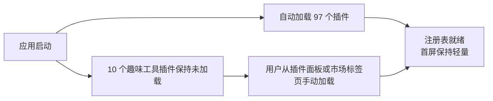

内置注册表的每条记录声明 manifest、`autoload` 标志与动态 `import()` 加载器：模块代码只在加载该插件时才拉取，未加载的插件只占一条 manifest 记录。

### 3.5 第三方包（.cspkg）、沙箱与签名

`.cspkg` 包是包含 `manifest.json`、入口模块与资源的 ZIP 压缩包（fflate 打包）。加载前先做清单校验（`src/core/cspkg.ts`）：必填字段、插件 id 格式、入口路径必须是包内相对路径（拒绝 `..`、绝对路径与盘符）与沙箱枚举；归档键名会归一化，路径穿越键与绝对路径键被丢弃，压缩包超大在解压前即被拒绝（防 zip 炸弹）。清单声明 `sandbox` 字段：

```jsonc
{
  "id": "com.example.analyzer",
  "name": "Analyzer",
  "version": "1.2.0",
  "author": "Example Corp",
  "description": "…",
  "entry": "dist/index.js",
  "sandbox": "isolated",        // "isolated"（默认）| "trusted"
  "formats": [{ "extension": ".dat" }]
}
```

- **isolated（默认）**：入口代码运行在 Web Worker 内，拥有独立全局作用域，无法访问宿主页面的全局变量、DOM 与状态库；画布渲染通过转移的 OffscreenCanvas 完成，宿主与 Worker 之间只走类型化 RPC 协议（`src/core/sandbox.ts` 与 `src/core/plugin-worker.ts`）。
- **trusted**：在宿主上下文中执行，拥有完整 DOM 访问权，仅建议用于自研包。

第三方插件加载与通信流程：

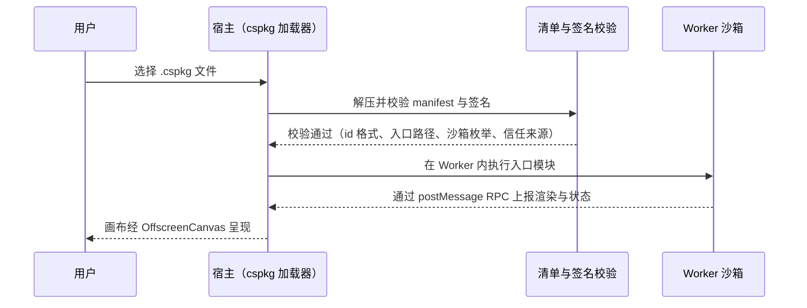

#### 3.5.1 包签名与信任注册表

签名能力回答"**这个包是谁发布的**"，与沙箱回答的"**它运行时能做什么**"互相独立——合法签名不会削弱沙箱隔离。

| 环节 | 实现 |
| --- | --- |
| 算法 | Ed25519（RFC 8032）与 SHA-256（FIPS 180-4），纯 TypeScript 在 BigInt 上自实现，不依赖 WebCrypto（各浏览器与 Node 对 Ed25519 支持不齐） |
| 签名载荷 | 规范化后的包载荷：manifest 递归排序键、去空白、丢弃 undefined 的稳定 JSON 加入口字节；签名 CLI 与浏览器校验端字节级一致 |
| 指纹 | `ed25519:<hex32>`——公钥 SHA-256 的前 16 字节 |
| 信任模型 | `verifyPackageSignature` 返回结构化结果，结论含 `unsigned` / `untrusted-key` / 通过三类；未签名包默认拒绝，未知密钥的合法签名提示用户核对指纹后显式信任 |
| 信任注册表 | 内置官方公钥常量 `OFFICIAL_TRUSTED_KEYS`，用户新增的受信密钥经 `storage.ts` 持久化，IndexedDB 不可用时优雅降级 |
| 工具链 | `node scripts/sign-cspkg.mjs --genkey <keyfile>` 生成密钥对；`<package-dir> --key <keyfile>` 签名产出 .cspkg；`--verify <file.cspkg> [--trust <keyfile>]` 复验 |

已知限制（如实记录）：Worker 与页面共享同源的 IndexedDB；当 Worker 不可用时的遗留回退方案（`new Function` 加遮蔽全局变量）只是尽力而为的近似，并非安全边界，回退启用时界面会明确告警。

### 3.6 文件路由与示例数据

用户把任意文件拖入中央区或插件列表时，宿主按魔数与扩展名（可选 WASM 辅助检测）识别格式并路由到匹配插件：

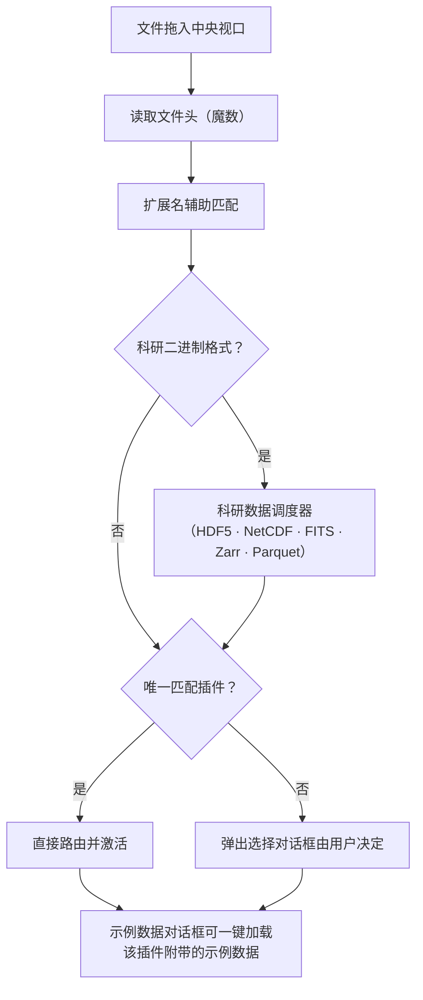

导入对话框本身也按文件格式过滤，未识别的文件不会进入解析器。大文件在进入解析前会先经 `src/core/chunked/` 的行窗口读取与内容指纹，配合 `parse-worker.ts` 与 `worker-pool.ts` 把解析放到 Worker 池中执行，避免阻塞主线程。

示例数据经 `examples` 模块统一注册（`src/core/examples.ts` 的 `BUILTIN_EXAMPLES`，每条记录把示例文件映射到插件 id）并在顶部栏"示例数据"对话框中按插件展示；`examples/data/` 含 138 个数据文件，`examples/projects/` 含 11 个 `.clproj` 示例项目，`examples/code/` 含 9 个 Python 示例程序。内容指纹（`citation.ts` 与存储层共用）让同一份数据的重复导入可被识别与复用。

## 第四章 四大工作模式

### 4.1 标准模式

默认落地体验。工作台为模块化外壳：顶栏（品牌与项目下拉、四模式切换、数据与科研入口）、左侧活动栏在文件、Git 与插件三个视图间切换（侧栏可调宽、可收起）、中央标签区（激活插件画布、文件预览、按文件分派的编辑器与内嵌科研工具以标签页共存，首次启动为拖放区）、右侧参数面板（把激活插件声明的参数转成响应式表单），状态栏常驻显示 GPU 可用性与性能指标。文件拖入后由宿主按魔数与扩展名路由，多插件匹配时弹选择框。

顶栏动作按语义分簇，以分隔线区隔：项目名下拉（上半区切换最近项目，下半区集中新建 / 打开 / 打开文件夹 / 重命名 / 另存为 / 删除 / 导出日志）、`[标准 | 流程 | 积木 | 代码]` 模式开关（旁有 IR 同步状态点）、`[数据 | 示例]` 数据簇（数据按钮带项目文件数徽标）、`[保存 | 分享]` 项目簇、`[分析 | 科研▾]` 科研簇（科研启动器按学科分组列出 25 个启动网格工具，支持搜索过滤与最近使用，见 05 篇）、右侧全局图标簇（命令面板、快捷键、AI 助手、引导、性能、语言、主题，窄屏折叠进 ⋯ 溢出菜单）。

适合"我已经知道哪个插件能回答我的问题，只想把文件指给它"的场景。


*标准模式：模块化外壳工作台，中央标签区承载插件画布、文件预览与编辑器，右侧参数面板实时联动，是默认探索入口。*

### 4.2 流程模式（Flow）

可视化数据流管线编辑器。左侧调色板、中间画布（节点加边）、右侧参数编辑器、底部结果预览。整个图持久化为工作区文件 `.flow.json`（`{ version, kind: 'ergalics-flow', graph }`，经 `src/core/vfs/` 写入），由文件资源管理器的流程编辑器打开，旧的 `blockGraph` 项目字段仍兼容读取，并共享 `.clproj` 的自动保存与分享管线。

#### 4.2.1 区块目录（38 个内置区块）

| 类别 | 数量 | 区块 |
| --- | --- | --- |
| 数据源 source | 4 | 示例数据、随机数据生成、网格生成、文件加载 |
| 变换 transform | 5 | 列选取、列重命名、新增列、归一化、排序 |
| 过滤 filter | 3 | 数值范围过滤、条件值过滤、Top-K 选取 |
| 数学 math | 6 | 加、减、乘、除（列对列或列对标量）、平方根、绝对值 |
| 统计 stats | 14 | 摘要统计、直方图分箱、单样本 / 独立双样本 / 配对 t 检验、单因素方差分析、Mann-Whitney U 检验、卡方独立性检验、相关分析、Cohen's d 效应量、多重比较校正、Bootstrap、蒙特卡洛传播、MCMC 采样 |
| 单位 units | 2 | 量纲换算（units.convert）、量纲一致性检查（units.check） |
| 可视化 viz | 4 | 散点、折线、直方图、二维点云（经渲染桥接走插件出图） |
| 绘图 plot | 4 | 折线、散点、直方图、柱状（出版级绘图引擎渲染） |

`viz.*` 与 `plot.*` 的分工是刻意的：`viz.*` 把 `RenderedView` 交给**插件渲染器**，与标准模式看到的是同一个插件；`plot.*` 走 `src/core/plot/` 的**纯 TS 矢量引擎**，产出可直接导出 SVG / PDF 的出版级图。数学与统计区块直接调用 `src/core/stats` 与 `src/core/units` 的纯函数实现（详见 07 篇）；区块元数据（名称、描述）内建中英双语，经 `src/blocks/l10n.ts` 统一解析，新增语言是纯数据改动。

控制流区块（if/else、repeat、parallel）刻意推迟——`BlockInstance` 上的 `region` 接缝已就位，后续可作为扩展嵌入而非重构。

#### 4.2.2 编译器与执行器

编译器是一个纯函数：结构校验（端口匹配、必需输入、类型兼容）、环检测、Kahn 式拓扑排序，错误以结构化 `diagnostics` 返回，画布据此绘制红色边与内联诊断条，全程不抛异常。

执行器带节点级增量缓存与脏值传播失效：修改单个区块的参数，只有它及其下游会重新执行。运行支持取消与并发去重——重复触发运行不会产生并行执行，取消会真正终止进行中的计算节点。

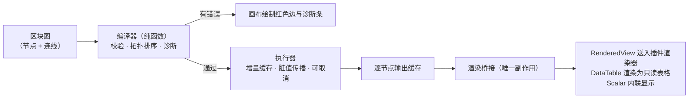

#### 4.2.3 结果预览

底部预览随所选节点输出类型自适应：`RenderedView` 走既有插件渲染器（散点、直方图等）；`plot.*` 区块产出的 `svg-plot` 矢量视图以独立 SVG 就地渲染，可直接导出 SVG / PDF；`DataTable` 输出（如 `stats.summary`、`stats.histogram` 的分箱结果）渲染为只读表格，使非可视化输出也看得见；`Scalar` 内联显示。管线有多个输出时由芯片切换器选择检视节点。


*流程模式：以 DAG 管线连接数据源 / 变换 / 统计 / 可视化区块，编译后增量执行、就地预览。*

#### 4.2.4 示例管线

8 个流程示例项目以真实 `.clproj` 文件存放在 `examples/projects`（同目录另有 3 个插件演示项目，见 01 篇），构建期经 `import.meta.glob` 自动发现，新增示例只需放入文件并在元数据表登记：

| 示例 | 主题 |
| --- | --- |
| block-01-signal-analysis | 信号分析 |
| block-02-random-distribution | 随机分布 |
| block-03-grid-scatter | 网格散点 |
| block-04-range-filter | 范围过滤 |
| block-05-dual-pipeline | 双管线对比 |
| block-06-topk-pipeline | Top-K 选取 |
| block-07-binning-stats | 分箱统计 |
| block-08-normalize-grid | 归一化网格 |
| crystal-lattice-demo | 晶格演示 |
| particles-demo | 粒子演示 |
| point-cloud-demo | 点云演示 |

全部 8 个流程示例都通过共享 IR 解释器执行，并由 `examples-roundtrip` 单元测试逐一验证。

### 4.3 积木模式（Blockly）

类 Scratch 的积木编辑器，面向学习者与想要命令式体验的用户。唯一执行入口是绿色"运行时"帽子区块，帽子下方未连接的孤立区块永不运行，从根本上杜绝"误执行破损代码"。40 种内置积木按十个类别组织：

| 类别 | 积木 |
| --- | --- |
| 开始 | 运行时帽子区块（唯一入口） |
| 数据 | 载入 CSV、载入 XYZ、随机数、范围、列表、列表取值 |
| 变量 | 赋值与读取 |
| 运算符 | 数字 / 文本 / 布尔 / 空值字面量、算术、比较、逻辑、一元 |
| 变换 | 归一化、排序、列选取、过滤、添加列 |
| 统计 | 摘要、直方图 |
| 绘图 | 散点、折线、直方图、点云 |
| 控制流 | 如果、重复、当循环、遍历、跳出、继续 |
| 函数 | 定义、返回、调用 |
| 工具 | 打印、原始文本 |


*积木模式：类 Scratch 画布以帽子区块启动脚本，积木拼图编译为共享 IR 执行。*

技术要点：

- Blockly 13 驱动画布，包为懒加载分包（约 828 KB），不影响标准与流程模式首屏；媒体资源同源 vendoring，不依赖 CDN。
- 区块名称、提示、下拉选项与工具箱类别经 Blockly 的 `BKY_*` 键系统本地化，切换语言时以重新标注的积木重建工作区，有专门单元测试（`tests/editor/block-i18n.test.ts`）验证。
- 运行按钮提供实时结果预览、变量面板与控制台面板三张卡片。
- 5 个内置示例程序（星系散点图、温度折线图、随机数直方图、标准化后散点、循环打招呼）位于 `src/editor/block/samples.ts`，经顶栏"示例"对话框加载。
- 积木图编译为共享 IR 后由内置解释器执行，解释器调用与代码模式相同的 Studio API。

### 4.4 代码模式（Monaco · Python / R / JavaScript）

真正的脚本编辑器。工具栏提供 **Python / R / JS** 分段语言开关与一个引擎徽标，明示当前缓冲区将由谁执行。

| 语言 | 执行引擎 | 说明 |
| --- | --- | --- |
| Python | Pyodide Web Worker 中的完整 CPython | 自由语法（推导式、f-string、可导入包），`studio` 作为正经可导入模块注入，支持 REPL 单表达式求值 |
| R | vendored webR 0.6.0 运行时（`public/webr/`，资源缺失时回退 IR 引擎） | 优先由真实 R 解释器执行；webR 资源缺失或 `studio.*` 桥接降级时回退到共享 IR 引擎；`<-` 赋值 |
| JavaScript | 进程内 IR 引擎 | 缓冲区解析为共享 IR，由与积木模式相同的解释器执行；`const/let/var` 声明 |

公共能力：

| 能力 | 行为 |
| --- | --- |
| studio 接口跨语言一致 | `load / random / range / exampleData / grid / normalize / sort / select / addColumn / addConstantColumn / filter / filterRange / topK / renameColumn / summary / histogram / plot / print / notify / getParam / setParam`。`studio.plot(...)` 经渲染桥接落到与流程模式 `viz.*` 区块完全相同的插件 |
| 一键语言互译 | 切换语言标签时弹出"语言切换预览"悬浮对话框，以内置 Monaco 编辑器呈现可编辑的参考翻译：可直接修改译文后点"应用"换入新语言，或点"放弃并清空"从空白开始，或"取消"留在原语言；放弃清空后出现一条"撤销清空"提示条，一键恢复切换前的代码。切换流程带防清空守卫——翻译结果为空时绝不静默清空非空缓冲区，只有显式"放弃并清空"经一次性放行标记真正清空 |
| 中断 | 停止运行会终止并重启 Worker，失控循环不会卡死页面；Worker 的引导地址与引导 Promise 做了记忆化，重启不重复初始化 |
| 快捷键 | `Ctrl/⌘ + Enter` 运行缓冲区（并停止进行中的 Python 任务）；键盘输入防抖 150 ms 后同步回 IR，使积木与流程在打字过程中保持实时 |
| DSL 边界显式化 | R / JS 解析器无法建模的语句保留为原始代码节点，运行时跳过并在控制台报告一次计数；完整语法随时在 Python 标签页可用 |

| 方法 | 说明 |
| --- | --- |
| load | 装载项目数据文件为表格 |
| random / range / exampleData / grid | 生成随机数、整数序列、内置示例与网格数据 |
| normalize / sort / select / addColumn / addConstantColumn / filter / filterRange / topK / renameColumn | 表格变换 |
| summary / histogram | 摘要统计与分箱 |
| plot | 绘图（经渲染桥接走插件渲染器） |
| print / notify | 控制台输出与通知 |
| getParam / setParam | 项目参数读写 |

9 个示例程序以真实文件存放在 `examples/code`（EDA 管线、蒙特卡洛估圆、信号分析、遥测探索、星系散点、随机直方图、范围循环、添加列绘图、归一化过滤），经"示例"对话框加载。


*代码模式：Monaco 编辑器 + 控制台 / 变量面板，Python 运行于 Pyodide Worker，注入 `studio` 模块。*

### 4.5 三模式互转（共享 IR）

IR（`src/editor/ir`，含校验、哈希与序列化）是积木、流程、代码三种模式的唯一事实来源，各模式与 IR 之间都有纯函数往返转换：

| 转换 | 模块 |
| --- | --- |
| IR 与流程 DAG 互转 | `src/editor/flow/convert.ts`（irToFlow、flowToIR，Kahn 拓扑排序，参数与区块目录 1:1 对齐） |
| Blockly JSON 与 IR 互转 | `src/editor/block/convert.ts` |
| 代码缓冲区解析回 IR | `src/editor/code/parse.ts`（无法解析的行保留为原始代码节点） |
| IR 生成代码 | `src/editor/codegen`（Python、R、JS 三个生成器） |
| IR 直接解释执行 | `src/editor/runtime/interpreter.ts`（调用与流程区块相同的 Studio API） |

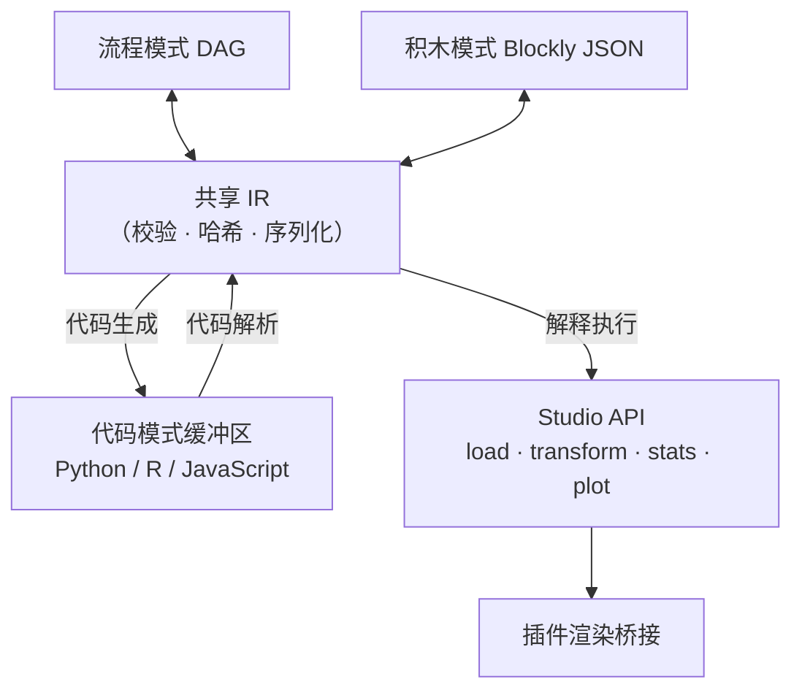

在流程模式搭一条管线，切到积木就能看到同样的逻辑以积木呈现，跳到代码就能看到生成的 Python；反向亦然。流程编辑会**合并**进 IR 而不是把它拍平（`mergeFlowIR`）：print / loop / if / function 语句留在原位，只替换 DAG 节点；`src/stores/useFlowSync.ts` 中的图签名守卫会忽略注水产生的防抖回声，使反复切换模式不会丢失节点。

代码生成器按目标语言处理方言差异：Python 生成器输出真实 Python 语法，R 生成器处理 R 的语法习惯（循环写法、真值字面量、整除与逻辑运算符等），JS 生成器输出可直接求值的脚本。

往返一致性由 `sync-threeway`、`flow-convert`、`editorStore`、`examples-roundtrip` 与 `roundtrip-all-langs`（Python / R / JavaScript 三语言自由往返）等单元测试钉住，并由 `verify-lang-modes` 端到端套件做真实浏览器的 R/JS 编辑、R→JS 互译、Flow ⇄ Block ⇄ Code 无损循环与真实管线运行验证。

## 第五章 科研工具集

### 5.1 统一注册表

`src/pages/research/toolRegistry.ts` 是工具集的**唯一事实来源**：每个独立科研界面在这里声明一次，由 `/studio` 路由、顶栏启动器与欢迎页启动网格三处共同消费。新增一个工具的成本是"注册表加一条记录 + i18n 加标题与描述两个键"，不需要改动路由、导航或启动器。

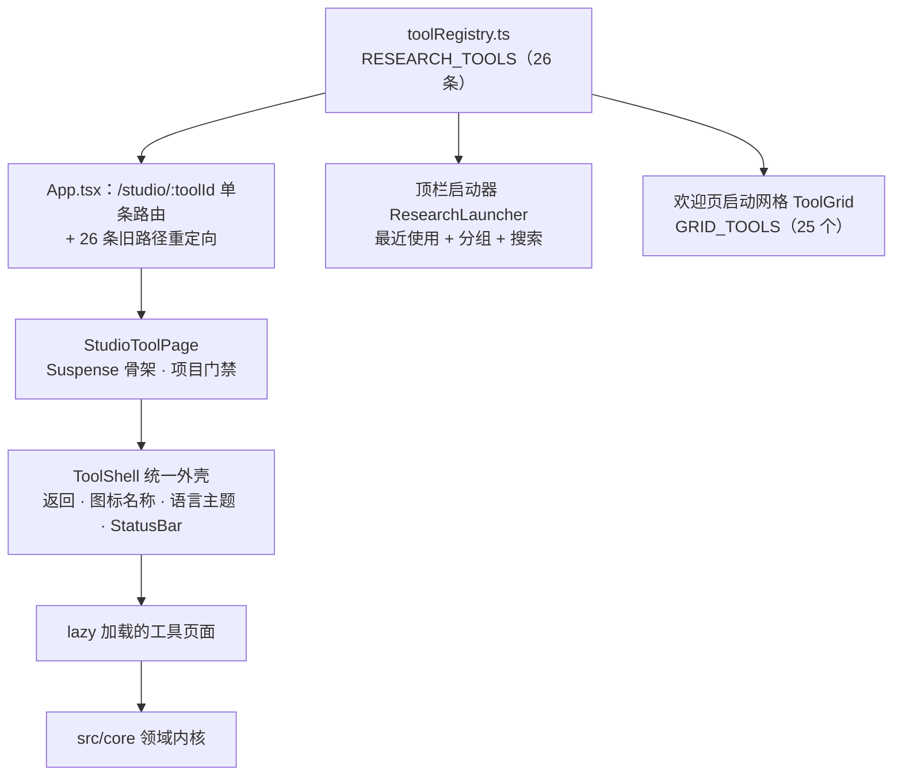

`ResearchTool` 记录的字段：

| 字段 | 含义 |
| --- | --- |
| `id` | 稳定标识，同时是 `/studio/<id>` 的路径段 |
| `path` | 规范路由 `/studio/<id>`，由 id 推导 |
| `legacyPath` | 改造前的 hash 路径（默认 `/<id>`），作为客户端重定向保留，使旧书签不失效 |
| `icon` | `ToolIconKind` 图标种类 |
| `titleKey` / `descKey` | i18n 键；描述默认取 `tool.<id>.desc` |
| `group` | 六个学科分组之一 |
| `inGrid` | 是否出现在欢迎页启动网格与顶栏启动器（默认是） |
| `requireProject` | 无激活项目时是否渲染 `EmptyProject` 门禁页（默认否） |
| `component` | `React.lazy` 包装的页面组件，每个工具一个独立分包 |

配套导出：`GRID_GROUPS`（六个分组的显示顺序）、`GRID_TOOLS`（入网格的子集，26 减 1 为 **25** 个）、`getTool(id)`、`TOOLS_BY_LEGACY_PATH` 与 `openToolEmbedded`（把工具嵌入工作台标准模式中央画布打开：切换到标准模式、在 appStore 记录嵌入工具 id，再视需要导航到 `/workbench`）。

**路由**。`App.tsx` 只声明 6 条显式路由：`/`（欢迎页）、`/workbench`（工作台）、`/studio/:toolId`（全部科研工具）、`/settings`、`/plugin/:pluginId`、`/share/:payload`，其余一律回落到欢迎页。26 条旧路径的重定向由 `RESEARCH_TOOLS` 在模块加载时**自动生成**，因此数量永远与注册表一致，不存在手工维护的重定向表。应用使用 `HashRouter`，因此深度链接形如 `#/studio/uncertainty`。

**项目门禁**。`StudioToolPage` 承担三件事：为懒加载页面提供 `Suspense` 骨架；深度链接或冷启动时**一次性**恢复最近项目（与工作台行为一致）；对声明了 `requireProject` 的工具，在项目未激活时渲染 `EmptyProject`（明示的"新建 / 打开"动作）而不是自动创建一个空项目——避免用户在深链接进入时莫名其妙多出一个空项目。未知的 `toolId` 渲染 `EmptyState`（"工具不存在"），而不是白屏或抛错。

**外壳**。所有工具页共用 `ToolShell`：顶部是返回工作台、工具图标与名称（右侧可挂工具自己的动作区），以及设置、语言与主题切换；主体是工具自己的内容区（居中列、页面级滚动）；底部是工作台同一个 `StatusBar`，常驻显示 GPU / WASM / 存储状态与帧率。嵌入工作台中央区的标签页由路由判定，只渲染工具主体与一条精简动作栏（顶栏与状态栏由工作台提供），体验一致。访问工具页本身会计入"最近使用"，供启动器排序。

### 5.2 六个分组的 26 个工具

分组按学科划分，互斥且穷尽。下表是注册表中的完整清单（名称与用途取自实际发布的中文 i18n 文案）：

| 分组 | 工具 id | 名称 | 路由 | 用途 | 需项目 |
| --- | --- | --- | --- | --- | --- |
| **测量与评估**（2） | `uncertainty` | 不确定性套件 | `/studio/uncertainty` | Bootstrap / 蒙特卡洛传播 / MCMC 置信区间与收敛诊断 | |
| | `profiler` | 数据画像 | `/studio/profiler` | 列剖析、相关矩阵、质量分与问题清单 | |
| **建模与推断**（4） | `model-lab` | 模型工作台 | `/studio/model-lab` | OLS / 逻辑 / 岭 / 多项式回归 + 系数表 + 残差诊断 | |
| | `inference` | 贝叶斯推断 | `/studio/inference` | HMC/NUTS 贝叶斯推断 + WAIC/LOO/PPC | |
| | `model-inference` | 模型推理 | `/studio/model-inference` | ONNX 模型浏览器内 WebGPU 推理 | |
| | `sweeps` | 参数扫描 | `/studio/sweeps` | 网格 / 列表 / 拉丁超立方扫描 + 响应面 | ● |
| **数据与谱系**（6） | `sql` | SQL 数据工作台 | `/studio/sql` | 直接对项目数据文件运行 DuckDB-WASM SQL | ● |
| | `lineage` | 数据血缘 | `/studio/lineage` | 文件 → 运行的 DAG 血缘图谱 | |
| | `figures` | 图表工作台 | `/studio/figures` | Figure Studio 多面板出版级图组 | ● |
| | `analysis` | 数据分析 | `/studio/analysis` | 快速图表 + 描述统计 + t / Mann–Whitney 检验 | |
| | `cleaning` | 数据清洗向导 | `/studio/cleaning` | 分步引导完成表格数据的转换、清洗与去重 | ● |
| | `files` | 文件资源管理器 | `/studio/files` | 浏览项目工作区 VFS 的目录与文件内容 | ● |
| **信号与记录**（3） | `signal` | 信号实验室 | `/studio/signal` | FFT / Welch PSD / 窗函数 / Savitzky–Golay / ACF-PACF / 季节分解 | ● |
| | `notebook` | Notebook | `/studio/notebook` | Markdown + Python 单元的可复现实验记录 | ● |
| | `runs` | 实验记录 | `/studio/runs` | 运行历史台账、自动记录与 A/B 对比 | |
| **报告与复现**（5） | `report` | 报告生成器 | `/studio/report` | 叙事 + 图 + 表 + 交互筛选 → 自包含 HTML | ● |
| | `reprolock` | 可复现锁 | `/studio/reprolock` | repro.lock 导入导出 + 漂移检查 + 一键复现 | |
| | `supplement` | 补充材料打包 | `/studio/supplement` | 论文附件 ZIP：manifest + runs + 血缘 + 数据/代码 + 可选 repro.lock | |
| | `course` | 课程模式 | `/studio/course` | 布置作业、收集与离线批改 | ● |
| | `gallery` | 作品画廊 | `/studio/gallery` | 浏览并重新打开可复现作品 | |
| **工具箱**（6） | `unit-convert` | 单位换算 | `/studio/unit-convert` | 常见物理量纲的单位换算 | |
| | `calc` | 计算器 | `/studio/calc` | 科学计算器 | |
| | `format-convert` | 格式转换 | `/studio/format-convert` | 数据文件格式互转 | |
| | `sigfig` | 有效数字 | `/studio/sigfig` | 有效数字修约与表示 | |
| | `molar-mass` | 摩尔质量 | `/studio/molar-mass` | 化学式摩尔质量计算 | |
| | `quick-stats` | 快速统计 | `/studio/quick-stats` | 粘贴即算的描述统计 | |

合计：测量与评估 2 + 建模与推断 4 + 数据与谱系 6 + 信号与记录 3 + 报告与复现 5 + 工具箱 6 = **26**。其中 9 个绑定项目（`sweeps`、`sql`、`figures`、`signal`、`notebook`、`report`、`course`、`cleaning`、`files`），`analysis` 不进入启动网格（`inGrid: false`），因为它同时由工作台顶栏的独立按钮发起，避免同一入口出现两次。工具箱 6 个均无需项目。

#### 5.2.1 测量与评估

- **不确定性套件（`uncertainty`）**——把"这个数字有多确定"变成可计算的对象。提供 Bootstrap 置信区间、蒙特卡洛传播与 MCMC 采样三条路径，并给出 R-hat、有效样本量 ESS、HDI 与 MCSE 等收敛诊断；样本量足够大时自动切到 WGSL GPU 引擎（每链一个 workgroup），未达阈值或设备不可用时回落到 CPU，两条路径在同一随机数序列下结果在数值容差内一致（内核细节见 07 篇）。


*不确定性套件以 Bootstrap 重采样给出分位数置信区间，配合蒙特卡洛传播与 MCMC，输出 HDI、R-hat、ESS 与 MCSE 等收敛诊断。*

- **数据画像（`profiler`）**——数据体检。流式单遍计算：数值列用 Welford 递推求精确均值与方差、蓄水池采样求分位数与 MAD，并以修正 z 分数标记离群；文本列用 HyperLogLog 估计基数、Space-Saving 求 Top-K；表级给出 Pearson / Spearman 相关与重复率，最终综合成 0–100 的确定性质量分与问题清单，按内容指纹缓存以支持重复打开。


*数据画像对一份 CSV 生成相关矩阵、列级直方图与缺失统计，并综合成 0–100 的确定性质量分与问题清单。*

#### 5.2.2 建模与推断

- **模型工作台（`model-lab`）**——拟合与诊断。支持普通最小二乘（Householder QR）、逻辑回归（IRLS）、岭回归（K 折交叉验证选参）与多项式拟合，产出含估计值、标准误、p 值与置信区间的系数表，并附 2×2 残差诊断图（残差-拟合、QQ、尺度-位置、残差-杠杆），支持多模型横向对比。


*模型工作台拟合线性模型并附 2×2 残差诊断图（残差-拟合、QQ、尺度-位置、残差-杠杆），系数表含估计值、标准误、p 值与置信区间。*

- **贝叶斯推断（`inference`）**——Inference Forge。HMC / NUTS 采样器（NUTS 带 U 形回旋判据与 Dual Averaging 步长自适应，无须手工设步数）、声明式似然模板配数据尺度化的弱先验、R-hat 与 bulk / tail-ESS 等后验诊断，以及 WAIC 与 PSIS-LOO 模型比较。


*Inference Forge 在浏览器内（WebAssembly）跑 NUTS 采样，并把收敛情况讲完整：后验摘要给出 94% HDI、MCSE、R-hat 与 ESS，另有逐链诊断、WAIC / PSIS-LOO 模型比较、后验预测检验，以及轨迹图与后验密度图。*

- **模型推理（`model-inference`）**——把已训练好的模型搬进浏览器：用 WebGPU 运行 ONNX 模型并查看推理结果，适合"模型在别处训练、结论要在这里复现"的场景。

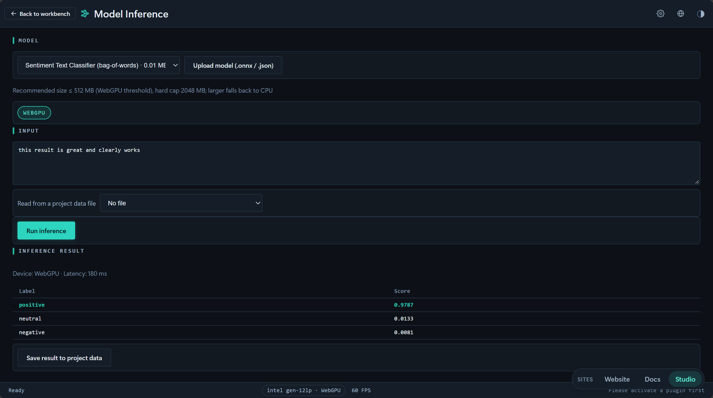

*模型推理在浏览器内用 WebGPU 运行 ONNX 情感分类模型，逐样本给出预测、置信度与端到端延迟。*

- **参数扫描（`sweeps`）**——`expandPlan` 把扫描计划展开为确定性设计点：全网格 / 列表轴走完整笛卡尔积，全拉丁超立方轴按维度分层抽样；混合 lhs 与 grid 的方案被显式拒绝，因为样本量此时没有无歧义的定义。执行后可看响应面。


*参数扫描把扫描计划展开为确定性设计点（全网格 / 拉丁超立方按维度分层抽样），执行后可查看响应面。*

#### 5.2.3 数据与谱系

- **SQL 数据工作台（`sql`）**——DuckDB-WASM 引擎，首次使用时懒加载；项目数据文件注册进 DuckDB 虚拟文件系统并直接暴露为表，因此可以对 `.clproj` 里的文件写 SQL。查询支持超时与 `AbortSignal`，中止或超时会终止 Worker 并丢弃单例，下次调用重建实例——一次跑疯的查询不会拖垮整个页面。
- **数据血缘（`lineage`）**——以运行记录上的文件 id 把项目文件（源）连到运行（变换），绘制成 Sugiyama 式分层 DAG（最长路径分层、单趟重心排序、行居中）。领域层无 React / store / DOM 依赖，画布可独立测试。
- **图表工作台（`figures`）**——出版级组图。`FigureSpec` 是挂在期刊模板网格（IEEE / Elsevier 栏宽、色盲友好调色板）上的多面板容器，`composeFigure` 渲染为单张独立 SVG（嵌套面板 viewport 加 a / b / c 面板标签），`exportFigure` 处理 SVG / PDF / PNG-600dpi 下载。组图只重新定尺寸，绝不修改原 `PlotSpec`。


*图表工作台在 IEEE 单栏模板上排一张 2×3 的特征值模式场组图：逐面板布局、统一色标、投稿前检查，以及 SVG / PDF / 600dpi PNG 导出。*

- **数据分析（`analysis`）**——假设检验、相关性与基础统计分析的常规入口：t 检验族、单因素方差分析、Mann-Whitney U、卡方独立性检验、Cohen's d 效应量，以及 Bonferroni 与 Benjamini-Hochberg 多重比较校正；结果可直接转写成中英双语的出版级句子。
- **数据清洗向导（`cleaning`）**——分步引导。步骤模型是五类可序列化操作：类型转换、缺失值策略（删除 / 均值 / 中位数 / 零 / 前向填充）、离群标注（IQR / z 分数）、去重、列重命名。每一步永不改写输入表，因此可以逐步前进、回退、跳转或"撤销该步"；质量侧的期望契约由 `data-quality` 提供（见 07 篇）。


*数据清洗向导以分步卡片引导完成类型转换、缺失值处理、去重与列重命名，每一步预览前后差异且不改写原表。*

- **文件资源管理器（`files`）**——回答"我的运行记录、图表和脚本到底存在哪"。页面经免 Git 的 VFS（`src/core/vfs/`）直接浏览项目工作区：左侧按目录懒加载的文件树，右侧对 UTF-8 文本（md / txt / json / csv / 代码等）做预览并支持下载，其余按二进制处理；页面另附标准项目骨架的静态目录指南（`project.clproj`、`runs/`、`figures/`、`data/`、`code/`、`manuscript/`、`.ergalics/`、`.git/` 等），每类目录带一行说明。

#### 5.2.4 信号与记录

- **信号实验室（`signal`）**——频谱、滤波与时域处理。基 2 FFT 与幅值谱（与 GPU 端 `fftKernelWGSL` 数学一致）、Hann / Hamming / Blackman 等窗函数、Welch 功率谱、Savitzky-Golay 平滑与滑动平均、自相关 ACF 与偏自相关 PACF，以及经典加性时序分解 x = 趋势 + 季节 + 残差。滤波后的列可作为派生文件保存回项目，并自动进入血缘图。


*信号实验室对加速度时序做频谱分析：Welch PSD（矩形窗、nfft=256、7 段）主峰落在约 0.02 Hz 并伴谐波，支持 FFT 幅值谱 / 窗函数 / 滤波与时域处理，可将图表发送到 Figure Studio 或存回项目文件。*

- **Notebook（`notebook`）**——Markdown 与 Python 单元混排的可复现实验记录，执行走代码模式同一个 Pyodide 运行时，因此 notebook 与脚本看到的是同一个 `studio` API；单元列表持久化在 `project.state.notebook`。
- **实验记录（`runs`）**——全工具的运行台账。流程、积木、代码、笔记本、扫描、不确定度、建模、推断的每一次执行都会自动留下耐久快照（参数、指标、耗时、来源），支持指标差异与成对 A/B 对比。记录存于 IndexedDB 的 `runs` 存储而**不**写进 `.clproj`，使项目文件保持小巧，并随项目删除一并清理。

#### 5.2.5 报告与复现

- **报告生成器（`report`）**——`buildReport` 把有序章节（标题、Markdown、图表工作台的图、数据表、运行摘要、交互筛选器）构建成**单一自包含 HTML**：内联 CSS、内联 SVG、内联 JSON 数据与零依赖原生 JS 控制器。所有用户字符串先转义，内嵌 JSON 以 `<script type="application/json">` 输出并把 `<` 做 unicode 转义，杜绝 `</script>` 载荷逃逸——报告可以安全地直接投递给他人。


*报告生成器把标题、图表工作台的组图、数据表与运行摘要构建成单一自包含 HTML，零依赖控制器，可安全投递。*

- **可复现锁（`reprolock`）**——导出与校验 `repro.lock`：数据指纹、参数哈希、种子与代码快照，支持五类漂移判定与一键重跑；环境快照（版本、平台与内核可用性）一并纳入锁文件，使"漂移发生在数据还是环境"有明确答案。


*可复现锁校验数据指纹、参数哈希、种子与代码快照并纳入环境快照，给出漂移发生在数据还是环境的判定。*

- **补充材料打包（`supplement`）**——`manifest.json`（项目元数据、运行记录、血缘图、作者与许可表单）加可选的原始数据文件与代码会话、可选的 repro.lock，用 fflate 打成研究者随论文一起上传的 ZIP。

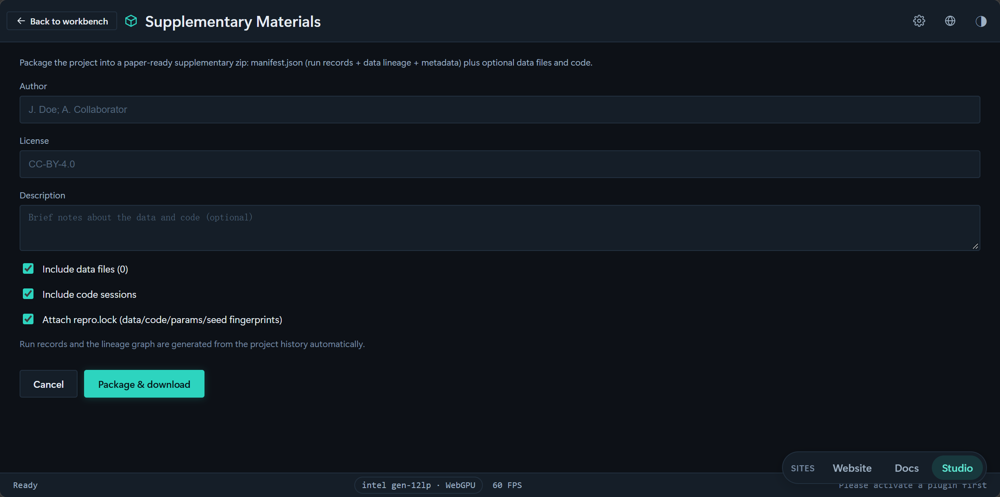

*补充材料打包把 manifest、原始数据与代码会话用 fflate 打成随论文上传的 ZIP。*

- **课程模式（`course`）**——本地优先的教学闭环：教师创建课程（由本地身份字符串标识，无账号体系）、发布绑定学科模板的作业；学生领取任务、在项目中作业并提交运行结果的 `repro.lock` 快照；教师查看学生 × 作业矩阵、记录评分与评语，并把整个班级按学生一目录导出为包。持久化在 IndexedDB `courses` 存储。


*课程模式以本地优先实现教师布置作业、学生提交 repro.lock 快照、教师批改并整班导出的教学闭环。*

- **作品画廊（`gallery`）**——本地"我的分享"存储（localStorage），记录分享出去的作品元数据与净化后的快照 HTML，使详情弹窗可离线重开。v1 不上传任何内容，下架只做标记（保留审计轨迹）并从所有列表过滤。


*作品画廊陈列按学科整理的可复现作品，每件标注主题与可复现锁状态（已锁定 / 检测到漂移 / 未锁定）以及作者与许可，便于发现与引用。*

#### 5.2.6 工具箱

六个轻量工具，均不依赖打开的项目，覆盖科研中的高频小操作：

- **单位换算（`unit-convert`）**——常见物理量纲间的单位换算，与全局单位系统（见第五章）同一套换算内核。
- **计算器（`calc`）**——科学计算器，支持表达式求值。
- **格式转换（`format-convert`）**——在支持的表格与科学数据格式之间互转。
- **有效数字（`sigfig`）**——按有效数字规则修约与表示数值。
- **摩尔质量（`molar-mass`）**——由化学式计算摩尔质量。
- **快速统计（`quick-stats`）**——粘贴一列数据即得均值、标准差等描述统计，并可一键进入不确定性套件做区间估计。

### 5.3 入口与导航

同一份注册表驱动多个入口，行为统一：

| 入口 | 行为 |
| --- | --- |
| 欢迎页启动网格（`/`，`ToolGrid`） | 按六个分组陈列 25 个工具卡片，附过滤框；搜索时分组被打平成一列。卡片点击即记录使用，并经 `openToolEmbedded` 嵌入工作台中央区打开 |
| 顶栏科研启动器（工作台顶栏的"科研▾"，`ResearchLauncher`） | 顶部是"最近使用"分组（最近 3 个，带角标），其下按学科分组列出全部工具；每项显示图标、名称与一行描述，使工具在打开前就能被识别；支持过滤输入与完整键盘导航。选择工具默认嵌入工作台中央区打开 |
| 命令面板与侧栏 | 命令面板与工作台侧栏同样消费注册表，选择后嵌入打开 |
| 旧路径重定向 | 改造前形如 `#/uncertainty` 的书签会被自动生成的重定向送到 `#/studio/uncertainty` |
| 独立整页 | 任意工具可经右侧面板的"独立页面打开"动作或 `/studio/<id>` 深度链接进入独立页，外壳与嵌入态一致 |

"最近使用"由 `src/core/recentTools.ts` 维护，存储在 localStorage（键 `ergalics:recent-tools`），最多保留 8 条、界面只展示前 3 条——留出余量是为了让裁剪永远不产生空位。

### 5.4 工具之间的流转

工具是分立的页面，但**不是孤岛**。它们通过三条共享通道协作，这也是把 26 项能力放在同一注册表下的实际意义：

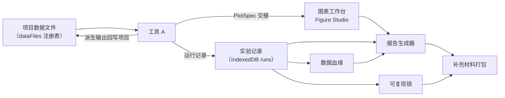

| 通道 | 机制 |
| --- | --- |
| 共享数据文件注册表 | `src/core/dataFiles.ts` 让项目自有文件、内置示例与代码模式的 `_FILES` 走同一套解析逻辑；`src/pages/research/researchUi.ts` 是这一层之上的薄胶水（无 React 依赖），负责"装载表格并识别数值列""把 PlotSpec 送进图表工作台""把派生输出组装成 CSV 存回项目"。因此数据清洗的结果能被信号实验室直接读取，滤波后的列又能被模型工作台拟合 |
| PlotSpec 交接 | 任何工具画出的图都是同一个 `PlotSpec` 数据结构，可以被图表工作台接收为组图的一个面板，从而复用期刊模板、面板标签与矢量导出；工作台里的科研级插件同样经"发送到 Figure Studio"把多面板图组推入图表工作台（见 03 篇） |
| 实验记录作为主干 | 每一次执行都进入 `experiment` 台账，血缘图据此把文件与运行连成 DAG，报告生成器再从中取运行摘要。科研工具集的"可复现"因此不是某几个功能，而是贯穿全部工具的一条数据流 |

### 5.5 配套内核

工具页之下是一组与具体工具解耦的领域内核（`src/core/`），供多个工具与插件复用：

- **单位系统（`units`）**——Quantity / convert / check 三件套：带量纲的数量构造、量纲安全的换算与单位一致性检查；单位换算工具与需要单位标注的插件共享同一实现。
- **分块读取（`chunked`）**——大文件的行窗口读取与内容指纹，为数据画像、清洗向导与文件路由提供不占满内存的摄取路径。
- **组图引擎（`figure`）**——`FigureSpec` 多面板容器挂在期刊模板网格上（`JOURNAL_TEMPLATES`：IEEE / Elsevier 单双栏尺寸、Okabe-Ito 色盲友好调色板、毫米级栏宽换算）；`composeFigure` 输出单张独立 SVG（嵌套逐面板 viewport + a/b/c 面板标签），`exportFigure` 处理 SVG / PDF / 600dpi PNG 下载；图表工作台另提供投稿前检查、双语 caption 起草与 3D 场图面板。组图只重新定尺寸，绝不修改原 `PlotSpec`。
- **运行 → 血缘 → 附件链条**——`experiment` 台账记录每次执行的参数、指标与耗时；`lineage` 以文件 id 把源与变换连成 DAG；`supplement` 把 manifest、运行记录、血缘、数据与代码打成论文附件 ZIP；`repro.lock` 漂移检查与一键复现贯穿其中。

### 5.6 小结

26 个工具覆盖了从数据入库到论文交付的完整链路：**测量与评估**回答"结果有多确定"，**建模与推断**回答"数据支持什么结论"，**数据与谱系**回答"数据从哪来、改过什么"，**信号与记录**回答"过程是否被完整记录"，**报告与复现**回答"别人能否原样重跑"，**工具箱**承接单位换算、修约与快查等高频小操作。它们共享同一个项目、同一批数据文件、同一组 `src/core` 内核与同一条插件渲染通路，因此从工作台切换到工具集（或反向）时，上下文零损耗。

每个工具背后的算法内核、依赖库与导出格式，见 07 篇《科学计算子系统》；工具的运行记录、血缘与复现链条如何被测试与门禁约束，见 08 篇《测试与质量保障》。

## 第六章 GPU 计算与原生核心

### 6.1 Rust 原生核心（源码交付）

`native/ergalics-core`（crate 版本 0.1.0，edition 2021，`crate-type = ["cdylib", "rlib"]`）编译目标为 `wasm32-unknown-unknown`，经 wasm-bindgen 0.2 绑定到 `src/native`。WebGPU 绑定依赖 web-sys 的实验性 GPU API 面（GpuAdapter、GpuDevice、GpuBuffer、GpuComputePipeline、GpuBindGroup 等约四十项 feature 显式开启）。依赖为 wasm-bindgen、wasm-bindgen-futures、js-sys、web-sys、console_error_panic_hook、serde 与 serde_json；release profile 开启 `lto`、`codegen-units = 1` 与 `opt-level = 3`。Rust 源码按职责分为五个模块：

| 源文件 | 职责 |
| --- | --- |
| lib.rs | 对外导出、版本查询（core_version）与初始化 |
| device.rs | GpuDeviceManager 与 GpuInfo：适配器与设备获取，`webgpu_available` 探测，带 CPU 回退选项 |
| buffer.rs | GpuBuffer：以显式 usage 掩码创建存储 / 只读 / 均匀缓冲，write 上传、read 经专用回读缓冲读回 |
| compute.rs | KernelDescriptor 与 BindingDescriptor、ComputeKernel 编译、绑定组物化与 dispatching，ComputeQueue 封装 |
| utils.rs | detect_file_kind 等辅助（基于魔数的文件类型检测）与日志 |

该 crate 以源码形式随仓库交付并可本地编译；它不参与生产环境的计算路径——随发行版构建生成的是占位模块（见第五节），实际计算由浏览器原生 WebGPU 承担。

### 6.2 宿主侧计算服务

`src/core/gpu.ts` 持有适配器与设备生命周期：`initGpu(mode)`（支持 `auto` 与 `cpu-fallback` 两种模式，带并发合并与 epoch 守卫，避免用户显式释放设备后被在途初始化覆盖）、`getGpuBackend` / `resetGpu` / `subscribeGpu`。后端状态 `GpuBackend` 包含可用性、适配器信息（vendor / architecture 等，经 `adapter.info` 读取）、设备引用、CPU 回退标志与显存不足（`oom`，由设备未捕获错误置位）跟踪。

其上的 `src/core/compute.ts` 是面向插件的计算面（即 `PluginApi.gpu`）：`createBuffer`、`write`、`read`、`compileKernel`、`compilationInfo` 与一次性 `run`。`getGpuCompute()` 依据设备可用性返回计算服务或 `null`——为 `null` 时插件回退 CPU 实现。执行路径经 `backend` 字段区分：原生 WebGPU 直连路径（`NativeCompute`，`backend = 'webgpu'`）直接以 `GPUDevice` 创建缓冲、编译 WGSL 管线并 dispatch，只读缓冲按 usage 分流 `mapAsync` 直映射或 `COPY_SRC → MAP_READ` 回读拷贝；当本地构建编译出真实原生模块时，`WasmCompute`（`backend = 'wasm'`）适配器以同一接口转发到 `src/native` 绑定。两条路径暴露完全相同的原语：

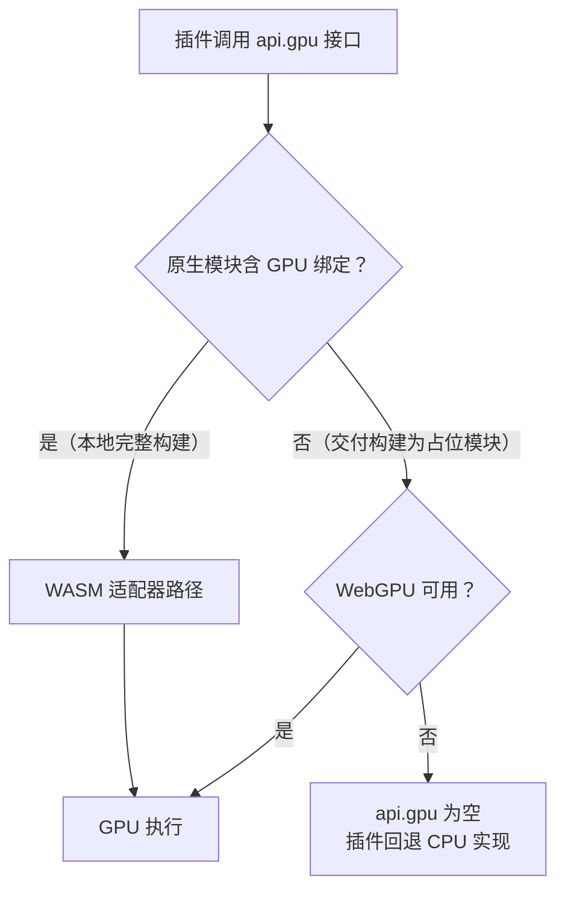

> 当 WebGPU 不可用时，`api.gpu` 为 `undefined`，插件回退到 CPU 实现——行为一致，不要求 GPU 存在。

这一设计保证开发与生产环境的加速计算均可用：浏览器原生 WebGPU 直连是交付构建的实际计算路径，而每个内置插件的 CPU 回退跑的是与 GPU 内核数学一致的实现。

### 6.3 可复用 WGSL 内核

`src/core/wgsl.ts` 收纳可复用的 WGSL 计算内核，并配套与内核数学一致的宿主侧打包 / 解包辅助函数供 CPU 回退使用（如 `packParticles` / `unpackParticles` / `advanceParticleCPU`、`packBodies` / `unpackBodies` / `advanceNBodyCPU` 与 `nbodyTotalEnergy`、`histogramCPU` 等）。当前共 **14 个内核**：

| 内核 | 数学内容 | 主要使用方 |
| --- | --- | --- |
| particleKernelWGSL | 交错式 [x, y, vx, vy] 单缓冲积分 | 粒子插件 |
| nbodyKernelWGSL | 三维全对引力 O(N²) 直接求和 | N-Body 引力插件 |
| histogramKernelWGSL | 分箱计数 + 对数刻度 | 直方图插件与统计区块 |
| heatmapKernelWGSL | 网格标量到颜色映射（viridis 停靠点） | 热力图插件 |
| pointCloudKernelWGSL | 点云投影与密度输出 | 点云插件、百万级点云增强 |
| fluidCollideKernelWGSL | D2Q9 格子 Boltzmann 碰撞 | 流体插件 |
| fluidStreamKernelWGSL | D2Q9 迁移 | 流体插件 |
| fluidCurlKernelWGSL | 涡量计算（涡街可视化） | 流体插件 |
| waveKernelWGSL | 二维波动方程 leapfrog 时间推进 | 波动方程插件 |
| matmulKernelWGSL | 分块矩阵乘法（TILE = 16） | 领域内核线性代数加速 |
| fftKernelWGSL | 按级迭代的基 2 FFT（最大 N = 4096） | 信号实验室 |
| kmeansKernelWGSL | K-means 指派与质心累加 | 数据画像与聚类 |
| binningKernelWGSL | 键值分箱聚合（sum / mean / count） | 分箱统计与扫描 |
| spmvKernelWGSL | 稀疏矩阵-向量乘（CSR 行式逐步） | 宿主侧稀疏线性代数内核库（暂无内置插件直接调用；em-eigensolver 改在 Pyodide 上以 NumPy 求解） |

两种典型的内核调用路径：

1. **单缓冲路径**（粒子演示）：上传交错式数据加均匀参数，dispatch WGSL 积分器，读回结果并上报真实 GPU 时间。
2. **乒乓缓冲路径**（N-Body、流体、波动方程演示）：成对缓冲交替读写，每个积分步完全留在设备上，无逐步回读开销。

以 N-Body 为例的逐步流程：


*N-Body 引力在 GPU 上的全对求和：数天体绕中心质量的三维引力轨迹，WGSL 内核计算并一次性读回交给 Three.js 渲染。*


*格子 Boltzmann 流体：WGSL 编译期推导 D2Q9 碰撞 / 流 / 涡量三内核并逐步计算，绕翼流场与卡门涡街清晰可见，小规模自动回退 CPU。*

#### 6.3.1 引擎选择与数据规模阈值

GPU 的收益来自算力，但上传与回读有固定开销，小规模数据在 GPU 上反而更慢。`src/core/gpu-kernels.ts` 因此提供统一分派层与一组数据规模阈值，`auto` 模式下低于阈值自动走 CPU：

| 内核 | 阈值单位 | 阈值 |
| --- | --- | --- |
| matmul | 输出元素数（m × n） | 16384（128 × 128） |
| fft | 复数样本数 | 1024 |
| kmeans | 点数 | 2048 |
| binning | 行数 | 10000 |
| spmv | 非零元素数（nnz） | 65536 |

内核描述符的绑定布局直接取自 `wgsl.ts` 的 `*_BINDINGS` 常量，宿主描述符与着色器文本不会漂移。阈值判断还会叠加实时设备可用性（`getGpuBackend()`）。`src/core/pointcloud-gpu.ts` 在此之上提供百万级点云的预算控制、确定性降采样与 WebGPU 高度着色内核，`src/core/mesh3d.ts` 提供三维网格数据管线的纯函数实现（面/体插件共享）。

#### 6.3.2 不确定度 WGSL 引擎

不确定度内核（`src/core/uncertainty`）自带两条 WGSL 加速路径，均复用本节的计算面：

- `gpu-engine.ts`：WebGPU 上的百分位 Bootstrap 重采样。固定统计量族（均值 / 中位数 / 方差 / 标准差 / 相关 / OLS 斜率）走 GPU 内核，自定义 JS 统计量始终走 CPU；重采样以不超过 `blockSize`（默认 65 536）的块推进，块间上报进度并响应 `AbortSignal`；随机源为 WGSL 版 PCG32（`pcg.ts` 的 `PCG32_WGSL`），与 CPU 路径共享同一种子序列定义。
- `gpu-mcmc.ts`：多链随机游走 Metropolis–Hastings。调用方提供 WGSL 对数密度主体（固定维度烘焙进内核），编译后每个线程承载一条链，链状态驻留缓冲跨 dispatch 保留，百万步运行不阻塞设备与界面；CPU 路径为 mulberry32 驱动的独立链并行批处理。

引擎选择（`auto` / `gpu` / `cpu`）遵循 3.1 节的设备可用性规则并把选择结果写入运行记录；GPU 不可用时自动回落 CPU，两条路径在同一种子下结果在数值容差内一致，收敛诊断（split-R-hat、ESS）对两条路径一致可用。

### 6.4 端到端数值验证

GPU 路径不是摆设：`verify-webgpu` 端到端套件在无头 Edge（SwiftShader 软件适配器）中驱动真实 WebGPU 通路，分两阶段验证。阶段 A 经 `tests/e2e/webgpu.html` 申请真实 WebGPU 设备，用 `src/core/wgsl.ts` 的真实 WGSL 内核驱动原生核心模块接口（缓冲创建、内核编译、dispatch、mapAsync 回读），对严格场景与边界场景分别比较 GPU 结果与 CPU 积分器（容差 5e-3 与 0.02）；阶段 B 在工作台加载粒子插件与星系样例，点击"GPU 计算"按钮，断言成功提示上报了真实引擎与实测 GPU 时间。单元测试层覆盖每个 WGSL 模板的生成、参数打包、输出尺寸与 CPU 回退的一致性，以及 GPU 与 CPU 两条路径的数值一致性比对（内核级与领域级两层）。

### 6.5 构建与降级说明

构建命令链为：`npm run build` 依次执行 `build:wasm`（本地 Rust 工具链编译进 `src/native`）→ `tsc --noEmit` → Vite 生产构建 → 文档构建；只构建前端可用 `npm run build:web`，它以 `make-wasm-stub.mjs` 开头——当真实构建产物缺失时，该脚本生成一个功能占位模块（`core_version` 返回 `'wasm-stub'`，`detect_file_kind` 回退扩展名检测，不携带任何 GPU 绑定），使动态导入的分块在打包期存在。CI 环境一律不安装 Rust 工具链（deploy 工作流除外），因此**交付构建运行的是占位模块**。

运行时降级由 `src/core/wasm.ts` 的加载器兜底：动态导入失败时重试 3 次（间隔 1 秒），最终把模块标记为不可用。三级路径总结：

| 档位 | 条件 | 计算路径 |
| --- | --- | --- |
| 本地完整构建（可选） | 本地执行 `build:wasm` 编译出真实模块 | WASM 绑定路径 |
| 交付构建的实际路径 | 构建仅含占位模块、WebGPU 可用 | 浏览器原生 WebGPU |
| 兜底路径 | WebGPU 不可用 | 与内核数学一致的 CPU 实现 |

无论处于哪一档，欢迎页硬件自检都会如实报告 WebGPU、WASM 与 IndexedDB 的可用性；插件在无 GPU 环境下以 CPU 完成同样的数学，行为一致。

#### 6.5.1 3D 场景宿主与 WebGL 缺席

三维渲染由宿主统一管理：`src/core/scene3d.ts` 的 `createScene3D(container)` 惰性创建并按会话缓存一个 Three.js 场景容器，宿主持有渲染循环、OrbitControls、缩放与 GPU 资源释放；插件实现 `renderToScene(scene)`（`Scene3DHandle`）把自己的网格与灯光挂进场景，声明了 `renderToScene` 的插件才会在激活时物化 WebGL 场景，2D 插件不为此付出 WebGL 上下文成本。WebGL 不可用或 3D 容器缺席时，相关插件给出明确的 2D 提示并以 2D 画布继续工作，AI 训练插件的 TF.js 后端同样在 WebGL 缺席时回退 CPU——功能降级始终显式、可观测。

## 第七章 科学计算子系统

### 7.1 内核总览

#### 7.1.1 子系统目录（43 个，按领域分组）

| 领域 | 子系统 | 一句话事实 |
| --- | --- | --- |
| 统计、推断与单位 | stats | 描述统计、假设检验、效应量、多重比较校正、功效分析与双语结果叙述（8 个模块文件） |
| 统计、推断与单位 | model | OLS / 逻辑 / 岭 / 多项式回归与残差诊断（Householder QR、IRLS、K 折交叉验证） |
| 统计、推断与单位 | inference | HMC / NUTS 贝叶斯采样、模型目录、WAIC / PSIS-LOO 比较、后验诊断与 ONNX 推理 |
| 统计、推断与单位 | uncertainty | Bootstrap / 蒙特卡洛 / MCMC 与 WGSL GPU 引擎（gpu-engine、gpu-mcmc）、PCG32、R-hat / ESS 诊断 |
| 统计、推断与单位 | signal | 基 2 FFT、窗函数、Savitzky-Golay 滤波、ACF / PACF、加性时序分解 |
| 统计、推断与单位 | units | 类型化量值 Quantity：SI 词头、量纲代数与换算检查 |
| 数据 I/O 与质量 | io | HDF5 / NetCDF / FITS / Parquet / Zarr 统一加载入口（scientific.ts 按魔数路由为 RawVariable） |
| 数据 I/O 与质量 | chunked | 大分隔文本文件的按行窗口读取（csv / tsv / dat / xyz / txt） |
| 数据 I/O 与质量 | data-quality | 列级 / 表级期望契约与懒求值质量报告、画像反推 schema、逐行隔离 |
| 数据 I/O 与质量 | cleaning | 清洗向导五类可序列化步骤与前进 / 回退 / 撤销引擎 |
| 数据 I/O 与质量 | sanitize | 外部产出 SVG 的允许列表净化器（sanitizeSvg.ts） |
| 数据 I/O 与质量 | validation | 可组合校验器 `(value, path) => issues[]`，schema 即普通数据 |
| 数据 I/O 与质量 | sql | DuckDB-WASM SQL 工作台引擎（懒加载、超时与 AbortSignal 中止） |
| 绘图与交付 | plot | 纯 TS 矢量绘图引擎：DataTable → 出版级 SVG，可导出 SVG / PDF |
| 绘图与交付 | figure | 期刊模板网格上的多面板组图（compose 单张 SVG、export 含 PNG-600dpi） |
| 绘图与交付 | report | ReportSpec → 单一自包含 HTML 交互报告（内联 CSS / SVG / JSON） |
| 绘图与交付 | markdown | Markdown DOM 增强：mermaid 图与 KaTeX 公式渲染 |
| 绘图与交付 | gallery | 作品画廊内置目录（catalog）与"我的分享"本地存储（filter / share / store） |
| 绘图与交付 | submit | 投稿前检查清单（checklist）与中英双语图注起草（caption） |
| 绘图与交付 | package | 论文补充材料 ZIP 打包（manifest + 数据 + 代码会话，fflate 压缩） |
| 可复现性与实验 | repro | 种子化随机数、稳定哈希、运行清单、DAG→Python 导出、repro.lock 锁文件、环境快照 |
| 可复现性与实验 | experiment | 运行记录模型与 A/B 参数对比（IndexedDB `runs` 存储，不写入 .clproj） |
| 可复现性与实验 | lineage | 文件 → 运行 DAG 血缘图与 Sugiyama 式分层布局 |
| 可复现性与实验 | sweep | SweepPlan 展开为确定性设计点（全网格 / 列表 / 拉丁超立方）与扫描运行 |
| 语言运行时与编辑器 | pyodide | Web Worker 内 CPython 运行时（pyodide-worker、注入用 studio.py、客户端运行时桥） |
| 语言运行时与编辑器 | r | R 运行时工厂：webR 完整运行时优先，缺失回落内置 IR 引擎并记录原因 |
| 语言运行时与编辑器 | monaco | Monaco 编辑器宿主装配（懒加载）与 `studio.*` 补全数据 |
| 语言运行时与编辑器 | notebook | 笔记本单元 / 输出模型与安全的小型 Markdown 渲染器 |
| 领域计算内核 | chem | 元素数据、分子结构与热力学（键能 / 生成焓、ΔG°(T)、Arrhenius 速率） |
| 领域计算内核 | geo | 球面几何与地形网格（spherical.ts、terrainMesh.ts） |
| 领域计算内核 | astro | FITS（Flexible Image Transport System）纯 TypeScript 读写 |
| 领域计算内核 | raytrace | GLSL 光线追踪着色器与共享天文计算（sky-base、astro、glsl） |
| 领域计算内核 | ai | 离线意图引擎（intents.ts 规则合成 `studio.*` 代码）与在线模式授权策略（provider.ts） |
| 领域计算内核 | profiler | 流式单遍列画像：Welford 均值方差、HLL 基数、质量分与问题清单 |
| 平台与基建 | git | isomorphic-git + LightningFS 与 simple-git 双适配器、自动提交与引用名规整 |
| 平台与基建 | vfs | 工作区文件系统（LightningFS / 内存后端、路径、项目骨架） |
| 平台与基建 | research | ScienceOutputStrip 统一科学输出总线（scienceOutput.ts，纯 TS） |
| 平台与基建 | errors | AppError 分类法、`Result<T, E>`、重试、断言守卫与全局捕获 |
| 平台与基建 | course | 课程模式领域模型、导出与离线批改（IndexedDB `courses` 存储） |
| 平台与基建 | templates | 学科模板目录、确定性示例数据与插件脚手架 |
| 平台与基建 | theme-pack | `.cstheme` 主题包 schema 校验、注册表、应用与主题市场 |
| 平台与基建 | plugin-tools | 内置插件面板增强（表格、本地化） |
| 平台与基建 | bench | 导入 / 计算 / 渲染 / 内存四类基准套件与结构化结果 |

#### 7.1.2 根级模块（38 个）

| 分组 | 模块 |
| --- | --- |
| 计算与渲染 | gpu.ts（WebGPU 设备服务）、compute.ts（PluginApi.gpu 计算面）、wgsl.ts（14 个可复用 WGSL 内核）、gpu-kernels.ts（引擎分派与规模阈值）、wasm.ts（原生模块加载器，重试 3 次）、pointcloud-gpu.ts（百万级点云预算与降采样）、mesh3d.ts（三维网格管线）、scene3d.ts（宿主 Three.js 场景容器）、viewport2d.ts（2D 视口平移缩放）、perf.ts（FPS / 帧时间 / 显存 / JS 堆监视） |
| 插件运行时与安全 | sandbox.ts（插件沙箱）、plugin-worker.ts（Worker 内插件运行时）、plugin-signing.ts（签名与信任注册表）、crypto-primitives.ts（自带签名用密码学原语）、cspkg.ts（第三方插件包）、pluginCache.ts（插件缓存） |
| 数据解析与存储 | fileFormat.ts（文件格式检测）、parse-tasks.ts（解析任务定义与共享运行器）、parse-worker.ts（Worker 内解析入口）、worker-pool.ts（Worker 池）、storage.ts（持久化）、dataFiles.ts（数据文件注册）、opfs.ts（OPFS 分块存储）、opfs-migration.ts（IndexedDB 迁移）、exampleAssets.ts 与 examples.ts（内置示例资产与样例发现）、labHandoff.ts（工具间一次性数据交接） |
| 工作流与应用 | boot.ts（启动序列闸门）、events.ts（类型化发布订阅事件总线）、settings.ts（应用设置）、recentTools.ts（最近使用的科研工具）、workspace-artifacts.ts（实验产物存入项目工作区）、cpu-info.ts（CPU 能力探测）、logger.ts（会话日志）、download.ts（下载辅助）、site-links.ts（三站互跳）、pwa.ts（离线缓存与 Service Worker）、citation.ts（引用与归档元数据） |

以下各节展开统计、I/O、绘图、可复现性、建模推断与交付管线中最核心的几个子系统。

### 7.2 统计内核（src/core/stats）

统计内核消费普通数值数组、DataTable 或 Dataset，返回结构化结果，全部为纯函数实现。公共出口按模块划分：

| 模块 | 能力 |
| --- | --- |
| descriptive | 均值、方差、标准差、中位数、分位数、摘要统计、均值置信区间（t 分布临界值经 studentTInv 求得） |
| special | 特殊函数：不完全伽马与贝塔函数、正态与 t 分布等累积分布及其逆函数（供检验与功效计算复用） |
| tests | 单样本 t 检验、双样本 t 检验（Welch 校正自由度）、配对 t 检验、单因素方差分析、Mann-Whitney U 检验、卡方独立性检验，返回含统计量、p 值与自由度的结构化结果 |
| effect | Cohen's d 效应量、Pearson 与 Spearman 相关 |
| correction | Bonferroni 与 Benjamini-Hochberg 多重比较校正，p 值先经清洗（非有限值剔除）再校正 |
| power | 双样本 t 检验的功效分析 |
| narrative | 把五类主要检验族（t 检验、方差分析、卡方、相关、线性回归）的结构化结果转写成中英双语的出版级句子；按期刊惯例渲染 p 值（`p < .001` 用不等式，其余三位小数省略前导零），不显著结果使用中性措辞 |

边界输入一律显式抛错而不是静默给出错误数字：Welch 自由度除零、方差分析组数不足、配对检验长度不等都会得到结构化错误。统计能力向用户的呈现方式有三种：流程模式的 14 个 `stats.*` 区块、积木与代码模式 Studio API 中的 `summary` 等调用，以及报告构建器与 Figure Studio 的图注草稿——底层都指向同一实现。

### 7.3 科研二进制 I/O（src/core/io）

科研数据常以领域二进制格式存储。`scientific.ts` 提供单一入口：给定拖入或打开的 File，先读文件头并按魔数（或扩展名）识别格式，再路由到对应加载器，把每个变量、数据集或 HDU 转成统一的 `RawVariable` 列表，调用方负责将其转为项目数据文件。

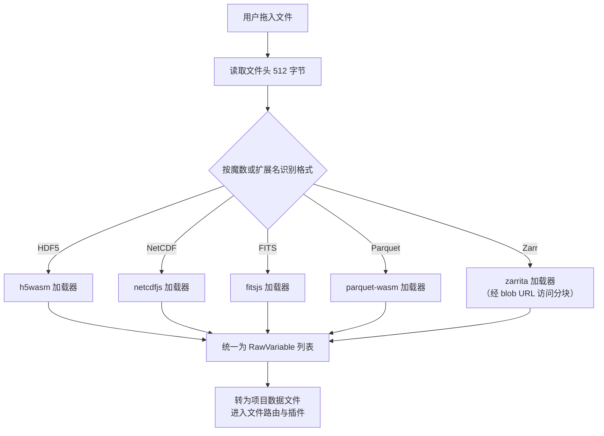

| 格式 | 典型领域 | 依赖库 | 模块 |
| --- | --- | --- | --- |
| HDF5 | 通用科学分层数据 | h5wasm | hdf5.ts |
| NetCDF | 地学、气象 | netcdfjs | netcdf.ts |
| FITS | 天文图像与表 | fitsjs | fits.ts |
| Parquet | 列式表格 | parquet-wasm（经 apache-arrow 合并全部记录批次） | parquet.ts |
| Zarr | 分块 N 维数组（本地目录或远程存储） | zarrita | zarr.ts |

辅助工具（`types.ts`）包括整型到 Float64 的安全转换（int64 与 uint64 数据集不再抛错）、名称净化、DataTable 转 CSV 与数据集构造。大文件的导入路径会先经 `chunked/` 的行窗口读取与内容指纹，再由 `parse-worker.ts` 与 `worker-pool.ts` 在 Worker 池中并行解析。

### 7.4 出版级绘图引擎（src/core/plot）

区别于插件里的画布渲染，plot 子系统是一套纯 TS 的矢量绘图引擎，目标是把 DataTable 转成出版级 SVG 并导出：

| 模块 | 能力 |
| --- | --- |
| types | PlotSpec、PlotSeries、比例类型与 SVG 载荷定义 |
| scale | 线性、对数、时间刻度，niceTicks 优雅刻度值，刻度格式化；退化定义域（单点、零跨度）有明确处理 |
| charts | DataTable 转折线、散点、直方图、柱状四类图型 |
| svg | renderSVG 矢量渲染，属性与文本分别转义 |
| export | 导出 SVG 文件与 PDF（jsPDF + svg2pdf.js），下载文本 |

由于整条链路（数据、刻度、渲染、导出）都是纯函数，绘图引擎有专门的单元测试（`tests/plot`），也是可复现性内核 DAG 转 Python 导出策略的天然搭配。流程模式的 4 个 `plot.*` 区块即由这套引擎渲染，与 4 个走插件渲染器的 `viz.*` 区块互为补充。

### 7.5 可复现性内核（src/core/repro）

科研计算的可复现性要求"同样的输入与参数得到同样的输出"。repro 内核提供六块能力：

| 模块 | 能力 |
| --- | --- |
| random | 带种子的伪随机数：mulberry32 算法，同种子产生完全一致的序列；全局 setSeed 与 currentSeed 支持会话级设定 |
| manifest | 运行清单 createManifest：记录种子、工作室版本、每个输入文件的哈希、区块图（经拓扑排序后计算哈希）与输出；manifestToText 生成可归档文本 |
| exporter | DAG 转 Python：把流程图导出为可独立重跑的 Python 脚本，与 topoSort 依赖排序配合，脚本内含与运行清单一致的种子设定 |
| lock | `repro.lock` 导出与校验：数据指纹、参数哈希、种子与代码快照，支持五类漂移判定与一键重跑 |
| snapshot | 环境快照（版本、平台与内核可用性）纳入锁文件，便于判定"漂移发生在数据还是环境" |
| index | 统一出口与稳定哈希（FNV-1a hashString，八位十六进制，供输入与图的指纹复用） |

运行清单的构成：

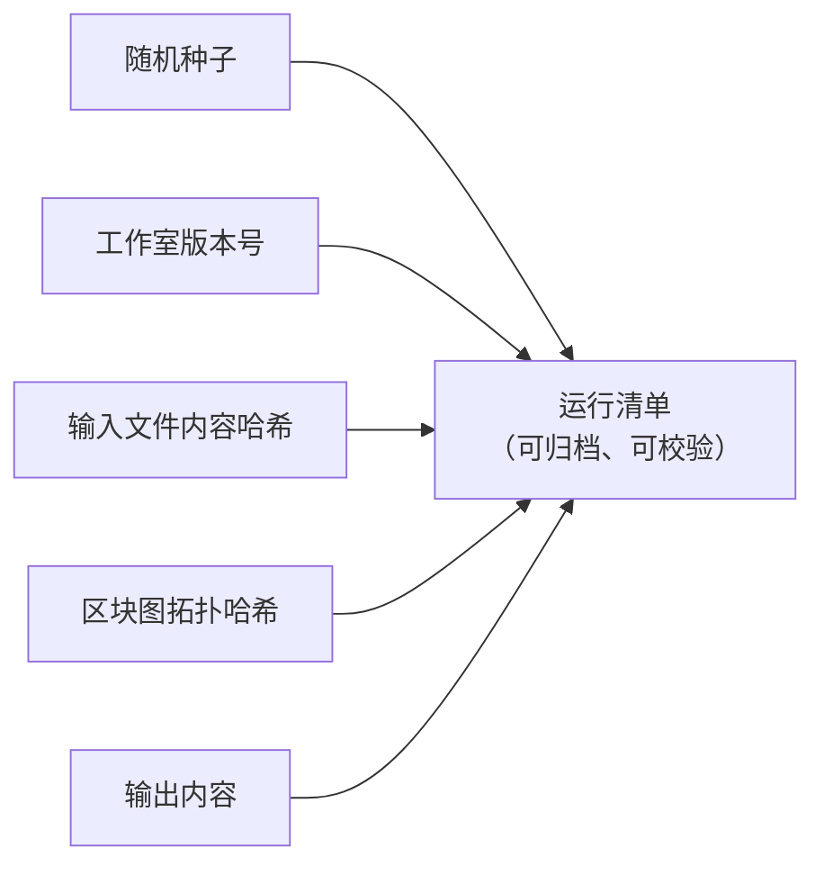

运行清单与重跑锁的界面落点：


*可复现性锁把运行清单（种子、版本号、输入哈希、区块图拓扑哈希、输出、环境快照）归档为可校验的 `repro.lock`，界面按五类漂移判定把每个作品标记为已锁定 / 检出漂移 / 未锁定，任何人都能据此核验结论能否原样重放。*

### 7.6 不确定度引擎（src/core/uncertainty）

| 模块 | 能力 |
| --- | --- |
| bootstrap | Bootstrap 置信区间：可复现重采样，支持均值 / 中位数 / 标准差等统计量 |
| montecarlo | 蒙特卡洛传播：输入分布经样本传播到输出分布 |
| mcmc | Metropolis-Hastings 采样（CPU 路径） |
| pcg | PCG32 伪随机数发生器（TS 实现与 WGSL 版 `PCG32_WGSL`），与 GPU 内核共享同一序列定义 |
| gpu-engine | WGSL GPU 加速的百分位 Bootstrap 重采样（每块 ≤ 65 536 次 dispatch，支持进度与中止） |
| gpu-mcmc | GPU 上的多链随机游走 MCMC（每线程一条链，链状态驻留缓冲） |
| diagnostics | 收敛诊断：R-hat、有效样本量 ESS、HDI 区间与 MCSE |
| index | CPU / GPU 引擎自动选择与统一出口，选择结果写入运行记录 |

引擎选择遵循 06 篇的阈值与设备可用性规则，GPU 不可用时自动回落到 CPU，两条路径在同一随机数序列下结果在数值容差内一致，并有专门的一致性单元测试。

不确定度能力在科研工具页中的实景：


*不确定度实验室对同一统计量给出 Bootstrap 置信区间与蒙特卡洛传播的对比，重采样种子可复现，GPU 加速路径在样本量达到阈值时自动接管。*

### 7.7 单位系统（src/core/units）

`quantity.ts` 提供类型化量值 `Quantity`：SI 词头、量纲代数与换算检查。它以 `units.convert`（换算）与 `units.check`（一致性检查）两个流程区块，以及参数面板中的 `QuantityInput` 组件向用户暴露，使带单位的物理参数不再以裸数字出现在管线里。

### 7.8 信号处理（src/core/signal）

| 模块 | 能力 |
| --- | --- |
| fft | 基 2 FFT 与幅值谱；与 GPU 端 `fftKernelWGSL` 数学一致 |
| window | 窗函数（Hann、Hamming、Blackman 等） |
| filter | Savitzky-Golay 平滑与滑动平均滤波 |
| correlation | 自相关 ACF 与偏自相关 PACF |
| decompose | 经典加性时序分解 x = 趋势 + 季节 + 残差：趋势用对称滑动平均（偶数周期用周期加一居中平均，同 X-11），季节项按相位去趋势均值归一化到零和；残差摘要给出均值 / 标准差与 Jarque-Bera 式偏度峰度正态性检查 |
| index | 统一出口；滤波后的列可作为派生文件保存回项目并进入血缘图 |

信号能力的界面落点——信号实验室：


*信号实验室对加速度时序做频谱分析：Welch PSD 主峰清晰可见并伴谐波，支持基 2 FFT 幅值谱、窗函数、Savitzky-Golay 滤波与时域处理，成品可发送到 Figure Studio 或存回项目文件。*

### 7.9 建模与推断

**回归建模（src/core/model）**

| 模块 | 能力 |
| --- | --- |
| linalg | 小型稠密线性代数：转置、乘法、Householder QR 与三角求解（只覆盖 OLS / 岭 / 多项式拟合所需） |
| ols | 普通最小二乘（QR 分解），系数表含估计值、标准误、p 值与置信区间 |
| logistic | 逻辑回归（IRLS 迭代重加权最小二乘） |
| ridge | 岭回归，K 折交叉验证选参 |
| poly | 多项式拟合 |
| diagnostics | 2×2 残差诊断图（残差-拟合、QQ、尺度-位置、残差-杠杆） |
| index | 统一拟合入口与结果类型 |

**贝叶斯推断 · Inference Forge（src/core/inference）**

| 模块 | 能力 |
| --- | --- |
| hmc | 哈密顿蒙特卡洛采样器，含 Dual Averaging 步长自适应 |
| nuts | No-U-Turn Sampler（U 形回旋判据），无须手工设步数 |
| model / templates | 声明式似然模板（线性回归、逻辑回归等），配数据尺度化的弱先验 |
| model-catalog | 可推断模型目录与参数元数据 |
| diag | R-hat、bulk / tail-ESS、HDI、MCSE 等后验诊断 |
| compare | WAIC 与 PSIS-LOO 模型比较；PSIS 采用 0.2 倍最大权重的原始截断（不做完整广义帕累托重拟合），Pareto-k 用 Hill 型尾部估计，足以标记 k > 0.7，但不等价于完整的 loo 诊断 |
| onnx-runner | 浏览器内 ONNX 模型推理（WebGPU 加速路径） |
| types | 采样、模型与诊断的公共类型 |

推断能力在流程区块中以 `stats.mcmc`、`stats.bootstrap`、`stats.montecarlo` 三块的形式进入管线，在科研工具页中以 Inference Forge（`/studio/inference`）与模型推理（`/studio/model-inference`）两个整页呈现。

建模与推断在科研工具页中的实景：


*Inference Forge 在浏览器内（WebAssembly）运行 NUTS 采样：含 94% HDI / MCSE / R-hat / ESS 的后验摘要、WAIC / PSIS-LOO 模型对比、后验预测检查与轨迹 + 密度图，底层即本节 model / inference 内核。*

### 7.10 数据工程与可靠性内核

| 子系统 | 关键能力 |
| --- | --- |
| data-quality | Pandera 风格列级 / 表级期望契约，懒求值质量报告；类型推断与画像（四分位、IQR 离群、缺失与去重计数）、由画像反推 schema 建议、逐行隔离（quarantine）并记录拒绝原因、DataTable 适配器 |
| cleaning | 数据清洗向导的步骤模型与引擎：类型转换、缺失值策略（删除 / 均值 / 中位数 / 零 / 前向填充）、离群标注（IQR / z 分数）、去重、列重命名五类可序列化步骤；步骤永不改写输入表，支持逐步前进 / 回退 / 跳转与"撤销该步" |
| profiler | 流式单遍列画像：数值列用 Welford 精确均值方差加蓄水池采样求分位数与 MAD，修正 z 分数（\|0.6745(x−median)/MAD\| > 3.5）计离群；文本列用 HyperLogLog 估基数与 Space-Saving 求 Top-K；表级给出 Pearson / Spearman 联合采样与重复率估计，综合成 0–100 确定性质量分与问题清单，按内容指纹缓存 |
| chunked | 大分隔文件的按行窗口读取（csv / tsv / dat / xyz / txt），工作集保持在一个分块而非整文件；其余格式仍走整文件 io |
| sql | DuckDB-WASM 引擎，首次使用时懒加载；项目文件注册进 DuckDB 虚拟文件系统并暴露为表；查询支持超时与 AbortSignal，中止或超时会终止 Worker 并丢弃单例，下次调用重建实例 |
| sanitize | 外部产出的 SVG 先经允许列表净化（sanitizeSvg.ts）再进入渲染，剥离脚本与事件属性 |
| validation | 可组合校验器 `(value, path) => issues[]`：组合即普通函数组合，schema 是普通数据，可复用、可部分应用、可无 React 单测；类型校验器跳过 null / undefined，需要必填时用 `required()` 组合 |
| errors | 结构化错误分类法与原因链、`Result<T, E>` 显式错误值通道、退避加抖动的重试与中止、断言守卫、去重错误注册表与有界诊断环，以及全局 `error` / `unhandledrejection` 捕获 |

`Result` 类型的存在理由是边界代码不应以抛错为默认：一行非法 CSV、一个缺失文件都是调用方必须分支处理的**预期**结果，把它变成值可以让分支在 `noImplicitReturns` 下穷尽，也把堆栈开销从热校验路径上移走。

数据画像与清洗在科研工具页中的实景：


*数据画像页对每个列给出 Welford 均值方差、分位数、离群计数与 HyperLogLog 基数估计，并综合出 0–100 确定性质量分与按内容指纹缓存的问题清单。*


*数据清洗向导由本小节 cleaning 内核驱动：类型转换、缺失值策略、IQR / z 离群标注、去重与列重命名五类步骤均可前进 / 回退 / 撤销，且永不改写输入表。*

### 7.11 科研工作流与交付

| 子系统 | 关键能力 |
| --- | --- |
| experiment | 运行记录模型与 A/B 参数对比：一次执行（流程 / 积木 / 代码 / 笔记本 / 扫描 / 不确定度 / 建模 / 推断）的耐久快照，存于 IndexedDB `runs` 存储而**不**写进 `.clproj`，使项目文件保持小巧；按 projectId 建索引，项目删除时一并清理；内容哈希复用 repro 的 FNV-1a |
| lineage | 数据血缘图与分层布局：以运行记录上的文件 id 把项目文件（源）连到运行（变换），采用 Sugiyama 式分层 DAG 画法（最长路径分层、单趟重心排序、行居中），无 React / store / DOM 依赖 |
| sweep | 参数扫描领域层：`expandPlan` 把 SweepPlan 展开为确定性设计点——全网格 / 列表轴走完整笛卡尔积，全拉丁超立方轴按维度分层抽样，混合 lhs / grid 方案被拒绝（样本量无歧义定义）；纯 TS，全部校验可测 |
| figure | 出版级组图：FigureSpec 是挂到期刊模板网格（IEEE / Elsevier 栏宽、色盲友好调色板）上的多面板 PlotSpec 容器；`composeFigure` 渲染单张独立 SVG（嵌套面板 viewport 加 a/b/c 面板标签），`exportFigure` 处理 SVG / PDF / PNG-600dpi 下载；组图只重新定尺寸，**不**修改原 PlotSpec |
| submit | 投稿前检查门：`runSubmissionCheck` 依据目标期刊档案（IEEE / Elsevier）遍历图文档（模板、面板、图注、导出设置），返回按图像 / 标注 / 文本 / 元数据分组的通过与失败项；每个失败项带 i18n 消息、修复键与问题控件的 DOM id，使界面可以提供"定位问题"；`caption.ts` 依据图型、列名与可选统计量草拟中英双语的"图 1. …"图注 |
| report | 交互式报告构建器：`buildReport` 把 ReportSpec（有序章节：标题、Markdown、Figure Studio 图、数据表、运行摘要、筛选器）构建成**单一自包含 HTML**——内联 CSS、内联 SVG、内联 JSON 数据与零依赖的原生 JS 控制器（筛选联动、可排序表格）；所有用户字符串先转义，内嵌 JSON 以 `<script type="application/json">` 输出并将 `<` 做 unicode 转义，杜绝 `</script>` 载荷逃逸 |
| package | 补充材料打包：manifest.json（项目元数据、运行记录、血缘图、作者与许可表单）加可选的原始数据文件与代码会话，用 fflate 打成研究者随论文一起上传的 ZIP |
| notebook | 笔记本模型：markdown / 代码单元的扁平列表，持久化在 `project.state.notebook`；执行语义在 notebookStore（Pyodide 运行时是有状态且页面级的），模块本身只持有单元模型、输出模型与一个安全的小型 markdown 渲染器 |
| course | 课程模式领域模型：本地优先的教学闭环——教师创建课程（由本地身份字符串标识，无账号体系）、发布绑定学科模板的作业，学生领取任务、在项目中作业并提交运行结果的 repro.lock 快照，教师查看学生 × 作业矩阵、记录评分与评语，并把整个班级按学生一目录导出为包；持久化在 IndexedDB `courses` 存储 |
| gallery | 作品长廊：内置精选目录（catalog.ts）与本地"我的分享"存储（localStorage），记录用户分享出去的作品元数据与净化后的快照 HTML，使详情弹窗可离线重开；v1 不上传任何内容，下架只做标记（保留审计轨迹）并从所有列表过滤 |
| templates | 学科模板目录：把早期"功能演示"样例改写为学科情景模板，每个从真实研究问题出发，附带确定性示例数据集与 3–6 步引导；模板内容以 `{ zh, en }` 对形式内嵌（不走全局 i18n 字典），只有周边 UI 框架使用 `tpl.` 键 |

交付与协作子系统的界面实景：


*报告构建器把有序章节（标题、Markdown、Figure Studio 图、数据表、运行摘要、筛选器）编译成单一自包含 HTML——内联 CSS / SVG / JSON 与零依赖的原生 JS 控制器，筛选联动、表格可排序。*


*Figure Studio 挂在期刊模板网格（IEEE / Elsevier 栏宽、色盲友好调色板）上组合多面板组图，并提供图注起草器与投稿前检查门（submit 内核）。*


*参数扫描把 sweep 的 SweepPlan 展开为确定性设计点：全网格 / 列表轴走完整笛卡尔积，拉丁超立方轴分层抽样，混合方案被拒绝以保证样本量定义无歧义。*


*课程模式实现 teacher–student 教学闭环：教师发布绑定学科模板的作业，学生提交运行结果（repro.lock 快照），教师以学生 × 作业矩阵评分并把全班导出为包。*

### 7.12 语言运行时与 AI 助手

| 子系统 | 关键能力 |
| --- | --- |
| pyodide | 代码模式 Python 运行时：`pyodide-worker.ts` 在 Web Worker 中启动 CPython，`studio.py.ts` 作为可导入模块注入 `sys.modules`，`runtime.ts` 把 PyodideClient 接到编辑器 store 与渲染桥——流式回传 stdout/stderr、把绘图载荷转给积木模式同一条 RenderedView → 插件通路、把 Python 变量快照转成面板可用的 DataValue |
| r | R 运行时工厂 `createRRuntime({ preferFull })`：优先尝试 webR 完整运行时，若 bundle 缺失或启动失败则回落到内置 IR 引擎并记录 `fallbackReason` 供界面如实告知；`preferFull = false` 时直接走内置引擎。内置路径无外部依赖，必须始终可用——当前发行版即以此路径运行完整 `studio.*` DSL |
| monaco | Monaco 编辑器宿主与语言服务装配（懒加载），并提供 `studio.*` 补全数据 |
| ai | 助手双模式策略：离线（默认）是 `intents.ts` 的纯 TS 规则引擎，把自然语言请求（如"对 x 和 y 做相关分析并画散点图"）经五类意图模板（相关 / 回归 / 分布 / 检验 / 筛选）合成为可运行的 `studio.*` Python 代码，全程不联网；在线模式要求**同时**具备显式授权标志与已配置端点，缺一即拒绝或降级，使提示词不会意外外泄；`validateStudioApi` 保证生成的调用不超出真实运行时模块的 API 白名单，助手绝不臆造接口 |
| theme-pack | `.cstheme` 主题包：纯声明式数据（CSS 自定义属性覆盖、字体偏好、密度模式与可选图表配色），**绝不携带可执行内容**；`parseCsTheme` 是唯一校验闸门——严格拒绝每层未知键、拒绝 `__proto__` / `constructor` / `prototype` 等危险原型键、要求 CSS 变量名为 `--kebab-case` |

### 7.13 支撑设施

- **运行日志导出**：`logger.ts` 聚合会话日志，配合 `download.ts` 支持从工作台导出日志文件，便于问题反馈与回归定位。
- **插件缓存与示例资产**：`pluginCache.ts` 与 `exampleAssets.ts`、`examples.ts` 支撑内置示例数据与示例项目（`examples/data` 下 138 个样例文件、`examples/projects` 下 11 个 .clproj 项目、`examples/code` 下 9 个 Python 示例）的发现与加载。
- **viewport2d 与 dataFiles**：2D 视口抽象（快照式访问，插件卸载安全）与项目数据文件注册（`setProjectFiles` 与 `resolveDataFile`），使项目自有文件、内置示例与代码模式 `_FILES` 共享同一套加载逻辑。
- **工具交接与产物落盘**：`labHandoff.ts` 支持工具间一次性数据交接，`workspace-artifacts.ts` 把实验产物保存进项目工作区，`recentTools.ts` 记录最近使用的科研工具。
- **OPFS 与迁移**：`opfs.ts` 提供大文件分块存储，`opfs-migration.ts` 把既有 IndexedDB 数据平滑迁移，项目元数据仍留在 IndexedDB。
- **事件与启动**：`events.ts` 提供插件↔插件、插件↔宿主的类型化发布订阅总线，`boot.ts` 作为启动序列闸门，`settings.ts` 管应用设置，`cpu-info.ts` 探测 CPU 能力供基准与画像参考。
- **PWA 与跨站导航**：`pwa.ts` 处理离线缓存与服务工作者预缓存清单（由 `gen-sw-precache.mjs` 生成），`site-links.ts` 负责工作台、官方站点与文档站三者的互相跳转。
- **引用与归档**：`citation.ts` 生成软件引用与归档元数据，由 `gen-citation-cff.mjs` 与 `check-citation.mjs` 维护 CITATION.cff。
- **性能基准**：`bench/` 的 `runAllBenchmarks()` 执行导入 / 计算 / 渲染 / 内存四类关键路径套件，返回含环境信息（Node 版本、平台、架构、CPU 型号、日期）的结构化结果，由 `scripts/bench-run.mjs` 在 Node 中无头运行并写入 `bench-results.json`，再与 `bench/baseline.json` 对比（详见 08 篇）。

这 43 个子系统与 38 个根级模块共同构成产品的"科学"底座：统计、建模与推断保证结果的专业性，I/O 与数据工程保证数据入口的开放性与可信度，绘图与组图保证输出的出版级质量，可复现性与交付管线保证结论可以被别人原样重放并随论文一起交付。

## 第八章 测试与质量保障

### 8.1 单元测试（Vitest）

运行方式：`npm test`（即 `vitest run`）执行全部单测；`npm run verify` 先做类型检查再跑单测，是贡献指引中要求保持绿色的组合检查。

测试文件按主题组织在 `tests/` 下，根目录与子目录各占一半：

| 主题 | 文件数 | 覆盖内容 |
| --- | --- | --- |
| 插件运行时与插件族（根目录） | 85 | 内置插件、科研 / 地理物理 / 环境 / 生物 / 数据插件、结构与化学插件、电磁特征值与流体耦合、三维可视化、插件增强与缺陷回归、沙箱与 cspkg、文件格式路由、Git 适配器、GPU 服务与 WASM、主题包、i18n、可访问性与对比度、引用元数据、PWA、画廊、课程、清洗、投稿、存储与运行记录、应用状态库；以及科研级插件套件 32 个插件的内核单测（化学：滴定 / 反应级数 / 图灵斑图，物理：量子求解器 / 伊辛 / 热机 / 扩散 / 衍射 / 轨迹，工程：电路 / 桁架 / 控制，生物与环境：药代 / 孟德尔 / 神经元 / 捕食者-猎物，地学：碳定年 / 土壤水 / 水文，数学：傅里叶 / 域着色 / ODE 场，统计：CLT / 马尔可夫 / Zipf，经济与心理：期权 / 演化博弈 / 信号检测论 / 反应时，天文与数据：凌星 / 赫罗图 / 图像处理） |
| 编辑器与 IR（editor/） | 15 | 共享 IR 校验与往返、Blockly JSON 与 IR 互转、解释器、JS 与 Python 代码生成、三模式 sync-threeway、积木 i18n、编辑器状态库、Studio API、代码示例，以及 `roundtrip-all-langs.test.ts` 固化的三语言自由往返 |
| 区块系统（blocks/） | 11 | 数据表运算、区块目录、编译器、执行器、几何、统计区块、文件数据、操作符、可视化桥接、单位 |
| 统计内核（stats/） | 7 | 描述统计、假设检验、多重比较校正、效应量、功效分析、特殊函数、结果叙述转写 |
| 平台核心（core/） | 9 | 计算服务与 WGSL 内核、OPFS 与迁移、错误分类法、校验框架、VFS 路径、Worker 池 |
| 状态库（stores/） | 6 | project / notebook / experiment / chunk / block / aiPanel |
| I/O（io/） | 4 | HDF5 / NetCDF / FITS / Zarr 加载器与辅助 |
| R 运行时（r/） | 4 | 运行时工厂、完整运行时回落、DSL、webR 桥 |
| 可复现性（repro/） | 4 | 随机数、运行清单、锁文件（含 v2）、快照 |
| 不确定度（uncertainty/） | 3 | Bootstrap、蒙特卡洛、MCMC 与诊断 |
| 模板（templates/） | 3 | 学科模板目录、插件脚手架、引导流程 |
| 插件签名 / 推断 / 扫描 / 组图 | 各 2 | 签名验证与网站包、贝叶斯模板与 ONNX、设计点展开、持久化与组图 |
| 其余单文件模块 | 各 1 | AI 助手意图、分块读取、数据质量、血缘、模型、笔记本、打包、页面、绘图、画像、报告、信号、SQL、单位 |

值得注意的测试技术：

| 技术 | 说明 |
| --- | --- |
| 模块级缓存重置 | 像 WASM 加载器这类带模块级状态的模块，每个用例前用 `resetModules` 加 `doMock` 重置，再动态导入新实例，避免用例之间互相污染 |
| FakeWorker 驱动真实运行时 | 插件 Worker 的 RPC 用假 Worker 承载真实的运行时实现，在 Node 里完成端到端往返，无需浏览器 |
| 严格模式的陷阱有专门说明 | `new Function` 在严格模式下无法同时使用 `"use strict"` 指令与默认参数值，遗留沙箱为此改用普通参数并显式传 `undefined`——这类"看起来是风格问题、实则是正确性问题"的点都沉淀在测试注释里 |
| 回归用例制度化 | 已修复的插件缺陷沉淀为 `pluginBugfixes` 等回归用例，i18n 键值在测试中校验齐备，避免复发 |

### 8.2 端到端测试（Playwright-core）

每套脚本各自启动 `vite preview` 生产预览（个别套件例外），驱动无头浏览器，断言真实像素与零控制台错误：

| 套件 | 端口 | 覆盖内容 |
| --- | --- | --- |
| smoke-test | 4173 | 启动、自动加载插件、自动建项目、响应式参数、最近项目恢复 |
| verify-ui | 4173 | 改版后的功能回归与布局几何：尺寸、主题切换、画布可见性、插件列表 |
| verify-fixes | 4177 | 自动适配、统一等宽字体、Run 控件开关、顶栏分簇 |
| verify-3d | 4199 | 宿主 Three.js 场景中的三维点云 |
| verify-plugins | 4198 | 三维与二维视口可见性互斥、等值线渲染涡旋场、散点与龙卷风示例 |
| verify-webgpu | 4289（dev server） | 两阶段：`tests/e2e/webgpu.html` 在无头 Edge（SwiftShader 软件适配器）中申请真实 WebGPU 设备，用 `src/core/wgsl.ts` 的真实 WGSL 内核驱动原生核心模块接口（缓冲、内核编译、dispatch、mapAsync 回读），对严格场景与边界场景分别比较 GPU 与 CPU 积分器（容差 5e-3 与 0.02）；再在应用内加载粒子插件与星系样例、点击"GPU 计算"，断言成功提示上报真实引擎与实测 GPU 时间 |
| verify-block-mode | 4174 | 积木模式：模式切换、编译、运行、积木到代码同步 |
| verify-code-mode | 4175 | Monaco 加 Pyodide：运行 Python、变量面板、控制台、绘图画布 |
| verify-lang-modes | 4176 | R / JS 代码模式与跨模式切换、R→JS 互译、Flow ⇄ Block ⇄ Code 无损循环 |
| verify-ai-samples | 4211 | 样例对话框逐个加载四个 AI 训练样本并捕获提示文案，使解析失败可观测而非靠推断 |
| verify-ai-training | 4199 | AI 训练器：超参面板、样例加载、TF.js 真实训练与实时损失曲线、模型切换重置默认超参、逻辑回归决策边界、MNIST CNN 数字缩略图 |
| verify-research | 4173 | 科研工具链路：启动器 → 运行记录 → 血缘 → 图表工作台 → 补充材料打包 → 笔记本 |
| verify-r-runtime | 自定 | webR 完整运行时检查：进入代码模式切换 R 语言后引擎徽标须翻转为完整 R 标签，真实 R 程序打印到控制台；回落时捕获原始导入错误供回落提示展示 |
| verify-site | — | 合并部署产物完整性：本地静态服务器逐路径探测，8 条规范路径全部返回 200 且非空 |

**运行器**。`npm run test:e2e` 即 `node scripts/e2e-run.mjs`，串联 **11 套**：`smoke-test`、`verify-ui`、`verify-fixes`、`verify-3d`、`verify-plugins`、`verify-webgpu`、`verify-block-mode`、`verify-code-mode`、`verify-ai-samples`、`verify-ai-training`、`verify-research`。运行器带 `--continue` 语义——某个套件失败后继续跑完其余套件，最后打印 pass / fail 汇总表并在任一失败时以非零码退出，替代了旧 npm 链"首个失败即停"的行为；也支持按名筛选（`node scripts/e2e-run.mjs smoke ui`）与 `--parallel <n>` 并发（端口冲突由 harness 自动让位）。

**链路与链外**。不在上述链内的三个脚本各有独立入口：`verify-lang-modes` 依赖 Monaco 与 Pyodide 的完整加载（耗时较长），`verify-r-runtime` 需要 webR vendor 产物在场，`npm run verify:site` 校验的是合并部署产物而非开发预览（`--merge` 时先跑 `merge-deploy.mjs`，再对 `pages-out` 起本地静态服务器，逐路径断言 8 条规范路径——站点根、favicon、`/app/` 工作台、`/app/docs/` 文档站与其深页——全部 200 且非空）。

**共享 harness**。所有套件都走 `scripts/_harness.mjs`，把过去散落在各脚本里、只在某台机器上成立的三件事统一为"从环境解析并带合理默认值"：浏览器可执行路径（按平台列出候选，Edge 优先、Chrome 兜底，CI 可用 `CHROME_PATH` 钉住）、截图目录（系统临时目录）、预览端口（被占用时自动另取）。harness 同时保证清理，断言失败不会泄漏预览服务或浏览器进程。

贡献指引要求：新插件或新功能必须附带端到端检查。

### 8.3 性能基准与体积预算

性能回归靠**基线对比**而非绝对阈值，且基线按环境分文件：

- `src/core/bench/` 的 `runAllBenchmarks()` 执行导入 / GPU 内核 / 渲染帧率 / 内存四类关键路径套件，返回含环境信息（Node 版本、平台、架构、CPU 型号、日期）的结构化结果。
- `npm run bench`（`node --expose-gc scripts/bench-run.mjs && node scripts/bench-compare.mjs && node scripts/bench-report.mjs`）在 Node 中无头运行并写入 `bench-results.json`；`scripts/bench-compare.mjs` 与基线逐指标比对——`bench/baseline.json` 面向开发机，`bench/baseline.<platform>-<arch>.json`（仓库中已有 `baseline.linux-x64.json` 与 `baseline.win32-x64.json`）面向 CI，因为共享 Runner 上的数字与开发桌面没有可比性；`scripts/bench-report.mjs` 产出单文件 HTML 报告。CI 场景用 `bench:ci`（比对与报告均带 `--env-baseline`）。
- 新环境首次运行没有基线时，`bench-compare.mjs` 记录一份并以 0 退出，由 bench 工作流把该文件提交回仓库，供后续运行真正设门禁。另有两类**硬件噪声守卫**会重录基线而非误报失败（重录文件**故意不提交**，避免"每次运行都产生一次提交"的噪声）：① Runner 报告的 CPU 型号或 Node 版本与基线不一致；② CPU/Node 字符串相同、但吞吐指标中 ≥75% 同向回归且内存指标全部持平——这是同型号 CPU 被换到不同宿主机（微码/固件/负载不同）的典型签名；选择性或混合方向的真实代码回归不会命中该守卫，仍会正常失败。
- 体积侧由 `scripts/build-budget.mjs` 分析构建产物（`dist/`，合并部署后为 `pages-out/app/`），对照仓库根的 `budget-baseline.json` 做门禁（FR-06）。

### 8.4 持续集成（5 条工作流）

| 工作流 | 触发 | 关键步骤与门禁 |
| --- | --- | --- |
| **ci** | push 到 main、所有 PR | 两个 job。`verify`：引用元数据检查（FR-10）→ `tsc --noEmit` → ESLint → `npm test` → 生成 WASM 存根 → `build:web` → 性能预算（FR-06）。`e2e-smoke`：构建后跑 `e2e-run smoke ui` 两套最快端到端（Runner 自带 Chrome 经 `CHROME_PATH` 钉住），全套件留在本地。任一步失败即红 |
| **bench** | push 到 main、发布 Release | `npm run bench:ci`（跑基准 + 按环境基线比对）→ 首次运行提交环境基线（该 job 持 `contents: write`）→ 结果写入 job summary 并上传 artifact；发布时作为附件挂到 Release（FR-23） |
| **security** | push 到 main、PR、每周一 03:00 UTC、手动 | 三个并行 job：OSSF Scorecards（v2.4.4，SARIF 产物留存 30 天）、SBOM 生成（CycloneDX 1.5，由无依赖 Node 脚本从 `package-lock.json` 生成，留存 90 天）、`npm audit`（**high / critical 阻断合并**，带需写明理由与后续 issue 的 `AUDIT_ALLOWLIST` 豁免机制，豁免项降级为警告） |
| **release** | 推送 `v*` 标签 | build：生成 WASM 存根 → `build:web` → 生成 `CITATION.cff` → 打包 dist zip；archive：Zenodo 存缴并铸造 DOI，**未配置 `ZENODO_TOKEN` 时显式报错并给出三步配置指引**，而不是静默跳过归档；release：发布 GitHub Release，附 zip、`CITATION.cff` 与 DOI |
| **deploy** | push 到 main、手动 | 装 Rust（`wasm32-unknown-unknown` 目标，带缓存）与 `wasm-bindgen-cli 0.2.127` → `build:wasm` 编译真实 WASM → 构建工作台 `app/` 与官网根站 → `deploy:merge` 合并产物 → `verify-site` 校验 8 条规范路径 → 发布 GitHub Pages |

**CI 里没有 Rust 工具链**（deploy 除外）：其余工作流的 `dist` 由 `scripts/make-wasm-stub.mjs` 生成模块存根，因为 `vite build` 会把 `src/core/wasm.ts` 中的动态导入切成独立 chunk，构建期只需要该 chunk 存在、不需要真实内核。

**构建链自带门禁**：`npm run build` = `build:wasm` && `tsc --noEmit` && `vite build` && `build-docs`，任一步失败即中止；纯前端场景可用 `npm run build:web`（跳过 WASM 编译，以存根开头）。

### 8.5 工程脚本

`scripts/` 下 41 个工程脚本（40 个 `.mjs` + 1 个 `.py`，另有共享类型声明与基准运行日志）按用途分为七类：

| 类别 | 脚本 |
| --- | --- |
| 端到端与 harness | `e2e-run.mjs`（运行器：--continue、汇总表、--parallel）、`_harness.mjs`（共享 harness）、`smoke-test.mjs`、`verify-*.mjs`（13 个：webgpu / 3d / plugins / code-mode / block-mode / lang-modes / r-runtime / ai-samples / ai-training / research / ui / fixes / site）、`_line-check.mjs`（目检 Monaco 当前行与选区实际渲染色） |
| 性能与预算 | `bench-run.mjs`、`bench-compare.mjs`、`bench-report.mjs`、`build-budget.mjs` |
| 构建与部署 | `build-wasm.mjs`、`make-wasm-stub.mjs`、`build-docs.mjs`、`merge-deploy.mjs`、`gen-sw-precache.mjs`、`copy-pyodide.mjs`、`copy-webr.mjs`、`vendor-blockly-media.mjs` |
| 资产与示例生成 | `make-example-data.mjs`（重建 distribution.dat、field.json 与图像演示的 base64 测试图案）、`make-example-projects.mjs`（从样例数据构建示例 .clproj）、`gen-ai-examples.mjs`（种子化 PRNG，产出确定、可提交、可被学习者检查的 CSV） |
| 合规与签名 | `sign-cspkg.mjs`（.cspkg 签名 CLI：--genkey 生成密钥、签名与校验）、`gen-sbom.mjs`（CycloneDX SBOM）、`gen-citation-cff.mjs`、`check-citation.mjs` |
| 领域专项 | `chem-reactmd-validate.mjs`（用真实载荷在低 / 高温两端运行目录内全部反应的 Python NumPy 引擎并打印对照表，确认每个反应只在高温下物理完成）、`repro-plugins.mjs`（两个商赛插件 fluid-cfd-coupler 与 em-eigensolver 的一次性复现与基线核对）、`make-qr.py`（二维码生成） |
| 技术文档排版 | `build-tech-docs.mjs`（md → 分页 HTML → A4 PDF）、`build-tech-summary.mjs`（从分篇汇编合集，使合集不可能与分篇漂移） |

其中 `gen-citation-cff.mjs` 与 `check-citation.mjs` 一写一校，共同维护 `CITATION.cff`（校验脚本比对 `src/core/citation.ts` 中硬编码的作者 / 许可与 `package.json`，漂移即以非零码退出并使 CI 变红）；`gen-sw-precache.mjs` 生成 Service Worker 预缓存清单，使离线可用范围与构建产物严格一致；`copy-pyodide.mjs` 与 `copy-webr.mjs` 把 Python / R 运行时 vendor 到本地自托管，避免运行时依赖公网 CDN。

**技术文档排版链路**。`docs/technical/` 下的十一份文档由 `node scripts/build-tech-docs.mjs` 重建：Markdown 经内置的子集解析器转成区块，mermaid 围栏在构建期用无头浏览器渲染为内联 SVG（产物不含任何客户端脚本，PDF 里是可缩放的矢量图），随后在真实页面尺寸下**逐块测量高度**并按页高装填——固定高度的 `.page` 配 `overflow: hidden`，靠目测平衡内容会在任何一节变长时把内容裁掉，因此分页必须由测量驱动。测量结果同时回填目录页码，并在生成后逐页复检"内容是否越过下边距"，发现溢出即以缩小后的可用高度重排。技术总结（`Ergalics Studio.md`）则由 `build-tech-summary.mjs` 从十一篇分篇源码汇编，因此不可能出现"分篇已改、合集还写着旧数字"的情况。

### 8.6 质量原则

1. **纯函数优先**。编译器、统计内核、绘图与组图引擎、代码生成与 IR 转换全部是纯函数，可在 Node 环境直接测试；血缘图的分层布局同样无 React / store / DOM 依赖。
2. **副作用收口**。区块系统里只有渲染桥接一个带副作用的模块，执行器异步但无副作用；研究工具页的胶水层（`researchUi.ts`）也被刻意写成无 React 依赖的薄层，以便单独测试。
3. **数值一致性兜底**。每个 GPU 内核都有数学一致的 CPU 实现，单测与端到端两层校验二者一致——这是"自动降级"能够被信任的前提。
4. **边界显式化**。边界输入抛结构化错误、空数据启动有守卫提示、环境缺失如实自检报告，而不是静默失败或静默降级；可复现性有专门的门禁文档告知。
5. **不静默跳过**。需要归档就必须归档（Zenodo 未配置即报错并给指引），需要门禁就必须门禁（审计豁免要写明理由），第一次运行没有基线就记录并提交——把"没跑成"和"跑过了"区分清楚。

## 第九章 使用指南

### 9.1 技术栈与环境要求

Ergalics Studio 是纯前端的单页应用，唯一的强依赖是一个现代浏览器；唯一可选的本地工具链是 Rust（只用于把原生核心编译成 WebAssembly，缺失时前端优雅降级）。

| 层级 | 选型 |
| --- | --- |
| 界面 | React 18、react-router-dom 7、Zustand 5 |
| 语言 | TypeScript 5.7（strict 模式） |
| 构建 | Vite 6 + Vitest |
| 可视化 | 原生 Canvas/WebGL、Three.js、WGSL 计算着色器 |
| 编辑器 | Monaco Editor、Blockly 13 |
| 运行时 | Pyodide（CPython）、DuckDB-WASM、TensorFlow.js |
| 科研 I/O | h5wasm、netcdfjs、fitsjs、zarrita、parquet-wasm（配 apache-arrow） |
| 打包与压缩 | fflate、lz-string |
| 原生核心 | Rust（wasm32-unknown-unknown）+ wasm-bindgen 0.2 |
| 端到端测试 | playwright-core 驱动无头 Edge |
| 协议 | MIT |

浏览器侧要求 WebGPU / WebAssembly / Web Worker / IndexedDB。WebGPU 与 WASM 均为可选：缺失时应用在欢迎页如实自检报告，并把计算回退到 CPU 实现。

### 9.2 安装、运行与构建

```bash
npm install          # 安装依赖
npm run dev          # 启动开发服务器
npm run build        # 完整构建：WASM 核心 → 类型检查 → 打包 → 文档站
npm run build:web    # 只构建前端（跳过 Rust 步骤）
npm run preview      # 预览生产构建
```

质量检查：

```bash
npm test             # Vitest 单元测试
npm run verify       # 类型检查（tsc --noEmit）+ 单元测试
npm run test:e2e     # Playwright 端到端套件（需本机浏览器）
npm run bench        # 性能基准并对基线
```

`npm run build` 自带门禁：WASM 编译、类型检查、打包、文档站拷贝任一步失败即中止。类型检查同时充当 lint——代码库不引入额外的 lint 规则集，而是把约束交给 TypeScript 严格模式。

### 9.3 数据格式支持

| 类别 | 格式 | 说明 |
| --- | --- | --- |
| 表格与文本 | CSV、TSV、DAT、TXT、MD | 分隔文本与表格数据，项目数据文件可直接导入 |
| XY 谱线文本 | XY、XYE | 两列（2θ–强度，XYE 含误差列）x–y 文本数据，`#` 行为注释，XRD 衍射图谱分析等插件直接载入 |
| 网格与点数据 | JSON、XYZ | 数值网格、标量场与点云（JSON 矩阵 / XYZ 列） |
| 矩阵与数组 | MTX、NPY、NPZ | Matrix Market 稀疏矩阵与 NumPy 数组（电磁谐振特征值求解等） |
| 化学结构 | CIF、POSCAR、VASP | 晶胞结构：原子、周期性化学键与密度估算 |
| 地理与轨迹 | GeoJSON、GPX、ASC | 矢量地图、GPS 轨迹、ESRI ASCII Grid 高程 |
| 生物序列与遗传 | FASTA、FA、VCF | 序列比对与分析、群体遗传变异数据 |
| 图像 | PNG、JPEG、WEBP、GIF | 图像查看器加载位图 |
| 科研二进制 | HDF5（.h5/.hdf5/.hdf、MAT v7.3、h5ad）、NetCDF（.nc）、FITS（.fits/.fit）、Zarr（.zarr）、Parquet（.parquet） | 纯 TypeScript 调度器按魔数分派到各加载器，解码后以 CSV 落入项目 |
| 项目 | .clproj | 工程自有格式，lz-string 压缩 |
| 插件包 | .cspkg | fflate 打包，加载时校验清单与可选签名 |
| 主题包 | .cstheme | 纯声明式数据，绝不携带可执行内容 |

大文件先经分块读取与内容指纹，再交由 Worker 池并行解析。

### 9.4 示例资源一览

| 位置 | 内容 |
| --- | --- |
| examples/data | 每个内置插件附带的可加载示例数据集 |
| examples/projects | 11 个真实 .clproj 流程管线（信号分析、分箱统计、双管线对比等） |
| examples/code | 9 个 Python 示例程序（EDA 管线、蒙特卡洛估圆、信号平滑等） |
| src/editor/block/samples.ts | 5 个积木示例程序（星系散点、遥测折线、随机直方图等） |
| src/core/templates | 学科模板目录，附确定性数据集与 3–6 步引导 |

### 9.5 参与贡献

贡献流程要求：改动前先阅读仓库根目录的 ARCHITECTURE.md 与 REQUIREMENTS.md；新增插件或功能需附带端到端检查；提交前保持 `npm run verify` 绿色。已修复的缺陷应沉淀为回归用例，而不是只改代码。

### 9.6 许可证

MIT。软件引用与归档元数据由 `CITATION.cff` 维护（由脚本从 package.json 生成并在 CI 中校验），打标签发版时会自动归档到 Zenodo 并铸造 DOI。

## 第十章 应用场景

### 10.1 应用场景

#### 10.1.1 科学与工程数据可视化

覆盖统计分析与工程绘图的常见图型：散点、折线、直方图、热力图、等值线、箱线图、小提琴图、误差带、平行坐标、桑基图、矩形树图、QQ 图、气泡图、雷达图、网络图等；数据格式上除 CSV、JSON、XYZ 外，还支持 HDF5、NetCDF、FITS、Zarr、Parquet 等科研领域常用的二进制格式导入，可服务地学、天文、生物等学科的数据探索需求。下图依次是等值线、空间插值与标准差椭圆三张代表性渲染。


*等值线：对二维标量场（JSON 网格）渲染色带 + 等值线，双高斯双峰可清晰呈现山谷与脊线，适合涡旋场、地形等数据。*


*空间插值：对离散站点数据做 IDW 逆距离加权网格化，输出插值色带与等值线，可调节幂次与搜索半径对比插值效果。*


*标准差椭圆：对点集计算平均中心、方向角与长短轴半径，一图概括分布中心、走向与离散程度，适合空间统计与分布形态分析。*

#### 10.1.2 物理仿真与教学演示

内置多个数据驱动的仿真引擎，全部"初始为空、绝不伪造默认场景"，数据既可来自内置示例也可来自用户文件；其中电磁谐振特征值求解器与流体双向耦合求解器是两个竞赛级求解器插件（Pyodide Worker 内核，另有独立专题文档）：

| 插件 | 演示内容 |
| --- | --- |
| N-Body 引力 | 4096 体的三维全对引力直接求和，WGSL 内核加速 |
| 格子 Boltzmann 流体 | D2Q9 通道流绕障碍物，展示卡门涡街与机翼绕流 |
| 波动方程 | 高斯脉冲、双源干涉、双缝衍射场景，leapfrog 内核积分 |
| 双摆 | RK4 积分配合初值仅差 0.001 弧度的"混沌幽灵摆"，直观展示混沌 |
| 电磁场 | 可拖动电荷在库仑力与洛伦兹力共同作用下的回旋运动 |
| 光学实验 | 薄透镜成像、三棱镜折射与色散，元件可在画布上直接拖动 |
| 结构力学 | 铰接桁架实时承重，杆件按轴力着色，超载断裂直至垮塌 |
| 电磁谐振特征值求解器 | Lanczos / LOBPCG / Jacobi-Davidson 求稀疏厄密腔体模式，3D 模式场随共振模式切换实时重算 |
| 流体双向耦合求解器 | 1D 管网-3D 场双向耦合，多速率时间步协调、粗-细子循环与毫秒级阀门控制 |


*波动方程：二维有限差分模拟高斯脉冲 / 双源干涉 / 双缝衍射，leapfrog 内核逐步积分，图为双缝衍射干涉。*


*双摆：RK4 积分，主摆与初始角仅差 0.001 rad 的"幽灵摆"并行演化，轨迹快速发散，直观展示混沌对初值的敏感依赖。*


*电磁谐振特征值求解器：Lanczos / LOBPCG / Jacobi-Davidson 求稀疏厄密特征对并做真实残差认证，图中为微波腔体 3D 模式场。*


*流体双向耦合：1D 管网-3D 场双向耦合求解器以多速率时间步协调与粗-细子循环驱动，耦合场体素与监测点时序同屏呈现，正反向边界耦合保证守恒性。*

#### 10.1.3 编程与计算思维教学

四种模式构成一条从"零代码"到"真代码"的渐进路径：初学者先在标准模式拖数据看图，再到流程模式理解数据流与统计概念（t 检验、方差分析、相关分析等 14 个统计区块），继而进入积木模式写出第一段带变量与循环的"程序"，最后在代码模式直接写 Python。三种脚本模式共享同一份 IR，切换模式时逻辑原样保留；仓库附带的 8 个流程示例项目、5 个积木示例与 9 个 Python 示例，构成可直接布置的练习素材库。课程模式进一步把这个闭环落在工具里：教师发布绑定学科模板的作业，学生提交带 `repro.lock` 的运行结果，教师查看学生 × 作业矩阵并批改。

#### 10.1.4 浏览器内机器学习入门

AI 训练插件基于 TensorFlow.js，支持线性回归、非线性神经网络、逻辑回归与卷积神经网络四类模型，画布上方实时绘制损失曲线，下方按模型切换散点加拟合线、二维决策边界或 MNIST 数字识别网格。训练样本内置（线性、三次加正弦、双高斯分类、200 张 MNIST 子集），TF.js 依赖在首次点击训练时才懒加载，避免拖慢启动。


*AI 训练：TF.js 四类模型（线性回归 / 神经网络 / 逻辑回归 / MNIST 卷积网络），上方实时损失曲线、下方按模型切换拟合线 / 决策边界 / MNIST 预测网格。*

#### 10.1.5 化学与生命科学套件

化学与生物插件把"从分子到群体"的建模放进浏览器：晶胞插件解析 CIF / POSCAR / VASP 构型，以球棍模型展示原子与周期性化学键，并结合有效组成与密度估算；反应动力学插件内置 NumPy / Langevin 引擎，在设定温度与催化剂条件下积分真实分子轨迹，酯化反应中键越过 Arrhenius 势垒断裂、自由基重组而成键。生物侧覆盖酶动力学（Michaelis-Menten 四情形拟合与 kcat 反解）、传染病分室模型（SIR / SEIR 的 RK4 积分）、序列比对（Needleman-Wunsch / Smith-Waterman 与 BLOSUM62）与群体遗传学（HWE 检验与 Wright-Fisher 遗传漂变）。


*自由反应动力学 3D：酯化反应（乙醇 + 乙酸）中分子轨迹由真实物理积分，键越过 Arrhenius 势垒断裂、自由基重组而成键，原子运动来自真实物理而非脚本动画。*


*酶动力学：无抑制 / 竞争性 / 非竞争性 / 反竞争性四情形对照，Levenberg-Marquardt 从含噪初速度数据反解 Vmax、Km，输出 kcat 与催化效率。*

#### 10.1.6 地理可视化与算法艺术

离线 GeoJSON 分级设色地图支持 Albers（中国）、Web 墨卡托与等距圆柱投影，内置中国省份示例；DEM 地形分析解析 ESRI ASCII Grid 高程并渲染 3D 地形曲面；交互地球仪（3D）把 Natural Earth 海岸线贴于球面，叠加球面 Tissot 变形圆；Mandelbrot 与 Julia 集、科赫雪花、巴恩斯利蕨、Spirograph 等 10 个趣味工具适合课堂演示与兴趣探索。


*GeoJSON 地图：离线分级设色地图，支持 Albers（中国）/ Web 墨卡托 / 等距圆柱三种投影，内置中国省份示例。*


*交互地球仪（3D）：可拖拽旋转、滚轮缩放的真三维地球仪，Natural Earth 110m 海岸线贴于球面，叠加球面 Tissot 变形圆并支持自动自转。*


*DEM 地形分析：解析 ESRI ASCII Grid 高程数据，三维曲面按高程设色、垂直夸张系数可调，并可叠加等高线。*

#### 10.1.7 研究交付与协作

面向"要把结果交出去"的场景：数据清洗向导把脏数据变成可用表格；运行历史台账汇总每一次运行的参数与指标；数据血缘图说明某个产物是由哪些文件、哪些步骤生成的；Figure Studio 按期刊模板拼出多面板组图；报告构建器把叙述、图与表打包成单一自包含 HTML；可复现锁锁定环境与数据指纹；补充材料打包把数据、代码与许可压成一个 ZIP。一条链路走完，结论不再只是截图。

## 第十一章 创新点

### 11.1 创新点

**四模式同源架构。** 市面上的工具要么只做拖拽可视化，要么只做代码编辑。Ergalics Studio 用一份共享 IR 打通积木、流程与代码三种范式，并配备三模式往返互转的专门单元测试；代码模式的缓冲区内容还能解析回 IR，使"换一种表达方式理解同一逻辑"成为一键操作，Python、R、JavaScript 三种语言之间亦可自由往返互译。对教学而言，这意味着同一条管线可以用多种难度梯度反复讲解。

**零安装的全栈科学计算环境。** CPython（Pyodide Worker）、R（vendored webR 0.6.0）、WGSL 计算管线与 IndexedDB / OPFS 持久化全部运行在浏览器内，数据不出本机，同时保持接近桌面软件的体验。这不仅是部署便利，更改变了"教学机房的软件审批、学生自带电脑的环境差异"这类现实约束的性质。

**真实 GPU 计算加优雅降级。** 计算管线不是演示性质的：14 个真实 WGSL 内核（含 D2Q9 流体、全对 N-Body、波动方程、FFT、K-means、SpMV）在 WebGPU 上执行，每个内核都配数学一致的 CPU 实现，单元测试对两条路径的结果做数值一致性校验；数据规模低于阈值或 WebGPU 缺失时自动回退 CPU，行为一致，且引擎选择被记入运行记录。

**严格数据驱动的仿真插件。** 所有仿真插件初始为空，重置只重放已加载数据，杜绝"伪造默认场景"。这一约束保证了演示与真实数据的统一性，也倒逼插件把物理参数做成可调项，而不是把结论画死在界面里。

**沙箱与签名两条正交防线。** 第三方包默认以隔离模式运行于 Web Worker，通过类型化 RPC 访问宿主，画布渲染经 OffscreenCanvas 转移完成；声明 trusted 的信任包经验证后运行于宿主 DOM。`.cspkg` 包在加载时进行清单校验（必填字段、id 格式、入口路径穿越防护、沙箱枚举），并支持 Ed25519 签名与信任注册表（纯 TypeScript 自实现，不依赖 WebCrypto）。沙箱约束"能做什么"，签名回答"是谁发布的"——一把钥匙丢了不会连带废掉另一把锁。

**从"能算"到"能交付"。** 运行记录、数据血缘、可复现锁、报告构建与补充材料打包构成一条完整的交付链：一次分析不光产出图表，还产出可核查的溯源信息与可原样重跑的材料包。这是把"科学计算"与"数据可视化"区分开的关键能力。

**工程化质量。** 173 个测试文件、2815 个单元测试（2813 通过 + 2 个无 GPU 环境跳过）构成回归网，14 套端到端套件（1 冒烟 + 13 个 verify 脚本）在真实浏览器中校验像素与零控制台错误，5 条 CI 工作流分别把守单元测试与类型、性能基线、依赖安全与 SBOM、发版归档（Zenodo DOI）与文档站部署；性能与体积用基线对比而非拍定阈值，且基线按运行环境分文件，避免共享 Runner 上的噪声被当成性能回归。

## 附录 文档索引

| 文档 | 内容 |
| --- | --- |
| 01-产品介绍 | 项目背景、设计目标、技术架构概述、功能全景、应用场景与创新点（产品视角） |
| 02-系统架构 | 分层架构、路由与页面组织、启动时序、状态管理、渲染管线、目录结构与依赖规则 |
| 03-插件系统 | 插件契约、107 个内置插件明细（含 32 个科研级插件套件）、市场目录与两级加载、cspkg 沙箱与 Ed25519 签名、文件路由 |
| 04-四大工作模式 | 标准、流程、积木、代码四种模式的设计与三模式互转（共享 IR） |
| 05-科研工具集 | 26 个科研工具的统一注册表、六个分组与逐项职责、入口导航与工具间流转 |
| 06-GPU计算与原生核心 | 原生核心源码交付与运行时 WebGPU/CPU 回退口径、WebGPU 计算管线、14 个可复用 WGSL 内核 |
| 07-科学计算子系统 | 统计内核、科研二进制 I/O、出版级绘图与组图、可复现性、不确定度、建模与推断等 43 个子系统 |
| 08-测试与质量保障 | 单元测试、端到端测试、性能基准与体积预算、五条 CI 工作流与工程脚本 |
| 电磁谐振特征值求解器（独立专题） | 稀疏厄密特征值求解：Lanczos / LOBPCG / Jacobi-Davidson 内核、MINRES 位移反演、真实残差认证、3D 模式场、Pyodide Worker 运行时 |
| 流体双向耦合求解器（独立专题） | 1D 管网-3D 场双向耦合：多速率时间步协调、粗-细子循环、正反向边界耦合、毫秒级阀门控制、守恒性与精度-效率权衡 |
| Ergalics Studio（本文） | 完整技术总结：由本目录各分篇与独立专题汇编而成，含目录导航、正文与本文档索引 |
| docs/guide（VitePress 站点） | 面向使用者的在线文档：导言、架构、各模式指南、测试、路线图、插件等 |

本文与上述文档随仓库代码一同演进：代码、配置或测试发生变化时，请一并核对与更新对应章节中的数字与描述。
