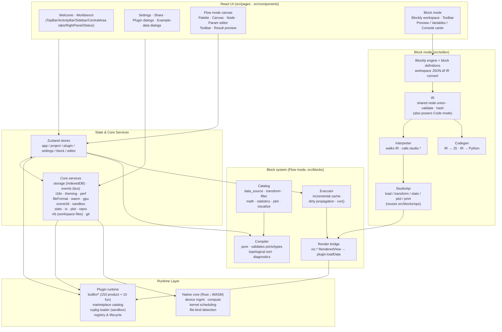

# 架构

## 分层



> **一个插件桥接，两处调用。** `D4`（流程模式的 `RenderedView` → `plugin.loadData`）和 `E5 → D4`（积木模式的 `studio.plot` → `RenderedView`）汇聚到同一条代码路径。在流程模式中新增一种可视化，积木模式便可直接获得对应的 `studio.plot(...)` 形式。编辑器层的详情见[积木模式](/guide/block-mode)，区块系统见[流程模式](/guide/flow-mode)。

## 科学计算子系统

`src/core/` 下有四个纯 TypeScript、少 DOM、可在 Node 中测试的子系统，供区块系统、Studio API 和工作台 UI 使用：

| 子系统 | 路径 | 接口 |
| --- | --- | --- |
| 统计内核 | `src/core/stats/` | 描述统计、特殊函数、假设检验、效应量、多重比较校正、功效分析 |
| 科学 I/O | `src/core/io/` | 一个分发器（`loadScientificData`）路由到 HDF5 / NetCDF / FITS / Zarr / Parquet 加载器，返回 `RawVariable[]` |
| 绘图引擎 | `src/core/plot/` | 使用线性/对数/时间比例尺的纯 TS SVG 渲染，以及 SVG/PDF 导出 |
| 可复现性 | `src/core/repro/` | 带种子的随机数生成器（mulberry32）、稳定哈希、运行清单、DAG 到 Python 导出 |

## 状态管理

应用状态保存在 Zustand store（`src/stores/`）中。其中五个保存核心工作台状态：

| Store | 职责 |
| --- | --- |
| `appStore` | 宿主状态、横幅、通知、性能指标、面板开关 |
| `projectStore` | 当前项目、最近列表、保存/自动保存、分享、参数持久化 |
| `pluginStore` | 注册表、加载/激活生命周期、文件分发、宿主容器 |
| `settingsStore` | GPU 模式、自动保存间隔及其他偏好设置 |
| `editorStore` | 积木 / 代码模式会话（IR、代码、变量、控制台） |

此外，科研模块拥有业务层 store（`experimentStore`、`figureStore`、`lineageStore`、`notebookStore`、`chunkStore`、`researchStore`、`analysisStore`、`blockStore`）；UI 也有自己的 store（AI 助手面板、命令面板、快捷键、引导教程、模板教程、发布），并有两个模式同步 hook（`useFlowSync`、`useModeConvert`）。

跨模块 UI 通信使用小型类型化事件总线（`src/core/events.ts`），例如 `plugin:<id>:params`、`host:params:changed`、`host:cancel-task`。

## 渲染管线

中央视口拥有三个渲染区域：

| 区域 | 作用 |
| --- | --- |
| `central-canvas` | 所有 2D 插件绘制所用的共享 2D 画布。 |
| `central-dom-host` | 为需要 DOM 元素的插件提供容器（沙箱画布区域也挂载在这里）。 |
| Three.js 场景 | **仅**当插件声明 `renderToScene` 时由 `scene3d.ts` 惰性创建。 |

插件 store 在每次激活时集中决定可见性：声明 3D 的插件显示场景并清除遗留的 2D 帧；其他插件立即隐藏场景。这保证 3D 坐标系不会出现在 2D 视口上，反之亦然。

## 原生核心

`native/ergalics-core`（Rust）编译至 `wasm32-unknown-unknown`，通过 wasm-bindgen 将绑定生成到 `src/native/`。它需要不稳定的 web-sys WebGPU 绑定，在 `native/.cargo/config.toml` 中通过 `rustflags = ["--cfg=web_sys_unstable_apis"]` 启用。具体 API 接口与调用约定见[原生核心与 WebGPU](native-core)。

## 依赖规则

| 规则 | 含义 |
| --- | --- |
| `pages → stores → core` | 低层绝不导入高层。 |
| `core` 保持少 DOM | 纯服务（`src/i18n/` 中的 i18n、fileFormat、存储适配器）可在 Node 环境中进行单元测试。 |
| 插件契约 | `src/types/plugin.ts` 是宿主与第三方代码之间唯一共享的约定。 |

**`core` 内部的引擎复用（当前状态）。** `src/core/` 下有六个文件依赖位于其外部的流程/积木引擎，因此上图中的（`core` → 引擎）是声明的目标，而非当前依赖边的实际集合：

| `src/core/` 文件 | 依赖 |
| --- | --- |
| `plot/charts.ts` | `@/blocks/ops` |
| `pyodide/runtime.ts` | `@/blocks` |
| `bench/memory-bench.ts` | `@/blocks` |
| `bench/import-bench.ts` | `@/blocks` |
| `r/runtime-factory.ts` | `@/editor` |
| `r/builtin-ir-runtime.ts` | `@/editor` |

因此 `src/blocks/` 和 `src/editor/` 是 `core` 的引擎依赖，而非平级层。计划中的整改会将它们作为子域移入 `src/core/`；在此之前，上表是事实来源。

## 科研模块分层

科研功能（实验跟踪、不确定度、单位、谱系、分块 I/O、Figure Studio、补充材料包、笔记本）都遵循同一套三层约定——它们在现有结构**内部**生长：

| 层 | 位置 | 规则 |
| --- | --- | --- |
| 数据/逻辑层 | `src/core/<feature>/` | 纯 TypeScript，不使用 React，不导入 store。只能依赖同级核心模块（`repro`、`plot`、`io`、`gpu`）以及 `fflate`/`apache-arrow` 一类叶子库。每个模块在 `tests/` 下按对应路径提供单元测试。 |
| 业务层 | `src/stores/<feature>Store.ts` | 只做编排——调用核心、通过 `projectStore` / `storage.ts` 持久化、订阅宿主事件通道。不含 UI 逻辑，不直接操作 DOM。 |
| 展示层 | `src/pages/` 和 `src/components/` | 仅消费 store；样式使用 `global.css` 设计令牌（不硬编码颜色/间距）；所有用户可见字符串都经过 i18n（同一次更改中提供 `zh-CN` + `en-US`）。 |

**跨模块通信**优先使用 `src/core/events.ts` 底部的类型化宿主通道（`run:completed`、`data:ingested`、`lineage:changed`、`figure:exported`、`notebook:executed`），而非 store→store 调用；直接调用仅用于真正的父子关系（例如 `projectStore` 在打开项目时协调重置）。

**持久化划分**：体积大、按项目保存但不可移植的数据（运行记录）存放在专用 IndexedDB store（`storage.ts`）中，并随项目级联删除；可移植的文档状态（笔记本单元、图表工作表）保存在 `ProjectState` 上，随 `.clproj` 一起传递。

**科研数据流**（谁写入哪些状态，谁监听哪些事件）：

```text
                         ┌────────────────────────────────────────────┐
                         │                event bus                   │
                         │  run:completed / data:ingested /           │
                         │  lineage:changed / figure:exported /       │
                         │  notebook:executed                         │
                         └──────▲───────────────▲─────────────▲───────┘
                                │               │             │
  Flow/Block/Code/Notebook ─────┘               │             └───── figureStore
  execution points                              │
  (recordRun / chunkStore)                      │
        │                                       │
        ▼                                       │
  IndexedDB `runs` store ──► experimentStore ───┘
        │                       ▲
        │ listRuns()            │ writes through
        ▼                       │
  lineageStore ──► LineageCanvas│
        ▲                       │
        │                       │
  chunkStore ───► data:ingested │
                                │
        project.state (portable, inside .clproj)
        ├── figureSheets ◄────── figureStore (write-through + dirty)
        ├── notebook      ◄────── notebookStore (write-through + dirty)
        └── editorSessions ◄───── apply*() at save time
```

流程图和积木程序还作为 `.flow.json` / `.block.json` **工作区文件**（`src/core/vfs/`）持久化，由文件浏览器的逐文件编辑器打开；旧版 `blockGraph` 项目状态仍会读取，以保持兼容。

每条进入总线的箭头都表示一个 store 在状态转换后发出事件；每条离开总线的箭头都表示在 store 的 `init*` 函数中注册的长期订阅（由 `App.tsx` 调用一次）。
