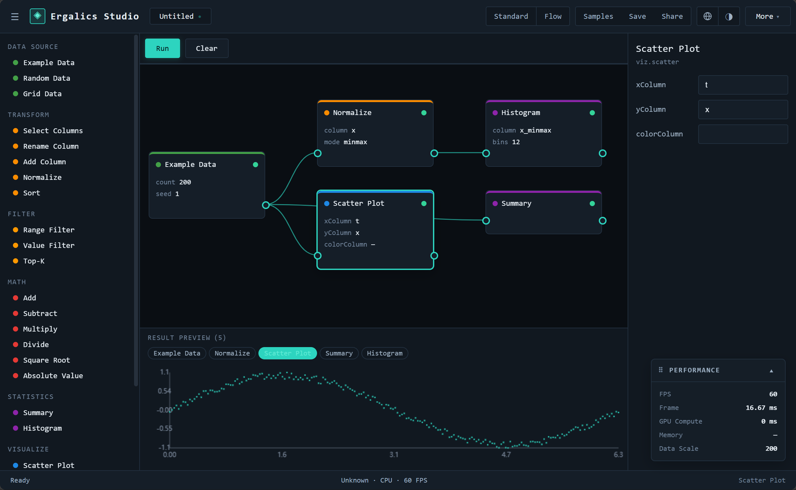

# 流程模式



**流程模式**是工作台的第二种模式（第一种是*标准模式*——将数据拖到插件上）。在流程模式中，可以组合**可视化数据流管线**：将区块放到画布上，连接端口，运行时按拓扑顺序执行图。每个节点的结果都可在同一位置检查，其形态与手动连接该区块时相同。

## 两种模式

| 模式 | 使用模型 | 适用场景 |
| --- | --- | --- |
| `Standard` | 加载文件 → 查看可视化 | 已有数据集，想要查看数据。 |
| `Flow` | 组合 DAG → 运行 → 查看每个节点的输出 | 想要逐步*变换*数据，组合数据源、数学、统计和可视化。 |

使用顶栏的四模式切换组（`Standard | Flow | Blocks | Code`）进行切换。

## 架构

区块系统位于 `src/blocks/`，采用分层设计，使最复杂的部分——编译器——保持为对元数据进行操作的纯函数：

```
types/      DataTable · Scalar · RenderedView · BlockMeta · BlockGraph
blocks/
  registry       meta + executor registration, category buckets
  compiler       pure: validate → topological sort → CompiledRegion
  executor       DagExecutor: run(), incremental cache, dirty propagation
  context        MemoryStorage + RuntimeEnvironment
  fileData       shared raw-text → DataTable parsing (source.file & studio.load)
  ops            pure column kernels (subset, normalize, histogram, …)
  catalog        53 built-in block types (data_source → … → plot · visualize)
  l10n           blockName / blockDescription (locale resolution)
  sample         SAMPLE_PIPELINES from examples/projects/*.clproj
  render         the only side-effectful step: viz.* → plugin.loadData
stores/
  blockStore     Zustand: graph state + run() orchestration + nodeOutputs
components/blocks/
  BlockCanvas · BlockNode · BlockPalette · BlockToolbar
  ParamEditor · BlockPreview · BlockWorkbench
  geometry.ts    pure hit-testing / port math (vitest-covered)
```

编译器从不接触 React。执行器是异步的，但没有副作用。只有 `render.ts`（以及它负责的 `VizPayload → plugin.loadData` 桥接）会跨入插件世界——这是有意设计，以便轻松测试执行器。

## 图模型

管线是一个 `BlockGraph` 实例：

- `instances: BlockInstance[]`——节点（`id`、`blockId`、`position`、`params`，可选的 `regions`）。
- `connections: BlockConnection[]`——边（`from {nodeId,portId}` → `to {nodeId,portId}`）。**连接列表是边的唯一事实来源**；实例本身不携带输入。
- `viewport: {x, y, zoom}`——画布平移/缩放状态。

`BlockInstance.regions` 为将来的控制流嵌套（if/else、repeat、parallel）预留——目前尚未使用，但扩展点已经就位，因此日后添加这些能力是*扩展*，而非重构。

## 在端口间流动的值

四种类型定义在 `src/types/datatable.ts` 中：

| 类型 | 结构 | 产生方 | UI 渲染 |
| --- | --- | --- | --- |
| `DataTable` | `{ columns, length, getColumn, getRow, columnNames, … }` | `source.*`、`transform.*`、`stats.*` | 只读表格（或通过 `viz.*` 可视化） |
| `Dataset` | ND 数组 / 序列数据集（二维表以外的科研级数据） | 科研数据导入器 | 只读表格（二维切片） |
| `Scalar` | `{ kind: 'scalar', value: number \| string \| boolean }` | （将来的归约 / 控制流） | 行内值 |
| `RenderedView` | `{ kind: 'rendered-view', id, viewType, data }` | `viz.*` / `plot.*` 区块 | 插件实时渲染（宿主的 2D 画布） |

管线可自由混合使用这些类型，结果预览会自动适配。

## 编译器：纯校验 + 拓扑排序

`compile(graph, registry)` 是纯函数，不使用 React、异步操作或 I/O。它返回 `CompileResult`，其中包含 `program: CompiledRegion` 或一组结构化 `diagnostics`：

- **端口级检查**——每个输入在必需时均已连接，类型匹配（`DataTable` 端口不能连接到 `RenderedView` 来源），且注册表认识每个 `blockId`。
- 使用 Kahn 算法**检测环**。同一次遍历产生拓扑顺序，因此发现环时会报告诊断并拒绝程序。
- **`diagnostics: CompileDiagnostic[]`** 包含 `severity: 'error' | 'warning'` 和可选 `nodeId`——画布将边标红，工具栏内嵌提示条显示诊断，而不是崩溃。

## 执行器：增量执行、便于缓存

`DagExecutor(program, env).run()` 按拓扑顺序遍历。首次运行后，它持有 `Map<nodeId, DataValue>` 缓存；`invalidate(nodeId)` 向下游遍历，并将所有依赖 `nodeId` 的内容标记为脏。更改一个参数因此只会重新执行该节点及其后代，即使管线较复杂，画布也能给人即时响应的感觉。

执行器是区块系统中唯一的异步部分；每个 `executor` 都返回 `Promise<DataValue>`，因此日后接入 GPU 工作时无须更改 API。

## 渲染桥接——viz.\* 从不绘图

`viz.*` 区块产生一个 `RenderedView`——纯数据：

```ts
{ kind: 'rendered-view', viewType: 'scatter', data: { pluginId, text } }
```

渲染发生在 `src/blocks/render.ts` 中：它从序列化文本构造 `File`，并交给目标插件的 `loadData`。这样保持了两个特性：

1. 区块系统与 DOM/插件零耦合——易于测试，也易于在无头环境中复用。
2. 新增可视化只需“编写一个产生 `RenderedView` 的区块”——其余工作由渲染器完成。

## 结果预览

结果预览面板位于画布下方，根据所选节点（或最后一个节点）的输出自动选择三种模式之一：

| 输出类型 | 预览 |
| --- | --- |
| `RenderedView` | 宿主 2D 画布通过现有插件（散点、直方图等）渲染。`plot.*` 区块则产生矢量 `RenderedView`（`viewType: 'svg-plot'`）：预览直接内联渲染独立 SVG——达到出版级，可导出为 SVG/PDF，不涉及插件画布。 |
| `DataTable` | 带固定表头和“显示 M 条中的前 N 条”页脚的只读表格，因此不仅能看到 `viz.*` 结果，也能看到 `stats.summary` 和 `stats.histogram` 的分箱计数。 |
| `Scalar` | 行内显示该值。 |

当管线有多个输出时，预览顶部的标签条可在节点间切换；画布上的节点选择与之同步。

## 内置区块

目录（`src/blocks/catalog/`）注册了**八个类别共 53 个内置区块**：

| 类别 | 数量 | 区块 |
| --- | --- | --- |
| data_source | 4 | 示例数据 · 随机数据 · 网格数据 · 文件 |
| transform | 5 | 选择列 · 重命名列 · 添加列 · 归一化 · 排序 |
| filter | 3 | 范围过滤 · 值过滤 · Top-K |
| math | 6 | 加 · 减 · 乘 · 除 · 平方根 · 绝对值 |
| statistics | 14 | 汇总 · 直方图 · 单样本/双样本/配对样本 t 检验 · 单因素 ANOVA · Mann–Whitney U · 卡方 · 相关 · Cohen's d · 多重比较校正 · bootstrap CI · Monte-Carlo · MCMC |
| units | 2 | 单位转换 · 单位检查 |
| visualize | 25 | `viz.*` 散点图 · 折线图 · 直方图 · 二维点云，另有 14 个领域视图（地质 ×3 · 调音表 · 调色板 · 声学波形 · 合成器预设 · CS ×7）和 7 个统计视图 |
| plot | 4 | `plot.*` 折线图 · 散点图 · 直方图 · 柱状图（矢量 SVG） |

控制流区块（`if_else`、`switch`、`repeat`、`parallel`）**有意延后实现**。`BlockInstance` 上的 `region` 扩展点已就位，因此以后可将它们作为扩展接入，而无需重构；完整理由见 `block-system-design.md` §A.1。

## 示例管线

`examples/projects/` 提供预构建管线（真实 `.clproj` 文件——可通过普通项目选择器导入）：

| 文件 | 展示内容 |
| --- | --- |
| `block-01-signal-analysis.clproj` | 正弦 + 噪声 → 归一化 → 直方图，另有散点图与汇总 |
| `block-02-random-distribution.clproj` | 500 个均匀随机数 → 直方图 + 汇总 |
| `block-03-grid-scatter.clproj` | 20×20 网格 → 散点图 |
| `block-04-range-filter.clproj` | 正弦 → 范围过滤 → 散点图 |
| `block-05-dual-pipeline.clproj` | 正弦分叉为归一化→散点图和范围过滤→折线图 |
| `block-06-topk-pipeline.clproj` | 数据集 → Top-K 选择 → 表格 / 绘图 |
| `block-07-binning-stats.clproj` | 数值列 → 直方图分箱 + 汇总统计 |
| `block-08-normalize-grid.clproj` | 网格数据 → 归一化 → 散点图 / 折线图 |

发现过程使用 `import.meta.glob('../../examples/projects/block-*.clproj',
{ query: '?raw', import: 'default', eager: true })`。**Samples** 对话框的 `samples` 标签页列出这些示例；显示名称和描述位于 `src/blocks/sample.ts → SAMPLE_META`（英文 + 中文）——数据文件包含图，展示字符串保存在代码中以便本地化。

## 扩展：编写自定义区块

区块是一个 `BlockDefinition`（元数据 + 执行器），在启动时注册到默认 `blockRegistry`。元数据涵盖国际化：

```ts
import { defineBlock } from '@/blocks/catalog/types';

export const myBlock = defineBlock(
  {
    id: 'transform.my_block',
    category: 'transform',
    name: 'My Block',                         // zh-CN default
    nameI18n: { 'en-US': 'My Block' },        // English (and any other locale)
    description: '做一点转换',
    descriptionI18n: { 'en-US': 'Apply a transform' },
    color: '#FB8C00',
    ...dataTableInOut(),
    defaultParams: { column: '', threshold: 0 },
  },
  async (ctx) => {
    const input = ctx.getInput('data') as DataTable;
    const col   = String(ctx.getParam('column') ?? '');
    const thr   = Number(ctx.getParam('threshold') ?? 0);
    // … return a DataTable
  },
);
```

`registry.register(meta, executor)` 是幂等的——重复注册（StrictMode 的双重 effect 或 HMR 重载）会保留最初的元数据，并在执行器缺失时补上执行器。不会出现“已经注册”的意外情况。

## 持久化

流程图作为**工作区文件**持久化：`.flow.json` 文档（`{ version, kind: 'ergalics-flow', graph }`）通过工作区 VFS（`src/core/vfs/`）写入，并由文件浏览器的流程编辑器（`src/components/editor/fileEditors/`）打开。旧版 `ProjectState.blockGraph` 项目状态仍会读取以保持兼容，因此旧的 `.clproj` 项目仍可通过相同的自动保存 / 分享 / 导出路径往返。

## 本地化

UI 文案（`"运行" / "Run"`、`"流程管线" / "Flow pipelines"`、诊断提示条等）位于 `src/i18n/` 下扁平的 `t(key)` 字典中。区块级名称和描述以 `nameI18n` / `descriptionI18n` 保存在元数据上，并由 `src/blocks/l10n.ts` 的 `blockName(meta, locale)` / `blockDescription(meta, locale)` 解析。默认项目名是常量 `DEFAULT_PROJECT_NAME = 'Untitled'`——有意固定为英文，以免切换语言后旧项目留下过时的本地化标题。

## 已知限制

| 限制 | 细节 |
| --- | --- |
| 尚无控制流区块 | 见上面的“内置区块”。扩展点存在；工作已跟踪但尚未排期。 |
| 区块中的 GPU 执行 | 每个执行器都返回 `Promise<DataValue>`，但目前内置区块在 CPU 上运行。契约已为 `gpu.*` / WGSL 支持的执行器做好准备；通过现有 Rust 核心路由这些执行器是下一阶段工作。 |
| 布局 | 区块由手工放置。自动布局（显而易见的下一项功能）有意尚未实现——先保持 API 稳定。 |

> 想要更偏命令式的体验？积木模式是共享 `DataValue` 契约和插件桥接的另一种工作台模式——架构、40 个内置积木和 5 个示例程序见[积木模式](block-mode)。
